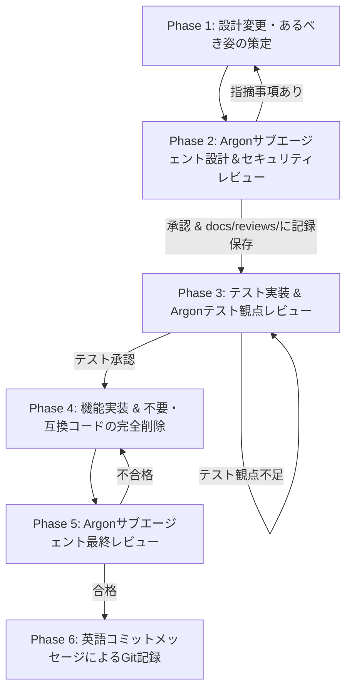

# 開発プロセス定義書 (Development Process Definition)

本書は、「よせあつめ家計簿 (Yoseatsume Kakeibo)」プロジェクトにおける機能追加、仕様変更、および保守開発における標準開発プロセスと品質ゲートを定義する。

---

## 1. 基本方針 (Guiding Principles)

1. **全体最適と「あるべき姿」の追求**:
   - 局所的・場当たり的な変更（モグラ叩き的なワークアラウンドや不要な互換パッチ）を厳禁とする。
   - 変更要求が発生した際は、必ずシステム全体（アーキテクチャ、データフロー、セキュリティ境界、UI/UX）を俯瞰し、システム自体が最もシンプルかつ堅牢となる「あるべき姿 (To-Be Architecture)」を定義してから着手する。
2. **仕様先行（Design-First）およびテスト駆動（Test-Driven）**:
   - コードを変更する前に、必ず設計書を更新し合意を形成する。
   - 実装前にテストを用意し、検証観点の網羅性を担保する。
3. **独立サブエージェントによる厳格な品質ゲート**:
   - 設計段階、テスト設計段階、最終受入段階の各ゲートにおいて、独立した「Gemini 4 Argon」サブエージェントによる客観的な多角的レビューを必須とする。

---

## 2. 開発ライフサイクル・標準フロー (Development Workflow)

---

### Phase 1: 設計書の変更と「あるべき姿」の策定
1. **全体影響の分析**:
   - 新規要件・修正要求に対し、フロントエンド（PWA/IndexedDB）、バックエンド（GAS/スプレッドシート）、暗号層、同期プロトコルの全体影響範囲を洗い出す。
   - 既存の仕様や制限（Google OAuthスコープ、40k文字セル制限、Ed25519暗号検証など）との整合性を確認する。
2. **設計書の先行更新**:
   - [docs/system_design.md](system_design.md)（および関連仕様書）を更新する。
   - 必要に応じて、データフロー図（DFD）、シーケンス図、ERD、状態遷移図を更新・追記する。
   - 部分的な継ぎ接ぎではなく、システム全体として最も自然で簡潔な設計となっているかを確認する。

---

### Phase 2: Argonサブエージェントによる設計・セキュリティレビュー
1. **サブエージェントの召喚**:
   - モデルに **Gemini 4 Argon** を指定した独立サブエージェント（Role: `Security & Architecture Auditor`）を起動する。
2. **レビュー観点**:
   - **ソフトウェア開発・アーキテクチャ観点**:
     - 単一責任原則、疎結合性、状態管理の妥当性
     - オフラインファーストおよびゼロコスト運用の継続性
     - データモデルおよび同期プロトコルの整合性
   - **セキュリティアセスメント観点**:
     - STRIDE脅威分析（なりすまし、改ざん、否認、情報漏洩、DoS、権限昇格）
     - OWASP Top 10（インジェクション、XSS、暗号の不備、認証・認可）
     - OAuthスコープ最小化（`@OnlyCurrentDoc`）の維持
     - 秘密鍵ライフサイクル（平文非保持、PIN暗号化、メモリ自動消去）
3. **レビュー記録の保存**:
   - `docs/` 直下が散らからないよう、専用の `docs/reviews/` ディレクトリ配下にレビュー記録を格納・管理する。
   - レビュー結果、指摘事項、残余リスク、判定スコアを `docs/reviews/review<連番>.md`（例: `docs/reviews/review1.md`, `docs/reviews/review2.md`）として保存する。
   - 指摘事項がある場合は Phase 1 に戻り設計を改善する。

---

### Phase 3: テスト実装とテスト観点レビュー
1. **テストコードの実装**:
   - 設計書に基づき、単体テスト（`test/unit/`）、結合テスト（`test/integration/`）、システムシナリオテスト（`test/system/`）を作成・拡充する。
   - 正常系、異常系、境界値、並行性、エラーハンドリングを網羅する。
2. **Argonサブエージェントによるテスト観点レビュー**:
   - Gemini 4 Argon サブエージェントにより、テスト観点の抜け漏れ（エッジケース、タイムスタンプ異常、ネットワーク切断、不正ペイロード、暗号攻撃等）がないかレビューを受ける。
   - 指摘された不足ケースを追加実装する。

---

### Phase 4: 機能実装と不要コード・互換性コードの削除
1. **プロダクションコード実装**:
   - 設計およびテストに適合するよう、最小限で堅牢なコードを実装する。
   - 全テストを実行し、100%パスすることを確認する。
2. **コードのクリーンアップ・棚卸し（必須ステップ）**:
   - **不要コードの削除**: 新実装により使われなくなった関数、変数、import、CSSルールを完全に削除する。
   - **不要な互換性維持コードの排除**: 過去の暫定対応や、古いデータ構造を維持するための場当たり的なフォールバック・冗長分岐を点検し、現行仕様（Schema v2等）に統一して不要な分岐を削除する。

---

### Phase 5: Argonサブエージェントによる最終レビュー
1. **品質基準の検証**:
   - 全自動テスト（単体・結合・システム）の合格。
   - カバレッジ基準: **全対象ファイルで命令網羅（Line）$\ge 98\%$ かつ 分岐網羅（Branch）$\ge 95\%$**。
2. **最終受入レビュー**:
   - Gemini 4 Argon サブエージェントにより、設計書との完全一致、コード品質、セキュリティ対策の最終監査を受ける。
   - 指摘事項がゼロ（Grade A+ 承認）となるまで完了とみなさない。

---

### Phase 6: コミットと記録 (Git Commit in English)
1. **コミットメッセージの記述規則**:
   - 最終レビュー合格後、コミットメッセージは**英語（English）**で記述する。
   - コミットメッセージには以下を含めること:
     - 変更の種別・要約（Conventional Commits形式: `feat:`, `fix:`, `refactor:`, `test:`, `docs:`）
     - 改修の背景と目的（Rationale & Context）
     - 主な変更点（Key Changes & Architecture Decisions）
     - セキュリティ対策およびテスト結果（Security mitigations & Test coverage metrics）

