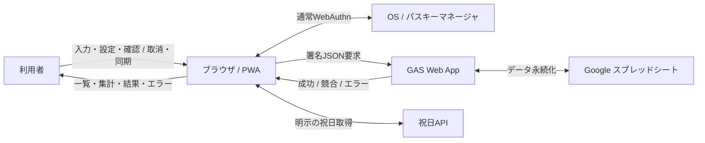
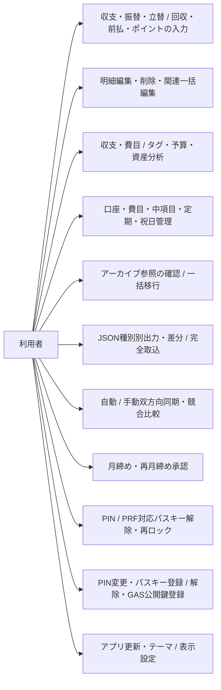
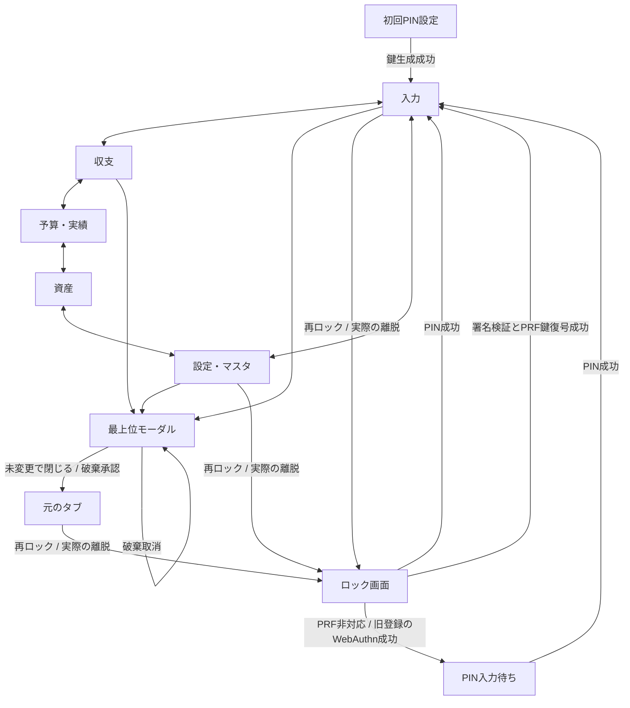

# システム外部設計書

本書は利用者が操作・観測する画面と入出力、および外部通信の契約を定義する。要件の正本は[要件定義書](requirements.md)、実装構造・DOM結合・内部アルゴリズム・保存/暗号/排他は[内部設計書](internal_design.md)である。旧system_design.mdの識別子をE-付きで保持する。同じ記述が衝突する場合、3.43以降の明示した改訂を優先し、要求と実装の未達を[設計テスト監査](design_test_audit.md)に区別する。ここで要求することは検証済み・実装済みを意味しない。

## 画面・利用者操作

<span id="e-3-1"></span>
### E-3.1 入力・仕訳

支出・収入・口座振替を入力し、日付・整数金額・口座・計上/実態の費目と中項目・メモ・タグを登録する。1明細は1仕訳であり、立替等は関連する複数明細になる。新規入力では実態分類を計上分類と同じにする選択を初期ONとし、必要時に独立入力する。税込額を保存し、電卓で8%/10%と端数処理を選べる。空欄の予定登録はE-3.43に従う。

<span id="e-3-2"></span>
### E-3.2 定期ルールと休日補正

開始日・任意の終了日、金額、収支種別、口座、計上/実態分類、毎月またはNか月周期、発生日（1〜28または月末31）、補正なし/前営業日/翌営業日を設定する。土日・登録祝日を補正し、月をまたいでも本来の計上月を維持する。対象月の定期予定を一括生成し、同一ルール・対象月を重複生成しない。月初/前月末の起動時自動生成と固定額の発生日到来自動確定、変動費の金額入力後手動確定は旧要件として保持するが、前二者は現行実装未達である（監査参照）。分類・戻る操作の詳細はE-3.48に従う。

<span id="e-3-3"></span>
### E-3.3 前払分割

一括支払日・総額・支払口座・分類・分割月数を指定し、前払費用への振替1件と月次支出N件を作成する。支払総額と償却額合計は一致し、割切れない余りは初月へまとめる。当月以前の償却を確定、未来月を予定とする。例として12,000円・12か月は支払振替1件と毎月1,000円の12件である。入力モード切替はE-3.48、一括編集はE-3.22/E-3.42に従う。

<span id="e-3-4"></span>
### E-3.4 リアルタイム集計と月締め

前月末残高と当月確定明細から現在確定残高を表示し、予定を加えた月末予測も表示する。確定と予定を区別したグラフ、予定表示ON/OFF、計上/実態軸切替を提供する。マスタをアーカイブしても過去の名称・集計を保持する。月締めは未確定件数の確認と承認を経てサーバーで確定・保存し、成功後に表示へ反映する。金額未入力は締められない。未来予定は保持する。締め済み明細の追加・編集・削除は再締め確認後に後続月残高も再計算する。確認取消・通信失敗時はE-3.43に従う。

<span id="e-3-5"></span>
### E-3.5 投資資産口座

証券・NISA・投資信託・暗号資産等を通常口座の投資/資産種別として扱い、残高を評価額として表示する。積立拠出は銀行等からの口座振替として記録する。独立した外部資産の二重管理を利用者へ要求しない。

<span id="e-3-6"></span>
### E-3.6 マスタ管理

設定画面で口座・収入/支出費目・費目配下の中項目・定期ルール・祝日を追加/編集する。口座にはID・名称・種別・初期残高・資産区分・ソート順を、定期ルールには有効/無効・周期・休日補正等を指定する。空の新規IDは自動採番し、一意な識別を失わない。口座・費目・中項目はアーカイブ/復元を行い、履歴を維持したまま新規候補から除く。名称変更・並び替え要求を保持する（並び替えUIの未達は監査参照）。祝日は年別に折りたたみ、初期は閉じる。保存の即時反映・競合・閉じる操作はE-3.44/E-3.46/E-3.48に従う。

<span id="e-3-7"></span>
### E-3.7 明細編集と削除

最近の入力・期間明細の行をタップ/クリックして編集する。種別・日付・金額・決済/振替先口座・両分類と中項目・メモ・タグ・確定/予定を変更できる。削除は確認付きの論理削除であり、通常一覧から除く。締め済み月への影響は保存前に対象月を示して再締め確認し、取消では入力を保持して保存しない。締め済み修正はアーカイブと後続残高へ反映し、未締めは差分同期する。表示原本が変わっていれば古い編集で上書きせず通知する。

<span id="e-3-8"></span>
### E-3.8 祝日の取込

内蔵プリセットをオフラインで取り込める。旧要求の2014〜2028年範囲を保持する（全範囲の検証不足は監査参照）。日付テキスト/CSV/JSONはYYYY-MM-DDとYYYY/MM/DD等を正規化し、既存日付と重複排除して追加件数を通知する。有効日付がなければエラーとし、入力を修正できる。オンライン祝日APIの取得結果は入力欄へ表示し、利用者のインポート実行で反映する。取得失敗は通知し、プリセット利用を案内する。

<span id="e-3-9"></span>
### E-3.9 ポイント支払

購入総額・ポイント利用額・決済口座・必要に応じポイント口座を入力する。ポイント口座ありはポイント支出と自己負担支出、口座なしは購入総額支出と相殺収入の2件を作り、互いに関連付けてポイントバッジを表示する。購入総額と自己負担の関係を保つ。未入力総額と利用額の矛盾等は保存せず通知する。

<span id="e-3-10"></span>
### E-3.10 日・月・年の分析と資産

収支は日別（選択月の日ごと）、月別（選択年12か月）、年別（取得済み履歴の年ごと）の表・グラフと収入・支出・収支差額・貯蓄率を表示する。資産は流動資産・投資資産・負債と純資産を表示し、流動+投資−負債で純資産を求める。収支と資産の切替はE-3.36のトップタブによる。資産の表示期間はE-3.43に従う。

<span id="e-3-11"></span>
### E-3.11 共有マスタの通常同期

共有設定を通常の差分同期で双方向に統合する。マスタ保存後は画面へ直ちに反映し、通信を待たず背景同期を表示する。個別の強制送信/全取得ボタンは設けない。競合はE-3.44.2に従う。

<span id="e-3-12"></span>
### E-3.12 入力種別とモード

支出・収入・振替・立替・回収・前払分割・ポイントの種別選択と入力モードタブを双方向に連動し、どちらから選んでも同じ入力欄と候補を表示する。共有入力とモード専用金額はE-3.48に従って保持する。

<span id="e-3-13"></span>
### E-3.13 アプリ更新

起動時オンラインで最新版を確認し、新版の番号を示して更新承認を求める。取消では現在画面を保つ。設定に現行版・更新確認・強制再読込を表示し、最新版/新版/オフライン/取得失敗を通知する。承認後はアプリキャッシュを消去して再読込し、金融データを消去しない。アプリ自身の更新では離脱確認を二重表示しない。バージョン取得とキャッシュ境界はE-4.2および内部設計に定義する。

<span id="e-3-14"></span>
### E-3.14 年間予算・貯蓄目標

対象年ごとに年間支出予算、貯蓄額、貯蓄率と費目別年間予算を設定し、月割目安と内訳合計/全体差額を表示する。前年確定実績・締め済み集計から軽微丸めした候補を初期表示または自動試算ボタンで反映する。金額は100万円以上1万円単位、1万円以上1千円単位、それ未満100円単位へ四捨五入し、貯蓄率は整数%とする。費目検索とリスト内スクロールを提供する。予算・実績タブで確定/予定を反映した消化率・残予算・順調/注意/超過のペース・貯蓄達成率・貯蓄率対比・累積推移と月次予算対比・費目別進捗を表示する。年度間の値を混同しない。

<span id="e-3-15"></span>
### E-3.15 差分インポート

既定は既存データを消さない差分マージである。明細はIDで照合し、ファイルの更新日時が新しい場合だけ更新し、同時刻/手元の新しい版と手元だけの明細を保持する。口座/定期ルールは新規IDを追加し既存を保護する。費目は既存親を保護して新規中項目を追加する。祝日は重複を除く日付集合、予算は年/費目、締め済み集計は月の未設定分を統合する。追加/更新/スキップ等を通知する。不正JSON・形式・値・参照は全書込前に拒否して原本を維持する。完全置換はE-3.45に従う。

<span id="e-3-16"></span>
### E-3.16 年月選択

期間表示を押して年月ピッカーを開き、任意年月の選択で集計・明細へ直接移動する。前後移動・今月も用意し、月/年/日状態を同時に整える。移動先に同じ日番号がなければ月末へ丸める。ブラウザ標準ピッカーの外観・開き方は実行環境に依存する。

<span id="e-3-17"></span>
### E-3.17 分類軸の表記

分類軸は初期から「🏷️ 計上分類ベース」と表示し、切替後は「📦 実態分類ベース」とする。再切替でも表記を統一し、表示される集計分類を明確にする。

<span id="e-3-18"></span>
### E-3.18 タグチップと分析

新規・明細編集に共通のタグチップを表示する。Enter/カンマ/候補選択で確定し、×または空入力時Backspaceで削除し、重複を作らない。履歴の有効明細から候補を表示する。候補選択は入力途中の語を破棄する。タグ別の収入・支出・件数・構成比を期間と予定表示に連動して集計し、検索・内訳・チャートを表示する。IME確定をタグ確定と取り違えない。

<span id="e-3-19"></span>
### E-3.19 メモ候補と分類補完

履歴のメモ候補を入力途中で絞り込み、選択時は入力途中全文を置換して候補を閉じる。最後に利用した計上費目・中項目を補完する。既存メモへの完全一致でも補完する要求を保持する。アーカイブ等で選択不能の分類を候補から指定して有効分類を壊さない。

<span id="e-3-20"></span>
### E-3.20 立替回収リスト

立替回収モードで未削除・未精算の立替を日付・メモ・金額と回収操作付きで表示する。回収操作は指定受取口座への回収明細を直接保存し、元明細を精算済みにして一覧から除く。回収タグ1個と短いメモはE-3.48に従う。金額未入力の元立替は精算せず通知する。二重操作や表示後の元明細変更で重複精算しない。

<span id="e-3-21"></span>
### E-3.21 カード締め・引落

カード口座に締め日・引落日（1〜28/末日99）、引落月差（当月0/翌月1/翌々月2）、引落元口座を設定する。対象締め期間の確定・金額確定済み支出から銀行→カードへの振替を生成し、カード負債と銀行残高へ反映する。土日祝は翌営業日へ調整する。請求周期ごとの重複を防ぎ、アーカイブ済み引落口座では新規生成しない。

<span id="e-3-22"></span>
### E-3.22 前払グループ一括編集

複数の有効明細を持つ前払グループだけで関連件数・月数を示し、一括反映を確認する。承認なら共有分類（子編集時）・メモ・タグ・変更金額を反映し、否認なら対象だけを編集する。親支払総額を月数倍に膨らませない。総額を変えたときだけ再配分して余りを初月へ置き、メモのみの変更では金額・端数・分類を保持する。親子の日付/種別/口座制約、税情報、締め済み月の確認、保存失敗時の全件保持はE-3.42に従う。

<span id="e-3-23"></span>
### E-3.23 計上×実態クロス集計

対象月/年に対し、行に計上費目、列に実態費目、交点に金額、行末/列末に合計、右下に総合計を表示し、空セルを0円とする。予定表示を反映する。行/列のクリックによる明細ドリルダウン要求を保持するが、現行実装には当該操作がなく未達である（監査参照）。

<span id="e-3-24"></span>
### E-3.24 テーマ

システム追従・ライト固定・ダーク固定を選べる。変更を直ちに画面とグラフへ反映し、再起動後も選択を保持する。システム追従時はOS設定変更へ連動し、固定時は連動しない。ブラウザ標準フォーム/ピッカー/スクロールバーにもテーマを伝える。全画面の読みやすさ・起動時のちらつき防止を要求するが、実機外観の検証限界は監査に残す。

<span id="e-3-25"></span>
### E-3.25 簡易電卓

新規/編集の金額欄から電卓を開き、数字・00・小数点・四則・C・削除・=、外税8/10%・内税8/10%と切捨て/四捨五入を使える。適用は呼出元金額へ整数額と税計算過程を反映し、取消では変更しない。ゼロ除算・不正式で画面を壊さない。金額の手動変更では古い税情報を破棄する。

<span id="e-3-26"></span>
### E-3.26 データ種別別JSON入出力

設定から全データ・明細・マスタ・年間予算・残高スナップショットの5種を選んでJSON出力する。共通メタデータはschema_version:2、export_type、ISO8601のexported_atである。ファイル名はyose_backup / yose_transactions / yose_master_config / yose_annual_budgets / yose_snapshotに_YYYY-MM-DD.jsonを続ける。出力は読める整形JSONであり、明細は削除通知も含む。取込時は種別宣言/構造を自動判別し、生の明細配列も受け入れる。宣言と内容の不一致は拒否する。既定の差分方式と結果統計はE-3.15、明示の完全方式はE-3.45、JSON例はE-5に従う。

<span id="e-3-27"></span>
### E-3.27 費目内訳ドーナツ

費目カードに正の支出を金額降順でドーナツ表示し、粒度・分類軸・予定表示へ連動する。空または合計0ではグラフを隠し、古い描画を残さない。内訳リストとドリルダウンを併設し、費目別推移はE-3.47に従う。

<span id="e-3-28"></span>
### E-3.28 構成比ツールチップ

費目・タグ・資産の全ドーナツで、タッチ/ホバー時に項目名・円金額・構成比を表示する。割合は小数第1位までとし、例は「食費: ¥45,000 (32.1%)」である。合計0の割合は0%とし、ゼロ除算しない。

<span id="e-3-29"></span>
### E-3.29 明細の表示階層

最近の入力と期間明細は費目>中項目を主表示とし、中項目なしは費目のみ、振替は資金移動として表示する。日付・確定/予定/立替/ポイントのバッジ、任意メモ、タグを補助表示する。費目名・中項目名・メモ・タグは文字列として扱い、埋め込まれたHTMLを実行しない。

<span id="e-3-30"></span>
### E-3.30 複合フィルター

状態・費目・口座・タグ・キーワードの全条件をANDで適用する。費目は計上/実態両軸、口座は振替元/先に一致する。キーワードはメモ・費目・中項目・タグの部分一致で英字大小を区別しない。即時に件数/一覧を更新し、0件時は空状態を表示する。アーカイブ候補と期間境界はE-3.47、ページ初期化はE-3.42に従う。

<span id="e-3-31"></span>
### E-3.31 中項目未指定

新規・明細編集・定期・保険の定期費目・アーカイブ保守の中項目先頭を「（指定なし / 費目のみ）」とする。未指定を選択でき、保存値はnull、明細表示は親費目だけとなる。明示的な空/nullを最初の子へ置き換えない。

<span id="e-3-32"></span>
### E-3.32 候補のフォーカス外終了

メモ/タグ候補は入力から外れる操作や外側タップで閉じ、スマートフォン画面へ残留させない。候補選択操作は先に確定できる。カスタム候補の操作はE-3.40に従う。

<span id="e-3-33"></span>
### E-3.33 保存完了通知

通常・立替・回収・前払・ポイント登録、明細編集、立替精算の成功後に非ブロッキングの完了トーストを表示する。約2.5秒で消え、一覧へ保存内容を反映する。保存拒否では成功を表示せず、入力を保持して理由を通知する。

<span id="e-3-34"></span>
### E-3.34 ローンと負債表示

口座にローン・借入金を追加でき、カードと区別した負債として資産集計する。ローン残高を負債合計へ含める。負債の通貨表記は−を¥の前に置く（例 -¥85,000）方式へ統一し、符号を二重表示しない。

<span id="e-3-35"></span>
### E-3.35 保険口座と定期保険料

保険・積立保険を資産に含める。保険口座で満期日・任意の想定返戻額・保険料の支払口座/毎月金額/引落日/計上分類を設定できる。保存と同時に対応する定期ルールを作成/更新し、満期日を終了日へ反映する。アーカイブ時や支払設定解除時は対応ルールを停止する。分類変更では旧中項目を別親へ流用しない。

<span id="e-3-36"></span>
### E-3.36 5タブと分析期間

入力・収支・予算/実績・資産・設定/マスタの5タブを表示する。収支/予算/資産のKPIは各タブだけに表示し、月次処理と明細・タグ・クロス集計は収支へ置く。口座カードは収支で口座別支出、予算で年別予算/実績、資産で現在/予測残高を表示する。日別は選択月の日別推移と当月内訳、月別は選択年12か月推移と選択月のKPI/内訳/明細、年別は選択年のKPI/内訳/口座集計と取得済み年推移を用いる。明細の日別は選択日であり、E-3.40の細分定義を優先する。

<span id="e-3-37"></span>
### E-3.37 セクション折りたたみ

収支・予算・資産・設定の各カードを見出しバー全体または右端ボタンで開閉でき、開閉状態を保存して再読込後も復元する。タイトル内の別の入力・リンク・ボタン操作は開閉と混同しない。キーボードEnter/Spaceでも操作でき、開閉状態を支援技術へ伝える。

<span id="e-3-38"></span>
### E-3.38 集計から明細へ移動

口座・費目・タグ内訳行を選ぶと、そのフィルターを設定し、他条件を解除して明細へ移動する。資産/予算の口座行からは収支タブへ切り替え、明細カードを開いて表示する。口座振替先への一致も含める。

<span id="e-3-39"></span>
### E-3.39 安全な起動・マスタ反映・一覧

グラフライブラリがない起動でも画面を操作できる。追加中項目は再読込した最新親へ保存し、新規/編集/一覧へ反映する。定期名・種別・口座ID等のHTMLを実行しない。アーカイブ口座を通常集計の有効口座一覧から、アーカイブ費目を有効年間予算一覧から除く。年別内訳は選択年だけ、資産/予算の口座行は収支明細へ移動する。初回設定直後の再ロックでもPIN解除フォームを表示する。E-3.47の履歴用フィルター候補はこの有効一覧除外とは異なる。

<span id="e-3-40"></span>
### E-3.40 候補操作・カード設定表示・明細期間

メモ/タグ候補は入力直下の限定高さで表示し、入力/フォーカスで絞り込み、選択/外部タップ/Escapeで閉じる。カード編集で引落元口座を初期選択し、一覧に締め日/引落日/引落元名を表示する。明細は月別で選択計上月、年別で選択計上年、日別で選択取引日を対象にし、タイトルへ期間を示す。30件を超えた場合はページ番号/総件数/前後操作を表示し、境界で送れない方向を無効化する。

<span id="e-3-41"></span>
### E-3.41 集計・設定の観測対象

予定OFFでは集計だけでなく明細からも予定を除く。軸切替、複合条件、0件表示、年月移動、年度別予算と月割表示、テーマ、5種出力、バージョン確認を継続検証する。静的型検査・4層テスト・品質ゲートの手順は開発プロセスと内部設計を正とし、本節の存在を網羅達成の証拠にはしない。

<span id="e-3-42"></span>
### E-3.42 編集・一覧・取込の境界

通常/立替/ポイントの関連IDだけでは前払一括確認を出さない。前払親のメモだけの更新で子分類を消さず、子のメモだけの更新で余りを失わない。親は支払総額、子は月額×有効子数で再配分し、編集対象自身の日付/状態/口座も保存するが親子の仕訳種別と親の前払振替先を維持する。金額変更で影響する税情報を無効化する。グループ全件の保存は成功/失敗を一体とし、通信失敗は未同期で残す。過去月移動や再試行でも同一IDを複数月へ重複配置しない。ページ送りは最新件数を使い、期間/粒度/検索/ドリルダウンで1ページ目へ戻す。年月移動は存在する日へ丸める。取込はすべての対象階層/数値/参照を先に検証し、1件でも不正なら部分反映しない。履歴の正規集計値と0、カード当月差0を有効値として表示する。暗号鍵の内部状態遷移は内部設計に定義する。

<span id="e-3-43"></span>
### E-3.43 パスキー・離脱・金額未入力・資産・同期・再締め

本節は競合する旧記述に優先する。パスキーは通常WebAuthnで認証し、PRF対応登録ではPIN入力なしに復号する。非対応・旧登録はPINを用いる。PIN単独解除も可能であり、パスキー単独の端末復旧を保証しない。旧鍵移行は有効PINで既存データを読めた後だけ行い、誤PIN/取消で鍵を変更しない。更新/終了/離脱はブラウザ標準確認を要求し、取消では入力と鍵を保持する。モーダルがなければ戻る確認、モーダルがあればE-3.48を優先する。実際の離脱後とBFCache復帰では再認証する。

通常・立替両額・回収・前払総額・ポイント総額の空欄は確認承認後0円の金額未入力予定として登録し、取消では入力/DBを保持する。関連明細すべてを予定とし、未入力回収で元立替を精算しない。ポイント利用額だけの指定は拒否する。一覧で金額未入力を明示し、有効金額入力で解除する。

資産は月（日別）・年（月末）・開始/終了日を含む期間指定・すべて（記録開始から本日までの月末）を選ぶ。確定でも未来日と予定を実績へ含めない。期首前残高を引継ぎ、取得できない過去日は0で捏造せず取得月末だけ表示して制約を示す。逆転期間はエラーにし前表示を保持する。月の前後は1か月、年は1年、期間指定は独立保持する。

手動同期はローカル差分0件でも取得・統合・送信・再取得し、全アーカイブと削除を反映する。同一IDは新しい更新日時を採用し、同時刻の未同期手元を優先する。待機中の手元再編集は保護する。結果は送信/受信/残未同期を区別し、通信失敗は処理段階と保存済み手元状態を示す。

月締めは対象予定件数を示して承認を求め、取消でローカル/サーバーを変更しない。金額未入力は補完を求め拒否する。承認した予定の集合・内容がサーバーと変わっていれば拒否し再確認する。成功後だけ手元を確定し、古い月の再締めでも最新締め月を戻さない。締め済み月を変更する登録/編集/削除/前払一括は全影響月の保存前再締め確認を求め、取消では変更全体を中止する。保存後の通信失敗は未同期で保持する。別端末の締めを後から知った場合の同期確認取消では既存未同期編集を破棄しない。締め済み月へ未入力/予定の登録・編集と定期予定生成は拒否し、削除は確認後に許可する。

<span id="e-3-44"></span>
### E-3.44 モバイル編集・アーカイブ保守・統合同期

タブは1行の横スクロール欄とし、ページの横溢れを防ぐ。横スクロールとタブ間のスワイプは区別する。新規/編集タグはチップ、候補は途中語を破棄して確定し、メモは全文置換する。編集はキャンセル左/保存右、削除を別段へ分ける。未変更は確認なしで閉じ、変更時の戻る/閉じる/Escapeは破棄確認を共通化する。モーダル中は背景を操作/スクロールできず、最前面だけを操作できる。ネストした電卓を閉じても背景保護を継続する。

保守で取得済み未削除明細が参照するアーカイブ口座/費目/中項目を確認し、有効設定へ一括移行する。両分類と振替元/先、アーカイブ親の子を含む。未取得過去を含むと保証せず、通常同期後の保守を案内する。費目は同収支種別の有効親と有効子（未指定可）、口座は同種別・同資産区分を候補にし、振替元先の同一化は拒否する。変更するのは参照だけで、金額/日付/タグ/メモ/ID/関連グループ、口座初期残高と定期ルールは保つ。件数/移行先と締め月を確認し、取消・確認中の原本/マスタ変更では全件を保存しない。通信失敗なら保存済み移行を未同期で保持する。

マスタは保存/描画を先に行い背景同期する。別項目変更は統合し同項目衝突は明示確認とする。端末表示/認証設定は共有しない。同期中・未同期・同期済み・失敗を共通表示し、到達失敗/HTTP/非JSON/タイムアウトを区別する。到達失敗ではURL/接続/公開権限と元のエラー詳細を案内し、未確認原因を断定しない。

<span id="e-3-44-1"></span>
### E-3.44.1 背景マスタ同期

背景のマスタ同期はマスタだけを受信し、手動/オンライン復帰は全状態から双方向同期する。本文受信完了まで30秒の期限とし、処理成否不明では自動再送せず次回取得で調停する。ロック後の再解除でも共通同期表示を継続する。

<span id="e-3-44-2"></span>
### E-3.44.2 設定競合の比較と取消

競合した各項目の手元/サーバー値から採用側を選ぶ。全項目を選び、明示適用するまで保存しない。全件手元/サーバーは選択補助であり即適用ではない。非競合部分を維持し、削除/未設定/null/空値を区別し、参照不整合は設定名/項目とともに示して選び直せる。確認中に手元値・サーバー版・認証状態が変われば古い選択を適用しない。×/取消/Escape/戻る/ロックで待機を終了し、両設定を保持する。

取消や自動同期で未確認の競合は通信失敗と区別し「設定の確認待ち」と表示する。明細だけの成功では待ちを消さず、共有設定の調停成功後に解除する。今回の競合設定は上書きしないが、確認前に既に完了した別の送受信段階を巻き戻さない。画面は同期全体を取り消したとは表示せず、その時点の送受信/未同期件数を保つ。

<span id="e-3-45"></span>
### E-3.45 見出し操作・編集分類・完全インポート

見出しバーの開閉はE-3.37に従う。明細編集は計上/実態の親子分類が一致すれば同じにするチェックをON、相違すればOFFで開く。開くだけでは保存値を変えず、ONの計上変更を両軸へ反映する。OFFで独立編集でき、再ONでは現在計上値へそろえる。振替は分類欄を隠す。

インポート方式の既定を差分マージとし、完全インポートを明示選択できる。対象種別・追加/変更/削除/維持件数・同期先へも及ぶことをプレビューし、最終確認語「完全インポート」の完全一致を必要とする。単なるOKでは実行しない。取消/×/Escape/戻る/ロックで全件を維持する。選択JSONの種別だけを置換し、含まれない他種別と接続先・認証鍵・共有基点を保つ。全データはマスタ/明細/スナップショットを置換し、明示的スナップショット値は尊重する。候補全体の検証・原本比較で失敗したら部分取込しない。取込時刻の新旧にかかわらず明示ファイル内容を採用する。

置換・削除は次回同期でサーバー全アーカイブと他端末にも反映する。送信待ちを設定/同期表示で知らせ、通常送受信に先行して処理する。同じ取込の再送は重複適用せず結果回収し、版競合は自動承認せず再度確認語を求める。送信不能な保留は専用選択と確認語で同種または全データの修正ファイルへ置き換えられる。後続の手元編集はACKで消さない。完全取込の承認は以後の再月締め確認を無効にしない。

<span id="e-3-46"></span>
### E-3.46 更新境界の整合性と競合

追加/編集/一括処理/自動生成/差分・完全取込/マスタ/同期/月締めの候補を検証し、不正な型・金額・日付・ID・種別不一致・親子不一致・口座/定期/保険/予算/集計の参照を拒否して理由を通知する。日付と計上月は休日補正のため独立とする。履歴のアーカイブ参照と明示未指定は保つが、新規または参照先変更でアーカイブ設定を使わず、有効定期も使わない。既存問題を増やさない修復操作は許可し、不正データを推測削除/別ID化しない。

編集中に同じ項目/明細が変われば古い画面で上書きせず、無関係な最新設定は保つ。暗号鍵変更/DB失敗では一括保存を中止する。精算・定期・カード自動引落は並行操作でも一度だけ生成する。差分取込や競合を含む同一受信候補はマスタ/明細/集計を一体検証・反映し、部分適用しない。既に完了した別通信段階の非巻戻しはE-3.44.2に従う。明細置換/初期残高変更では導出集計を再計算する。未入力は0円予定のまま、明示0と空欄を区別する。テーマ/折りたたみは即時反映し、続く操作順を保存結果にも反映する。

<span id="e-3-47"></span>
### E-3.47 保守更新・履歴フィルター・費目推移

「一覧を更新」は取得済みローカル明細/マスタ/アーカイブ月を再読取りし、読取中/完了/失敗を明示する。古い要求の後着で一覧を戻さない。移行元は未削除の参照明細が1件以上ある設定だけとし、0円/予定、両分類、振替先、アーカイブ親の子も数える。設定ごとの件数と選択元の明細だけを表示する。有効な選択は維持し、消えた選択/0件は明示する。確認/移行中は更新と競合させず、終了後に再取得する。

明細フィルターは有効設定に加え、他フィルター適用前の対象期間明細が参照するアーカイブ費目/口座を含める。両分類と振替元/先を含め、0円/予定OFFでも候補を残す。年月は計上月、日は取引日を使う。候補が残れば選択維持、消えればすべてへ戻す。新規入力ではアーカイブ設定を選べない。

費目別支出推移を日/月/年で表示する。日は選択月の取引日、月は選択年12か月、年は取得済み履歴の計上年である。両分類と予定ON/OFFに連動し、月次集計がある月は明細を重ねて数えない。月次集計から日別を推測配分しない。取得範囲と取引日/計上月の違いを案内する。アーカイブ/未知ID/未分類を安全に表示し、ライブラリ不在なら時系列表、0件なら空表示とする。テーマ/再描画で古いグラフや古い名称を残さない。既存の内訳ドーナツ/リスト/ドリルダウンは保持する。

<span id="e-3-48"></span>
### E-3.48 定期分類・戻る・回収・入力引継ぎ

定期追加は「実態分類を計上分類と同じにする」を初期ONとする。編集は保存済み有効分類の親子が一致するときだけONとし、省略値は従来規則で補完するが明示未指定を保つ。ONでは実態欄を畳み両軸へ計上値を保存、OFFでは独立入力、振替では分類を保存しない。相違値を開いただけで変更しない。中項目表記はE-3.31に統一する。

戻るは最上位モーダルを閉じ、アプリ離脱確認を出さない。明細/マスタ編集は未変更なら即閉じ、変更時は破棄取消で入力を保持し承認時だけ閉じる。閉じる/Escapeも同じである。ネストした電卓を先に閉じ、履歴を増やさない。ロックで未保存編集を破棄し、保存中の閉じるを保留する。保存失敗後は入力を保ち再試行でき、追加を重複させない。古い読取/保存完了で新しい編集を上書き/閉鎖しない。

立替リストからの直接回収はタグ「立替回収」1個、メモ「立替回収」だけとする。元明細のメモ/タグを変えない。手入力回収では利用者のメモ/タグを保ち、システムタグを重複させない。通常→前払分割では空の総額へ通常金額を引継ぎ、明示0を空扱いしない。既存前払総額は上書きしない。共通日付/口座/両分類/メモ/タグと他モードの専用金額を保ち、モードの違う税計算過程は破棄する。

## 通信・認証の外部契約

<span id="e-4-1"></span>
### E-4.1 同期の起動と結果

非表示/バックグラウンド移行時は未同期を送信し、オンライン復帰と手動は共有マスタを含む双方向同期を行う。月締めは未同期送信を先行する。非表示同期はブラウザに中断され得るため、成功表示はサーバー応答に基づく。起動中/終了、送受信件数/残未同期、失敗段階と確認待ちを区別する。完全インポート保留があれば先に送信する。

<span id="e-4-2"></span>
### E-4.2 GAS公開・HTTP契約

GAS Web AppはGoogleログイン不要のANYONE_ANONYMOUS、実行主体USER_DEPLOYINGで公開する。POSTはJSON文字列をContent-Type: text/plain;charset=utf-8、credentials:omit、redirect:followで送り、署名結果のJSON応答を読む。no-corsの読めない応答を成功扱いしない。GETは固定のstatus:okとアプリ識別だけを返し、明細/マスタ/鍵を返さない。公開権限は実デプロイで確認する必要があり、GET到達だけでは署名POST/CORS成功を保証しない。バージョン確認はversion.jsonを時刻付きURLとno-storeで取得し、祝日APIはE-3.8の利用者操作に従う。

<span id="e-4-3"></span>
### E-4.3 署名要求と初回登録

通常POSTはaction、timestamp、payloadの署名対象とsignatureを持つ。GASは登録Ed25519鍵・署名と現在時刻から±5分以内を検証し、未認証要求で家計データを返さない。公開鍵未設定時だけregister_initial_keyに公開鍵と自己署名を渡して一度登録できる。設定済みを上書きしない。初回はPINを設定して暗号鍵/通信鍵を生成し、起動はロック画面からPINまたはPRF対応パスキーで鍵束を復号し、既存データを検証した後だけ本編へ進む。端末保存内容は暗号化するが、解除中の画面/メモリまで開発者ツールから不可視にする保証ではない。

<span id="e-4-4"></span>
### E-4.4 パスキーとPIN

ユーザー操作で通常WebAuthn登録/認証を行い、PRFを任意要求し、認証器種別・transport・hintsを限定しない。登録のcredential ID、公開鍵、アルゴリズム、user handle、RP ID、originを照合し、単回challenge・type・origin・RP hash・UP/UV・署名を検証する。PRF対応の登録ではPIN入力なしで解除でき、PIN単独解除も維持する。登録はcreate後の署名検証付きgetまで成功して完了する。非対応時はPINが必要であることを通知する。user handleはcredentialごとに乱数生成する。同じhandleでcreateすると認証器が旧credentialを置換し得るため、再登録候補は別handleを使い、署名検証付きgetと端末保存に成功するまで旧登録を維持する。1Password等の保存/更新ダイアログはブラウザと提供元が決め、特定の画面を保証しない。

初期設定・再ロック・再起動・BFCache復帰の認証表示中は背景を操作不可とし、Tab/Shift+Tabのフォーカスを認証画面内で循環させる。認証中は背景の同期/設定/入力をキーボードから起動できず、解除後は通常操作とスクロールを復元する。解除UIは全画面認証へ統一し、設定内の旧PIN解除ボタン/モーダルとPIN保護解除APIは提供しない。

<span id="e-4-5"></span>
### E-4.5 鍵管理の操作領域

設定で①PIN保護/ロック状態、②WebAuthn登録状態/上書き再登録/解除、③GAS用公開鍵表示/コピー/初回登録/鍵再生成を視覚的に分ける。PIN変更は家計データと鍵の同一性を保ち、新PINで解除でき旧PINでは解除できない。平文へ戻す操作は提供しない。公開鍵初回登録はサーバー未設定時だけ有効であり、設定済み鍵の更新にはGAS側の管理操作が必要である旨を表示する。初回設定終了後の接続/鍵詳細はトグルで再展開でき、背景描画で操作中の詳細を隠さない。GAS接続先URLは入力途中の値を背景再描画で上書きせず、保存完了前の古い読取結果も反映しない。保存したURLと同期managerの接続先を一致させる。

<span id="e-4-8"></span>
### E-4.8 旧PRF方式からの移行

旧vault/共有bundleは有効PINで既存鍵を復号し既存データを読めた後に除去する。誤PIN/取消では原本を保持する。公開鍵のない旧パスキー登録は再登録を求める。旧登録はPINで解除後に再登録し、PRF対応を確認してPIN省略を有効にする。パスキー提供者の同期のみで別端末のDB復旧を保証しない。

<span id="e-4-api"></span>
### E-4.API 操作別の要求・応答

全POSTで署名・時刻検証を共通に行い、拒否・処理失敗はsuccess:falseとerrorで示す。通信成功でもupdate_masterのmaster_conflict:true、retroactive_updateのconflict:true、push_diffのconflictsは業務上の競合であり、単純な保存成功として扱わない。公開鍵未登録でも許される例外は初回自己署名登録だけである。内部の保存・ACK・三方向比較手順は内部設計を正とする。

| action | 入力契約 | 成功時の観測可能な結果 |
|---|---|---|
| register_initial_key | publicKey、自己署名 | 初回鍵登録。既存登録は拒否する |
| fetch_state | 署名済み取得要求 | master_config、snapshot、pending_diffs、archived_transactions、archive_months、state_versionを返す |
| fetch_master | 署名済み取得要求 | 共有master_configを返す。明細全アーカイブを転送しない |
| push_diff | transactions | 未締め明細の統合、snapshotを返す。締め済みへの未承認到達は拒否する |
| update_master | master_configとbase_version | 共有設定を版比較して保存し、競合時はmaster_conflictと現行master_configを返す |
| close_month | target_month、承認したapproved_planned | 承認集合と版が一致した月を締め、snapshotを返す |
| retroactive_update | transaction、任意previous_target_month、再締め承認 | 締め月変更と後続集計を更新し、競合版は上書きしない |
| replace_import | import_id・data内の種別/固定内容・base_version | 対象種別を置換しimport_id/imported_atと受理データを返す。同一ID再送は結果回収、異内容/基点競合は拒否する |


<span id="e-5"></span>
## E-5 JSONデータ契約と旧記載例

共通のID・数値・参照条件はE-3.46に、種別ラッパーはE-3.26に従う。以下は旧設計から保持した部分例であり、すべての参照先を含む有効な一括インポートファイルではない。5.1のcat_housing/sub_rent、5.3の投資/ポイント口座や一部中項目は例内に定義がなく、同じファイル群として無加工取込できる保証はない。厳格検証へ渡す場合は対応マスタを含めて参照を満たす必要がある。例内の旧settlement_account_idは互換読取り例であり、新規設定の正規フィールドはdebit_account_idである。JSON例を完全な検証規則の代替にはしない。


<span id="e-5-1"></span>
### E-5.1 `master_config.json`

```json
{
  "schema_version": 2,
  "theme": "system",
  "updated_at": "2026-10-16T09:30:00Z",
  "accounts": [
    {
      "id": "acc_wallet",
      "name": "現金（財布）",
      "type": "cash",
      "initial_balance": 15000,
      "is_asset": true,
      "sort_order": 1,
      "is_archived": false
    },
    {
      "id": "acc_bank_main",
      "name": "メイン銀行",
      "type": "bank",
      "initial_balance": 1000000,
      "is_asset": true,
      "sort_order": 2,
      "is_archived": false
    },
    {
      "id": "acc_card_a",
      "name": "メインクレカ",
      "type": "credit_card",
      "initial_balance": 0,
      "is_asset": false,
      "settlement_account_id": "acc_bank_main",
      "closing_day": 15,
      "debit_day": 10,
      "debit_month_offset": 1,
      "debit_account_id": "acc_bank_main",
      "sort_order": 3,
      "is_archived": false
    },
    {
      "id": "acc_receivable",
      "name": "立替金・貸付金",
      "type": "receivable",
      "initial_balance": 0,
      "is_asset": true,
      "sort_order": 4,
      "is_archived": false
    },
    {
      "id": "acc_prepaid",
      "name": "前払費用（年払い・まとめ払い枠）",
      "type": "prepaid",
      "initial_balance": 0,
      "is_asset": true,
      "sort_order": 5,
      "is_archived": false
    }
  ],
  "categories": [
    {
      "id": "cat_food",
      "type": "expense",
      "name": "食費",
      "sort_order": 1,
      "is_archived": false,
      "subcategories": [
        { "id": "sub_groceries", "name": "食料品", "sort_order": 1, "is_archived": false },
        { "id": "sub_dining_out", "name": "外食", "sort_order": 2, "is_archived": false }
      ]
    },
    {
      "id": "cat_social",
      "type": "expense",
      "name": "交際費・娯楽",
      "sort_order": 2,
      "is_archived": false,
      "subcategories": [
        { "id": "sub_drinking", "name": "飲み会・友人食事", "sort_order": 1, "is_archived": false },
        { "id": "sub_leisure", "name": "レジャー・サブスク", "sort_order": 2, "is_archived": false }
      ]
    }
  ],
  "recurring_rules": [
    {
      "id": "rec_rent",
      "name": "家賃引き落とし",
      "is_active": true,
      "start_date": "2026-04-01",
      "end_date": "2028-03-31",
      "frequency": "interval_months",
      "interval_months": 1,
      "day_of_month": 27,
      "holiday_adjustment": "after",
      "amortize_months": 1,
      "type": "expense",
      "amount": 120000,
      "account_id": "acc_bank_main",
      "to_account_id": null,
      "category_id": "cat_housing",
      "subcategory_id": "sub_rent",
      "actual_category_id": "cat_housing",
      "actual_subcategory_id": "sub_rent",
      "memo": "定期：家賃"
    }
  ],
  "holidays": [
    "2026-01-01", "2026-01-12", "2026-02-11", "2026-02-23", "2026-03-20",
    "2026-04-29", "2026-05-03", "2026-05-04", "2026-05-05", "2026-05-06",
    "2026-07-20", "2026-08-11", "2026-09-21", "2026-09-22", "2026-09-23",
    "2026-10-12", "2026-11-03", "2026-11-23"
  ],
  "annual_budgets": {
    "2026": {
      "expense_budget": 3600000,
      "savings_target_amount": 1200000,
      "savings_target_rate": 25.0,
      "category_budgets": {
        "cat_food": 600000,
        "cat_housing": 1440000,
        "cat_social": 240000
      }
    }
  }
}

```

<span id="e-5-2"></span>
### E-5.2 `pending_diffs.json` および `/archives/YYYY-MM.json`

```json
{
  "schema_version": 2,
  "exported_at": "2026-10-16T12:00:00Z",
  "transactions": [
    {
      "id": "tx_019293a4-0001",
      "group_id": "grp_dinner_20261016_01",
      "date": "2026-10-16",
      "target_month": "2026-10",
      "status": "confirmed",
      "type": "expense",
      "amount": 5000,
      "tax_meta": {
        "input_mode": "tax_excluded",
        "base_amount": 4546,
        "tax_rate": 0.10,
        "rounding": "floor"
      },
      "account_id": "acc_card_a",
      "to_account_id": null,
      "category_id": "cat_social",
      "subcategory_id": "sub_drinking",
      "actual_category_id": "cat_food",
      "actual_subcategory_id": "sub_dining_out",
      "recurring_rule_id": null,
      "amortization_meta": null,
      "memo": "友人とディナー（自己負担分）",
      "tags": ["友人A"],
      "created_at": "2026-10-16T21:00:00Z",
      "updated_at": "2026-10-16T21:00:00Z",
      "is_deleted": false
    }
  ]
}

```

※ローカル（IndexedDB）保存時は、各レコードに `sync_status: "unsynced" | "synced"` を付与する。

**明細の正規フィールドと参照契約**

以下の型は現行UI・生成処理が出力する正規形である。「任意」は通常明細で省略/nullを許すことであり、該当機能が生成する明細の必要情報まで省略できる意味ではない。削除通知はID・is_deleted・有効updated_at・同期状態を持つ最小形を許し、業務項目を省略できる。同梱値があれば検証対象となる。

| フィールド | 正規型・省略可否 | 意味・参照 |
|---|---|---|
| id | 空でない安全な文字列・必須 | 明細の一意識別子である。group_idと同一視しない |
| group_id | 文字列・通常任意、前払は必須 | 立替・ポイント・前払等の関連集合を表す。前払親子は同じ値を持つ |
| related_tx_id / is_point_split | 相手明細ID文字列 / boolean・ポイント以外は任意 | ポイントの2明細は互いのidを指し、両方is_point_split:trueとなる。通常のgroup_idだけで前払判定しない |
| date / target_month | YYYY-MM-DD / YYYY-MM文字列・有効明細は必須 | 取引日と計上月である。休日補正により月が異なってよい |
| status / type / amount | confirmedまたはplanned / expense・income・transfer / 0以上の整数・有効明細は必須 | 確定/予定、仕訳種別、円金額である。入力UIのadvance/repay/prepaid/pointは保存仕訳種別ではない |
| account_id / to_account_id | 口座ID文字列 / 任意の口座IDまたはnull | 元口座は必須、振替先はtransferで必須であり、同一口座振替を許さない |
| category_id / subcategory_id | 費目ID / その費目配下の中項目IDまたはnull | 計上軸である。費目は収支種別に対応し、中項目未指定を許す。振替は分類をnullとする |
| actual_category_id / actual_subcategory_id | 費目ID / その費目配下の中項目IDまたはnull・任意 | 実態軸である。省略時の補完と明示nullを区別し、別の親の子を複写しない |
| recurring_rule_id | 定期ルールID文字列またはnull・任意 | 生成元ルールを示す。未削除明細の同一ルール/計上月の重複を防ぐ |
| memo / tags | 文字列 / 文字列配列・任意 | 利用者のメモとタグである。HTMLとして実行しない |
| created_at / updated_at | ISO8601日時文字列・通常生成時付与 | 作成時刻と最終更新時刻である。updated_atを版比較に使用し、削除通知にも有効なupdated_atを必要とする |
| is_deleted / sync_status | boolean / unsyncedまたはsynced | 論理削除とローカル同期状態である。削除明細も同期・出力の対象である |
| amount_pending | boolean・任意、既定false相当 | trueは金額未入力を表し、amount:0かつstatus:plannedを必須とする。明示0と異なる |
| settlement_status | unsettledまたはsettledの文字列・任意 | 旧精算履歴として保持する。新規回収の正本は回収側のadvance_source_idであり、元明細をsettledへ更新しない。旧settledへの補完ひも付けではunsettledへ移行する |
| advance_source_id | 元立替明細ID文字列・回収側のみ任意 | 同額全額の立替回収を1対1で関連付ける正本である。候補・解除・削除時の扱いはE-5.2.1に従う |
| previous_target_month | YYYY-MM文字列・月移動時だけ任意付与 | 最初の移動元計上月であり、再試行中は維持し、送信版と一致するACK後だけ解除する |
| reclose_approved_months | YYYY-MM文字列の配列・再締め承認時だけ任意付与 | 承認済みの影響締め月集合である。承認を他の内容版へ流用せず、GASも必要月を検査する |
| tax_meta / amortization_meta / auto_settlement_meta | オブジェクトまたはnull・機能非該当なら省略可 | 税・前払・カード自動精算の補助情報であり、正規形は以下のとおりである |

**税計算過程 tax_meta**

| 内部フィールド | 正規型・生成条件 | 意味 |
|---|---|---|
| input_mode | tax_excludedまたはtax_included_extracted文字列 | 外税加算または税込からの税額抽出を区別する。旧ERDのtax_includedは現行生成名ではない |
| base_amount | 0以上の整数 | 税抜本体額である |
| tax_amount | 0以上の整数 | 税額である。現行の税計算は常に返すが、上記旧JSON例には省略されている |
| tax_rate | 数値0.08または0.10 | 税率である |
| rounding | floorまたはround文字列 | 切捨てまたは四捨五入である |

税なしの通常額はnullである。適用した金額と過程を保存し、手動金額変更・前払金額再配分時は整合しない旧過程を無効化する。旧例のtax_amount欠落や旧input_modeについて、自動変換を保証する記述ではない。

**前払補助情報 amortization_meta**

| 内部フィールド | 正規型・生成条件 | 意味 |
|---|---|---|
| is_payment_record | boolean・現行前払生成時必須 | trueは支払親transfer、falseは償却子expenseである。親の振替先と子の元口座は前払費用口座である |
| total_amount | 0以上の整数・親子双方 | 一括支払総額であり、連動金額変更時は対象の親子で更新する |
| amortize_months | 1以上の整数・支払親だけ | 作成時の分割月数である |
| total_months | 1以上の整数・償却子だけ | 作成時の総分割月数である |
| current_month_index | 1〜total_monthsの整数・償却子だけ | 初回を1とする償却回数である |
| original_payment_date | YYYY-MM-DD文字列・償却子だけ | 元の一括支払日である |

旧ERDのoriginal_amount（整数の元総額）、parent_tx_id（親明細ID参照）は過去の設計記述である。現行生成処理はこれらを出力・参照せず、元総額をtotal_amount、親子関連を共通group_idとis_payment_recordで表す。total_months/current_month_indexは子で現行も使用する。旧2フィールドが自動移行されることやparent_tx_idによる親子参照検証を保証しない。旧フィールドの削除を利用者へ要求する意味でもない。

**カード自動精算 auto_settlement_meta**

| 内部フィールド | 正規型・生成条件 | 意味・参照 |
|---|---|---|
| card_id | クレジットカード口座ID文字列・必須 | 精算先であり、明細のto_account_idと一致する |
| billing_cycle | YYYY-MM文字列・必須 | 請求周期である。card_idとの組で未削除精算の重複を防ぐ |
| debit_account_id | 引落元口座ID文字列・現行生成時付与、既存取込では省略可 | 明細のaccount_idと一致する。旧2フィールド例では省略されていた |

**契約と現行検証範囲の区別**

正規生成形の全フィールドが入出力境界で同じ深さまで厳格検証されているとは限らない。現行共通検証は補助情報のオブジェクト形、前払の役割/仕訳種別/非空group_id、カード口座/周期/振替元先整合、amount_pendingと金額/状態等を検査する。一方、tax_metaの全内包値、前払の総額/月数/回数/支払日、related_tx_idの相手実在・相互参照、settlement_statusの値域までの一律検証は実装されていない。この差は[E-5.2監査](reviews/review54_external_audit.md)に不足として残し、正規型表の追加だけで実装済みとしない。


<span id="e-5-3"></span>
### E-5.3 `summary_snapshot.json`

```json
{
  "schema_version": 2,
  "last_closed_month": "2026-09",
  "calculated_at": "2026-10-01T15:00:00Z",
  "account_balances": {
    "acc_wallet": 12500,
    "acc_bank_main": 1240000,
    "acc_nisa_katsu": 800000,
    "acc_nisa_momo": 700000,
    "acc_card_a": -85000,
    "acc_receivable": 5000,
    "acc_prepaid": 6666,
    "acc_point": 1200
  },
  "monthly_summaries": {
    "2026-09": {
      "income_total": 350000,
      "expense_total": 210000,
      "net_income": 140000,
      "by_category": {
        "cat_social": {
          "total": 15000,
          "by_subcategory": { "sub_social_present": 15000 }
        }
      },
      "by_actual_category": {
        "cat_food": {
          "total": 15000,
          "by_subcategory": { "sub_food_out": 15000 }
        }
      },
      "closing_balances": {
        "acc_wallet": 12500,
        "acc_bank_main": 1240000,
        "acc_nisa_katsu": 800000,
        "acc_nisa_momo": 700000,
        "acc_card_a": -85000,
        "acc_receivable": 5000,
        "acc_prepaid": 6666,
        "acc_point": 1200
      }
    }
  }
}
```

---


<span id="e-6-1-1"></span>
## E-6.1.1 システム文脈図

利用者との境界、および署名付き通信の外部サービス境界を示す。永続化内部は内部設計で扱う。



<span id="e-6-2"></span>
## E-6.2 利用者ユースケース

全機能の個別契約はE-3.x、通信・認証はE-4.xに定義する。図は操作群の概要である。



<span id="e-6-5"></span>
## E-6.5 画面とロックの遷移

現行5タブとPINまたはPRF対応パスキーによる解除の観測可能な状態を示す図である。各モーダルの確認/取消/競合はE-3.43〜E-3.49に従う。



5タブはどれからも直接選択でき、図の隣接線は横スワイプの順序を表す。端では循環せず、入力/ボタン/リンク/チャート/横スクロール/モーダル/画面端からのスワイプを除外する。縦・短距離・複数指・取消でも遷移しない。

<a id="e-3-49"></a>
### E-3.49 パスキー解除と既存立替回収の関連付け

本節は競合する旧記述に優先する。ロック画面のパスキーボタンはPRFラップを持つ登録で「パスキーで解除」、旧/非対応登録で「パスキーで認証（復号はPIN）」とし、設定画面でもPIN省略の可否と再登録方法を表示する。PRF欠損・認証取消・暗号化データ不一致で解除せず、PIN入力を保持して再試行できる。PIN変更では同じ鍵のパスキー解除を維持し、署名鍵再生成では古いパスキーラップを失効させ再登録を案内する。

収支一覧・最近の入力の種別欄はincome→収入、expense→支出、transfer→振替とする。

一覧行または削除ボタンをポインタで押下している間は、その一覧の再描画によって押下対象を破棄しない。操作の完了後に最新の一覧へ更新し、保存直後の再編集や削除のクリックを失わせない。ポインタ取消・画面非活性化・認証変更で描画待機を残さない。

立替元（立替金口座への振替）、回収（立替金口座からの振替）、収入の編集画面に「立替・回収のひも付け」を設ける。入力中の編集があれば先に保存または取消を案内し、未保存内容と関連付け操作を混ぜない。共通モーダルで日付・メモ・金額・受取口座を示して候補を選択する。元側は既存回収振替/収入、回収/収入側は元立替を候補とし、1対1・同額正数・confirmed・金額入力済み・未削除であるものだけを選べる。収入候補の受取口座は有効かつ立替金口座以外である。アーカイブ口座の収入は先に口座を変更する。部分回収と複数立替のまとめ回収は対象外である。候補と関連先は取得済み明細に限定し、過去分は差分同期で取得する旨を表示する。

収入を選ぶ場合は「収入を回収振替へ変更し、収入集計から除外して立替金残高を減らす」旨を確認する。受取口座・メモ・タグ等を保持し、分類は振替に従って解除する。通常振替の関連付けは金融内容を変更しない。締め月変更には既存の再締め承認を適用する。関連先のある両側に日付/メモ/金額と解除ボタンを表示する。未取得の元IDがある場合も関連済みと表示し、再リンク候補にしない。解除では収入への自動復元を行わない旨を表示する。取消・原本競合・鍵変更・保存失敗では部分保存せず、成功時だけ候補・一覧・集計・トーストへ反映する。

<a id="e-5-2-advance"></a>
### E-5.2.1 立替回収の参照

回収明細の任意文字列 `advance_source_id` を関係の正本とする。有効回収から参照される元立替は未回収候補から除く。旧 `settlement_status=settled` は履歴として保持する。旧精算済み元へ本人が補完リンクを作る場合は、その時点で参照による精算管理へ原子的に移行し、以後は解除/回収削除で未回収に戻る。回収削除時の墓標には参照を残せる。関連中の元削除、金額不一致、仕訳種別/立替金口座の方向/確定状態を壊す変更は、関連を解除してから行う。立替金口座以外の支払元/受取先の変更は、同額・確定済み・立替金口座方向を維持する限り通常の編集として許可する。JSON出力/差分同期/取込で参照を保持し、二重関連・自己参照・不正型を拒否する。

<a id="e-3-55"></a>
## E-3.55〜58 メタ情報・一括編集・寄附枠・投資推移

R-3.55〜58を表示・操作契約とする。設定に「データ情報」、明細に行チェック/「表示ページを選択」/「選択解除」/「一括編集」、予算に「ふるさと納税枠」、資産に投資評価記録フォームと口座選択を設ける。一括編集ダイアログは各項目の適用チェックを設け、未指定を「変更しない」として扱う。適用できない項目は理由とともに無効化する。タグの空欄は明示指定時だけ全解除である。分類の親変更時に子をクリアし、計上/実態の両軸を独立指定する。保存失敗時は編集内容を保持し、成功時だけ選択を解除する。

寄附の判別方法、取得済み範囲、予定の扱い、概算の条件と式を画面へ表示する。公的資料は[国税庁No.1155](https://www.nta.go.jp/taxes/shiraberu/taxanswer/shotoku/1155.htm)、[新潟市限度額の計算](https://www.4894.call.city.niigata.jp/Faq/X0309701?logid=0&sugtype=6)であり、2026-10-24に確認した。税率は0/5/10/20/23/33/40/45%から選ぶ。税額の未入力と0を区別する。

投資推移は全投資口座/個別口座の取得原価（直近記録）と口座評価額を表示する。記録一覧は日付・口座・取得原価・口座評価・削除を示す。帳簿明細の収支や同期用月末残高を評価差益で書き換えず、評価観測を表示層で適用する。グラフが使えない場合も同じ数値を表で確認できる。ロックで編集ダイアログ/選択/描画世代を破棄し、遅延応答の再表示や保存を防ぐ。

一括編集のチェック操作では単明細編集を起動せず、既存一覧pointer保護を維持する。変更ありの閉じる/Escape/背景クリックでは破棄確認し、保存中は閉じる/再提出/再オープンを抑止する。ロック時は確認なし破棄し、世代比較で旧処理完了が再解除後の画面へ触れない。税率は住民税課税所得と人的控除差から求める特例控除用であり、通常の所得税率と異なる場合があると説明する。

取得原価は保有商品の取得原価合計を入力する。グラフは次の記録まで前値を保持する階段状とし、記録日間を線形補間しない。口座評価額は預り金を含む口座全体である。取得原価の記録100/口座評価150の翌日に入金30があっても取得原価は直近記録100を保持し、参考口座評価だけ180となる。買付・売却後の取得原価は本人が保有商品一覧等で確認して更新する。旧拠出額の記録は取得原価欄を未記録（旧形式）と表示し、再編集時に取得原価を空欄とする。

ふるさと納税枠に「家計簿からの給与・税・社会保険料集計」を設ける。各項目は収支種別に合う費目全体/中項目の複数選択であり、アーカイブ済みの分類も過去資料用に表示する。「集計元を保存」は税通知書の入力なしでも保存できる。前年/当年の取得済み金額・件数を表示し、未設定は未設定とする。家計簿の所得税・住民税支払額を所得割額・特例税率へ代入しない。通知書の概算条件と通常予算は別保存で相互に保持する。集計元の保存中も税フォーム全体を凍結し、失敗時は選択を保持する。

### review56 Phase 5からの設計再入

一括編集のopen読取後に選択ID集合を再確認し、選択解除/絞込/チェック変更で対象が変わった旧openを棄却する。保存中は一括・税・投資それぞれの提出対象フォームの全input/select/buttonを無効化し、提出後に受け付けた変更を失わない。失敗/承認取消では入力値と選択状態を保持して元の編集可能性を復元する。投資の口座・日付は保存中変更不可とし、表示対象と保存原本のずれを防ぐ。ロック後の旧finallyでは新世代のフォームを有効化/無効化しない。


### review58 ふるさと納税の費目割当と自動控除

ふるさと納税について、上記review56/57時点の「給与・控除は参考表示のみ」を変更する。[ふるさと納税計算設計](furusato_calculation.md)を新たな表示・データ・計算の正本とし、費目割当/手入力/自動導出を区別して上限へ使用する。投資・一括編集・メタ情報は変更しない。

<a id="e-3-59"></a>
### E-3.59 グラフ操作と年間目標の連動

期間に応じた丸の密度、金額軸の操作/復元、表示項目の選択、収入の推移/内訳/絞込、年間目標の基準入力・自動額を追加する。画面・空状態・入力・非同期条件は[グラフ・年間目標設計](chart_budget_improvements.md)を正本とする。
