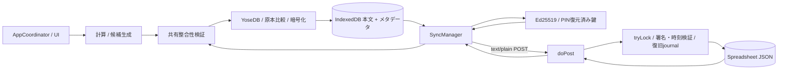
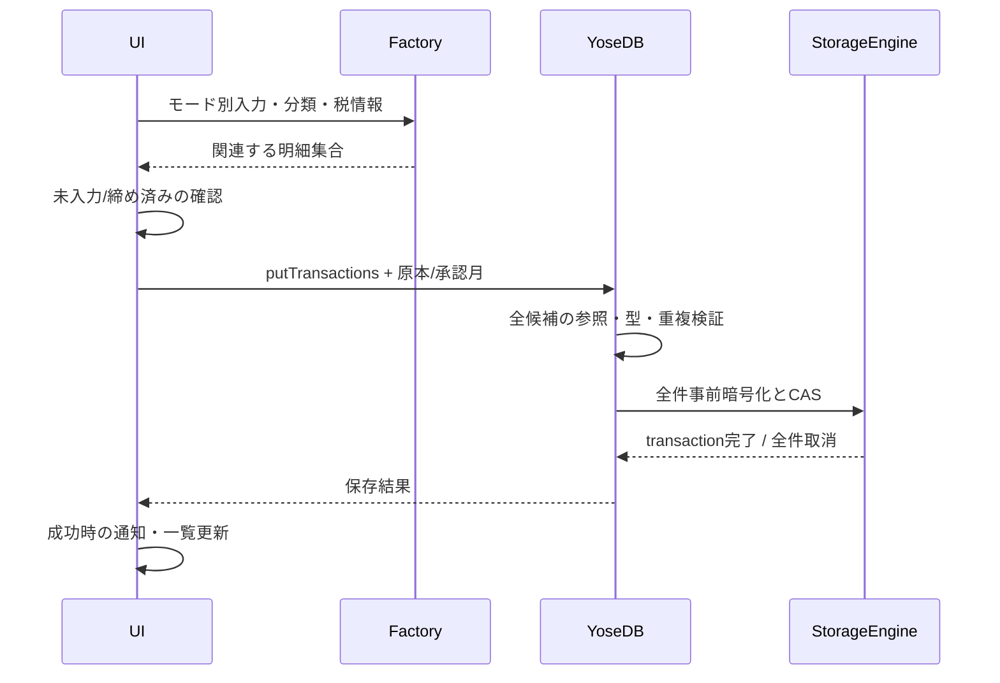
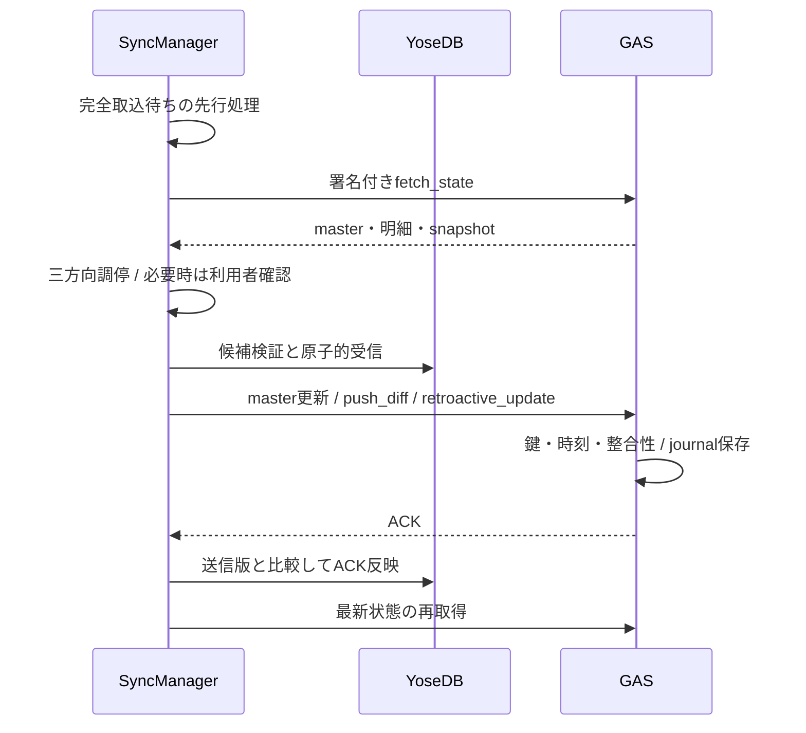
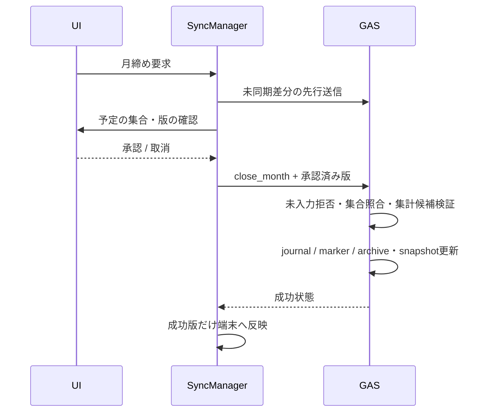
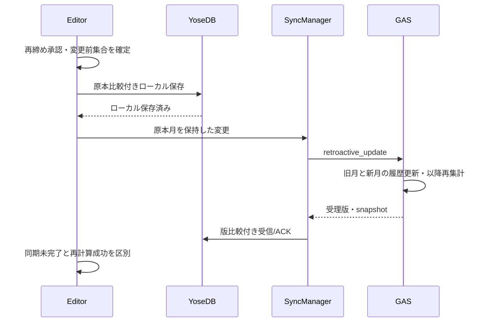
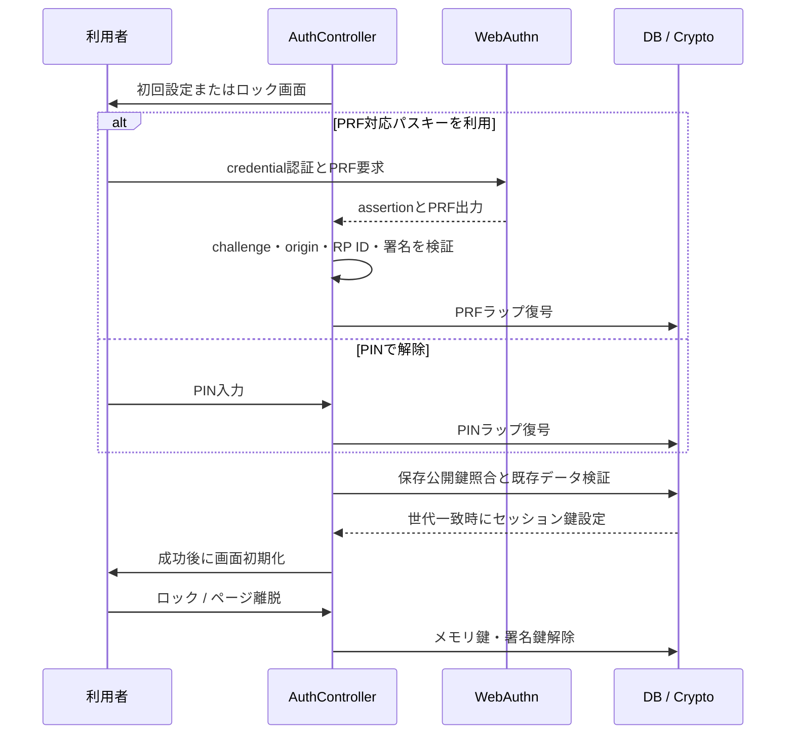
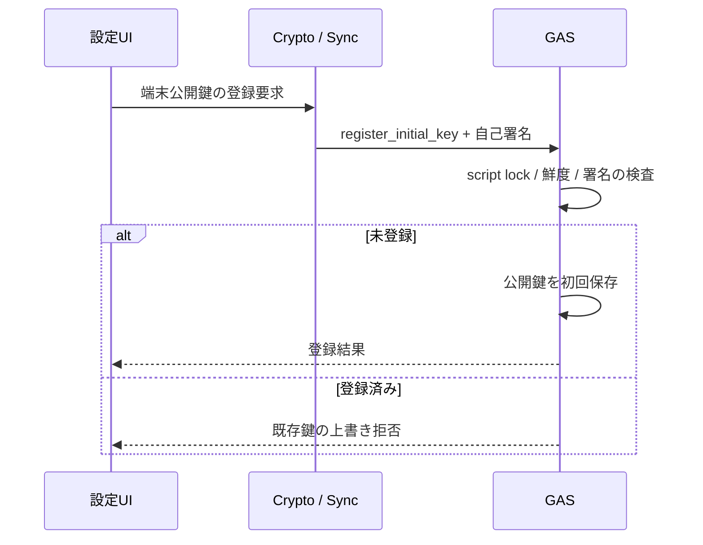
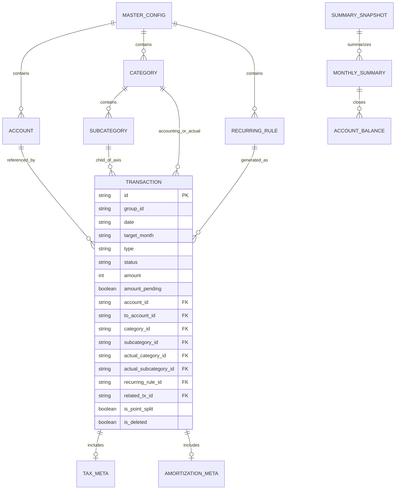

# 「よせあつめ家計簿」内部設計書

## 本書の位置付け

[要件定義書](requirements.md)を実現するモジュール、計算、状態、永続化、通信、認証、復旧方式を定義する。画面・公開JSONは[外部設計書](external_design.md)、既存テストの実assertと不足は[設計テスト監査](design_test_audit.md)に定義する。

`I-`で始まるIDは内部設計の識別子であり、旧章番号を継承した箇所と本書で分解した箇所を区別する。要求の実装/検証が不足する点は明記し、旧文書の「完全保証」「100%互換」等の表現を実測なしに引き継がない。データ構造のJSON例の正本は外部設計書であり、本書はその格納方式と参照関係を扱う。

<a id="i-2-1"></a>
## I-2.1 全体構成と信頼境界

| 要素 | 実装 | 責務 |
| --- | --- | --- |
| 静的配布/画面 | GitHub Pages相当のHTTPS、HTML/CSS、ES Modules | 画面、入力、計算、端末内保存、同期/更新の操作である。 |
| 端末内保存 | IndexedDB、Web Crypto API | 金融本文の暗号化、検索用メタデータ、PIN保護された鍵、同期基点/送信待ちを保持する。 |
| 通信 | SyncManager、Ed25519署名、HTTPS POST | 設定と明細の調停、署名、送信、受信候補の検証と反映を行う。 |
| サーバー | コンテナバインドGAS、PropertiesService、LockService | 公開鍵検証、時刻検証、排他、候補検証、保存/再計算、復旧を行う。 |
| サーバー保存 | スプレッドシートのJSONシート | マスタ、未締め差分、月別履歴、集計、復旧記録を保持する。端末内AES暗号化とは別である。 |

ローカル暗号化はブラウザ保存時の本文を保護する。解除済みセッションの実行コード、端末そのもの、サーバーの閲覧権限まで不可視にする設計ではない。

<a id="i-2-2"></a>
## I-2.2 ディレクトリと実行入口

```text
yose/
  index.html / css/style.css / manifest.json
  sw.js / version.json
  js/app.js                 起動Facade
  js/ui/                    認証、調停、入力、編集、集計、設定、保守、競合確認
  js/db.js / js/db/          公開Facade、低水準保存、業務保存、取込
  js/logic.js / js/logic/    公開Facade、計算、参照検証、設定調停
  js/crypto.js / js/webauthn.js / js/sync.js / js/version.js
  gas/Code.gs / gas/appsscript.json
  scripts/                  静的検査、GASセットアップ、共有検証器の生成
  test/unit/ / test/integration/ / test/system/ / test/ui/
  test/helpers/             GAS/IDBの模擬とChrome CDP
  docs/                     要件、外部/内部設計、監査、開発プロセス、レビュー
```

`js/app.js`はAppCoordinatorを入口として公開する。`js/db.js`と`js/logic.js`は細分化したモジュールの再エクスポートを担う。使用するランタイムモジュールはSW配布対象にも含める。

<a id="i-2-3"></a>
## I-2.3 スプレッドシートの保存単位

`master_config`、`summary_snapshot`、`pending_diffs`、`arch_YYYY-MM`をJSONデータセットとして扱う。`loadJsonFile`/`saveJsonFile`は論理ファイル名とシート名を対応させる。`replacement_journal.json`等の復旧記録も同じ格納経路を使う。PropertiesServiceは登録公開鍵を保持する。復旧確定マーカーはreplacement_commitシートの単一セルに保存する。

JSONは40,000文字ごとにセルへ分割する。サーバーには金融データの平文JSONを保存する。Google側のアクセス権、実際のシート権限、配布済みGASの設定はローカルAESで代替されない。

<a id="i-2-4"></a>
## I-2.4 GASセットアップと配布設定

`gas/appsscript.json`はV8、Asia/Tokyo、`spreadsheets.currentonly`、`ANYONE_ANONYMOUS`、`USER_DEPLOYING`を宣言する。`initialSetup`と`scripts/setup_gas.js`/`setup_gas.sh`は初期設定を補助する。実行手順は[README](../README.md)を参照する。

ソース宣言は公開済みデプロイの権限を変更しない。初回認可、シートへのバインド、公開URL、匿名GETと署名POSTの到達性は実環境の確認対象である。模擬GAS実行をデプロイ成功の証拠としない。

<a id="i-4-6"></a>
## I-4.6 UIモジュールと状態の責務

AppCoordinatorはDB/同期の依存注入、期間・表示軸・入力モード、タブ/モーダル/認証のライフサイクルを調停する。

| モジュール | 責務 |
| --- | --- |
| auth_controller / sync_status_controller | 鍵/PIN/パスキー、ロック、同期状態の購読と表示である。 |
| tx_input_controller / tx_edit_controller / tx_list_controller | モード別入力、原本比較付き編集、期間抽出/検索/ページ送りである。 |
| summary_controller / chart_controller | 期間/軸別集計、グラフと代替表示、旧描画の破棄である。 |
| master_controller / settings_controller | マスタ編集、予算/テーマ/鍵管理/バックアップ操作である。 |
| tag_memo_input / backup_import_controller | 入力候補/チップ、完全取込の確認と取消状態である。 |
| maintenance_controller / master_conflict_controller | アーカイブ参照の移行、設定競合の比較と選択である。 |

各コントローラーの相互操作はcoordinator経由を基本とする。実際の依存はimportと生成箇所を正とし、旧文書の「10ファイル固定」「循環参照100%防止」は保証条件としない。

<a id="i-4-7"></a>
## I-4.7 コアモジュールの責務

| モジュール | 処理 |
| --- | --- |
| defaults / storage_engine / yose_db | 定数、Memory/IndexedDB、暗号化、業務候補生成/原本比較/原子的保存である。 |
| backup_merger / backup_replacement | 非破壊マージ、種別判定/全置換候補/参照検証である。 |
| date_utils / transaction_factory | 日付/休日/カード請求、ID、税/電卓、定期/前払/立替/ポイント/保険連動を計算する。 |
| aggregator / budget_engine / category_trend | 残高・粒度別・分類/タグ/クロス・資産・予算・費目推移を集計する。 |
| master_sync / master_maintenance / data_integrity | 三方向設定調停、アーカイブ参照移行、共通整合性規則を扱う。 |
| crypto / webauthn / sync / version | 署名/暗号、資格情報認証、通信状態、配布版更新を扱う。 |

GASの整合性検証器は共有data_integrityから生成し、`check:gas-integrity`で一致を検査する。金融値の算出・候補検証とUI表示を分離する。

<a id="i-3-1"></a>
## I-3.1 仕訳生成と分類

transaction_factoryはexpense/income/transferの単一明細を生成する。立替自己負担と貸付、ポイントの自己負担/専用口座または相殺収入は別明細として関連付ける。直接精算は短いメモとシステムタグを指定し、手入力回収では利用者のメモを保持してタグをSetで重複排除する。

計上/実態の親子を保持し、実態中項目は省略時だけ同じ親の計上中項目を補う。明示nullを異なる親の子へ置換しない。移行済みのアーカイブ参照と、新規に禁止する参照を区別する。

<a id="i-3-2"></a>
## I-3.2 定期・休日・カード生成

`generateRecurringTransactions`は有効状態、開始/終了月、月間隔、既存の同一ルール+計上月を検査する。月末日を丸め、休日補正後もtarget_monthを保持し、安定IDを生成する。生成結果はplannedである。現在のUI起動経路はカード自動精算を実行するが、定期は生成ボタン経路である。要求3.2の起動自動生成/固定額自動確定は未達として監査する。

カード精算は請求周期内の確定・金額確定済み支出を対象とし、安定IDとcreate-only比較で並行二重作成を抑止する。保険口座の編集は対応する定期ルールの作成/更新/無効化を伴う。定期編集UIが提供していない周期等の項目を、計算APIが対応することだけで画面対応済みとしない。

<a id="i-3-3"></a>
## I-3.3 前払分割と一括更新

総額の支払振替1件と、前払口座からの月次費用N件を同一group_idで作る。2回目以降をfloor(総額/N)、初回に余りを加える。親子とamortization_metaを保持する。

`updateInstallmentGroup`は編集前グループ集合を比較する。メモ等だけの編集で総額を再分割せず、明示的な金額/期間変更時に再計算する。親/子の単独編集、締め済みメンバーの再締め、未入力フラグ、原本変更・暗号化/IDB失敗時の全件保持を扱う。

<a id="i-3-4"></a>
## I-3.4 収支・資産・費目推移

aggregatorは口座残高、確定/予定、日/月/年、計上/実態を算出する。月次snapshotがある月はローカル同月行との二重計上を避ける。資産は履歴残高を基点に確定明細を加え、履歴のない過去日を0円で推測補完しない。ローン/カードの内部符号は一律の負数限定とせず、資産/負債の集計規則に従う。

category_trendは日別では取引日、月/年では計上月の既存集計を利用する。日次へsnapshotを推測配賦しない。明細リストの年/月はtarget_month、日はdateで抽出する。フィルター前の期間集合から計上/実態と振替先を含めてアーカイブ候補を決める。

summaryの描画世代と取得済み同一マスタを使い、古いreadによる描画を拒否する。ChartControllerは既存chartをdestroyし、テーマ/空状態を反映する。Chart不可時の表はHTMLエスケープする。

<a id="i-3-5"></a>
## I-3.5 予算・タグ・クロス計算

budget_engineは前年の確定実績とsnapshotから年度初期値を算出し、金額規模別に百/千/一万円単位へ丸める。年度予算、費目別内訳、累積推移、経過月ペース、貯蓄率/額を算出する。表示中の有効費目を保存する際に非表示アーカイブ予算を消さない。

タグ集計は対象取引のタグを集計し、クロスは計上/実態費目ごとに行列、行/列合計と総合計を返す。クロス集計の計算対応と、要求3.23の行/列クリック操作の対応は別に判定する。

<a id="i-3-6"></a>
## I-3.6 マスタ編集・競合・アーカイブ移行

編集開始版をexpectedConfigとして保持し、送信ごとに候補を複製する。失敗した新規候補を次回pushへ持ち越さない。DB保存では三方向比較により無関係な変更を保持し、同じ項目の競合を拒否する。設定の画面反映後に背景同期を要求する。

保守一覧は削除を除いた取得済み明細から両分類/両口座のアーカイブ参照を数え、参照1件以上の設定だけを示す。refresh世代を比較し、移行中の更新を抑止する。移行は型/収支種別/資産区分/親子を検証し、明細・マスタ原本と確認済み締め月を比較して一括保存する。

<a id="i-3-7"></a>
## I-3.7 入力部品と画面状態

TagMemoInputは新規/編集のチップ・候補を共有する。候補採用時は未確定文字列を置換し、IME・フォーカス移動・マウス/タッチ/キーを扱う。電卓は対象入力IDと適用前の税メタ情報を持ち、取消では適用しない。通常から前払の空総額へだけ文字列の金額を引き継ぐ。

モーダルは最上位だけを操作可能とし、背景inertとbody固定で背面操作/スクロールを抑止する。戻る/Escape/closeは共通経路を使い、明細/マスタは初期値比較で破棄確認する。履歴ガードを復元し、認証ロック時は閉じる。マスタopenは世代+認証鍵、save-closeは世代を比較し、保存中closeを保留する。

折畳み/テーマの永続化は意図の順序を保ち、先行失敗で後続操作を止めない。期間・モード・親分類の後着readから最新操作を保護する。

<a id="i-3-8"></a>
## I-3.8 差分インポート

JSONを解析し、種別・配列・危険キー・ID重複・有限数値等を事前検証してから候補全体を合成する。明細はID/更新日時、設定は非破壊の和集合、snapshotは月キーを基準に扱う。新設定を参照する明細を同じ候補で検証できる。

書込前に参照整合性と認証鍵を確認し、全件暗号化後に比較付き一括保存する。不正JSONや混在不正要素で部分保存せず、元データを維持する。形式・結果通知は外部設計3.15/3.26に従う。

<a id="i-3-9"></a>
## I-3.9 完全インポートと送信待ち

prepareReplacementImportは種別単位の全置換候補と原本版を作成する。正確な確認語、planの同一性、認証、原本比較後に業務ストアと暗号化pending_importを原子的に更新する。取消/ロック/暗号化途中失敗/IDB例外は全原本を保持する。

同期は未送信の完全取込を先に処理し、fetch_stateでbase_versionを結び、replace_importへimport_id付きで送る。版競合は再承認、ACKは送信したoutbox/版を比較する。応答喪失時も同一操作を再送でき、送信後のローカル編集を古いACKで消さない。サーバーはreceiptとjournal/markerで複数シート変更を復旧する。

<a id="i-3-10"></a>
## I-3.10 共通整合性と保存境界

data_integrityは型/必須値/安全なID/参照/親子/収支種別/重複/予算/snapshot階層を検査する。既存問題の種類と件数を比較し、悪化を拒否して修復を許す。全置換では候補全体を厳格に検査する。通常新規のアーカイブ参照禁止と履歴取込を区別する。

`mutateBusiness`は原本取得→復号→候補生成/検証→事前暗号化→認証同一性と原本の比較→単一readwrite transactionの順に処理する。low-level requestのsuccessだけでなくtransactionの完了を待つ。明細編集/削除/精算/グループ更新、生成、受信/ACKにも原本比較を適用する。

GASも署名後の候補状態を共通規則で検証し、複数シートの更新を復旧journal経由で確定する。不正な保存JSONや読取失敗を空データと誤認して上書きしない。

<a id="i-4-1"></a>
## I-4.1 同期状態と調停

SyncManagerは同期実行中、最後のエラー/同期時刻、設定再送待ち、競合パスを持つ。非表示/オンライン/手動/月締めの契機を登録し、ロック時は署名鍵を外し、再初期化でlistenerを重複させない。

通常の双方向同期は完全取込待ち→リモート状態取得→共有master調停/検証→未同期明細送信（締め済みは遡及経路）→再取得の流れを使う。共有設定の基点・手元・サーバーで三方向比較し、端末固有設定を除外する。競合候補は選択/参照整合/原本版/鍵を再確認する。同一受信候補のmaster/明細/snapshot/ACKは一括反映し、既に完了した別段階までは巻き戻さない。

成功ACKで同期済みにする対象は送信した版だけであり、送信中の再編集を未同期のまま残す。通信失敗や確認取消で原本を消去しない。requestTimeoutMsは30秒で本文読取も対象とする。UIの同期中・未同期・競合待ちを別状態として通知する。

<a id="i-4-2"></a>
## I-4.2 GAS入口と要求検証

`doGet`は固定の疎通状態だけを返す。`doPost`はJSON解析、script lock、復旧処理、action/payload/署名・timestamp検証を行う。初回公開鍵は登録済み鍵の上書きを許さず、登録要求の署名を検証する。

既存actionはpush_diff、close_month、retroactive_update、fetch_state、fetch_master、update_master、replace_importおよび互換経路のupdate_external_assetsである。候補全体の不整合は保存前に拒否する。close_monthは予定集合と内容版の承認を照合し、未入力金額を確定しない。遡及更新は元月を保持して移動/削除を扱い、履歴を最新締め月まで再計算する。

<a id="i-4-3"></a>
## I-4.3 端末内暗号化

DMKは256bit乱数、本文はAES-GCM-256と12byte IVで暗号化する。対象はtransactions、master_config/current、summary_snapshot、共有同期基点、完全取込outboxである。取引のid/target_month/date/sync_status/is_deleted等は検索用に暗号化外へ付ける。

security_keysにはPIN暗号化されたmaster_keys_packageや公開credential等を保存し、settingsには接続先等を保存する。これらのストア全体、検索メタデータ、Google側JSONまで「全て暗号化」とは扱わない。DMKが必要な業務更新で途中ロックした場合、平文保存へ退避しない。

<a id="i-4-4"></a>
## I-4.4 鍵と通常WebAuthn

Ed25519署名鍵とDMKを初回生成し、PINからPBKDF2/HMAC-SHA-256（100,000回、16byte salt）で導いたAES鍵でまとめて保護する。解除中だけCryptoKeyをメモリに保持する。

パスキーは通常WebAuthnで、credentialごとのuser handleとcredential ID/公開鍵等を保存する。challenge・origin・RP ID・署名等を検証し、PRF対応登録は暗号ラップを復号してPINを省略する。非対応・旧登録はPINで解除する。パスキー内部秘密鍵をexportせず、鍵束を設定同期へ含めない。1Password実機の提供者動作と、仮想CTAP2でのプロトコル確認は区別する。

<a id="i-4-8"></a>
## I-4.8 旧PRF形式の移行

PIN復号成功を確認して同じDMKと署名鍵を復元した後に、旧vault/credential ID/共有bundleを除去する。誤PIN・取消時は原本を保持する。通常credentialへの再登録を案内し、旧IDのみを検証済み資格情報と扱わない。

<a id="i-5"></a>
## I-5 永続化スキーマと論理モデル

| 端末ストア/キー | 内容と保護 |
| --- | --- |
| transactions/id | 暗号化金融本文と検索用メタデータである。 |
| master_config/current | 暗号化した端末の設定である。 |
| master_config/sync_base | 受理済み共有masterの暗号化基点である。 |
| master_config/pending_import | 全置換の暗号化送信待ち・操作ID・base_versionである。 |
| summary_snapshot/current | 暗号化した締め済み月集計/残高である。 |
| security_keys | PINラップ鍵束、公開鍵、WebAuthn公開情報と任意のPRF暗号ラップである。 |
| settings | GAS URL等の端末設定であり、業務本文暗号化とは別である。 |

メモリ実装は非ブラウザ試験向けであり、IndexedDBの実transaction/失敗特性を同一と仮定しない。サーバーのSchema v2 JSONと端末内暗号化envelopeは異なる層である。入出力項目・型は外部設計5.1〜5.3、参照関係はI-6.4を参照する。

<a id="i-6-1-2"></a>
## I-6.1.2 詳細データフロー



<a id="i-6-3-1"></a>
## I-6.3.1 入力・ポイント連動の保存



<a id="i-6-3-2"></a>
## I-6.3.2 双方向同期・署名検証



<a id="i-6-3-3"></a>
## I-6.3.3 月締めと復旧



<a id="i-6-3-4"></a>
## I-6.3.4 締め済み明細の遡及変更



<a id="i-6-3-5"></a>
## I-6.3.5 起動・認証・ロック



<a id="i-6-3-6"></a>
## I-6.3.6 初回公開鍵登録



<a id="i-6-4"></a>
## I-6.4 論理エンティティの参照関係



図は論理的な参照を示す。IndexedDBやJSONシートの外部キー機構ではなく、I-3.10の検証で保証する。tax_meta/amortization_metaの全項目や口座種別は外部設計のスキーマを参照する。

<a id="i-7-1"></a>
## I-7.1 OAuth権限境界

コンテナバインドと`@OnlyCurrentDoc`を採用し、許可スコープを対象スプレッドシートへ限定する。Drive全体アクセスを前提としない。Googleの審査・公開権限・認可状態はコード内宣言だけでは保証されない。

<a id="i-7-2"></a>
## I-7.2 JSONチャンク境界

スプレッドシートのセル上限に余裕を持たせ、40,000文字単位に分割して保存し、読取時に連結してJSON解析する。複数チャンク・境界値・古い余剰セルの消去・読取/書込失敗を独立した検証対象とする。テスト名にlargeとあっても40,000を超える入力か実assertを確認する。

<a id="i-7-3"></a>
## I-7.3 通信オプション

POST本文は署名付きJSON文字列、Content-Typeは`text/plain;charset=utf-8`、credentialsはomit、redirectはfollowである。ブラウザのCORS処理はクライアント/GASモックだけでは再現できない。GET疎通成功は署名付きPOSTの成功を意味しない。

<a id="i-7-4"></a>
## I-7.4 署名直列化と時刻検証の限界

action/timestamp/payloadをキー順序の一致するcanonical JSONにしてEd25519で署名する。クライアント生成/署名はWeb Crypto対応が必要であり、独自の未対応環境fallbackを持つと説明しない。GASはPure JSのEd25519検証を持つ。

GASは現在時刻との±300,000ms超を拒否し、CacheServiceが利用できる場合はsignatureをキーに300秒記録して同一署名の再送を拒否する。これは鮮度と短期キャッシュの併用であり、永続nonceによる全再送防止ではない。CacheServiceの不存在/例外時はその検査を継続できず、早期失効も含めた保証は別途検証が必要である。完全取込のimport_id/receiptや安定IDによる冪等性と、認証の再送防止を混同しない。

<a id="i-7-5"></a>
## I-7.5 鍵ライフサイクル

PINラップ、通常WebAuthn、署名鍵はI-4.3/I-4.4に従う。ページ離脱/手動ロックでメモリ鍵を外し、BFCache復帰は再ロックする。ブラウザ更新取消時はセッションを保つ。解除済みDevToolsでの本文参照不可まで保証しない。

<a id="i-7-6"></a>
## I-7.6 排他と永続復旧

GASはscript lockの`tryLock(30000)`を使い、取得失敗を返しfinallyで解放する。処理候補を検証してから永続journalとmarkerで複数保存を確定/復旧する。GoogleのシートI/OとPropertiesService自体が単一ACID transactionを提供するという意味ではない。

ローカルCAS、script lock、サーバー状態版、更新時刻、安定ID、再送receiptは異なる競合境界である。模擬LockServiceのassertをGoogle実行基盤の同時実行検証と扱わない。

<a id="i-7-7"></a>
## I-7.7 Service Workerと配布版

SWは静的資産をinstallでaddAllし、activateで旧cacheを消してclients.claimする。GETのみcache-firstとし、非HTTP(S)、version.json、script.google.comを処理対象外とする。network fallbackはbasic/200のみcacheへ追加し、cache.put失敗で応答を妨げない。HTMLの通信失敗ではindexを返す。

SKIP_WAITINGは即時待機解除、CLEAR_ALL_CACHESはcache削除であり、同じ動作ではない。登録はupdateViaCache:none、版確認はno-storeと時刻query、承認後はcache削除と再読込を行う。package/version.json/js版定数/SW/index表示とlockの版を揃える。

Chart.jsは外部CDNであり静的資産一覧に含まれない。オフライン時のグラフ初回描画や実SW更新ライフサイクルは、Chart stubを使いSW本体のライフサイクルを直接assertしないCDPのDOM試験だけでは保証されない。

<a id="i-7-8"></a>
## I-7.8 金額精度と表示

保存金額は有限な整数を検査し、税/分割は明示丸めを行う。計算はJavaScript Numberを使用し、任意桁整数や全浮動小数点誤差排除を保証しない。安全整数範囲の上限拒否や大量累積の誤差境界は別の設計/試験課題である。旧文書の精度目標を達成済みと扱わず、監査へ残す。

<a id="i-3-49"></a>
## I-3.49 パスキー鍵解除と既存立替回収

### パスキーの鍵ライフサイクル

`webauthn_credential` の1レコードに公開credentialと任意の `prfWrap` を保存する。登録ではPRFを要求してcreate後に署名検証付きgetを必ず行い、得た32byte PRF出力からHKDF-SHA-256（乱数salt、用途固有info）でAES-GCM-256鍵を導出する。鍵束（DMK/Ed25519 PKCS8）を乱数12byte IVで暗号化する。version/credentialId/rpId/originをAADへ結合する。レコードに保存するのは公開情報、PRF入力salt、HKDF salt、IV、暗号文のみであり、PRF出力・生鍵・PINは永続化/ログ/共有設定/バックアップへ含めない。再登録createでは必ず新しい乱数user handleを用い、認証器側で旧credentialを同一利用者として置換させない。user handleはcredential内で保持し、旧webauthn_user_idの再利用を廃止する。登録失敗/取消/ロック競合/保存失敗では端末の旧登録と旧パスキーによる解除を維持する。新credentialを生成した後の認証器内残存はWebAuthnから削除できず、提供者の管理対象である。生の一時byte列はfinallyで消去し、解除中だけCryptoKeyをメモリへ保持する。

解除は署名検証→PRF鍵導出/復号→鍵import→既存config/snapshot/全明細読取→同じ解除試行でsecurity_keysから読み直した保存公開署名鍵との一致検証→session/sync署名鍵の確定である。失敗/世代不一致では仮のDB鍵を消去し、遅い認証/登録が再ロックを覆さない。PIN変更は同一鍵なのでPRFラップを保持する。署名鍵再生成は新公開鍵・PIN鍵束・旧credentialのPRFラップ失効を単一security_keys transactionで確定し、古い署名鍵を復元できなくする。コミット直後にロックされた場合は解除中状態を戻さず、次のPIN解除で保存公開鍵を読み直して新鍵を復元する。解除はcredentialレコード全体の削除であり、旧vaultとは区別する。

PRFの根拠は[WebAuthn Level 3 PRF extension](https://www.w3.org/TR/webauthn-3/#prf-extension)である。create時の出力は必須ではなく、getではenabledを要求しない。PRF非対応の通常パスキーもPIN経路とともに保持する。

### 関係モデルと保存境界

回収側の `advance_source_id` だけを正本とする。新規直接回収も同じ関係を生成し、元の `settlement_status` は更新しない。未回収は旧settledと有効回収参照の両方を除いて導出する。既存の到達不能 `currentSettlingAdvanceId` 分岐を削除する。

専用DB操作で選択時の両原本を現在値と照合し、1対1・同額正数・confirmed・金額確定・口座方向を検証して回収の参照だけを変更する。収入候補の口座は非アーカイブかつacc_receivable以外の有効口座に限定し、DB保存時も検証する。収入からの変換は同一IDをtransfer/account_id=acc_receivable/to_account_id=旧account_idへ変更し、両分類と税情報をnullにする。メモ/タグ/日付/グループ/作成日時を保持する。旧settled元の関連補完は許可するが新規直接回収の対象にはしない。補完リンク作成時に旧settledをunsettledへ変更し、有効回収参照による精算判定へ原子的に移行する。この元変更も原本比較と再締め承認の対象である。解除は回収参照を削除する。以降は回収削除だけでも元が自然に未回収へ戻り、元未取得時も回収側だけで解除/削除できる。原本比較・事前暗号化・鍵世代検証・複数書込は既存mutateBusinessの原子境界を使う。

共有validatorでは回収参照の型/安全ID/自己参照/回収役割/確定/正数/二重参照を常に検証する。元が取得済みなら非削除・立替振替・同額・確定・旧settledでないことを検証し、未取得元は過去明細未取得として保持する。旧settledと有効参照の併存を禁止することで、移行元の日時競合時に回収だけを部分受理させない。関連を壊す編集は解除を案内して拒否する。立替金口座以外の支払元/受取先は、口座の有効性・同額・確定状態・立替方向を保つ通常編集を許可する。前後の金融口座を固定する制約は設けず、オフラインの解除→編集→再リンクの最終状態も一括同期可能にする。墓標回収は参照検証/重複/未回収導出から除く。GASにも同じvalidatorを生成埋込する。

閉じ月を跨ぐ解除後編集で関係の途中状態を送らないよう、承認済み過去月と未締め月の差分を単一push_diffバッチで送る。GASは全候補のタイムスタンプ競合/再締め承認を確認し、pending/archives/snapshotを既存runIntegrityMutationで一体検証・保存する。閉じ月変更/移動/削除で影響月以降を再計算する。1件でも関係が不整合になる競合はバッチ全体を拒否し未同期を保持する。旧retroactive_update APIは既存呼出し向けに維持し、新しい同期経路は統一する。

### 設定URLの入力と再描画

設定のGAS URLはinputイベントで未保存状態と入力世代を記録する。renderSettingsは開始時の世代を取得し、同一世代かつ未保存入力がない場合だけ保存済みURLを入力欄へ反映する。URL保存は提出時の値をDB/SyncManagerへ適用し、提出後に別の入力があればその未保存状態を残す。保存完了も世代を進め、保存前の古い読取結果でURL/接続表示を戻さない。UIで遅い再描画→入力→保存、および遅い読取→保存→読取完了の双方を検証する。

### 数値受入の再計測

Nodeの標準coverageとブラウザ未計測のままでは全対象の数値受入を判定できないため、`test:coverage`を追加する。対象は`js/**/*.js`、`gas/**/*.gs`、`sw.js`の本番原本集合である。head内のテーマ初期化を同位置の同期外部スクリプト`js/theme_bootstrap.js`へ抽出し、SW資産にも含める。HTMLの定数`onsubmit="return false;"`は分岐のない宣言であり、テーマ以外の本番インラインロジックが増えた場合は対象追加を要する。

Node・ブラウザ・GASで同一のIstanbul計測器を使用する。Nodeは同期module load hook、ブラウザはCDP Fetchによるテスト配信、SW/themeのVM試験は読込helperで、元ソースへ標準statement/function/branch counterだけを挿入する。本番原本・SWキャッシュ資産に計測コードを保存しない。計測前の原本SHA-256とIstanbulの位置mapを証跡に含め、集計時も原本のhashと再生成した位置mapを完全照合する。差替fixtureやCDNを本番コードとして採用しない。V8/CDPの詳細Profilerは遷移中の破棄処理の分岐が失われるため、最終受入の集計器には使用しない。

ブラウザは最初のnavigate前にCDP Runtime bindingと収集関数を注入する。navigate/reload直前・pagehide・明示flush・closeでcounterを退避し、退避後に0へ戻してdeltaを保持する。通常操作前はpagehide listenerの末尾再配置だけを行う。pagehideの末尾は破棄中にCDP通知が失われるため、テスト専用の乱数keyでsessionStorageへ同期保存してから0へ戻す。同一originの次document/復帰/通常flushで保留記録をbindingへ送り、ACK後に保留記録を消す。BFCacheの同一documentもcounterを保持したまま通常どおり復帰し、再開のためのdebugger停止は要しない。保存・送信失敗や未知の原本/位置mapを無視しない。Nodeはprocess終了時に同じ形式を保存する。

別originでテストが終了した場合は、assert完了後のcloseで元originの収集専用空HTMLへ遷移して保留記録を回収する。このHTMLは本番スクリプトを読み込まず、回収のために本番処理を追加実行しない。VMは共通のcoverage objectをcontextへ渡し、context内のcounterもNode終了時の証跡に含める。

収集/退避/listener再配置に用いるRuntime.evaluateはexceptionDetailsを検査して例外を呼出し元へ伝播し、closeの回収失敗も握り潰さない。送信・sessionStorage・counter reset・再配置の各失敗を直接試験する。deltaでは全counterが0のファイルを省き、原本集合は全対象0初期化で保持する。省略前に形式/原本検証を行い、不正な0記録を見逃さない。

遷移中のevaluate応答やbinding通知が失われても記録を落とさないよう、通常flushも乱数chunk ID付きでsessionStorageへ同期保存してからcounterを0へ戻す。bindingは保留chunkを再送し、Nodeは原本/位置/counterの検証と保存が成功したchunkだけをACKする。ACKは次回flushで渡し、ブラウザはACK済みchunkだけを除去する。同じIDの再受信はpayload SHA-256が一致することを確認して重複保存せず、異なるpayloadなら拒否する。遷移によるcontext破棄の明確なCDPエラーだけは計測用の冪等evaluateで期限付き再試行し、一般の計測例外を再試行/無視しない。UI操作そのものは自動再実行しない。通知喪失・応答喪失でも実際の分岐回数が重複しないことを回帰試験で確認する。

再試行対象はCDPプロトコル由来の例外型で識別し、本文だけで判定しない。exceptionDetails由来のJavaScript例外は、同じcontext破棄の文言を含んでいても即時失敗とする。計測evaluateとwaitFor双方で一般例外の実行回数が1回のままであることを検証する。

生データは実行固有ディレクトリへ保存し、JSON破損/不正構造/原本差異/位置map差異/不正counterを計測失敗とする。全対象manifestの各原本を0で初期化してから、Istanbul標準mergeとreportで統合し、全ファイルのLine/Branch各97%を判定する。未実行SWを含む原本集合とレポート集合を照合し、率の平均や手製OR集計を行わない。Node標準V8の参考値とIstanbulの数値は測定器が異なるため混同しない。SWのVM試験は実配備試験とは区別する。

通常の読取・入力操作ごとに全counterを複製/保存する必要はなく、同じdocumentのcounterへ累積する。明示的navigate/reloadの直前、pagehide、明示flush、closeで記録を退避する。操作前にpagehide listenerを末尾へ置き直す処理は保持し、アプリの同期pagehide処理の計数も含める。全スナップショットのmap/counter検証と未ACK再送を維持し、計測負荷で長いUIスイートを打ち切らない。

収集器の回帰試験はreloadで新document tokenの変更を待ち、履歴復帰で同じtoken/persisted=trueをassertする。reload前後の両分岐、復帰listener内の反対分岐、旧documentのpagehideだけの反対分岐を保持することを確認する。SWのfetchはResponseを返すかrejectする標準契約に従い、null応答を想定した到達不能分岐を削除する。試験もResponseのstatus/type/bodyと通信拒否を用いる。

### 認証境界の追加監査

ES ModulesではglobalThisが存在するため、暗号APIの既定値にあるglobalThis不存在フォールバックを除去する。明示的にWeb Crypto非対応である場合の失敗は維持する。RSAの実署名、DER不正構造、保存credential不備、PRF出力長/拡張結果欠損を公開APIから検証する。署名のcanonical JSONは配列内のundefined/function/symbolおよび疎配列の穴をnullへ正規化し、JSONの配列位置を保持する。

### 認証画面の背景と旧解除経路

全原本監査で認証表示中のTabが背景へ抜けることを実Chromiumから検出した。modal interaction guardをDB読込前に1回設置し、認証画面を通常モーダルより優先する最上位として扱う。認証以外のbody直下要素をinertにし、背景スクロールを固定する。Tab/Shift+Tabは表示中かつ有効な認証内controlの端で循環し、Escapeで認証を閉じない。解除後は元のinert/scroll状態を復元し、再初期化でguardを重複設置しない。

設定の旧PIN解除モーダルは全画面認証の背後にしかなく、正規操作から不要である。promptPinUnlock・関連HTML/イベント/委譲を除去し、ensureKeyUnlockedは実際のロック状態・DMK・秘密鍵を検査して全画面解除を案内する拒否ガードへ統一する。認証後は常にPIN鍵束が存在するため、非PIN保護の通常画面、isKeyProtectedWithPinフラグ、平文保護解除の警告だけの旧APIも除去する。存在しない非保護状態を作る試験ではなく、実際の初期設定・PIN/PRF解除・再ロック・再起動・BFCacheからの復帰を検証する。

### 公開ロジックの境界試験

数値ゲートの再入では、既存の公開API契約を実際の入力から追加検証する。日付の引数省略では休日補正なし・標準カード周期を保持し、祝日のJSONスカラー入力は後段の文字列走査に従う。マスタの省略可能な一覧は空として扱い、存在しない移行先中項目を拒否して元明細を保持する。

マスタ競合は生成されたconflictDetailsの名称/存在フラグ/経路に従って解決する。対象配列やIDが消えた古い解決情報、値IDの不一致、欠損メタデータを公開デコーダの異常入力として拒否し、入力を変更しない。これは通常UIで不正データを作る試験とは区別する。両端末で異なる祝日を削除した場合は両方の削除を反映する。

予算は実明細による費目実績を同費目の前年集計で上書きせず、非正数の集計を追加しない。所有プロパティとして渡された__proto__/constructor/prototypeを集計・費目予算から除外し、Object.prototypeを変更しない。0円予算の実績超過でも消化率の除算異常を起こさない。テストのために未知の税アクションを新たな成功契約とせず、存在しない保険費目を架空の正常データとして使用しない。

移行元の存在検証後のaccounts/categories空配列フォールバックは不要である。UUID生成はES Modulesで存在するglobalThisからcryptoを取得し、randomUUIDがない場合の既存生成経路は保持する。マスタ競合の私有経路取得では、ID segmentは三者すべてがID配列の場合だけ生成され、削除/型変更は親の競合で停止する。ラベル検索はIDまで、参照名検索は存在する値のlocal/remoteレコードまでである。この不変条件から途中の親欠損/非配列フォールバックを削除し、公開APIの古い解決情報を拒否するガードは維持する。

### 明細一覧のポインタ操作と再描画

保存後のrefreshAllViewsが、行へのmousePressedとmouseReleasedの間にinnerHTMLを置換し、行クリックを失わせる実装不具合を実Chromiumで再現した。openは最新DBを読むため、旧DB値や単なる待機不足とは区別する。最近/期間一覧のポインタ操作中は対象一覧のDOM置換を保留し、windowでpointerup/cancelを捕捉した後の次taskで解放する。クリックと削除のイベントが元の行/ボタン上で完了した後に描画を適用する。複数pointerはIDで管理し、次taskで新たな押下を含むすべての操作完了を再確認する。blur/表示非活性でも待機を解放する。認証変更・離脱では待機を解放するとともに描画世代を失効させる。

最近/期間一覧に独立した描画世代を持ち、待機後に世代・認証鍵・ロック状態を再確認する。古い検索/期間/原本の結果を適用しない。AuthController.invalidateSessionから共通の描画取消を呼び、再認証後へ旧結果を持ち越さない。行操作は最新DBの明細を読み、削除済みなら編集画面を開かない。待機中の変更・削除を古い表示のまま保存しない。

保留はDOM適用に限定し、金融データの読取/保存やローカル保存後の新編集をネットワーク応答待ちにしない。フィルタ/ページ変更と空一覧も同じ適用境界を通し、初期化の重複でlistenerを増やさない。実押下中に保存後の再描画を進める先行試験で、押下対象が残り、解放後に最新値で編集できることを確認する。キャンセル・blur・認証変更でも待機を残さない。

### 編集を閉じた後の遅延ひも付けと通知

ひも付け候補の読込中に元の編集画面を閉じた場合も、AdvanceLinkControllerの操作/読込世代を失効させる。編集closeから共通cancelを呼び、Escape・取消・保存・認証変更で閉じた元画面に遅延ダイアログを復活させない。取消後の再編集と新しいひも付け読込は独立して成功できる。

鍵再生成の成功/取消/失敗通知は、実際の鍵保存を担当するAuthControllerだけが行う。設定イベント側の無条件の重複成功通知を除去し、PIN取消・誤PIN・保存失敗を成功として表示しない。コミット前の取消・誤PIN・保存失敗では公開鍵・PIN鍵束・既存パスキー原本を維持する。コミット直後ロックの場合は、保存済みの新鍵を戻さず既存のPIN復旧設計に従う。

<a id="i-3-55"></a>
## I-3.55〜58 分析追加と一括更新

メタ情報のcount/confirmed/planned/日付/平均は非削除明細だけである。deletedだけは削除済みを数える。非削除0件では件数・平均・期間数0、日付なしである。サイズはsharedMasterConfig射影・summary_snapshot・全transactionsの論理JSONをTextEncoderで測定し、端末設定を除外する。

getAnalyticsStateはmaster/transactions/snapshot rawを二重取得し一致を確認してから同じraw集合を復号する。不一致は再取得し、鍵変更は拒否する。メタ情報と資産表示はこの一貫読取を共用する。資産KPIと資産履歴は同じ取得状態を渡す。

bulk_edit純関数は選択明細と全関連明細から共通能力を導出し、許可項目以外を拒否する。単なるgroup_idだけで関連とみなさず、同グループ複数件/補助情報/連携役割から判定する。DBのbulkEditTransactionsは開いた原本・認証鍵・最新設定/全明細をmutateBusiness内で比較/検証し原子的保存する。updated_at=max(現在時刻,原本updated_at+1ms)、sync_status=unsyncedを全対象へ適用する。既存previous_target_monthを保持し、未設定の移動時だけ原本target_monthを記録する。承認は既存と今回のreclose_approved_monthsの和集合とし、保存時点の締め境界に必要な全月の承認を再検証する。金額変更時tax_metaをクリアし、金額未入力を明示解除する。保存後描画失敗は保存失敗と分離する。モーダルを開く読取後に選択ID集合を再確認する。

ふるさと納税は取引日で寄附年/前年確定収入を判定する。年度予算内furusato_estimate={resident_tax,income_tax_rate}に通知書入力値を保持する。furusato_sources={salary:[],income_tax:[],resident_tax:[],social_insurance:[]}は各要素{category_id,subcategory_id:nullまたはID}の計上分類参照である。salaryはincome、残りはexpense分類だけである。親指定は全子を含み、同項目内はORで一度だけ数える。異なる項目に同じ親/子が重なる指定は拒否する。共有validatorは形・必須参照・種別・重複を検証する。年度ごとに前年/当年の確定・金額既知・非削除・指定収支種別・取引年一致を集計する。実態分類は使わない。集計元だけの保存は通知書入力を変更しない。予定/金額未入力だけの年も枠を表示し、未入力は額を合計せず別件数とする。税率0%と所得割0円を区別し、所得割0円だけ上限0円とする。前年収入は取得済み確定額であり、snapshotと混ぜて二重計上せず、未取得を年収0円と断定しない。

投資口座type=investmentのinvestment_historyはYYYY-MM-DDをキー、{acquisition_cost,market_value}を値とする日末観測マップである。共有validatorは投資口座だけ、実在日・取得原価/評価額とも0以上の安全整数を許可する。同日の旧値CASで追加/訂正/削除し、同日変更/口座削除/種別変更/アーカイブ化を拒否する。別日の変更は保持する。口座マスタ配下なので既存暗号・共有同期の対象である。非破壊取込は同日の手元値を保持して不足日を追加する。マージで採用しない値も含め、新たな税設定と評価記録の全入力を共通validatorで事前検証する。

採用観測は観測日<=表示日、評価への加算取引は観測日<取引日<=表示日である。取得原価は直近観測のacquisition_costを保持し入出金を加算しない。未観測はnullである。旧形式invested_amountだけの観測は検証・保持するが取得原価として利用しない。両原価欄の併記を拒否し、訂正時に新形式へ置換する。旧形式に後続する日も取得原価を過去の新形式から探し直さない。評価の観測当日は常に観測値を採用する。観測後は確定取引で口座全体評価を増減する。評価再構成は、締めなし、または全archive受信の証拠がある場合だけ許可する。月次archive範囲から取引日の完全性を推測しない。過去計上月に観測後取引日がある未取得明細も考慮する。観測を適用できない評価は帳簿残高を保つ。

完全性印はfetch_state.state_versionがmaster_config/snapshot/pending_diffs/archived_transactions/archive_monthsの正規JSONと一致する受信だけで付与する。update_master応答snapshotへの差替えでこの一致を失った場合は付けない。暗号化snapshotのrawラッパーへ端末用印と取得archive月一覧を付け、全明細/master/snapshotと同じIndexedDB原子batchで保存する。印は復号本文・共有・エクスポートに含めず、取込JSON内の印を根拠にしない。snapshot再暗号化で印が消える。transactions完全置換ではsnapshotを変更しない種別も同じ原子batchで再暗号化して印を消す。getAnalyticsStateは同一raw集合の暗号化snapshotからだけ印を取得する。snapshot単独照合APIは設けない。

全投資口座合計はis_asset=falseを除外し、1口座でも取得原価未記録なら合計取得原価もnullにする。未来観測/未来確定は除外する。未取得の過去日も明示観測日、および選択対象投資口座の直近取得原価が既知の表示日は残し、全体資産・流動・負債等はnull、投資は口座ごとの既知値と不明を分離する。個別口座選択でも全体資産系列を変えない。KPI/口座現在残高は今日、履歴はpoint.dateをas-ofとする。口座予測は補正後現在評価額に既存の予測/現在帳簿差を加えた参考値である。観測削除/過去訂正後は現在まで再計算する。

一括・税・投資フォームは保存中全input/select/buttonを凍結し、表示更新完了までbusyを維持する。取消/失敗では値・選択・適用可否を復元する。投資の成功時は新configから同日原本を再読込して続く訂正を可能にする。ロックは世代を失効させ、旧finallyが再解除後のフォームへ触れない。


### review57 取得原価と家計簿集計への是正

InsightsControllerは通知書入力のdirtyと集計元選択のdirtyを分離する。再描画では変更中の片方を上書きせず、成功した保存だけ原本を更新する。年変更・ロックで破棄し、旧保存完了が別年の入力を変更しない。年度別設定は既存の三者マージ・暗号化・GAS共有検証・取込を通す。非破壊取込は未設定のfurusato_sourcesのみ補完する。全入力の構造不正は採用されない値も含めて拒否し、取込時は構造検証を先に行い、候補統合後にBackupMerger.validateImportData(data,type,candidate.categories)を再度呼ぶ。第三引数の分類集合でmaster_config内/単独annual_budgets内の全集計元参照・種別を検証し、既存値保持で採用しない入力も対象とする。検証はmutateBusinessの再試行内で行い、並行する分類変更後も再評価する。通知書が無くても集計元の保存は可能である。

取得原価系列はChart.jsのstepped='before'を用い、前の点から次の記録日まで水平に保持する。観測日を年/月の間引き系列にも追加する。実Chart.jsの描画命令ではtarget.x/previous.yを経由する方式である（[公式canvas helper](https://github.com/chartjs/Chart.js/blob/master/src/helpers/helpers.canvas.ts)、2026-10-24確認）。


### review58 ふるさと納税の費目割当と自動控除

ふるさと納税について、上記review56/57時点の「給与・控除は参考表示のみ」を変更する。[ふるさと納税計算設計](furusato_calculation.md)を新たな表示・データ・計算の正本とし、費目割当/手入力/自動導出を区別して上限へ使用する。投資・一括編集・メタ情報は変更しない。

<a id="i-3-59"></a>
### I-3.59 グラフ操作と年間目標の連動

chart_geometryの純関数、ChartViewportのイベント管理、ChartControllerの系列状態、収入履歴マップ、resolveAnnualTargetsの共通計算を分離する。保存・検証・同期・取込・認証世代は[グラフ・年間目標設計](chart_budget_improvements.md)を正本とする。
