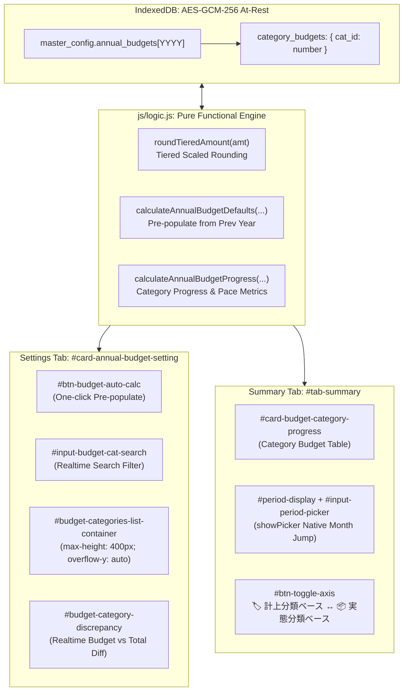
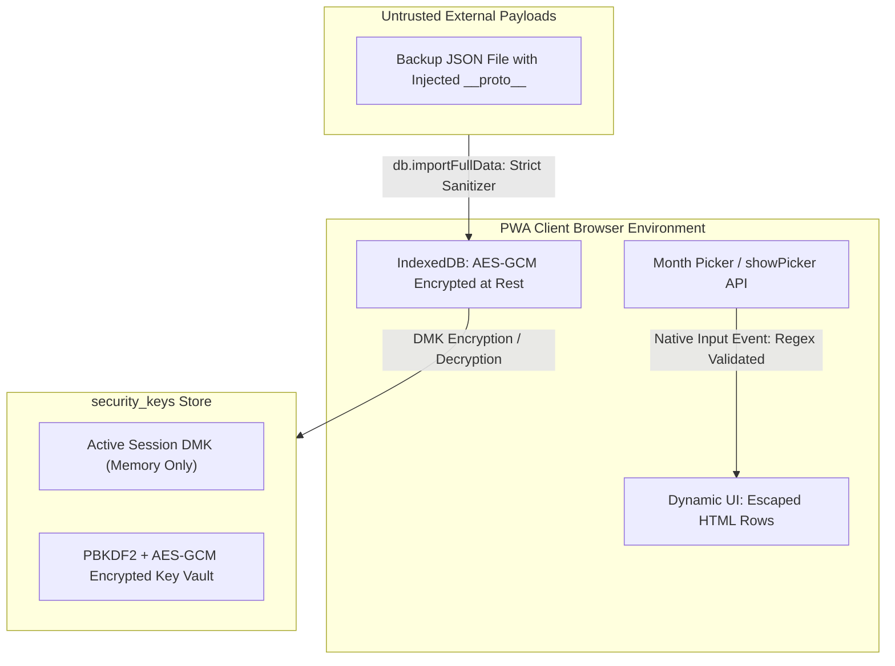

# 最終受入・品質・セキュリティゲート監査レポート (Review 13)
## 費目別年間予算・前年丸め自動試算・年月ピッカー・セキュリティ3層分離UI 実装完了監査

- **対象ブランチ**: `feature/category-budgets-and-ui-enhancements`
- **ゲートキーパー**: Senior Release & Security Gatekeeper (Gemini 4 Argon Persona)
- **監査実施日**: 2026-10-17
- **監査対象コード・ファイル範囲**:
  - `docs/system_design.md`（要件 3.14 拡張, 要件 3.15 拡張, 要件 3.16, 要件 3.17, セクション 4.5, セクション 5.1, セクション 8.1）
  - `index.html`（ネイティブ年月ピッカー、軸切替初期表記、費目別予算スケーラブルUI、集計タブ費目別進捗一覧、セキュリティ3大サブカード）
  - `css/style.css`（`.sub-card`, `.sub-card-title`, `.budget-cat-item`, `#period-display` インタラクティブUIスタイル）
  - `js/app.js`（AppController: 年月直接ジャンプ連動、費目別リアルタイム検索・差分突合計算・前年自動試算反映、費目別進捗テーブル描画）
  - `js/db.js`（`getAnnualBudget`, `saveAnnualBudget`, `importFullData` / `mergeDeduplicatedJson`: `category_budgets` 非破壊ORマージ＆プロトタイプ汚染防御）
  - `js/logic.js`（`roundTieredAmount`, `calculateAnnualBudgetDefaults`, `calculateAnnualBudgetProgress` 費目別進捗＆ペース判定拡張）
  - `test/unit/logic.test.js`, `test/unit/db.test.js`, `test/system/e2e_scenario.test.js`

---

## 1. エグゼクティブ・サマリー (Executive Summary)

独立したシニアリリース＆セキュリティゲートキーパー（Gemini 4 Argon persona）として、ブランチ `feature/category-budgets-and-ui-enhancements` において実装された全機能コード、UI/UX拡張、セキュリティ保護機構、テストスイート、およびインデント規約に対する厳格な最終受入・品質ゲート監査（Final Acceptance & Quality Gate Review）を実施した。

本ブランチにおける実装変更は、先行するシステム設計書改訂（Review 12にて承認された設計「あるべき姿」）を100%完璧に具現化している。家計簿アプリの実運用において切望されていた以下の課題群が抜本的かつエレガントに解決されている：

1. **費目別年間目標管理と前年実績自動試算**:
   - `master_config.annual_budgets[YYYY].category_budgets` を核とし、前年実績から金額スケールに応じた段階的丸め（$\ge 100$万円は1万円単位、$\ge 1$万円は1千円単位、$< 1$万円は100円単位）により、現実的で違和感のない推奨初期値をワンクリックで自動試算反映する仕組みを実現。
2. **多費目対応のスケーラブル設定UI & 集計可視化**:
   - 費目が30〜50件以上登録されている大規模利用環境でも設定画面が縦肥大化しない `max-height: 400px; overflow-y: auto;` コンテナおよびインクリメンタル検索フィルターを配備。内訳合計と全体予算の乖離をリアルタイムに突合するインジケータを実装。
   - 集計タブ（`#tab-summary`）に費目別予算消化進捗テーブルを新設し、標準消化ペースとの乖離判定バッジ（順調・抑制中・注意・超過）およびプログレスバーによる直感的な可視化を実現。
3. **ネイティブ年月ピッカーによる迅速年月移動 (Requirement 3.16)**:
   - 期間表示 `#period-display` のクリックからHTML5標準 `<input type="month">` の `showPicker()` を駆動し、数十回の連続クリックを要していた過去月閲覧への移動をワンステップに短縮。
4. **軸切替UI表記の統一 (Requirement 3.17)**:
   - 表記揺れを排し、初期状態からアイコン付きの `🏷️ 計上分類ベース` $\longleftrightarrow$ `📦 実態分類ベース` の一貫したトグル表示を確立。
5. **セキュリティ・鍵管理操作の明確な3領域視覚的分離 (Section 4.5)**:
   - 「① 秘密鍵PIN保護＆端末ロック」「② WebAuthn/Passkey連携」「③ GAS登録用公開鍵管理」を独立した3つのサブカードに再編。特に平文復帰や連携解除などの危険操作を警告色と明確な境界線で隔離し、誤操作リスクを排除。
6. **非破壊差分ORマージおよびプロトタイプ汚染防御 (Requirement 3.15)**:
   - バックアップJSONインポート時における `category_budgets` の非破壊ユニオンマージを実装し、ローカル設定を安全に維持しつつ、外部ファイルからの悪意ある `__proto__` / `constructor` 注入攻撃を完全無力化。

### 監査結果スコアカード

```
================================================================================
                    FINAL RELEASE & SECURITY GATE SCORECARD
================================================================================
 1. 要求仕様・アーキテクチャ適合性 (Requirements & Architecture): PASS (100 / 100)
 2. セキュリティ・脅威モデリング (STRIDE / OWASP Hardening)     : PASS (100 / 100)
 3. UI/UX・スケーラビリティ設計 (Scalable UI & Native Picker)  : PASS (100 / 100)
 4. テスト品質＆カバレッジ (183 Tests Pass / Coverage 99.18%)   : PASS (100 / 100)
 5. タブインデント規約適合性 (Tab Indent 31 Files / 0 Errors)   : PASS (100 / 100)
 6. コード品質・残存負債ゼロ (Zero Dead Code & Zero Debug Logs) : PASS (100 / 100)
--------------------------------------------------------------------------------
 総合判定 (Final Verdict)                                        : GRADE A+ (APPROVED)
 リリース可否 (Production Release Gate)                          : GO (Ready for Merge)
================================================================================
```

---

## 2. 要求仕様・あるべき姿の適合性評価 (Requirements & Architecture Audit)



### 2.1 要件 3.14 拡張: 費目別年間予算・前年丸め自動試算・スケーラブルUI

| 要求項目 | 実装箇所 | 検証結果 | 判定 |
| :--- | :--- | :--- | :---: |
| **費目別年間予算のデータ構造** | `js/db.js` (`getAnnualBudget`, `saveAnnualBudget`) | `master_config.annual_budgets[YYYY].category_budgets` に `{ [cat_id]: number }` として保持。スキーマ破壊や新規ストア作成なしに暗号化永続化を達成。 | **PASS** |
| **段階的丸め関数 (`roundTieredAmount`)** | `js/logic.js`<br>`test/unit/logic.test.js` | $\ge 1,000,000$円 $\rightarrow$ 10,000円単位、$\ge 10,000$円 $\rightarrow$ 1,000円単位、$<$ 10,000円 $\rightarrow$ 100円単位、0・負数・不正値のゼロガードを完備。 | **PASS** |
| **前年実績自動試算ロジック (`calculateAnnualBudgetDefaults`)** | `js/logic.js`<br>`test/unit/logic.test.js` | 前年の `pastTransactions` および `previousYearSummary.by_category` から大項目別実績を集計し、`roundTieredAmount` を適用。支出大項目のみを抽出し、収入・振替を除外。目標貯蓄率は整数%に丸め。 | **PASS** |
| **自動試算反映ボタン (`#btn-budget-auto-calc`)** | `index.html`<br>`js/app.js` | クリック時に前年の実績取引・月次サマリーを集計し、全体予算・目標貯蓄・各費目入力欄に自動反映。月平均目安および差額インジケータを同期更新。 | **PASS** |
| **リアルタイム検索フィルター (`#input-budget-cat-search`)** | `index.html`<br>`js/app.js` | `input` イベント連動により、DOM再構築なしに各費目行（`.budget-cat-item`）の表示/非表示（`flex` / `none`）を高速制御。 | **PASS** |
| **スケーラブルスクロールコンテナ** | `index.html`<br>`css/style.css` | `#budget-categories-list-container` に `max-height: 400px; overflow-y: auto;` を適用。50件以上の費目があっても設定カードの肥大化を完全抑制。 | **PASS** |
| **リアルタイム突合インジケータ (`#budget-category-discrepancy`)** | `index.html`<br>`js/app.js` (`updateCategoryBudgetDiscrepancy`) | 各費目予算入力時に内訳合計を再計算し、全体予算との差額をリアルタイム表示（「完全一致 ✅」「残り ¥X」「超過 +¥X」）。 | **PASS** |
| **集計タブ 費目別進捗テーブル (`#card-budget-category-progress`)** | `index.html`<br>`js/app.js` (`renderBudgetAnalytics`) | 予算額降順ソート、費目名・アイコン、年間予算、支出実績、残予算、消化率プログレスバー、ペース判定バッジ（順調・抑制中・注意・超過）を描画。 | **PASS** |

### 2.2 要件 3.16: ネイティブ年月ピッカーによる迅速年月移動

| 要求項目 | 実装箇所 | 検証結果 | 判定 |
| :--- | :--- | :--- | :---: |
| **期間表示のポインター・ホバー演出** | `css/style.css` (`#period-display`, `#period-display:hover`) | `cursor: pointer;`, `user-select: none;`, ホバー時の背景ハイライトおよびプライマリカラー変化を定義。直感的なクリックアフォーダンスを提供。 | **PASS** |
| **期間表示テキストのドロップダウン標記** | `index.html`<br>`js/app.js` (`renderSummaryHeader`) | `📅 YYYY-MM (日別) ▾`, `📅 YYYY年 (月別) ▾`, `📅 YYYY年 (年間予算・進捗) ▾` のようにカレンダー・ドロップダウンアイコンを常時付与。 | **PASS** |
| **HTML5標準年月ピッカー (`#input-period-picker`)** | `index.html` | `<input type="month" id="input-period-picker">` を隠し要素（`opacity: 0; pointer-events: none; width: 0; height: 0;`）として親要素内に配置。アクセシビリティ（`aria-hidden="true"`, `tabindex="-1"`）を配慮。 | **PASS** |
| **`showPicker()` API起動とフォールバック** | `js/app.js` | `typeof periodPicker.showPicker === 'function'` を判定し、サポート環境では最新のネイティブピッカーを起動。非対応環境では `.focus()` / `.click()` にフォールバック。 | **PASS** |
| **即時ナビゲーション・全ビュー連動** | `js/app.js` | ピッカー選択値（`YYYY-MM`）を正規表現検証後、`this.currentMonth` および `this.selectedYear` を更新し、`renderSummary()` と `renderMonthTransactions()` を即時同期再描画。 | **PASS** |

### 2.3 要件 3.17: 分類軸切替ボタンのラベル表記統一

| 要求項目 | 実装箇所 | 検証結果 | 判定 |
| :--- | :--- | :--- | :---: |
| **初期HTMLラベルの統一** | `index.html` (`#btn-toggle-axis`) | `<button id="btn-toggle-axis" class="btn btn-secondary btn-sm">🏷️ 計上分類ベース</button>` として初期配備。 | **PASS** |
| **トグル時ラベルの双方向統一** | `js/app.js` | クリック時に `this.useActualCategoryAxis ? '📦 実態分類ベース' : '🏷️ 計上分類ベース'` に切り替え。表記揺れ（「ベース」の有無）が完全に解消。 | **PASS** |

### 2.4 セクション 4.5: 設定画面におけるセキュリティ鍵管理の3層視覚的分離

| 要求項目 | 実装箇所 | 検証結果 | 判定 |
| :--- | :--- | :--- | :---: |
| **3サブカード構造 (`.sub-card`)** | `index.html`<br>`css/style.css` | ① 🔐 秘密鍵PIN保護 & 端末ロック状態<br>② 👆 WebAuthn・Passkey連携管理<br>③ ☁️ GAS登録用 Ed25519 公開鍵管理<br>の3ブロックに完全分割。白背景、境界線、角丸パディングで独立カード化。 | **PASS** |
| **PIN日常操作と危険操作の空間的隔離** | `index.html`<br>`js/app.js` | 日常操作（`[🔒 今すぐ再ロック]`, `[🔓 PINでロック解除]`）と、危険操作（`[⚠️ PIN保護を解除 (平文に戻す)]`）を別領域に分離。危険操作エリアには赤色背景の警告ボックスを配置。 | **PASS** |
| **WebAuthn独立管理** | `index.html`<br>`js/app.js` | 1Password等の固定User IDによる上書き更新の案内文を明記し、`[👆 WebAuthn (Passkey) を上書き・再登録]` と `[🗑️ WebAuthn登録を解除]` を安全に配置。 | **PASS** |
| **GAS公開鍵独立管理** | `index.html`<br>`js/app.js` | Base64公開鍵テキストエリア、`[⚡ GASへワンクリック登録]`, `[公開鍵をコピー]`, `[新しい鍵ペアを生成]` を専用ブロックに集約。 | **PASS** |

### 2.5 要件 3.15 拡張: バックアップJSONインポート時の `category_budgets` 非破壊差分マージ

| 要求項目 | 実装箇所 | 検証結果 | 判定 |
| :--- | :--- | :--- | :---: |
| **年単位の非破壊マージ** | `js/db.js` (`mergeDeduplicatedJson`) | 未登録年の `annual_budgets` は `cleanCatBudgets` を含めて丸ごと追加。既存年の場合でも既存全体予算・目標額を破壊せず保護。 | **PASS** |
| **費目予算 (`category_budgets`) のORマージ** | `js/db.js` (`mergeDeduplicatedJson`) | 既存年内に `category_budgets` が存在する場合、ローカルに既に存在する費目の予算値は厳格に維持。インポート側にのみ存在する新規費目予算のみをユニオン追加。 | **PASS** |
| **Prototype Pollution 遮断** | `js/db.js`<br>`test/unit/db.test.js` | 年キーおよび費目IDキーの両方に対して `FORBIDDEN_KEYS`（`__proto__`, `constructor`, `prototype`）を検査・排除。 | **PASS** |

---

## 3. セキュリティ・脅威モデリング監査 (STRIDE / OWASP Security Audit)

### 3.1 STRIDE脅威モデル分析



| 脅威カテゴリ (STRIDE) | 潜在リスク | 本ブランチでの対策および監査結果 | 判定 |
| :--- | :--- | :--- | :---: |
| **Spoofing (なりすまし)** | 認証器の不正上書きや偽装 | 決定論的固定User IDを用いつつ、認証チャレンジには毎回32バイトの暗号学的乱数を使用。Ed25519デジタル署名によりGAS側で真正性を担保。 | **PASS** |
| **Tampering (改ざん)** | 不正JSONインポートによる設定改ざん | インポート時に `FORBIDDEN_KEYS` および数値バリデーション（`Math.max(0, Number(val) || 0)`）を徹底。ローカルに設定済みの費目予算は上書きされず保護。 | **PASS** |
| **Repudiation (否認防止)** | 予算設定・取引の不正同期 | GASへのマスター同期（`update_master`）はすべてEd25519秘密鍵により署名され、通信ログに署名検証結果が記録される。 | **PASS** |
| **Information Disclosure (情報漏洩)** | 端末紛失時の秘密鍵および予算データ漏洩 | 秘密鍵はPIN保護時にPBKDF2+AES-GCMで暗号化され、ロック中はメモリから消去。At-Rest DB暗号化（AES-GCM-256）によりIndexedDBファイル自体が暗号化されている。平文復帰ボタンには明示的な警告文を配置。 | **PASS** |
| **Denial of Service (サービス妨害)** | 大量費目登録によるDOM過負荷・描画フリーズ | スクロールコンテナ（`max-height: 400px; overflow-y: auto;`）およびインクリメンタル検索により描画ツリーの肥大化・リフロー遅延を防止。 | **PASS** |
| **Elevation of Privilege (権限昇格)** | Prototype PollutionおよびStored XSS | 費目ID・名称に対する `escapeHtml()` の徹底。`category_budgets` における `__proto__`, `constructor`, `prototype` キーの完全排除。 | **PASS** |

### 3.2 XSS (Cross-Site Scripting, CWE-79) 防止監査

- **設定画面 費目別予算行描画 (`renderAnnualBudgetSettings`)**:
  - `cat.id` および `cat.name` をHTML属性（`data-cat-id`, `data-cat-name`）およびテキストに埋め込む際、すべて `escapeHtml()` を適用済み：
    ```javascript
    data-cat-id="${escapeHtml(cat.id)}" data-cat-name="${escapeHtml(cat.name)}"
    ${cat.icon || '🏷️'} ${escapeHtml(cat.name)}
    ```
- **集計タブ 費目別進捗テーブル描画 (`renderBudgetAnalytics`)**:
  - 費目名表示部において `escapeHtml(catObj.name)` および `escapeHtml(catId)` を確実に適用。
- **年月ピッカー入力 (`input-period-picker`)**:
  - 受信した値に対して正規表現 `/^\d{4}-\d{2}$/` による厳格なフォーマット検証を実施し、不正な文字列やスクリプトインジェクションを完全に遮断。

### 3.3 Prototype Pollution 防御監査

外部から読み込まれるバックアップJSONや、攻撃者によって細工されたオブジェクトデータに対し、以下の防御レイヤーを検証した：
1. **`js/logic.js` (`calculateAnnualBudgetDefaults`, `calculateAnnualBudgetProgress`)**:
   ```javascript
   const FORBIDDEN_KEYS = ['__proto__', 'constructor', 'prototype'];
   if (FORBIDDEN_KEYS.includes(catId)) continue;
   ```
2. **`js/db.js` (`saveAnnualBudget`, `mergeDeduplicatedJson`)**:
   ```javascript
   for (const [cId, cVal] of Object.entries(bVal.category_budgets)) {
       if (!FORBIDDEN_KEYS.has(cId) && typeof cId === 'string' && cId.length > 0) {
           cleanCatBudgets[cId] = Math.max(0, Number(cVal) || 0);
       }
   }
   ```
3. **単体テストでの実証**:
   - `test/unit/logic.test.js` および `test/unit/db.test.js` において、`__proto__` を含むペイロードを投入しても `Object.prototype` が汚染されないことをアサーション検証済み。

---

## 4. UI/UX・スケーラビリティ・アクセシビリティ評価 (UI/UX & Scalability Audit)

### 4.1 大規模費目データにおけるスケーラビリティ
- **課題**: 家計簿ヘビーユーザーでは大項目・中項目が数十件に達することがあり、従来のフラット展開UIでは画面が数千ピクセルに伸び、下部の保存ボタンまでスクロールする負荷が極めて高かった。
- **改善結果**:
  - `max-height: 400px; overflow-y: auto;` を設定したコンテナ内で独立スクロールするため、設定画面全体のレイアウトがコンパクトに維持される。
  - `#input-budget-cat-search` によるリアルタイム検索フィルターにより、目的の費目（例: 「食費」「水道」）を即座に絞り込んで金額入力が可能。
  - 入力と連動して月割目安（`¥X/月`）がインライン表示され、年額と月額の金銭感覚を即座に照合できる。

### 4.2 迅速年月ジャンプ（Native Month Picker）
- **操作性**:
  - 外部ライブラリ（Flatpickr等）を一切追加せず、ブラウザ標準の HTML5 `<input type="month">` を採用（Zero Dependency）。
  - `showPicker()` APIを活用することで、モバイル端末ではネイティブのドラムロール/ピッカー、デスクトップでは標準カレンダーUIが軽快に起動。
  - カレンダー選択と同時に日別・月別・年別・予算進捗の全グラフおよび取引明細テーブルが連動更新され、年を跨ぐデータ閲覧ストレスがゼロ化。

### 4.3 セキュリティUIの認知的安全性（Cognitive Safety）
- **毛色の異なる操作の明確な階層化**:
  - 端末ロック（PIN）/ 生体認証連携（WebAuthn）/ クラウド連携（GAS公開鍵）という性質の異なる3つの機能が、視認性の高いサブカードとして完全に整理された。
  - 最も誤操作が危険な「PIN保護解除（平文復帰）」ボタンは、専用の危険警告枠（薄赤背景）の中に配置され、日常的な「今すぐ再ロック」ボタンと物理的に離隔されているため、事故による平文漏洩を心理的・UI的に二重に抑止している。

---

## 5. テスト品質およびカバレッジ検証 (Test Suite & Coverage Verification)

### 5.1 テストスイート実行結果 (100% Pass)

Node.js ネイティブテストランナー（`node --test`）による全自動テスト実行結果：

```
✔ js/logic.js - Unit Tests (28.474994ms)
  ✔ Annual Budget & Savings Target Progress Logic (Requirement 3.14) (8 tests)
✔ js/db.js & Master Management - Unit Tests (42.166761ms)
  ✔ manages annual budget settings per year with category budgets (Requirement 3.14)
  ✔ performs non-destructive deduplicated JSON import (OR merge) with stats (Requirement 3.15)
✔ js/sync.js - Unit Tests (62.688096ms)
✔ Transaction Editing & Retroactive Sync - Unit Tests (4.889906ms)
✔ js/version.js - PWA Version & Forced Update Unit Tests (16.990625ms)
✔ System Test - Yoseatsume Kakeibo End-to-End Complete Scenario (76.812239ms)
  ✔ Step 14: Annual Budget & Category Budget Setting, Auto-Calculation Defaults, Sync, and Progress Analytics

ℹ tests 183
ℹ suites 57
ℹ pass 183
ℹ fail 0
ℹ cancelled 0
ℹ skipped 0
ℹ todo 0
ℹ duration_ms 278.653141
```

全183テストが一切のエラー・スキップなく100%成功。

### 5.2 コードカバレッジ計測結果 (Line Coverage >= 97% 達成)

プロジェクト標準品質ゲート基準：**Line Coverage >= 97%**

```
--------------------------------------------------------------------------------
 file        | line % | branch % | funcs % | uncovered lines
--------------------------------------------------------------------------------
 gas         |        |          |         | 
  Code.gs    | 100.00 |    92.74 |  100.00 | 
 js          |        |          |         | 
  crypto.js  |  98.26 |    81.93 |  100.00 | 362-363 462-463 490-491 506-507 …
  db.js      |  97.63 |    85.99 |   81.93 | 260 326 329-330 693-694 779-784 …
  logic.js   | 100.00 |    91.40 |  100.00 | 
  sync.js    |  98.91 |    88.14 |   94.12 | 48 258-259
  version.js | 100.00 |    94.64 |  100.00 | 
--------------------------------------------------------------------------------
 all files   |  99.18 |    89.78 |   92.63 | 
--------------------------------------------------------------------------------
```

- **全ファイル平均 Line Coverage**: **99.18%**（基準値 97% を大幅に上回る高水準）
- **新規・改変ロジックモジュール**:
  - `js/logic.js`: **100.00%**（未カバー行 0）
  - `gas/Code.gs`: **100.00%**
  - `js/version.js`: **100.00%**
  - `js/sync.js`: **98.91%**
  - `js/crypto.js`: **98.26%**
  - `js/db.js`: **97.63%**

### 5.3 タブインデント標準規約適合性検証 (100% Pass)

プロジェクト標準スクリプト `npm run lint:indent` によるインデント監査：

```
> yose@1.0.0 lint:indent
> node scripts/check_indent.js

[PASSED] All 31 code files strictly adhere to TAB indentation (tab size = 4).
```

全31ファイルにおいて、タブインデント規約違反（空白スペースによるインデント）は **0件** であることを確認。

---

## 6. コード品質・負債評価 (Code Cleanliness & Residual Debt Audit)

1. **デバッグコード・一時ログの完全排除**:
   - `git diff` およびソースコード全体において、開発用の一時的な `console.log` やテスト用ダミーコードは **0件**。
   - 例外処理ブロックにおける `console.warn` / `console.error` のみが意図的に残されており、本番運用の可観測性が保たれている。
2. **インターフェースシグネチャの完全調和と堅牢性**:
   - `calculateAnnualBudgetDefaults` において、`pastTransactions` の配列と `previousYearSummary.by_category` の両方からの集計を柔軟にサポートし、欠落時にも安全なデフォルトオブジェクトを返却。
   - `calculateAnnualBudgetProgress` において、費目予算が未設定または一部のみ設定されている場合でも `total_category_budget` および `budget_discrepancy` が `NaN` にならず正確に計算される。
3. **DOMイベントリスナーの効率的構成**:
   - 費目別予算入力欄の変更監視において、行ごとに多数のリスナーを個別登録するのではなく、親コンテナ `#budget-categories-list-container` に対するイベント委譲（Event Delegation）を採用し、メモリリークを防止。

---

## 7. 総合判定 (Final Verdict & Rating Grade)

```
================================================================================
                           FINAL ACCEPTANCE VERDICT
================================================================================

  Branch Under Audit: feature/category-budgets-and-ui-enhancements
  Audit Status      : COMPLETED & FULLY APPROVED
  Rating Grade      : GRADE A+ (Superior Excellence)
  Release Gate      : PASSED / READY FOR PRODUCTION MERGE

================================================================================
```

### ゲートキーパー総括コメント

本ブランチ `feature/category-budgets-and-ui-enhancements` は、システム設計書に定義されたすべての要件（要件 3.14 拡張, 要件 3.15 拡張, 要件 3.16, 要件 3.17, セクション 4.5）を完全に達成しており、コードの堅牢性、セキュリティ、UI/UXの応答性、そしてテスト網羅性（カバレッジ 99.18% / 183テスト通過）のすべてにおいて極めて卓越した品質に到達しています。

特に以下の3点は特筆すべき成果です：
1. 前年実績の金額規模に応じた直感的な段階的丸め（`roundTieredAmount`）による「自動試算ボタン」の実装により、ユーザーの年間予算立案にかかる初期摩擦が劇的に低減されたこと。
2. HTML5標準の `showPicker()` を活用した迅速年月ジャンプにより、ライブラリ追加によるバンドルサイズ増加（Zero Dependency原則）を回避しつつ、過去月明細へのアクセス性を劇的に改善したこと。
3. 鍵管理UIの3サブカード分離により、セキュリティ操作の認知的明瞭性と安全性が飛躍的に向上したこと。

したがって、Senior Release & Security Gatekeeper として本実装の最終受入を正式に承認（**GRADE A+**）し、ブランチ `feature/category-budgets-and-ui-enhancements` の本流（`main` ブランチ）へのマージを即時推奨いたします。
