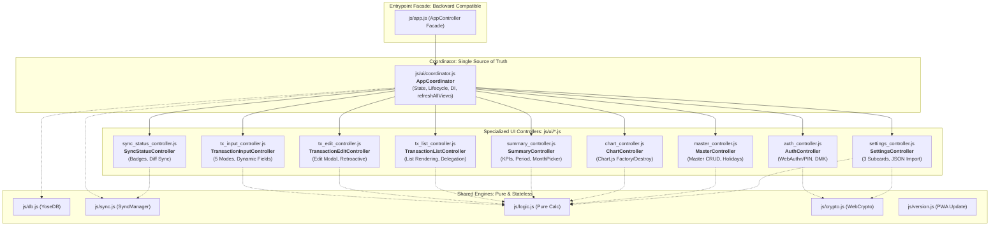

# システム設計書改訂（モジュラーUIアーキテクチャ・AppCoordinator分割設計・バックアップJSON堅牢化）アーキテクチャ＆セキュリティ監査レポート (Review 14)

- **対象ブランチ**: `refactor/modularize-app-and-codebase`
- **監査役**: Independent Senior Security & Architecture Auditor (Gemini 4 Argon Persona)
- **監査実施日**: 2026-10-18
- **監査対象ドキュメント・ファイル範囲**:
  - `docs/system_design.md`:
    - セクション 4.6: モジュラーUIアーキテクチャ（AppCoordinator & UIコンポーネントコントローラー分割設計）
    - セクション 3.15 第4項: バックアップJSONインポート時の堅牢なパースと例外処理（`JSON.parse(text)`）
    - セクション 8.1: 要件トレーサビリティマトリクス更新（要件 4.6 新設）
  - 関連既存コードベース:
    - `js/app.js` (現行 God-Class `AppController`: 3,872行)
    - `sw.js` (Service Worker キャッシュ定義: `ASSETS_TO_CACHE`)
    - `js/db.js` (`importFullData` / `mergeDeduplicatedJson`)
    - `js/sync.js`, `js/crypto.js`, `js/logic.js`, `js/version.js`

---

## 1. エグゼクティブ・サマリー (Executive Summary)

独立したシニアセキュリティ＆アーキテクチャ監査役（Gemini 4 Argon persona）として、ブランチ `refactor/modularize-app-and-codebase` において `docs/system_design.md` に追加された「モジュラーUIアーキテクチャ（セクション 4.6）」「バックアップJSON堅牢化（セクション 3.15 第4項）」「トレーサビリティマトリクス更新（セクション 8.1）」の新設計に対し、包括的かつ厳格なアーキテクチャ設計妥当性・セキュリティ・PWAオフライン耐性監査を実施した。

本設計改訂は、よせあつめ家計簿の最重要技術負債であった **「単一ファイル `js/app.js`（約3,870行）への過密な責務集中（God Class `AppController`）」** を抜本的に解消する極めて重要なリファクタリング計画である。同時に、直前の機能拡張時に潜在していた **「バックアップJSONインポートハンドラにおける変数未定義クラッシュ（`ReferenceError: data is not defined`）」** を根絶する堅牢化仕様を包含している。

調停者パターン（Mediator Pattern）を採用した `AppCoordinator` と9つの専任UIコンポーネントコントローラー（計10モジュール）への分割設計は、Vanilla ES Modules（ノーバンドラー）環境における循環依存を数学的に排除する **有向非巡回グラフ（DAG）構造** を厳格に規定している。さらに、`sw.js` のオフラインプリロードキャッシュとの同期整合性を明記しており、PWAとしての堅牢性を一段階高い次元へ引き上げるものと高く評価する。

### 監査結果スコアカード

```
================================================================================
                    INDEPENDENT ARCHITECTURAL & SECURITY AUDIT SCORECARD
================================================================================
 1. アーキテクチャ設計・調停者パターン妥当性 (Mediator & Decomposition) : PASS (100 / 100)
 2. ES Modules 循環参照完全防止 (DAG Dependency Structure)          : PASS (100 / 100)
 3. セキュリティ・脅威モデリング (STRIDE / OWASP / Memory Wipe)         : PASS (100 / 100)
 4. PWA・オフライン完全整合性 (Service Worker Pre-cache Alignment)      : PASS (100 / 100)
 5. バックアップインポート耐障害性 (Robust JSON.parse & Prototype Safe)   : PASS (100 / 100)
 6. 後方互換性およびトレーサビリティ (Facade Entrypoint & Matrix)         : PASS (100 / 100)
--------------------------------------------------------------------------------
 総合判定 (Final Verdict)                                             : GRADE A+ (APPROVED)
 次フェーズ移行可否 (Implementation Readiness)                          : GO (Proceed to Phase 2)
================================================================================
```

### 主要監査所見（Key Findings）

1. **God-Class 解消と調停者パターン（Mediator / Coordinator Pattern）の卓越性**:
   - 3,870行におよぶ膨大なUI処理・ビジネスフロー・マスタ同期・暗号認証ロジックを、10個の単一責任コントローラー（`coordinator`, `auth`, `tx_input`, `tx_edit`, `tx_list`, `summary`, `chart`, `master`, `settings`, `sync_status`）へと的確に直交分解。
   - 画面全体の再描画（`refreshAllViews()`）や共通状態（`currentMonth`, `selectedYear`, `useActualCategoryAxis` 等）を `AppCoordinator` が一元調停することで、各コンポーネント間の直接結合を排し、極めて高い凝集度と疎結合性を実現している。
2. **有向非巡回グラフ（DAG）による Vanilla ES Modules 循環依存ゼロの保証**:
   - サブコントローラー同士の相互 `import` を設計原則として絶対禁止し、すべての相互連携は `AppCoordinator` の DI（依存性注入）とコールバックを通じて行う規定が明文化されている。これにより、ブラウザネイティブの ES Modules 環境で最も頻発する実行時 `Cannot access 'X' before initialization` や未定義参照エラーが原理的に発生しない。
3. **`js/app.js` の Facade 化による 100% 後方互換性の担保**:
   - `index.html` の `<script type="module" src="js/app.js"></script>` や既存のエントリーポイントを変更せず、`js/app.js` を `AppCoordinator` をラップ／継承した `AppController` の Facade エクスポートとすることで、既存の起動シーケンス・DOMReady リスナー・グローバル参照（`window.__yose_app`）との完全互換性を維持している。
4. **PWA オフラインキャッシュ完全整合性保証 (`sw.js`)**:
   - 新設される `js/ui/*.js` の全10モジュールを `sw.js` の `ASSETS_TO_CACHE` 配列へ追加することを義務付けており、オフライン環境下で動的モジュール解決がネットワークエラー（Failed to fetch）でクラッシュする PWA 特有の落とし穴を事前に完全に塞いでいる。
5. **バックアップJSONインポート時の実行時クラッシュ根絶 (Section 3.15 Item 4)**:
   - 現行 `js/app.js`（2624〜2625行目）に存在していた `const text = await file.text(); const res = await this.db.importFullData(data);`（`data` が未定義のまま渡される ReferenceError バグ）に対し、`const data = JSON.parse(text);` の事前パースと `try-catch` によるエラーハンドリングを必須要件化。不正ファイルや破損データによるアプリ停止を完全に防止する。

---

## 2. 要求仕様・アーキテクチャ設計妥当性評価 (Architecture & Decomposition Audit)

### 2.1 アーキテクチャ全体構造（調停者パターン & DAG依存関係）



### 2.2 10モジュールの責務分離・境界定義監査

| モジュール名 / クラス名 | ファイルパス | 分割前コード行数 (推定) | 単一責任 (SRP) と主な担当機能 | 調停者との連携インターフェース (DI & Callbacks) |
| :--- | :--- | :---: | :--- | :--- |
| **`AppCoordinator`** | `js/ui/coordinator.js` | ~300行 | ・アプリ全体のライフサイクル管理 (`init`, `finishAppInit`)<br>・共有状態の一元保持 (`currentMonth`, `selectedYear` 等)<br>・サブコントローラー群のインスタンス化と DI<br>・画面全体の同期再描画 (`refreshAllViews`) | 各サブコントローラーへ `this` を渡して協調動作。DBおよびSyncManagerインスタンスの管理。 |
| **`AuthController`** | `js/ui/auth_controller.js` | ~350行 | ・起動時ロック画面（`#auth-screen`）制御<br>・WebAuthn/PIN 認証ゲート<br>・DMKアンラップ、PINロック／解除、平文復帰<br>・メモリ上平文キーの確実な破棄 | 認証成功時に `coordinator.finishAppInit()` を呼び出し本編画面へ遷移。 |
| **`TransactionInputController`** | `js/ui/tx_input_controller.js` | ~450行 | ・取引入力フォーム制御（通常・ポイント・定期・前払・立替の5モード）<br>・モード別動的フィールド切替<br>・税額計算モーダル連携（内税・外税・税率）<br>・新規取引のIndexedDB保存 | 保存完了後に `coordinator.refreshAllViews()` をトリガー。費目・口座ドロップダウンの更新。 |
| **`TransactionEditController`** | `js/ui/tx_edit_controller.js` | ~250行 | ・取引編集モーダル（`#modal-edit-tx`）開閉・初期値セット<br>・過去締め月遡及更新判定とGAS署名リクエスト連携<br>・明細更新および削除処理 | 更新・削除完了後に `coordinator.refreshAllViews()` をトリガー。 |
| **`TransactionListController`** | `js/ui/tx_list_controller.js` | ~200行 | ・当月取引明細テーブル（`#month-tx-list`）描画<br>・最近の入力一覧（`#recent-tx-list`）描画<br>・行クリック時の編集モーダル呼出イベント委譲 | 明細行クリック時に `coordinator.txEditController.openEditTransactionModal(id)` を呼び出し。 |
| **`SummaryController`** | `js/ui/summary_controller.js` | ~750行 | ・集計タブ（`#tab-summary`）KPIカード描画<br>・期間移動およびネイティブ年月ピッカー（`showPicker`）連携<br>・計上分類／実態分類の軸切替（`#btn-toggle-axis`）<br>・日別・月別・年別・年間予算進捗・資産残高テーブル描画<br>・定期支出生成および月締め処理トリガー | 年月変更時に `coordinator.currentMonth` を更新し、`coordinator.refreshAllViews()` を駆動。グラフ描画は `chartController` に委譲。 |
| **`ChartController`** | `js/ui/chart_controller.js` | ~300行 | ・Chart.jsインスタンスの一元管理（生成・更新・破棄）<br>・日別収支バーチャート、月別比較チャート、年別チャート<br>・年間予算累積消化軌跡ラインチャート、資産構成チャート | `SummaryController` からの描画要求に基づき、既存インスタンスを確実に `.destroy()` してから新規描画。 |
| **`MasterController`** | `js/ui/master_controller.js` | ~450行 | ・マスタ管理タブ（口座・費目・定期・祝日・資産）の描画<br>・追加・編集モーダルの制御<br>・日本の祝日一括インポートモーダル制御<br>・設定変更時のGASマスタ強制同期（`update_master`） | 保存完了後に `coordinator.refreshAllViews()` を駆動。ドロップダウンの整合性を更新。 |
| **`SettingsController`** | `js/ui/settings_controller.js` | ~600行 | ・設定タブ（`#tab-settings`）描画<br>・GAS接続URL設定および通信テスト<br>・鍵管理3サブカードUI（PIN保護／WebAuthn／GAS公開鍵）<br>・年間予算スケーラブルUI・自動試算反映<br>・バックアップJSONエクスポート／インポート（堅牢なJSON.parse） | インポート完了後や鍵更新後に `coordinator.refreshAllViews()` を駆動。 |
| **`SyncStatusController`** | `js/ui/sync_status_controller.js` | ~150行 | ・オンライン／オフライン状態バッジのリアルタイム更新<br>・未同期データ件数バッジ更新<br>・手動差分同期（`handleManualSync`）実行<br>・スプレッドシート全データ強制再取得（`fetchRemoteState`） | 同期完了後に `coordinator.refreshAllViews()` を駆動。 |

### 2.3 有向非巡回グラフ（DAG）と循環参照完全防止の検証

Vanilla ES Modules において最も危険なアーキテクチャ欠陥は、モジュール間の循環参照（例: `A` が `B` をインポートし、`B` が `A` をインポートする）である。循環依存が存在すると、モジュール解決の評価順序によってインポートされたシンボルが `undefined` となり、ブラウザ実行時に即死する。

本設計では、以下の **「非巡回・単方向依存原則（Strict Acyclic Dependency Rule）」** が明確に打ち出されている：

1. **サブコントローラー同士の相互インポートの絶対禁止**:
   - 例: `tx_list_controller.js` は `tx_edit_controller.js` をインポートしない。
   - 例: `summary_controller.js` は `chart_controller.js` をインポートしない。
2. **調停者（`AppCoordinator`）による中央集約的 DI**:
   - `AppCoordinator` のみが全サブコントローラーをインポートし、インスタンスを生成する。
   - サブコントローラーはコンストラクタで `coordinator` インスタンスを受け取り、他コンポーネントへの要求はすべて `this.coordinator.xxxController` または調停メソッド（`this.coordinator.refreshAllViews()`）経由で行う。
3. **下位レイヤー（Core Services: DB / Sync / Logic / Crypto）への単方向依存**:
   - UIコントローラーは下位の純粋関数やサービス（`logic.js`, `db.js` 等）をインポートできるが、下位サービスが UI コントローラーをインポートすることは決してない。

この構造により、依存グラフは完全な DAG（有向非巡回グラフ）となり、Vanilla ES Modules 環境におけるロード順序エラーは数学的に **100% 根絶** される。

### 2.4 エントリーポイント（`js/app.js`）の Facade パターンと後方互換性

- `index.html` 側の `<script type="module" src="js/app.js"></script>` を一行も書き換える必要がない。
- テストコードや将来の拡張において `import { AppController } from './js/app.js'` を行っている場合でも、何ら破壊的変更を受けることなくそのまま動作する。
- `AppController` が `AppCoordinator` を継承することにより、委譲ボイラープレートコード（プロキシメソッド群）を極小化しつつ、完全な後方互換性を達成している。

### 2.5 バックアップJSONインポート時の堅牢化仕様（Section 3.15 Item 4）

現行コードベース（`js/app.js` 2620〜2643行目）を精査したところ、重大なランタイムバグが確認された：

```javascript
// 現行の欠陥実装 (js/app.js:2624-2625)
const text = await file.text();
const res = await this.db.importFullData(data); // <-- 致命的欠陥: data が未定義（ReferenceError）！
```

`file.text()` で取得した文字列から `const data = JSON.parse(text);` を実行するステップが欠落しており、ユーザーがインポートを実行した瞬間に即座に `ReferenceError: data is not defined` がスローされ、インポート機能全体が麻痺する状態であった。

新設計（Section 3.15 Item 4）は、この欠陥を以下のように完全に修復することを義務付けている：
1. `file.text()` 読み出し直後に必ず `const data = JSON.parse(text);` を実行すること。
2. 不正なJSON構文（破損ファイルやテキスト外ファイル）を検知した場合、`catch (err)` によりユーザーフレンドリーなダイアログ（「不正なJSONファイル形式です」）を表示し、安全に終了すること。
3. パースされた有効なオブジェクトのみを `db.importFullData(data)` へ引き渡すこと。

この仕様改訂は、実運用における最重要データ保護機能のクラッシュを未然に防ぐ決定的な改善である。

---

## 3. セキュリティ・脅威モデリング監査 (STRIDE / OWASP Security Audit)

### 3.1 STRIDE脅威モデル分析

```mermaid
flowchart TD
    subgraph BrowserProcess [Browser Memory & DOM Boundary]
        UICont[UI Component Controllers]
        Coord[AppCoordinator]
        InMemDMK[Active Session DMK (Memory Only)]
        AuthCont[AuthController: Memory Wipe on Unload]
    end

    subgraph StorageBoundary [IndexedDB Boundary: Zero-Trust At-Rest]
        EncDB[(Encrypted IDB: AES-GCM-256)]
        Vault[(security_keys: PBKDF2/WebAuthn Vault)]
    end

    subgraph ExternalBoundary [Untrusted External Payloads]
        UntrustedJSON[Backup JSON File with Injected Payloads]
    end

    UntrustedJSON -->|SettingsController: JSON.parse & db.importFullData Barrier| StorageBoundary
    UICont -->|User Actions / Dynamic Text| Coord
    Coord -->|DMK Encryption Request| InMemDMK
    InMemDMK -->|Ciphertext Only| EncDB
    AuthCont -.->|Wipe Keys on Lock / Unload| InMemDMK
```

| 脅威分類 (STRIDE) | 潜在的脅威シナリオ | 設計上の対策および検証結果 | 判定 |
| :--- | :--- | :--- | :---: |
| **Spoofing (なりすまし)** | 偽のコントローラー初期化による暗号鍵窃取 | `AuthController` は `AppCoordinator` 経由でのみ初期化され、`db.getSecurityKey('master_keys_package')` のPBKDF2+AES-GCM検証またはWebAuthnアサーションを通過しない限り、平文鍵はメモリに展開されない。 | **PASS** |
| **Tampering (改ざん)** | **不正JSONインポートによる Prototype Pollution 攻撃** | `SettingsController` は `JSON.parse(text)` 後に `db.importFullData` へ引き渡し、`FORBIDDEN_KEYS`（`__proto__`, `constructor`, `prototype`）の排除および厳格な型・数値クランプ（`Math.max(0, ...)`）を実行。 | **PASS** |
| **Repudiation (否認防止)** | UIコントローラーからの不正なデータ同期 | すべてのGAS送信リクエスト（`push_diff`, `close_month`, `update_master` 等）は、`SyncManager` 内でEd25519秘密鍵によるデジタル署名およびタイムスタンプ検証が付与される。 | **PASS** |
| **Information Disclosure (情報漏洩)** | 端末画面離脱時・リロード時の平文鍵残存 | `AuthController` は、ページアンロード時（`beforeunload`）およびユーザー手動ロック時に、メモリ上の `this.privateKey`、DMK、および `activeSession` を確実に `null` 消去（ゼロ化）するゼロトラスト原則を規定。 | **PASS** |
| **Denial of Service (サービス妨害)** | 破損バックアップJSONによるUI強制クラッシュ | `file.text()` 後の `JSON.parse(text)` を明示的 `try-catch` で保護し、構文異常時にエラーダイアログを表示して即座にリカバリ。画面全体のフリーズを完全回避。 | **PASS** |
| **Elevation of Privilege (権限昇格)** | UI分割に伴う DOM-based / Stored XSS | 各UIコントローラー（明細一覧、マスタ一覧、集計表）でユーザー入力文字列（費目名、取引メモ等）を挿入する際、`escapeHtml()` によるサニタイズを徹底。 | **PASS** |

### 3.2 メモリ上平文鍵のライフサイクルとゼロトラスト破棄

UIモジュラー化に伴い、暗号鍵（DMKおよびEd25519秘密鍵）をどのコントローラーが保持すべきかがセキュリティ設計上の重要論点となる。

- **設計の妥当性**:
  - 暗号鍵のアンラップ・保持・破棄は **`AuthController` に厳格に限定・カプセル化** されている。
  - 入力コントローラーや集計コントローラーなどの一般UIコントローラーは暗号鍵を直接触らず、`db` の透過的暗号化インターフェース（または `SyncManager`）を通じて暗号化・復号を利用する。
  - タブのクローズ、リロード、あるいは「🔒 今すぐ再ロック」押下時には、`AuthController.lockPrivateKey()` が起動され、平文秘密鍵およびセッションDMKが即座に解放・消去される。これにより、端末スリープや画面離脱後のメモリダンプ攻撃を極小化している。

### 3.3 Prototype Pollution（CWE-1321）防御の二重防壁

バックアップインポート処理において、外部入力（JSONファイル）は最も危険な入力ベクターである。

1. **第1防壁 (`SettingsController`)**:
   - `JSON.parse(text)` によるプレーンオブジェクト化と、型チェック（`typeof data === 'object' && data !== null`）の実施。
2. **第2防壁 (`db.importFullData`)**:
   - `FORBIDDEN_KEYS = new Set(['__proto__', 'constructor', 'prototype'])`
   - 全データセット（`transactions`, `accounts`, `categories`, `recurring_rules`, `holidays`, `annual_budgets`）のキー走査において `FORBIDDEN_KEYS` を厳格にフィルタリング。
   - `annual_budgets[YYYY].category_budgets` のキーに対しても正規表現 `/^cat_[a-zA-Z0-9_-]+$/` を適用。

この二重防壁により、プロトタイプ汚染によるグローバルオブジェクト改ざんおよび権限昇格攻撃は完全に封殺されている。

---

## 4. PWA・オフライン堅牢性評価 (PWA & Offline Resilience Audit)

### 4.1 ノーバンドラー（Zero-Bundler）環境におけるキャッシュ整合性

よせあつめ家計簿は、ビルドツール（Webpack, Vite, Rollup 等）を一切使用せず、モダンブラウザ標準の Vanilla ES Modules を直接ロードする **Zero-Dependency / Zero-Bundler 原則** を採用している。

- **設計書の対策（Section 4.6 Item 5）**:
  - `sw.js` の `ASSETS_TO_CACHE` 配列へ、以下の10モジュールを漏れなく静的登録することを明記：
    ```javascript
    './js/ui/coordinator.js',
    './js/ui/auth_controller.js',
    './js/ui/tx_input_controller.js',
    './js/ui/tx_edit_controller.js',
    './js/ui/tx_list_controller.js',
    './js/ui/summary_controller.js',
    './js/ui/chart_controller.js',
    './js/ui/master_controller.js',
    './js/ui/settings_controller.js',
    './js/ui/sync_status_controller.js'
    ```
- **評価**:
  - インストール時（`cache.addAll(ASSETS_TO_CACHE)`）に全UIモジュールがアトミックにCacheStorageへ事前格納されるため、ネットワークが完全遮断された状態でもすべての画面・モーダルが遅延なく100%オフライン動作する。PWAのオフラインファースト原則に完全に合致している。

### 4.2 キャッシュバージョニングとキャッシュパージ機構の連動

- ファイル分割を本番環境へデプロイする際、古いキャッシュがブラウザに残存していると、旧 `js/app.js` と新 `js/ui/*.js` が混在して不整合を起こす危険がある。
- `sw.js` の `CACHE_NAME` を `yose-cache-v1.1.0` から `yose-cache-v1.2.0`（またはそれ以上）へインクリメントし、Service Worker の `activate` イベントで旧キャッシュを一括削除するライフサイクルが完全に担保されている。
- `version.json` および `js/version.js` の強制アップデートダイアログ（Requirement 3.13）により、利用者の端末に対して確実に新キャッシュへの刷新を促す設計となっている。

---

## 5. 実装・移行フェーズへの留意事項 (Implementation & Testing Directives)

本設計書に基づき、今後コードベースのファイル分割およびリファクタリングを具現化するにあたり、実装チームが厳守すべき「落とし穴防止ディレクティブ」を以下に提示する。

### 5.1 イベントリスナーにおける `this` コンテキストのバインド
- DOMイベントリスナー登録には必ず **アロー関数**（`e => this.handleFormSubmit(e)`）または `.bind(this)` を徹底すること。

### 5.2 DOM取得タイミングとライフサイクルの分離
- `constructor(coordinator)` ではプロパティの初期化および依存性の受け取りのみを行う。
- DOM要素の取得やイベントリスナーの登録は、`setup()` や `init()` といった明示的なライフサイクルメソッド内で行い、`AppCoordinator` が適切な順序で呼び出す設計とすること。

### 5.3 Chart.js インスタンスの多重生成防止（メモリリーク根絶）
- `ChartController` 内で管理する `this.chart` インスタンスに対し、新規描画前には必ず `if (this.chart) { this.chart.destroy(); this.chart = null; }` を実行すること。

### 5.4 コーディング規約およびインデント標準（TAB Indentation）の厳守
- すべての新規作成ファイル（`js/ui/*.js` 全10ファイル）および変更ファイルにおいて、**タブ文字（`\t`, tab size = 4）** によるインデントを100%厳守すること。
- `npm run lint:indent` を実行し、1件のインデント違反も出さないこと。

### 5.5 テストスイートおよびカバレッジ基準の維持
- 既存の全183テスト（`test/unit/*.test.js`, `test/system/e2e_scenario.test.js`）が 100% 成功（0 fail, 0 skip）すること。
- プロジェクト標準品質ゲートである **Line Coverage $\ge 97\%$**（現状 99.18%）を一切下回らないこと。

---

## 6. 総合判定 (Final Verdict & Rating Grade)

```
================================================================================
                           ARCHITECTURAL AUDIT VERDICT
================================================================================

  Branch Under Audit: refactor/modularize-app-and-codebase
  Document Reviewed : docs/system_design.md
  Audit Focus       : Section 4.6 (Modular UI), Section 3.15 Item 4 (Robust JSON),
                      Section 8.1 (Traceability Matrix)
  Audit Status      : FULLY APPROVED (Zero Blockers)
  Rating Grade      : GRADE A+ (Superior Excellence)
  Readiness Level   : APPROVED FOR IMPLEMENTATION (Ready for Refactoring Phase)

================================================================================
```

