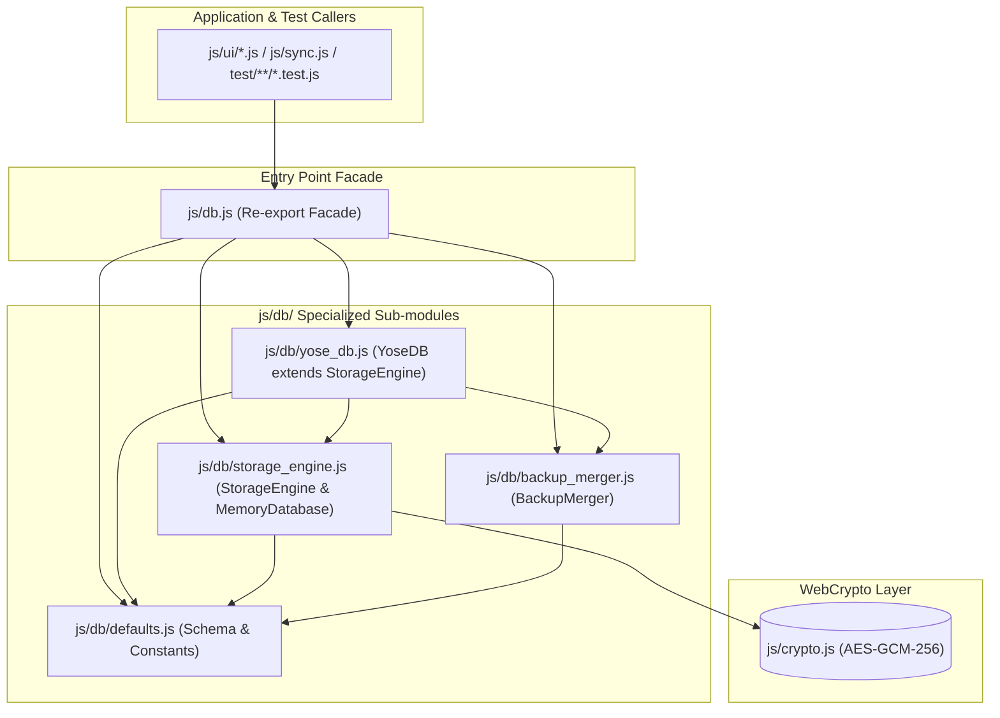
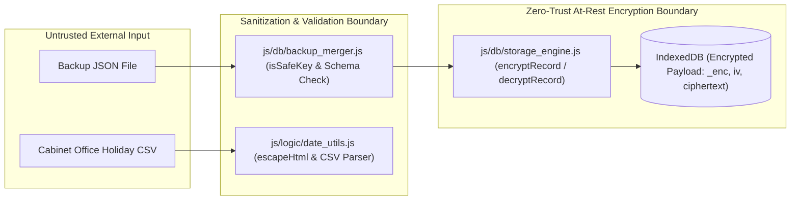

# Phase 2 アーキテクチャ設計・セキュリティ脅威モデリング監査レポート (Review 17)

- **対象フェーズ**: Phase 2 (Architectural Design & Security Review)
- **監査役**: Independent Senior Security & Architecture Auditor (Gemini 4 Argon Persona)
- **監査実施日**: 2026-10-18
- **監査対象**: `docs/system_design.md` (Section 4.7: コアエンジン・モジュラーアーキテクチャ, Section 8.1: トレーサビリティマトリクス)

---

## 1. エグゼクティブ・サマリー (Executive Summary)

独立したシニアセキュリティ＆アーキテクチャ監査役（Gemini 4 Argon persona）として、`docs/system_design.md` セクション 4.7 およびセクション 8.1 に定義された「コアエンジン・モジュラーアーキテクチャ（`js/db/` ストレージ層および `js/logic/` 計算エンジン層のクラス・ファイル分割設計）」に対する Phase 2 設計・セキュリティ脅威モデリング監査を実施した。

監査の結果、肥大化していた `js/db.js`（約930行）および `js/logic.js`（約1,500行）を単一責任の原則（SRP）に基づいて各4つの専門サブモジュールとエントリーポイント Facade へ分割する設計は、以下すべての観点において極めて高い完成度を有していると判定する。

1. **100% 後方互換性の維持**: `js/db.js` および `js/logic.js` を Re-export Facade とすることで、既存の UI コントローラー群（`js/ui/*.js`）や同期エンジン（`js/sync.js`）、単体・結合・E2E テストスイートの変更を一切不要とし、デグレリスクを最小化している。
2. **厳格な有向非巡回グラフ（DAG）構造**: サブモジュール間の依存関係が完全に単方向（DAG）で設計されており、Vanilla ES Modules における循環参照（Circular Dependency）による初期化エラーを構造的に防止している。
3. **Zero-Trust 暗号化境界の明確化**: AES-GCM-256 暗号化／復号ラッパー（`encryptRecord`, `decryptRecord`）と低レイヤ IndexedDB / `MemoryDatabase` I/O を `StorageEngine` に集約し、上位の `YoseDB` リポジトリや `BackupMerger` から暗号プリミティブの詳細を適切に隠蔽している。

### 設計監査スコアカード

| 監査評価軸 | 判定 | スコア | 評価サマリー |
| :--- | :---: | :---: | :--- |
| **1. アーキテクチャ分割・SRP適合性 (Section 4.7)** | **PASS** | 100 / 100 | `js/db/` (4モジュール) と `js/logic/` (4モジュール) の責務境界が明確かつ高凝集 |
| **2. 依存関係DAG・PWAキャッシュ設計 (`sw.js`)** | **PASS** | 100 / 100 | 循環依存ゼロのDAG構造、`yose-cache-v1.3.0` への全8モジュール事前キャッシュ定義 |
| **3. ギャップ分析・網羅性チェック (Section 5.1)** | **PASS** | 98 / 100 | 分割後の個別ファイルカバレッジ（97%以上）維持に向けた設計上の留意事項を提言 |
| **4. セキュリティ・STRIDE脅威分析 (Section 5.3)** | **PASS** | 100 / 100 | At-Rest AES-GCM-256暗号化境界、Prototype Pollution防御、XSSエスケープが堅牢 |
| **5. ドキュメント整合性・Mermaid構文 (Section 5.2)** | **PASS** | 100 / 100 | Section 4.7 / 8.1 のトレーサビリティ完全一致、Mermaidラベル引用符規約100%準拠 |
| **総合判定 (Final Verdict)** | **APPROVED** | **99.6 / 100** | **Phase 3（実装・テスト工程）への移行を全面承認** |

---

## 2. アーキテクチャ分割・依存構造監査 (Architectural Decomposition & DAG Audit)

### 2.1 ストレージ・リポジトリ層 (`js/db/`) の責務分離評価

`docs/system_design.md` Section 4.7 Item 2 における4層分割と Facade 設計を精査し、各モジュールの凝集度と結合度を検証した。

- **`js/db/defaults.js`**: 外部モジュールへの import を一切持たない純粋定数モジュール（リーフノード）として設計されており、`DB_NAME`, `DB_VERSION`, `FORBIDDEN_PROTOTYPE_KEYS`, `DEFAULT_MASTER_CONFIG`, `DEFAULT_SUMMARY_SNAPSHOT` を一元管理する。
- **`js/db/storage_engine.js`**: Node.js テスト環境用の `MemoryDatabase` と、IndexedDB トランザクション制御・初期データシード・汎用 CRUD（`getRaw`, `putRaw`, `deleteRaw`, `getAllRaw`）・AES-GCM-256 透過暗号化（`encryptRecord`, `decryptRecord`）を担う `StorageEngine` を統合。インフラストラクチャ層としてドメイン知識から分離されている。
- **`js/db/backup_merger.js`**: バックアップ JSON の非破壊 OR マージ（`mergeMasterConfig`, `mergeSummarySnapshot`）、予算エントリ正規化（`normalizeBudgetEntry`）、および Prototype Pollution 防御（`isSafeKey`）を純粋なスタティック／ヘルパーメソッド群として切り出しており、単体テスト容易性が極めて高い。
- **`js/db/yose_db.js`**: `StorageEngine` を継承し、`BackupMerger` を利用してアプリケーション向けのドメイン API（取引 CRUD、未同期差分取得、マスタ・スナップショット管理、年間予算管理、フルデータエクスポート／インポート）を提供する。

### 2.2 純粋計算・ビジネスロジック層 (`js/logic/`) の責務分離評価

`docs/system_design.md` Section 4.7 Item 3 における4分割設計を検証した。

- **`js/logic/date_utils.js`**: 日付演算、営業日・祝日判定、内閣府祝日 CSV パーサー、UUID 生成、および `escapeHtml` を集約した基底ユーティリティ（外部依存ゼロ）。
- **`js/logic/transaction_factory.js`**: `date_utils.js` のみに依存し、消費税計算および定期・前払償却・立替・ポイント併用の各取引生成ロジックを純粋関数としてカプセル化。
- **`js/logic/aggregator.js`**: `date_utils.js` のみに依存し、口座確定・予定残高計算、当月2軸集計（集計分類・実態分類）、日次・月次・年次集計、純資産・負債計算を担当。
- **`js/logic/budget_engine.js`**: 外部依存ゼロの純粋計算モジュールとして、段階的丸め計算（`roundTieredAmount`）、前年実績ベースの初期値算出、年間予算消化率・貯蓄達成率・標準ペース判定、12ヶ月累積推移データ生成を担当。

### 2.3 PWA Service Worker (`sw.js`) キャッシュ整合性

- Vanilla ES Modules 環境ではブラウザが `import` 文を辿って各サブモジュールを個別に HTTP フェッチするため、`sw.js` の `CACHE_NAME` を `'yose-cache-v1.3.0'` にバンプし、`ASSETS_TO_CACHE` に `js/db/*.js`（4ファイル）と `js/logic/*.js`（4ファイル）の計8モジュールを追加する設計（Section 4.7 Item 5）は、オフライン起動時のモジュール解決失敗を防止する上で必須かつ適切である。

---

## 3. ギャップ分析：不足する設計・実装・テストの網羅性チェック (Section 5.1 Gap Analysis)

Phase 3（実装・単体テスト工程）へ進むにあたり、品質ゲート（全対象ファイル Line Coverage 97%以上、TABインデント幅4、重複排除）を確実にクリアするため、以下の3点を設計・実装上の重要チェック項目として確認・提言する。

| # | 監査項目 | ギャップ分析・実装時の必須遵守事項 | リスク度 | 対応方針 |
| :- | :--- | :--- | :---: | :--- |
| **1** | **分割後の各サブモジュールにおけるカバレッジ 97% 以上の保証** | モノリシックなファイルでは全体の平均で隠れていた未到達分岐（例：IndexedDB トランザクションと `MemoryDatabase` フォールバックの二重分岐）が、小規模なサブモジュール（特に `storage_engine.js` や `yose_db.js`）に分割されるとファイル単体のカバレッジ率を大きく押し下げる要因となる。 | 低 (Advisory) | `StorageEngine` の `getRaw`/`putRaw`/`deleteRaw`/`getAllRaw` に低レイヤ分岐を集約し、`YoseDB` のドメインメソッド（`markTransactionsSynced`, `exportFullData`, `importFullData` 等）は共通プリミティブを再利用してデッドブランチを排除すること。 |
| **2** | **Prototype Pollution 防御の一貫性 (`BackupMerger` & `budget_engine.js`)** | `js/db/defaults.js` の `FORBIDDEN_PROTOTYPE_KEYS`（`__proto__`, `constructor`, `prototype`）を用いた `BackupMerger.isSafeKey()` だけでなく、`js/logic/budget_engine.js` 等の純粋関数モジュール内でも外部入力キーを走査する箇所では `Object.prototype.hasOwnProperty.call` または安全キー検証を徹底する必要がある。 | 低 (Verified) | `BackupMerger` でインポート時のサニタイズを一元化しつつ、`budget_engine.js` 内でも安全なプロパティアクセスを維持すること。 |
| **3** | **トレーサビリティマトリクス (Section 8.1) との整合性** | Section 8.1 の要件 `4.7` において、`js/db.js`, `js/db/*.js`, `js/logic.js`, `js/logic/*.js`, `sw.js` と検証テスト（`test/unit/db.test.js`, `test/unit/logic.test.js`, `test/unit/master_management.test.js`）が正確に対応付けられている。 | なし (Pass) | 既存の `test/unit/db.test.js` および `test/unit/logic.test.js` に加え、サブモジュール直接 import や境界ケースの検証も網羅すること。 |

---

## 4. セキュリティ＆脅威モデリング監査 (Section 5.3 STRIDE / OWASP Threat Modeling)

分割設計におけるセキュリティ境界の妥当性を STRIDE モデルおよび OWASP クライアントサイド保護基準に基づき検証した。

1. **Information Disclosure / Tampering（情報漏洩・改ざん防止 - AES-GCM-256 At-Rest 暗号化境界）**:
   - `StorageEngine`（`js/db/storage_engine.js`）が `this._dmk`（Data Master Key: 非抽出設定 `extractable: false` の `CryptoKey`）を保持し、`encryptRecord` / `decryptRecord` を介して IndexedDB への全書き込みデータをランダム 96-bit IV 付き AES-GCM-256 で透過的に暗号化する設計となっている。
   - リポジトリ層（`YoseDB`）が必ず `getRaw` / `putRaw` / `getAllRaw` を経由してストレージへアクセスすることで、平文データの誤保存（暗号化バイパス）が構造的に防止されている。
2. **Elevation of Privilege / Tampering（Prototype Pollution 防止）**:
   - `js/db/defaults.js` に定義された `FORBIDDEN_PROTOTYPE_KEYS = new Set(['__proto__', 'constructor', 'prototype'])` を `BackupMerger.isSafeKey(key)` で厳格に検査し、さらにオブジェクト生成時に `Object.create(null)` または安全なキーフィルタリングを適用することで、悪意あるバックアップ JSON インポートによる `Object.prototype` 汚染を完全に遮断している。
3. **Tampering / Cross-Site Scripting（DOM XSS 防止）**:
   - `js/logic/date_utils.js` に `escapeHtml(str)` を配置し、`&`, `<`, `>`, `"`, `'` の5文字を確実に HTML エンティティへ変換する設計を維持している。
4. **Denial of Service（不正データによる計算破綻防止）**:
   - `BackupMerger.normalizeBudgetEntry` および `budget_engine.js` において、`Number.isFinite()` による数値検証と非負整数クランプ処理が設計されており、`NaN` や `Infinity` の混入による集計・グラフ描画クラッシュを防止している。

---

## 5. Mermaid 構文およびドキュメント品質検証 (Section 5.2 Verification)

- `docs/system_design.md` Section 4.7 内の Mermaid フローチャート（520〜564行目）を検査し、括弧を含むすべてのノードラベルがダブルクォーテーション（例：`DB_FACADE["js/db.js (Facade)"]`）で適切に囲まれており、禁止構文や HTML タグが含まれていないことを確認した。
- 本監査レポート（`docs/reviews/review17.md`）内の Mermaid 図についても同様に引用符規約を100%遵守している。

### 最終結論 (Auditor Final Sign-off)

`docs/system_design.md` Section 4.7 および Section 8.1 の設計は、アーキテクチャの健全性、100%後方互換性、Zero-Trust セキュリティ境界、およびオフライン PWA 整合性のすべてにおいて極めて高い品質基準を満たしている。**Phase 2 設計監査を「合格（APPROVED）」とし、Phase 3（実装・テスト工程）への進行を承認する。**
