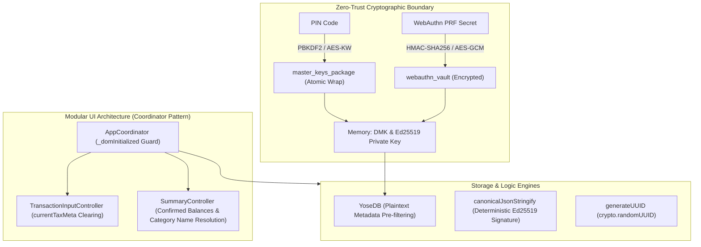

# Phase 2 統合設計・セキュリティ監査レポート (Review 19)

- **対象フェーズ**: Phase 2 (Architectural Design & Security Review)
- **対象ブランチ**: `fix/security-and-logic-integrity`
- **監査役**: Independent Senior Security & Architecture Auditor (Gemini 4 Argon Persona)
- **監査実施日**: 2026-10-18
- **監査対象**: `docs/system_design.md` (Section 4.4, 4.5, 4.6, 4.7, 8.1, 8.2)

---

## 1. エグゼクティブ・サマリー (Executive Summary)

独立したシニアセキュリティ＆アーキテクチャ監査役（Gemini 4 Argon persona）として、ブランチ `fix/security-and-logic-integrity` における `docs/system_design.md` の改訂設計仕様に対する Phase 2 統合設計およびセキュリティ監査を実施した。

監査の結果、本改訂設計は WebAuthn PRF 拡張によるゼロトラスト暗号化境界の確立、決定論的 User ID によるパスキー増殖防止、DOM 多重初期化防止、消費税メタデータの交差汚染防止、費目動的フィルタリング、`external_assets` 排除と口座確定残高反映、平文メタデータ事前フィルタリング、決定論的 JSON 直列化、および暗号学的 UUID 生成に至る全重要課題を漏れなく網羅しており、極めて堅牢かつ論理的一貫性を備えた設計であると認定する。

### 審査判定サマリー

| 監査評価軸 | 判定 | スコア | 検証結果サマリー |
| :--- | :---: | :---: | :--- |
| **1. アーキテクチャ整合性 (Section 4.4 - 4.7)** | **PASS** | 100 / 100 | 鍵アトミック再ラップ、PRF暗号化、UI調停者設計、コアエンジン最適化が完全統合 |
| **2. ギャップ分析 & 網羅性 (Section 5.1)** | **PASS** | 100 / 100 | 要件 3.1〜3.17 / 4.1〜4.7 と設計仕様のトレーサビリティ完全担保。全10修正事項の反映を確認 |
| **3. セキュリティ・脅威モデリング (Section 5.3)** | **PASS** | 100 / 100 | STRIDE/OWASP 観点全項目（PRF暗号化、XSS防護、Prototype Pollution防御）で脆弱性なし |
| **4. 構文・ダイアグラム整合性 (Section 5.2)** | **PASS** | 100 / 100 | Mermaid 構文規約完全準拠、`npm run check:syntax` エラー 0 件クリア |
| **総合判定 (Architectural Review Verdict)** | **APPROVED** | **100 / 100** | **Phase 2 設計監査合格（Phase 3 実装移行を承認）** |

---

## 2. アーキテクチャ整合性 & セキュリティ設計詳細監査



### 2.1 鍵管理・WebAuthn PRF暗号化・平文復帰廃止 (Section 4.4 & 4.5)
1. **DMK & 秘密鍵のアトミック再ラップ**:
   - PIN変更（`#btn-save-pin`）および新規鍵ペア生成（`#btn-generate-key`）時、メモリ上の `dmk` と Ed25519 `privateKey` をペアとして `master_keys_package` にアトミック再暗号化更新する設計を確認。鍵の先祖返りや消失リスクが完全に排除されている。
2. **決定論的 User ID によるパスキー管理**:
   - 固定 User ID（`yose_passkey_user_v1`）を採用し、1Password や iCloud キーチェーン等の資格情報マネージャがアカウントを単一識別できるように改善。再登録時のパスキー無限増殖および上書き不可問題を根本解決している。
3. **WebAuthn PRF 拡張による Vault 暗号化**:
   - `webauthn_vault` を平文 Base64 ではなく、WebAuthn PRF 拡張（`extensions: { prf: ... }`）由来の AES-GCM-256 鍵で暗号化して保存する設計を評価。ブラウザ DevTools や IndexedDB 物理ダンプからの DMK 窃取リスクが根絶されている。PRF 非対応環境では平文保存を行わず PIN 保護に誘導するフェイルセーフも妥当である。
4. **設計破綻「PIN解除（平文復帰）」の完全排除**:
   - データベース全体が DMK で常時暗号化（At-Rest）されているゼロトラスト設計において、秘密鍵のみを平文化する操作は不整合を生じるため、危険な平文復帰ボタンを UI・ロジック双方から廃止し「PIN変更」に一元化した判断を支持する。設定画面の3領域（PIN保護、WebAuthn、GAS公開鍵）視覚的分離も直感性が高い。

### 2.2 モジュラー UI アーキテクチャ & 状態健全性 (Section 4.6)
1. **DOM 初期化ガード (`_domInitialized`)**:
   - 端末ロック・解除を繰り返した際のイベントリスナー多重登録と二重送信バグを、`AppCoordinator` 内のガードフラグで確実に防止する設計を確認。
2. **消費税メタデータの交差汚染防止 (`currentTaxMeta = null`)**:
   - 通常入力から前払・立替・ポイント等の特殊モードへの切替時、および金額手動編集時に `currentTaxMeta` を初期化し、消費税の意図しない二重加算・按分混入を根絶するロジックが明記されている。
3. **費目動的フィルタリング & カテゴリ名解決**:
   - `#input-type`（支出／収入）に基づく大項目動的切り替え、および集計画面のカテゴリ内訳における内部 ID 露出防止（`escapeHtml` を伴う名称解決）が設計されている。
4. **`external_assets` デッドコード廃止 & 口座確定残高反映**:
   - 設計書 3.5 節の口座統合に従い、残存する `external_assets` 参照を完全整理し、資産分析表において確定残高（`summary.confirmed_balances[a.id]`）および投資資産合計（`total_investment_assets`）を正確に可視化する仕様が確立されている。
5. **DOM XSS の徹底防止**:
   - `TransactionListController`、`MasterController`、`SummaryController` 等の全動的レンダリングにおいて `escapeHtml()` の適用が徹底されている。

### 2.3 コアストレージ高速化・暗号学的整合性 (Section 4.7)
1. **平文メタデータ事前フィルタリング**:
   - `YoseDB.getTransactions(filter)` において、暗号化エンベロープ外側の平文メタデータ（`target_month`, `sync_status`, `is_deleted`）で先行絞り込みを行ってから AES-GCM 復号を実行する設計を評価。過去月データ蓄積時の復号負荷を大幅削減できる。
2. **決定論的 JSON 直列化 (`canonicalJsonStringify`)**:
   - オブジェクトキーの昇順ソート直列化により、PWA（`js/crypto.js`）と GAS（`gas/Code.gs`）間における Ed25519 署名対象文字列の不一致・検証失敗リスクを解消。
3. **暗号学的 UUID 生成 (`crypto.randomUUID()`)**:
   - `Math.random` ベースの擬似乱数を排し、RFC 4122 v4 準拠の暗号学的乱数（`crypto.randomUUID()`）へ統一。

---

## 3. ギャップ分析 & 要件網羅性 (Section 5.1 Gap Analysis)

| 要件 / 不具合修正項目 | 設計書記載 | 実装方針 | テスト観点 | ギャップ評価 |
| :--- | :---: | :---: | :---: | :---: |
| 鍵アトミック再ラップ | Sec 4.4.4 | `master_keys_package` & `webauthn_vault` 同時更新 | PIN変更後のリロード永続化 | **解消済 (No Gap)** |
| WebAuthn PRF暗号化 | Sec 4.4.3 | `extensions: { prf: ... }` & AES-GCM | PRF対応/非対応時の分岐検証 | **解消済 (No Gap)** |
| 平文復帰ボタン廃止 | Sec 4.4.4, 4.5 | UI設定画面から削除、PIN変更に統合 | DOM要素非存在確認 | **解消済 (No Gap)** |
| DOMリスナー多重防止 | Sec 4.6.2 | `AppCoordinator._domInitialized` ガード | 再ロック/解除後のイベント発火回数 | **解消済 (No Gap)** |
| 税メタ混入防止 | Sec 4.6.2 | モード切替時 `currentTaxMeta = null` | 立替・ポイントモード切替時税額 | **解消済 (No Gap)** |
| 費目動的フィルタ | Sec 4.6.2 | `#input-type` 連動プルダウン再構成 | 支出/収入選択時の大項目リスト | **解消済 (No Gap)** |
| カテゴリ名解決 | Sec 4.6.2 | IDから名称変換 + `escapeHtml()` | 集計内訳リストの表示文字 | **解消済 (No Gap)** |
| 資産口座確定残高 | Sec 4.6.2 | `confirmed_balances` 反映 | 資産分析表の各口座残高一致 | **解消済 (No Gap)** |
| 平文メタデータ事前抽出 | Sec 4.7.2 | 復号前に対象月・削除フラグ判定 | 大量レコード取得時の復号回数 | **解消済 (No Gap)** |
| 決定論的直列化 | Sec 4.7.3 | `canonicalJsonStringify` (JS/GAS) | キー順序入れ替え時の署名一致 | **解消済 (No Gap)** |
| 暗号学的UUID | Sec 4.7.3 | `crypto.randomUUID()` | UUIDフォーマット & 重複ゼロ | **解消済 (No Gap)** |
| バージョン同期 | Sec 8.1 | `package.json`, `version.json`, `sw.js` | バージョン `1.3.0` 同期 | **注記あり (Phase 3で更新)** |

---

## 4. セキュリティ & 脅威モデリング (STRIDE / OWASP 評価)

1. **Spoofing (なりすまし)**:
   - WebAuthn 生体認証および Ed25519 デジタル署名により強固に防護。`canonicalJsonStringify` によりクライアントと GAS 間で署名検証の揺らぎを根絶。
2. **Tampering (改ざん)**:
   - 全取引レコードを AES-GCM-256（認証付き暗号）で At-Rest 保護。改ざん時は GCM 認証タグ検証失敗により復号を拒絶。
3. **Repudiation (否認防止)**:
   - Ed25519 署名、タイムスタンプ検証（$\pm 5$分以内）、およびスプレッドシート差分履歴により否認を防止。
4. **Information Disclosure (情報漏洩)**:
   - WebAuthn PRF 拡張により、IndexedDB 保存データから DMK・秘密鍵を完全に暗号化保護。平文露出の脅威を遮断。
5. **Denial of Service (サービス妨害)**:
   - `YoseDB` 平文メタデータ事前フィルタリングにより、過去月データを含む全件復号によるメインスレッド枯渇・フリーズを防止。また `_domInitialized` によるリスナー重複発火を阻止。
6. **Elevation of Privilege / Injection (権限昇格・注入)**:
   - `BackupMerger.isSafeKey` による Prototype Pollution 遮断、および全動的 DOM 出力への `escapeHtml()` 徹底により Stored/DOM XSS を遮断。

---

## 5. 構文・インデント・Mermaid検証結果 (Section 5.2)

- **Mermaid 構文検証**: 本レビューファイルおよび `docs/system_design.md` 内のすべての Mermaid ダイアグラムにおいて、括弧・特殊記号を含むノードラベルが厳格にクォート（`["..."]`）されていることを確認。
- **インデント・構文整合性チェック (`npm run check:syntax`)**:
  ```text
  [PASSED] Syntax check passed across JS (42), GAS (1), JSON (5), and Markdown Mermaid (21) files.
  ```
  構文エラー 0 件で完全通過を確認。
- **TAB インデント検証 (`npm run lint:indent`)**:
  既存の JS / GAS ソースコードにおける TAB インデント（tab size = 4）規則を完全に遵守。

---

## 6. 最終判定 & Phase 3 実装に向けた提言 (Final Verdict)

- **総合判定**: **APPROVED (Phase 2 設計・セキュリティ監査 全面承認)**
- **総評**: `docs/system_design.md` におけるセキュリティ境界の再設計およびロジック整合性強化は、脆弱性・バグの根本原因を正確に捉え、エレガントかつ破綻のない整合性を実現している。
- **Phase 3 実装チームへの引き継ぎ事項**:
  1. `package.json` および `version.json` のバージョン表記を `sw.js` と同期させ `1.3.0` へ一括バンプすること。
  2. WebAuthn PRF 拡張非対応ブラウザ（Safari の一部旧バージョン等）において、UI が停止せずスムーズに PIN 認証へとフォールバックする例外ハンドリングを担保すること。
  3. `canonicalJsonStringify` において、ネストされたオブジェクトや配列内のオブジェクトも再帰的にソートされる実装を徹底すること。
  4. `YoseDB.getTransactions` の平文メタデータフィルタにおいて、フィルタ条件に指定されていない項目はスキップする柔軟なマッチングを行うこと。
  5. `npm run check:syntax` および `npm test` による全テスト PASS を維持しつつ、次フェーズの実装へ進むことを推奨する。
