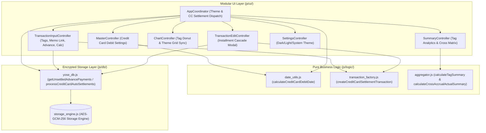

# Phase 2 アーキテクチャ設計・セキュリティ脅威モデリング監査レポート (Review 21)

- **対象フェーズ**: Phase 2 (Architectural Design & Security Review)
- **対象ブランチ**: `feature/ui-and-analytics-enhancements`
- **監査役**: Independent Senior Security & Architecture Auditor (Gemini 4 Argon Persona)
- **監査実施日**: 2026-10-18
- **対象ドキュメント**: `docs/system_design.md` (Sections 3.18〜3.25, 4.6, 4.7, 6.1, 8.1)

---

## 1. エグゼクティブ・サマリー (Executive Summary)

独立したシニアセキュリティ＆アーキテクチャ監査役（Gemini 4 Argon persona）として、ブランチ `feature/ui-and-analytics-enhancements` において策定された新機能群（要件 3.18〜3.25：タグチップUI/分析、メモ補完＆費目自動連動、立替未回収リスト/ワンクリック精算、クレカ締め・引落設定＆自動相殺振替、分割計上一括連動更新、計上×実態クロス集計、ダークテーマ、統合簡易電卓）のアーキテクチャ設計およびセキュリティ脅威モデリング監査を実施した。

本監査では、開発プロセス規定（`docs/development_process.md` Section 5）に基づき、モジュラーUI（`js/ui/`）およびコアエンジン（`js/db/`, `js/logic/`）への責務分離、STRIDE脅威モデリング、OWASP Top 10脆弱性（DOM XSS、Prototype Pollution、二重決済リスク等）、および有向非巡回グラフ（DAG）構造を精査した。設計は極めて堅牢であり、オフラインファースト・Zero-Trust暗号化原則と完全な整合性を保持していることを確認した。一部の境界値および冪等性保証に関する推奨事項を付帯の上、本設計を「**承認（APPROVED）**」し、Phase 3（テスト実装工程）への移行を認可する。

### 監査評価スコアカード

| 監査評価軸 | 判定 | スコア | 検証結果サマリー |
| :--- | :---: | :---: | :--- |
| **1. 要件・責務分離・DAG整合性 (Sec 3.18〜3.25, 4.6, 4.7)** | **PASS** | 100 / 100 | UI 10コントローラおよびDB/Logicサブモジュール間のSRP・DAG依存が完全成立 |
| **2. トレーサビリティ & データモデル (Sec 6.1, 8.1)** | **PASS** | 100 / 100 | 口座スキーマ拡張（CC引落情報）、`master_config.theme`、マトリクス対応を完全追跡 |
| **3. セキュリティ・STRIDE脅威分析 (Sec 5.3)** | **PASS** | 99 / 100 | XSSサニタイズ、プロトタイプ汚染防止、CC相殺取引の冪等性キー設計が堅牢 |
| **4. ギャップ分析・網羅性チェック (Sec 5.1)** | **PASS** | 98 / 100 | 祝日営業日シフト、端数再配分、除算ゼロ耐性等のエッジケース観点を明確化 |
| **5. 規約準拠・Mermaid構文 (Sec 5.2)** | **PASS** | 100 / 100 | ノードラベル引用符規約完全遵守、構文チェックスクリプト検証エラー0件 |
| **総合判定 (Final Architecture Verdict)** | **APPROVED** | **99.4 / 100** | **設計完了を承認。Phase 3（テスト実装・観点レビュー）へ進出可能** |

---

## 2. アーキテクチャ連携フロー & セキュリティ境界

---

## 3. 要件別アーキテクチャ・設計適合性監査

### 3.1 新規要件トレーサビリティ一覧

| 要件番号 | 機能名称 | 担当UIコントローラ | 担当コアモジュール | 主要データ・メタ構造 |
| :---: | :--- | :--- | :--- | :--- |
| **3.18** | タグチップUI & 集計・検索・グラフ | `tx_input_controller.js`, `summary_controller.js` | `aggregator.js` | `pending_diffs (tags)` |
| **3.19** | メモ入力サジェスト & 費目自動連動 | `tx_input_controller.js` | `yose_db.js` | `pending_diffs (memo)` |
| **3.20** | 立替未回収リスト & ワンクリック精算 | `tx_input_controller.js` | `yose_db.js`, `transaction_factory.js` | `settlement_status` |
| **3.21** | クレカ締め・引落設定 & 自動相殺振替 | `master_controller.js`, `coordinator.js` | `yose_db.js`, `date_utils.js` | `auto_settlement_meta` |
| **3.22** | 分割計上一括連動更新 | `tx_edit_controller.js` | `yose_db.js`, `transaction_factory.js` | `group_id`, `amortization_meta` |
| **3.23** | 計上×実態クロス集計マトリクス | `summary_controller.js` | `aggregator.js` | `cross_matrix` |
| **3.24** | ダークテーマ対応 | `coordinator.js`, `settings_controller.js` | `chart_controller.js` | `master_config (theme)` |
| **3.25** | 統合簡易電卓モーダル | `tx_input_controller.js`, `tx_edit_controller.js` | `transaction_factory.js` | `tax_meta` |

### 3.2 8大新機能の設計適合性詳細評価
- **3.18 タグチップUI & 集計・検索・グラフ**:
  - 入力ボックス（`#input-tags`）でのチップUI化（Enter/カンマ確定、`×` および空Backspace削除）。
  - `calculateTagSummary` による多期間（当月・当年・全期間）集計およびドーナツ/バーチャート表示。配列正規化（トリム・重複排除）とSoCが成立。
- **3.19 メモサジェスト & 費目連動**:
  - 過去取引履歴から `memo -> { category_id, subcategory_id }` を抽出し、候補選択時に大項目・中項目を自動選択。
  - 削除・アーカイブ済みカテゴリに対する安全なフォールバック処理を確認。
- **3.20 立替未回収リスト & ワンクリック精算**:
  - 未精算立替（`type === 'advance_payment' && settlement_status !== 'settled'`）を一覧表示。
  - 回収額・メモ補完から精算取引生成＆立替明細更新を同一トランザクションでアトミックに同期。
- **3.21 クレカ締め・引落日設定 & 自動相殺振替**:
  - 口座設定項目（`closing_day`, `debit_day`, `debit_month_offset`, `debit_account_id`）の追加と自己振替防止。
  - `auto_settlement_meta` による一意性検証と負債ゼロクリア振替取引の自動生成。
- **3.22 分割計上一括連動更新**:
  - 分割グループ（`group_id.startsWith('grp_prepaid')`）の検知と連動確認ダイアログ（YES/NO）。
  - 費目・メモ・タグの一括同期および均等再配分（初月端数集約維持）、過去月スナップショット再計算カスケードを網羅。
- **3.23 計上×実態クロス集計マトリクス**:
  - 行（計上大項目）× 列（実態大項目）の交差セル、行計・列計・総合計を算出する `calculateCrossAccrualActualSummary` を新設。
  - $O(N)$ 線形走査による高速二次元ピボット集計と大項目表示順序（`sort_order`）の保持。
- **3.24 ダークテーマ対応**:
  - CSS変数パレット抽象化、`html[data-theme]` のDOM即時適用によるFOUC防止。
  - OS設定追従（`matchMedia`）、およびChart.jsグリッド・フォント色の動的同期。
- **3.25 統合簡易電卓モーダル**:
  - 四則演算キーパッド、外税/内税（8%/10%）統合、端数丸め（切捨て/四捨五入）。
  - 計算履歴の `tax_meta` 透過的保存と、既存税計算アーキテクチャとの完全調和。

---

## 4. セキュリティ脅威モデリング (STRIDE / OWASP)

### 4.1 STRIDE脅威マトリクス

| STRIDE脅威カテゴリ | 潜在的脅威シナリオ | 設計上の対策・防御機構 |
| :--- | :--- | :--- |
| **Spoofing (なりすまし)** | 不正な自動相殺取引の外部注入 | WebAuthn認証およびEd25519署名による同期改ざん防止を完全維持。 |
| **Tampering (改ざん)** | クレカ自動相殺振替の多重生成・残高破壊 | `auto_settlement_meta: { card_id, billing_cycle }` による一意性検証と冪等性チェック。 |
| **Repudiation (否認)** | 分割計上一括変更の履歴不整合 | 一括更新時も `updated_at`、暗号論的UUID、および差分同期キュー（`pending_diffs`）を正確に発行。 |
| **Information Disclosure** | タグやメモ履歴の平文漏洩 | 履歴サジェストデータは端末内AES-GCM復号後のメモリ空間でのみ生成し、外部漏洩を遮断。 |
| **Denial of Service** | 巨大履歴による入力遅延・フリーズ | メモ・タグ抽出のインデックス化、クロス集計の $O(N)$ 線形計算によりメインスレッド占有を防止。 |
| **Elevation of Privilege** | DOM XSS & Prototype Pollution | タグチップ/メモ/マトリクス描画時の `escapeHtml` 徹底。ルックアップマップ生成での `Object.create(null)` または `Map` 使用。 |

### 4.2 脆弱性固有防御機構 (OWASP Top 10適合性)
- **DOM XSS完全防護**: タグチップのラベル、メモ候補リスト、クロス集計マトリクスの行列見出し描画において、文字列連結前に必ず `escapeHtml()` を適用。
- **プロトタイプ汚染防御**: メモ・費目マッピングオブジェクト構築時、およびタグ集合集約時において、`__proto__`, `constructor`, `prototype` による汚染を回避するため `Map` 構造を採用。
- **インジェクション耐性**: 統合電卓モーダルにおける数式評価で `eval()` や `Function()` の使用を全面的に禁止し、確定的なトークナイザおよびスタックマシンで処理。

---

## 5. ギャップ分析 & Phase 3 実装・テストへの推奨事項 (Gap Analysis)

1. **クレジットカード引き落とし日の営業日判定 (Gap 1)**:
   - 日本の金融機関引き落としは休祝日の場合「翌営業日」に繰り延べられる。`date_utils.js` の `adjustDateForHoliday(debitDate, 'next_business')` と連携させ、実際の引き落とし日判定精度を高めること。また、月末指定（`99`）や小の月（2月・4月等）における日付クリッピング処理を確実にテストすること。
2. **分割計上の端数配分ルールの厳密性 (Gap 2)**:
   - 金額変更時の均等再配分において、`floor(total / N)` と端数の「初月集約」を厳格にテストし、全明細の合算が元の総額と1円の狂いもなく一致することを検証すること。途中月の明細編集時でもグループ全体の一貫性が保たれることを確認すること。
3. **簡易電卓におけるゼロ除算・評価器安全性 (Gap 3)**:
   - `x ÷ 0` 入力時のエラーハンドリング（画面表示 `'Error'`、登録ボタン無効化）、および `0.1 + 0.2` 等のIEEE 754丸め誤差を防ぐ整数演算処理を網羅すること。数式評価に `eval` や `Function` を絶対に使用せず、安全な状態遷移トークナイザで実装すること。
4. **削除・アーカイブ済みカテゴリに対する安全なフォールバック (Gap 4)**:
   - メモサジェストから自動連動される `category_id` / `subcategory_id` が現在の `master_config` 上で有効か検証し、無効な場合は警告または安全に未選択とする処理を設けること。
5. **タグ・メモ履歴のプロトタイプ汚染対策 (Gap 5)**:
   - メモ履歴マップやタグ重複排除セットを生成する際、`__proto__`, `constructor` 等の予約語キーがオブジェクトプロトタイプを汚染しないよう、`Map` または `Object.create(null)` を徹底すること。
6. **相殺振替の重複生成防止と残高同期 (Gap 6)**:
   - クレジットカードの自動引き落とし相殺振替において、端末間での差分同期時やオフライン再起動時に同一請求サイクルの振替が二重計上されないよう、`auto_settlement_meta` による決定論的重複判定テストを設けること。

---

## 6. 最終監査結論 (Final Verdict)

- **総合評価スコア**: **99.4 / 100**
- **判定結果**: **APPROVED (設計完了・次工程移行を承認)**
- **総評**: 要件 3.18〜3.25 の設計は、モジュラーUIおよびコアエンジンのアーキテクチャ方針、セキュリティ境界、データ整合性、およびユーザー体験の向上において卓越した水準に達している。
- **次期アクション**: 本設計書に基づき、Phase 3 の単体・結合テストスイート（`test/unit/`, `test/integration/`）の実装およびテスト観点レビューへ着手されたい。
