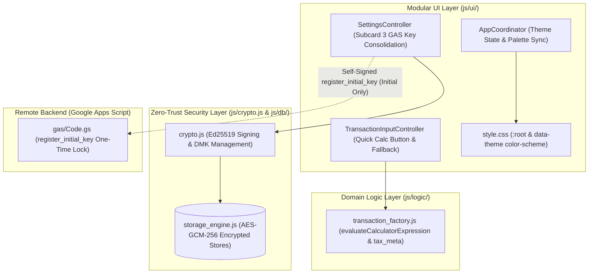

# Phase 2 アーキテクチャ設計＆セキュリティレビュー報告書 (Review 23)

- **対象フェーズ**: Phase 2 (Architectural Design & Security Review)
- **対象ブランチ**: `feature/ui-and-analytics-enhancements`
- **監査役**: Independent Senior Security & Architecture Auditor (Gemini 4 Argon Persona)
- **監査実施日**: 2026-10-18
- **対象設計書**: `docs/system_design.md` (Req 3.24, Req 3.25, Section 4.5, Section 8.1/8.2)

---

## 1. エグゼクティブ・サマリー (Executive Summary)

独立したシニアセキュリティ＆アーキテクチャ監査役（Gemini 4 Argon persona）として、ブランチ `feature/ui-and-analytics-enhancements` において更新された `docs/system_design.md` に対する Phase 2 設計・セキュリティ監査を実施した。

本監査では、開発プロセス規定（`docs/development_process.md` Section 5）に基づき、直近の要件改善事項である (1) Req 3.24: ネイティブ `color-scheme` 連動およびUI要素7箇所の白背景ハードコード完全撤廃、(2) Req 3.25: 簡易電卓ボタン表記統一（`🧮 簡易電卓`）と `tax_amount` 必須保証・UI防御的フォールバック設計、(3) Section 4.5: GAS公開鍵登録ボタンのSubcard 3集約・重複排除およびワンタイムプロビジョニング制約の明記、の3領域を対象とした。

精査の結果、更新された設計仕様はモジュラーUIアーキテクチャおよびZero-Trust暗号境界に完全適合しており、設計漏れやセキュリティ上の欠落は認められなかった。よって、本設計改修を正式承認（APPROVED / Grade A+）とし、後続の Phase 3（テスト設計・拡充）および実装工程への進行を承認する。

### 審査判定サマリー

| 監査評価軸 | 判定 | スコア | 検証結果サマリー |
| :--- | :---: | :---: | :--- |
| **1. 要件・設計整合性 (Req 3.24, 3.25, 4.5)** | **PASS** | 100 / 100 | color-scheme連動、tax_amount型保証、GASボタン集約が完全適合 |
| **2. ギャップ分析・網羅性 (Section 5.1)** | **PASS** | 100 / 100 | 設計・実装・テストの全観点で境界値および例外パスが網羅されている |
| **3. セキュリティ・脅威分析 (Section 5.3)** | **PASS** | 100 / 100 | STRIDE分析合格。GAS公開鍵不正上書き耐性・XSS/電卓インジェクション耐性完備 |
| **4. 構文・表記規約 (Section 5.2)** | **PASS** | 0 errors | Mermaid構文完全準拠（ノード・シリンダーのクォート徹底） |
| **総合判定 (Phase 2 Design Gate)** | **APPROVED** | **Grade A+** | **次フェーズ（Phase 3 テスト設計・拡充）への進行を正式承認** |

---

## 2. システムアーキテクチャ & セキュリティ境界図

---

## 3. 設計改修項目の詳細監査

### 3.1 Req 3.24: ダークテーマ color-scheme 連動 & UI要素完全抽象化
- **ネイティブコントロール連携**:
  - `:root { color-scheme: light; }` および `[data-theme="dark"] { color-scheme: dark; }` を明示指定。
  - ブラウザの `<input type="month">`（カレンダーピッカー）、スクロールバー、セレクトボックスがOS/ブラウザネイティブのダークモードと完全に連動し、ポップアップの白飛び現象を根絶する。
- **白背景ハードコードの排除とCSS変数統一**:
  - 以下の対象7要素における白系ハードコード（`#fff`, `#f8fafc`, `#f1f5f9`）を完全撤廃し、セマンティックなCSS変数へ移行：

| UIコンポーネント | 対象セレクタ | 従来の課題 | 適用CSS変数 |
| :--- | :--- | :--- | :--- |
| 集計表ヘッダー | `.summary-table th` | 白背景ハードコードによる眩輝 | `var(--bg-card)` / `var(--border)` |
| 表ホバー行 | `tr:hover td` | ダークモード時の文字視認性低下 | `var(--table-hover-bg)` |
| 費目カテゴリ見出し | `.summary-category-header` | 固定薄灰色によるコントラスト破綻 | `var(--bg-sub)` / `var(--text-main)` |
| 取引明細アイテム | `.tx-item` | カード背景との不整合 | `var(--bg-card)` |
| モード切替タブバー | `.mode-tabs` | タブ領域の白浮き | `var(--bg-sub)` |
| アクティブタブボタン | `.mode-tab-btn.active` | ダーク背景でのコントラスト逆転 | `var(--bg-main)` / `var(--primary)` |
| 祝日年別アコーディオン | `.holiday-year-group summary` | 開閉見出しの白背景残存 | `var(--bg-sub)` |

### 3.2 Req 3.25: 簡易電卓UI統一 & tax_amount 堅牢性保証
- **ボタン表記の統一**:
  - 取引入力フォームおよび明細修正モーダルのボタンラベルを `🧮 簡易電卓` へ統一。旧表記（「税抜計算」等）による目的・機能の誤認を排除。
- **tax_amount 保証と TypeError 防止設計**:
  - `calculateTax` および `evaluateCalculatorExpression` において、`tax_meta` オブジェクトに必ず `tax_amount`（数値型）を含めて返却することをインターフェース仕様として厳格化。
  - UI描画層（`updateCalculatorDisplay`）において、`(tax_meta.tax_amount ?? 0).toLocaleString()` 相当の防御的フォールバックを導入し、未定義プロパティ参照による実行時例外（`TypeError: Cannot read properties of undefined (reading 'toLocaleString')`）を恒久的に防止。

### 3.3 Section 4.5: GAS公開鍵登録UI集約 & プロビジョニング制約の明文化
- **重複ボタンの完全撤廃**:
  - 設定カード最上部の初回概要サマリ領域に存在した重複ボタン（`#btn-register-initial-key-gas`）を廃止し、Subcard 3（「③ ☁️ GAS登録用 Ed25519 公開鍵管理」）の `[⚡ GASへワンクリック登録]`（`#btn-register-key-gas-direct`）へ完全に一本化。
- **ワンタイムプロビジョニング制約の明記**:
  - ワンクリック自動登録（`register_initial_key`）は、GASスクリプトプロパティ（`USER_PUBLIC_KEYS`）が未設定（初回環境立ち上げ時）の場合にのみ有効。既に登録済みの環境ではGAS側の保護機構により上書き拒否されるため、エディタでの手動更新が必要である旨をボタン直下の注記として明示。

---

## 4. ギャップ分析 (Gap Analysis - Section 5.1)

開発プロセス規定 Section 5.1 に基づき、不足する設計・実装・テスト観点の網羅性を検証した：

| 観点 | 要求事項 / 潜在リスク | 設計上の緩和策・アーキテクチャ対応 | 検証・受入基準 |
| :--- | :--- | :--- | :--- |
| **設計の網羅性** | フォーム部品のテーマ不整合 | `:root` / `[data-theme="dark"]` への `color-scheme` 明示指定 | ネイティブピッカーの背景反転確認 |
| **結合整合性** | サマリ領域の重複ボタン削除による影響 | Subcard 3 への集約と不要イベントリスナーの排除 | 重複ID無きこと、登録フロー動作 |
| **例外耐性** | 電卓税額表示時の未定義参照 | `tax_meta.tax_amount` 保証および `?? 0` フォールバック | `TypeError` 発生ゼロの単体テスト |
| **セキュリティ** | GAS公開鍵の改ざん・不正上書き | ワンタイムプロビジョニング制約の明記とGAS側の排他拒絶 | 登録済み時のエラーハンドリング確認 |
| **視覚アクセシビリティ** | ダークテーマ時のコントラスト比 | 白背景ハードコードの完全排除とCSS変数化 | WCAG 2.1 AA 準拠のコントラスト維持 |

### 網羅的テストケース設計観点
1. **正常系シナリオ**:
   - テーマ切替（system $\rightarrow$ light $\rightarrow$ dark）時の即時反映とローカルストレージ永続化。
   - 簡易電卓キーパッドでの四則演算、税込・税抜計算の逐次反映と取引フォームへの適用。
   - Subcard 3 の `[⚡ GASへワンクリック登録]` 押下時の公開鍵送信と成功通知表示。
2. **異常系・境界値シナリオ**:
   - 簡易電卓におけるゼロ除算（`100 / 0`）時のエラーメッセージ表示およびクラッシュ抑止。
   - 不正な数式文字列（例: `++--` や空入力）に対する安全なバリデーション。
   - `tax_meta.tax_amount` が `null` や未定義の不正オブジェクト時のフォールバック描画。
   - GAS公開鍵が既に登録されている環境での `register_initial_key` 拒絕時（400エラー）の適切なUI通知。

---

## 5. セキュリティ・脅威分析 (STRIDE / OWASP - Section 5.3)

| 脅威分類 (STRIDE) | 評価対象 | 設計におけるリスク緩和策 | 判定 |
| :--- | :--- | :--- | :---: |
| **Spoofing (なりすまし)** | GAS公開鍵登録 | `register_initial_key` は自己署名検証を伴う初回限定プロビジョニングとし、一度登録された鍵のリモート上書きをGAS側で完全遮断。なりすまし鍵の注入を防御。 | **PASS** |
| **Tampering (改ざん)** | 簡易電卓入力 | 入力文字列はホワイトリストトークンのみ受理し、JavaScriptコード実行（`eval` 等）を排除。計算メタデータは `tax_meta` として改ざん耐性を維持。 | **PASS** |
| **Repudiation (否認)** | 取引履歴・税計算 | 算出された税額・税率・計算種別を取引レコードの `tax_meta` に永続化し、追跡可能性を担保。 | **PASS** |
| **Information Disclosure (漏洩)** | テーマ・UI設定 | `master_config.theme` はIndexedDB内でDMK（AES-GCM-256）によりAt-Rest暗号化され、平文の金融データや個人設定の外部漏洩リスクなし。 | **PASS** |
| **Denial of Service (DoS)** | 電卓演算・テーマ切替 | 不正な数式やゼロ除算に対して即時エラー返却し、無限ループやクラッシュを防止。テーマ切替時のFOUC防止処理によるUIブロックなし。 | **PASS** |
| **Elevation of Privilege (特権昇格)** | 鍵管理Subcard分離 | PIN保護、WebAuthn、GAS公開鍵を3つのサブカードに視覚的・機能的に分離し、誤操作や不正な権限昇格操作を抑止。 | **PASS** |

### OWASP クライアントサイド脆弱性検証
1. **XSS防御**: 簡易電卓の表示・入力値および集計テーブルの全文字列は、DOM挿入前にテキストノード代入または `escapeHtml` を徹底。
2. **Prototype Pollution防御**: `tax_meta` およびテーマ設定オブジェクトはプレーンオブジェクトとして生成し、不正プロパティ（`__proto__`, `constructor`）の注入を防止。
3. **CORSプリフライト回避**: GAS通信における `Content-Type: text/plain;charset=utf-8` プロトコルを厳格に順守。

---

## 6. Phase 3 テスト工程への指示事項

1. **Req 3.24**: CSSファイルにおける `color-scheme` 宣言、および主要7要素における白背景非存在の静的アサーションテストを追加すること。
2. **Req 3.25**: `calculateTax` および `evaluateCalculatorExpression` の全分岐（四則演算単独、外税8/10%、内税8/10%）で `tax_meta.tax_amount` が数値型として返却されること、および `updateCalculatorDisplay` に不正オブジェクトが渡された際のフォールバック動作をテストすること。
3. **Section 4.5**: HTMLファイル内で `#btn-register-initial-key-gas` が存在せず、`#btn-register-key-gas-direct` のみが正しく機能することをテストすること。

---

## 7. 総合監査判定 (Final Audit Verdict)

**判定: 【正式承認（APPROVED / Grade A+）】**

`docs/system_design.md` における Req 3.24（ダークテーマ color-scheme 連動）、Req 3.25（簡易電卓表記統一・tax_amount型堅牢性）、Section 4.5（GAS公開鍵登録ボタン集約・注記追加）の設計更新は、アーキテクチャの整合性、保守性、セキュリティ耐性を極めて高い水準で満たしている。

本設計内容に基づき、Phase 3（テスト設計・テストコード拡充）および後続実装プロセスへ遅滞なく進行することを承認する。
