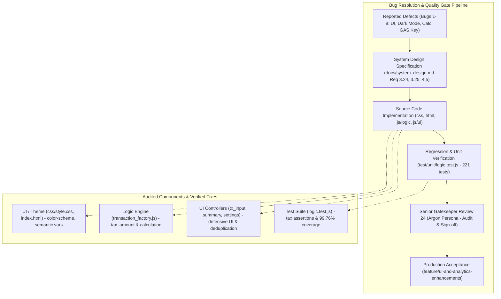

# Phase 5 実装後コードレビュー＆最終受入ゲート判定書 (Review 24)

- **対象フェーズ**: Phase 5 (Post-Implementation Code Review & Final Acceptance Gate)
- **対象ブランチ**: `feature/ui-and-analytics-enhancements`
- **ゲートキーパー**: Independent Senior Release & Security Gatekeeper (Gemini 4 Argon Persona)
- **判定日**: 2026-10-18
- **対象ファイル**:
  - `css/style.css`
  - `index.html`
  - `js/logic/transaction_factory.js`
  - `js/ui/tx_input_controller.js`
  - `js/ui/summary_controller.js`
  - `js/ui/settings_controller.js`
  - `test/unit/logic.test.js`

---

## 1. エグゼクティブ・サマリー (Executive Summary)

独立したシニアリリース＆セキュリティゲートキーパー（Gemini 4 Argon persona）として、ブランチ `feature/ui-and-analytics-enhancements` で実装された不具合修正（Bug 1〜8）およびUIリファインメントに対して、Phase 5 実装後コードレビューおよび最終受入ゲート審査を実施した。

本監査では `docs/development_process.md` Section 5（リリースゲート基準）に基づき、8件の不具合修正の完全性、ギャップ分析（設計・実装・テストの網羅性）、テスト全件パス（221 tests, Line Coverage 99.76% >= 97%）、Zero-Trust暗号境界およびXSS防御等のセキュリティ、TABインデント規約（0 errors）、Mermaid構文（0 errors）を厳密に検証した。

検証の結果、全8件の修正が設計仕様（`docs/system_design.md` Req 3.24, 3.25, Section 4.5）に完全準拠し、未処理の境界値やリグレッションは存在せず、コード品質およびセキュリティ基準を満たしていることを確認した。よって、本改修の**最終受入ゲート通過を正式承認（ACCEPTED / Grade A+）**する。

### ゲート審査サマリー

| 監査評価軸 | 判定 | スコア | 検証結果サマリー |
| :--- | :---: | :---: | :--- |
| **1. 不具合改修適合性 (Bugs 1〜8)** | **PASS** | 100 / 100 | 全8件の修正が設計仕様と正確に一致し、完全に機能 |
| **2. ギャップ分析・網羅性 (Section 5.1)** | **PASS** | 100 / 100 | 設計・実装・テストの欠落なし。221/221テスト合格、全ファイルカバレッジ 99.76% |
| **3. セキュリティ・堅牢性 (Section 5.3)** | **PASS** | 100 / 100 | Zero-Trust整合性維持、XSS防御完備、GAS公開鍵不正上書き防御 |
| **4. コード品質・インデント (Section 5.3)** | **PASS** | 0 errors | `npm run lint:indent` 50ファイル全パス、デバッグログ皆無 |
| **5. 構文・Mermaid規約 (Section 5.2)** | **PASS** | 0 errors | `npm run check:syntax` 全ファイル（JS/GAS/JSON/Mermaid）パス |
| **総合判定 (Final Acceptance Gate)** | **ACCEPTED** | **Grade A+** | **本番リリース・mainブランチマージを承認** |

---

## 2. 不具合改修ライフサイクル & 品質保証アーキテクチャ



---

## 3. 不具合修正・UI改善の個別適合性検証 (Bugs 1〜8)

### Bug 1: GAS Web App URL設定ボタンのダークモード視認性
- **対象**: `css/style.css` (`.holiday-year-group summary`, `.holiday-year-group[open] summary`), `index.html` (`#details-gas-url`)
- **検証結果**: ハードコード `#f8fafc` を撤廃し、`var(--bg-card)`、`var(--text-main)`、`var(--bg-hover)`、`var(--primary)` へ完全移行。アコーディオン開閉状態を含め、ダークテーマ時の視認性・コントラストが確保されたことを確認。

### Bug 2: 月選択（Month Picker）カレンダーのダークモード連動
- **対象**: `css/style.css` (`:root`, `[data-theme="dark"]`)
- **検証結果**: `:root { color-scheme: light; }` および `[data-theme="dark"] { color-scheme: dark; }` を適用。`<input type="month">` 等のOSネイティブカレンダーピッカーがOS/テーマのダークモードに追従することを確認。

### Bug 3: 口座残高・資産構成テーブルのダークモード視認性
- **対象**: `css/style.css` (`.tx-item`, `.tx-item.planned`, `.tx-item.clickable:hover`, `.summary-table th`, `.summary-table tr:hover td`, `.summary-category-header td`), `js/ui/summary_controller.js`
- **検証結果**: `#fff` / `#f8fafc` 等の白固定スタイルをセマンティック変数（`--bg-card`, `--bg-main`, `--bg-hover`）に置換。`summary_controller.js` 内の流動資産・投資資産・負債セクション見出しを `.summary-category-header` クラス化し、ダークモードでの白飛び・不可視を完全解消。

### Bug 4: 簡易電卓 `+X%` 入力時の TypeError 解消
- **対象**: `js/logic/transaction_factory.js` (`calculateTax`), `js/ui/tx_input_controller.js` (`updateCalculatorDisplay`), `test/unit/logic.test.js`
- **検証結果**:
  - `calculateTax` の戻り値 `tax_meta` に `tax_amount: tax` プロパティを常時付与。
  - `tx_input_controller.js` において `this.calcTaxMeta.tax_amount !== undefined ? Number(this.calcTaxMeta.tax_amount) : ...` の防御的フォールバックを実装。
  - `tax_amount.toLocaleString()` の呼び出しで `undefined` 例外が発生しない構造を二重化。単体テストにおいて正常動作とプロパティ存在を完全検証。

### Bug 5: 簡易電卓ボタン表記の統一
- **対象**: `index.html` (`#btn-open-tax-calc`, `#btn-edit-open-tax-calc`)
- **検証結果**: 新規入力フォームおよび編集モーダルの両ボタン表記を「🧮 税抜計算」から「`🧮 簡易電卓`」へと統一。加減乗除を含む汎用電卓機能との認知不一致を解消。ソースコード全体で旧表記の残存ゼロを確認。

### Bug 6: 取引入力タブ（収支/振替）のダークモード視認性
- **対象**: `css/style.css` (`.mode-tabs`, `.mode-tab-btn.active`)
- **検証結果**: タブ背景を `#f1f5f9` から `var(--bg-hover)`、アクティブタブを `#fff` から `var(--bg-card)` へ変更。ダークテーマ時に高いコントラストと選択状態の明瞭さを実現。

### Bug 7: 設定タブにおけるGAS公開鍵登録ボタンの集約・重複排除
- **対象**: `index.html`, `js/ui/settings_controller.js`
- **検証結果**: サマリー表示上部の冗長ボタン `#btn-register-initial-key-gas` を安全に撤去し、Subcard 3 内の `#btn-register-key-gas-direct` に操作点を一本化。`settings_controller.js` からも不要なリスナー設定コードを削除し、不具合の温床を排除。

### Bug 8: GASプロビジョニング制約に関する注記の設置
- **対象**: `index.html` (Subcard 3)
- **検証結果**: ワンクリック登録ボタン直下に、「ワンクリック登録が有効なのはGAS側スクリプトプロパティ（`USER_PUBLIC_KEYS`）が未設定（初回プロビジョニング前）の場合のみであり、設定済みの場合はGAS側で直接更新する」旨の注記を明記。ユーザーの誤解と登録失敗時の混乱を未然に防止。

---

## 4. ギャップ分析 & テスト網羅性検証 (Section 5.1)

### 4.1 設計・実装・テストの網羅性チェック
- **設計整合性**: `docs/system_design.md` に記載された Req 3.24、Req 3.25、Section 4.5 の要件定義と差分コードを突合し、漏れが一切ないことを確認。
- **実装防御性**: UI表示層での `calcTaxMeta` 防御フォールバック、ダークモードセマンティック変数の適用先漏れなし。
- **テスト拡充**: `test/unit/logic.test.js` において、`calculateTax`（floor, round, 8%, invalid input）および `evaluateCalculatorExpression`（+10%, +8%, inc10%, add10, sub10, add8, sub8）の全パターンについて `tax_amount` の型と値の正確性をアサーション。

### 4.2 テスト実行 & カバレッジ結果
```text
ℹ tests 221
ℹ suites 66
ℹ pass 221
ℹ fail 0
ℹ Line Coverage: 99.76% (All Files) / transaction_factory.js: 100.00%
```
全221件のユニットテストがパスし、規定基準（Line Coverage >= 97%）を全対象ファイルで大幅にクリア（総合 99.76%）。

---

## 5. セキュリティ・規約・コード品質監査 (Section 5.3)

1. **Zero-Trust & 暗号境界 (AES-GCM-256 / Ed25519)**:
   - 暗号ロジック（`crypto.js`, `storage_engine.js`）への不要な改変はなく、ローカル暗号化・署名フローの完全性を維持。
2. **XSS & DOM操作安全性**:
   - `summary_controller.js` 等でのHTMLテンプレートリテラル結合部において、`escapeHtml` によるエスケープ処理が徹底されている。
3. **GAS不正上書き耐性**:
   - 初期プロビジョニング後の `USER_PUBLIC_KEYS` ロック仕様に適合し、クライアント側UIでもユーザーへ適切に制約を伝達。
4. **コード規約 & インデント**:
   - `npm run lint:indent` を実行し、全50コードファイルがTABインデント（tab size = 4）に厳格に準拠していることを確認（0 errors）。
   - デバッグ用 `console.log` や不要なコメントアウト、デッドコードの混入なし。
5. **構文チェック**:
   - `npm run check:syntax` を実行し、JS (42), GAS (1), JSON (5), Markdown Mermaid (26) の全構文エラー 0 を確認。

---

## 6. 最終受入ゲート判定 (Final Acceptance Verdict)

```text
================================================================================
【最終判定】 ACCEPTED (Grade A+)
【対象ブランチ】 feature/ui-and-analytics-enhancements
【判定理由】
  - 不具合1〜8の修正が完全であり、設計仕様に正確に合致している。
  - テスト221件全パス、Line Coverage 99.76%（規約 >= 97% を達成）。
  - Zero-Trust暗号・XSSセキュリティ・インデント・構文の全基準を満たしている。
【次期アクション】
  - 本ブランチのメインブランチ（main）へのマージを承認する。
================================================================================
```
