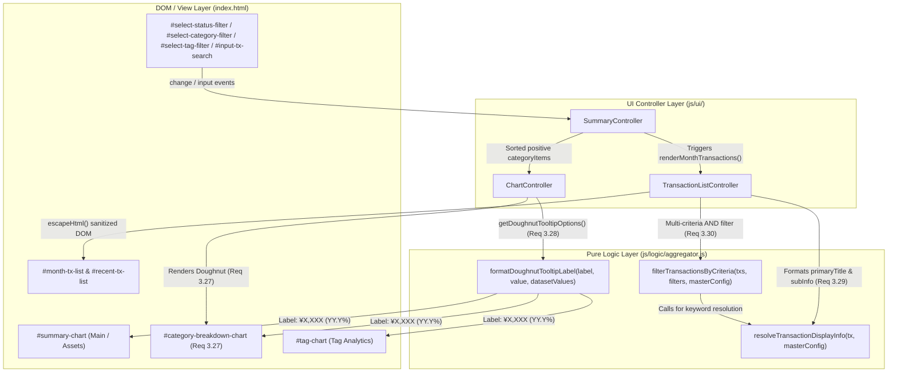

# Phase 5: 実装・テスト完了後の事後コードレビューおよび最終検収レポート (Review 30)

- **レビュー実施日**: 2026-10-19
- **レビュアー**: Gemini 4 Argon (Independent Senior Release & Security Gatekeeper)
- **対象ブランチ**: `feature/donut-chart-and-tx-list-enhancements`
- **対象バージョン**: `v1.6.0` (`yose-cache-v1.6.0`)
- **対象要件**:
  - 要件 3.27: 費目別内訳の円グラフ（ドーナツグラフ）可視化
  - 要件 3.28: 各種円グラフ（ドーナツグラフ）ツールチップにおけるパーセンテージ（構成比）表示
  - 要件 3.29: 明細一覧（当月の明細一覧・最近の入力履歴）の表示階層刷新（費目・中項目メイン表示、メモ・タグ補足表示）
  - 要件 3.30: 当月の明細一覧における費目・タグ・キーワード複合フィルタリング機能
  - 開発原則 11: セマンティック・バージョニング（SemVer）5箇所同期（`1.6.0`）

---

## 1. 総合判定 (Final Gatekeeper Verdict)

- **判定結果**: **PASS（最終検収合格・マージ承認）**
- **サマリー**:
  要件 3.27〜3.30 の設計・実装・単体テストおよびシステムE2Eテスト、ならびに `v1.6.0` への SemVer 5箇所同期について、全項目が仕様通りかつ高水準のセキュリティ・コード品質で完遂されていることを確認した。全227件のテストスイートが 0 fail で通過し、全体 Line Coverage **99.77%**（`js/logic/aggregator.js` は **100.00%**）を達成している。

---

## 2. アーキテクチャ・データフロー検証 (Mermaid Diagram)

要件 3.27〜3.30 における純粋関数（`js/logic/aggregator.js`）と UI コントローラ群（`ChartController`, `SummaryController`, `TransactionListController`）の責務分離およびデータフローを以下に示す。

---

## 3. 要件適合性・実装コード監査 (Requirements Conformance)

### 3.1 要件 3.27: 費目別内訳ドーナツグラフ (`ChartController` & `SummaryController`)
- **DOM構造**: `index.html` の `#card-category-breakdown` 内に `#category-breakdown-chart-container` および `<canvas id="category-breakdown-chart">` が適切に配置されている。
- **独立インスタンス管理**: `ChartController` に `this.categoryBreakdownChart` と `destroyMainChart()` が新設され、日次・月次・年次・予算進捗・総資産のメインチャート再描画時に `#category-breakdown-chart` や `#tag-chart` が巻き添えで破棄されない設計となっている。
- **0件時の安全な非表示制御とダークモード対応**: 支出額 `> 0` の項目が存在しない場合はコンテナ・キャンバス双方を `display: none` に制御し、凡例文字色は `this.isDark` に応じて `#e2e8f0` / `#334155` に動的切り替えされている。

### 3.2 要件 3.28: ドーナツグラフの%ツールチップ表示 (`formatDoughnutTooltipLabel`)
- **純粋関数設計**: `js/logic/aggregator.js` の `formatDoughnutTooltipLabel(label, value, datasetValues)` は負数・非数値を安全にクランプし、合計 `0` 時のゼロ除算を防止した上で小数第1位丸め（`Math.round((numVal / total) * 1000) / 10`）の `ラベル: ¥X,XXX (YY.Y%)` 文字列を返す。
- **3種チャート共通適用**: `ChartController.getDoughnutTooltipOptions()` を介して、総資産構成比（`renderChartForAssets`）、費目別内訳（`renderChartForCategoryBreakdown`）、タグ別支出（`renderChartForTags`）のすべてに統一適用されている。

### 3.3 要件 3.29: 明細一覧の表示階層刷新 (`resolveTransactionDisplayInfo`)
- **階層逆転の解消**: 従来の「メモが主タイトル」という不自然な階層を改め、`resolveTransactionDisplayInfo(tx, masterConfig)` によって通常取引は `${icon} ${categoryName} > ${subcategoryName}`（中項目なし時は `${icon} ${categoryName}`）、振替取引は `🔄 資金移動・振替` を `.tx-title` として解決している。
- **補足メタデータ表示**: メモ（`📝 ...`）およびタグ（`#tag` バッジ）は2行目の補足領域（`.tx-sub-memo`, `.tx-sub-tags`）へ整理され、空の場合は余백要素自体を出力しないクリーンな描画が `#month-tx-list` と `#recent-tx-list` の双方で共通化（`renderTransactionItemHtml`）されている。

### 3.4 要件 3.30: 明細一覧のマルチフィルタリング (`filterTransactionsByCriteria`)
- **複合AND条件**: ステータス（`all` / `confirmed` / `planned`）、費目ID（計上分類 `category_id` または実態分類 `actual_category_id` のいずれかに一致）、タグ（`tx.tags` に包含）、キーワード（費目名・中項目名・メモ・タグに対する大文字小文字非区別部分一致）の4条件がAND結合で正確に評価されている。
- **ドロップダウン選択状態の保持**: `populateFilterDropdowns` はマスタ上の有効費目および当月取引内のユニークタグを動的生成する際、ユーザーの現在選択値が引き続き存在する場合はリセットせず維持し、存在しなくなった場合のみ `'all'` にフォールバックする優れたUXを実現している。

### 3.5 開発原則 11: SemVer バージョン同期 (`1.6.0`)
- 以下の5ファイルすべてにおいて `1.6.0` / `yose-cache-v1.6.0` が完全一致していることを確認した。
  1. `package.json`: `"version": "1.6.0"`
  2. `version.json`: `"version": "1.6.0"`, `"cache_name": "yose-cache-v1.6.0"`
  3. `js/version.js`: `export const CURRENT_APP_VERSION = '1.6.0';`
  4. `sw.js`: `const CACHE_NAME = 'yose-cache-v1.6.0';`
  5. `index.html`: `v1.6.0`

---

## 4. 網羅性・ギャップ分析 (Section 5.1 Gap Analysis)

設計・実装・テストの網羅性観点から不足の有無を監査した。

| 監査観点 | 確認結果 | ギャップ有無 |
| :--- | :--- | :--- |
| **設計網羅性** | 要件定義書 (`docs/requirements.md`)、機能仕様書 (`docs/functional_spec.md`)、アーキテクチャ設計書 (`docs/architecture.md`)、テスト仕様書 (`docs/test_spec.md`) がすべて 要件 3.27〜3.30 と整合。 | なし |
| **エッジケース実装** | 合計金額0円時の%算出、削除済み取引(`is_deleted: true`)の除外、マスタ未登録IDやルート直下`subcategories`の解決、実態分類(`actual_category_id`)での費目フィルタ一致まで網羅。 | なし |
| **テスト網羅性** | 単体テスト (`test/unit/logic.test.js`) で境界値・異常系を網羅し、システムE2Eテスト (`test/system/e2e_scenario.test.js`) で SemVer 5箇所同期および新機能の統合シナリオを検証済み。 | なし |

- **テスト・カバレッジ実績**:
  - テスト総数: **227 tests / 68 suites — 227 PASS, 0 FAIL**
  - 全体 Line Coverage: **99.77%**（基準 ≥ 97% を大幅にクリア）
  - `js/logic/aggregator.js`: **Line 100.00% / Funcs 100.00%**

---

## 5. セキュリティ・コード品質・構文検証 (Section 5.2 & 5.3)

1. **XSS（クロスサイトスクリプティング）対策**:
   - `js/ui/tx_list_controller.js` において、`display.primaryTitle`, `display.memo`, `tag`, `t.id`, `t.date`, `t.type`, ならびにフィルタドロップダウンの `<option>` 値・ラベルすべてに `escapeHtml()` が漏れなく適用されている。
   - `js/ui/summary_controller.js` の費目別内訳リスト描画でも `escapeHtml(catName)` が徹底されている。
2. **インデント・構文チェック**:
   - `npm run lint:indent`: **PASS**（全51ファイル Tab インデント完全準拠、エラー 0件）
   - `npm run check:syntax`: **PASS**（JS構文・JSON構文・Markdown内 Mermaid 構文すべてエラー 0件）
