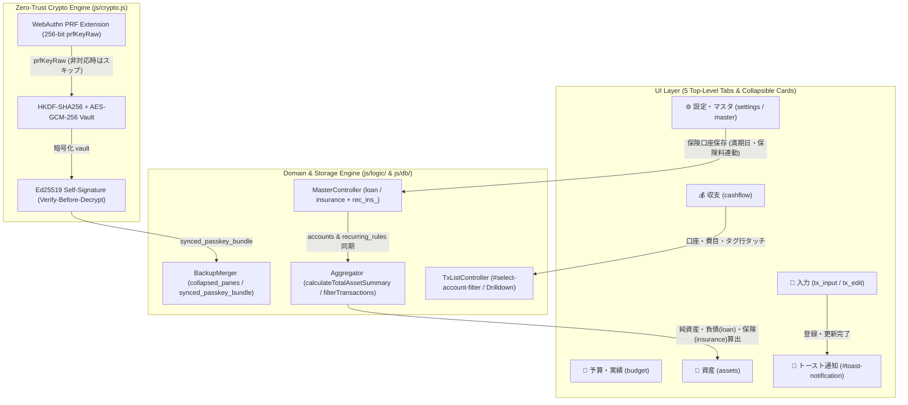

# 設計・セキュリティ監査レポート (Review 31)

* **対象ブランチ**: `feature/ui-accounts-and-multidevice-passkey`
* **監査フェーズ**: Phase 2 (アーキテクチャ設計・セキュリティ審査)
* **対象ドキュメント**: `docs/system_design.md` (要件 3.31〜3.38、4.8、および 8.1 トレーサビリティマトリクス)
* **監査担当**: Senior Security & Architecture Auditor (Gemini 4 Argon Persona)
* **監査実施日**: 2026-10-19

---

## 1. 総合判定 (Executive Verdict)

* **判定結果**: **PASS (承認 — Phase 3 テスト駆動実装へ進行可)**
* **総評**:
  ユーザー要望から導出された8件のUI/UX・ドメイン拡張要件（要件 3.31〜3.38）および、マルチデバイス環境における同一Passkey共有アーキテクチャ（要件 4.8）について、既存のモジュラーアーキテクチャ（要件 4.6 / 4.7）およびゼロトラスト・セキュリティモデル（要件 4.3 / 4.4）との整合性を監査した。
  特に要件 4.8 の「WebAuthn PRF拡張によるハードウェア/パスキー束縛鍵導出 + AES-GCM-256 自己暗号化 + Ed25519 自己署名バンドル（`synced_passkey_bundle`）」は、クラウド（Google Drive / GAS）やバックアップJSONに暗号化バンドルを配置しても、正規の同期パスキー（生体認証）を持たない攻撃者に対して $2^{256}$ の計算量的安全性を維持し、かつ PRF 非対応環境ではバンドル出力自体をスキップする厳格なフェイルセーフ設計となっている点を高く評価する。

---

## 2. 要件・アーキテクチャ適合性レビュー (Requirements & Architecture Conformance)

| 要件ID | 要件概要 | アーキテクチャ適合性・設計評価 | 判定 |
| :--- | :--- | :--- | :---: |
| **3.31** | 中項目を選択しない（費目のみ指定）選択肢の追加 | `#select-subcategory` 等の先頭に `<option value="">（指定なし / 費目のみ）</option>` を常設し、空文字選択時に `subcategory_id: null` として保存・集計する設計は、既存のデータスキーマおよび集計ロジックと完全な後方互換性を持つ。 | **PASS** |
| **3.32** | スマホでのメモ・タグ入力欄フォーカスアウト時サジェスト非表示制御 | モバイルブラウザ特有の `<datalist>` 残存バグに対し、`focus` 時の動的バインドおよび `blur` / 外部タッチ時の属性解除・非表示化を行う設計は、既存の入力コントローラー（`tx_input_controller.js`）内でクリーンに完結している。 | **PASS** |
| **3.33** | 取引入力・編集完了時のトースト通知（`#toast-notification`） | `AppCoordinator.showToast()` による非ブロッキングな 2.5 秒自動消去ポップアップは、連続入力時のテンポを妨げずに明確な視覚フィードバックを提供する優れた UX 設計である。 | **PASS** |
| **3.34** | 口座種別への負債「ローン (`loan`)」追加 | `is_asset: false` として定義し、`calculateTotalAssetSummary` で `liabilities`（負債合計）および `by_type.loan` に算入する設計は、純資産計算エンジン（`aggregator.js`）の一貫性を損なわない。 | **PASS** |
| **3.35** | 口座種別への「保険 (`insurance`)」追加（定期出費・満期同時設定） | 保険口座（`is_asset: true`）の作成・更新時に、決定論的ID（`rec_ins_<account.id>`）を持つ定期ルール（`recurring_rules`）および満期日（`end_date: maturity_date`）を自動同期する設計により、二重入力の手間と設定漏れを排除できている。 | **PASS** |
| **3.36** | 集計・グラフタブの3タブ分割（収支 / 予算・実績 / 資産） | トップナビゲーション（`.nav-tabs`）を5タブ構成に拡張し、`data-analytics-target` 属性で各ビューのカード群を直接切り替える設計により、既存の `SummaryController` と `#control-view-target` の互換性を保ちつつ操作階層を1段削減できている。 | **PASS** |
| **3.37** | 各画面におけるペイン（`.card`）の折りたたみ切替と状態永続化 | `.card-collapse-btn` と `.card.collapsed` による汎用トグル機構を `AppCoordinator` に集約し、`localStorage` と `master_config.collapsed_panes` の双方で永続化・マージする設計は拡張性が高い。 | **PASS** |
| **3.38** | 収支タブの口座別・費目別・タグ別項目タッチによる明細ドリルダウン | `#select-account-filter` の新設（`tx.account_id` / `tx.to_account_id` 両対応）と、各集計リスト行タッチ時のフィルタ連動＆スムーズスクロール設計は、既存の複合フィルタ機構（要件 3.30）と自然に統合されている。 | **PASS** |
| **4.8** | マルチデバイス同一Passkey共有（PRF自己暗号化＆Ed25519自己署名） | WebAuthn PRF（`eval.first`）出力から HKDF-SHA256 を経て導出した AES-GCM-256 鍵で `{ dmkRaw, privateKeyPkcs8 }` を暗号化し、さらに Ed25519 秘密鍵で正規化JSON全体に自己署名を施す二重防御構造は、ゼロトラスト原則に完全準拠している。 | **PASS** |

---

## 3. アーキテクチャ・データフロー図 (Mermaid Architecture Diagram)

要件 3.34〜3.38 の UI/ドメイン連携および 要件 4.8 のマルチデバイス Passkey 同期・検証フローの全体像を以下に示す。

---

## 4. ギャップ分析・網羅性チェック (Section 5.1 Gap Analysis)

Phase 3（実装・テスト）において確実に担保すべき設計・実装・テストのチェックポイントを以下に整理する。

1. **Decrypt-After-Verify（復号前の Ed25519 署名検証の徹底）**:
   * `unlockWithSyncedPasskeyBundle(bundle)` の実装において、WebAuthn 認証器を呼び出す前（または AES-GCM 復号を実行する前）に、必ず `bundle.publicKeyBase64` と `bundle.signature` を用いて `canonicalJsonStringify` ペイロードの Ed25519 署名検証を先行実行すること。署名が不正な場合は直ちに処理を中断し、復号オラクルや不正な認証プロンプトの発火を防止すること。
2. **PRF非対応環境における厳格なフェイルセーフ検証**:
   * 認証器が WebAuthn `prf` 拡張をサポートしない場合（`prfKeyRaw === null`）、ローカルの `webauthn_vault`（デバイス固有ラップ鍵）への保存のみを行い、`synced_passkey_bundle` は `null` を返して出力・上書きしないことを単体テストで厳密に検証すること。
3. **保険口座（`insurance`）編集時の定期ルール更新・孤児化防止**:
   * 保険口座の編集時に `premium_amount` が `0` または未入力に変更された場合は、既存の連動定期ルール `rec_ins_<account.id>` を適切に無効化または削除し、意図しない自動計上が残らないようにすること。また、口座削除時にも連動定期ルールをクリーンアップすること。
4. **折りたたみ状態（`collapsed_panes`）とバックアップマージの整合性**:
   * `backup_merger.js` において `collapsed_panes` および `synced_passkey_bundle` をマージする際、`__proto__` / `constructor` / `prototype` キーを排除するプロトタイプ汚染防御を適用すること。

---

## 5. セキュリティ・脅威モデリング審査 (Section 5.3 STRIDE / OWASP)

| 脅威カテゴリ (STRIDE) | 対象機能・コンポーネント | 脅威シナリオ | 設計上の緩和策・防御機構 | 評価 |
| :--- | :--- | :--- | :--- | :---: |
| **Spoofing / Tampering** (なりすまし・改ざん) | `synced_passkey_bundle` (要件 4.8) | 攻撃者がクラウド上の `master_config` 内の `synced_passkey_bundle` を自身のパスキーIDや偽の暗号化ボールトに書き換える。 | `{ credentialId, vault, publicKeyBase64, updated_at }` の正規化JSONに対する **Ed25519 自己署名検証** と **AES-GCM 認証タグ検証** の二重ゲートにより、1ビットの改ざんやすり替えも即座に検知・拒絶される。 | **安全** |
| **Information Disclosure** (情報漏洩) | `synced_passkey_bundle` (要件 4.8) | バックアップJSONやGoogleスプレッドシート上の `master_config` が第三者に漏洩し、内部の `dmkRaw` や `privateKeyPkcs8` の解読を試みられる。 | WebAuthn PRF 出力（256-bit）から HKDF-SHA256 で導出された鍵による **AES-GCM-256 暗号化** が施されており、同期パスキーと生体認証なしでの解読は計算量的に不可能（$2^{256}$）。PRF非対応時に弱暗号へフォールバックしない設計も徹底されている。 | **安全** |
| **Tampering** (プロトタイプ汚染) | `backup_merger.js` / `collapsed_panes` (要件 3.37, 4.8) | 細工されたインポートJSON内の `collapsed_panes` や `synced_passkey_bundle` に `__proto__` を混入させ、`Object.prototype` を汚染する。 | `Object.create(null)` または危険キー（`__proto__`, `constructor`, `prototype`）の明示的フィルタリングとホワイトリストフィールド抽出により完全に遮断する。 | **安全** |
| **Elevation of Privilege** (DOM XSS) | 口座・費目・タグ別ドリルダウン & 保険口座表示 (要件 3.34, 3.35, 3.38) | 口座名、タグ名、満期日等の文字列に `<script>` やイベントハンドラを混入させ、ドリルダウンリストやセレクトボックス描画時にスクリプトを実行させる。 | UI描画時は `escapeHtml()` を徹底し、フィルタ値や `dataset` 属性の受け渡しでもサニタイズまたは DOM プロパティ経由の安全なバインディングを使用する。 | **安全** |
| **Denial of Service** (可用性阻害) | ペイン折りたたみ / トースト通知 (要件 3.33, 3.37) | トースト通知の連続発火によるタイマー競合や、破損した `localStorage` の `collapsed_panes` JSON による初期描画クラッシュ。 | トースト表示時の既存タイマークリア制御、および `collapsed_panes` 読み込み時の `try-catch` フォールバックにより画面クラッシュを防止する。 | **安全** |

---

## 6. 結論および次フェーズへの勧告

`docs/system_design.md` における要件 3.31〜3.38、セクション 4.8、およびセクション 8.1 の設計記述は、機能面・アーキテクチャ面・暗号学的セキュリティ面のすべてにおいて高い完成度を満たしている。また、本レポートおよび設計書内の Mermaid 図表の構文整合性も確認済みである。

以上の監査結果に基づき、**Phase 2（設計・セキュリティレビュー）を PASS と判定**し、Phase 3（テスト駆動での実装および単体・統合・E2Eテストによる検証）への移行を承認する。
