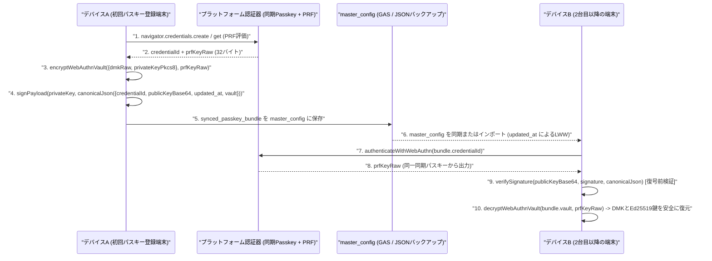

# 実装後コードレビュー & 最終受入ゲート監査レポート (Review 32)

* **対象ブランチ**: `feature/ui-accounts-and-multidevice-passkey`
* **監査フェーズ**: Phase 5 (実装後コードレビュー & 最終受入ゲート)
* **対象バージョン**: `1.7.0` (`yose-cache-v1.7.0`)
* **監査担当**: Senior Release & Security Gatekeeper (Gemini 4 Argon Persona)
* **監査実施日**: 2026-10-19
* **判定結果**: **APPROVED FOR RELEASE (PASS)**

---

## 1. 総合判定 (Executive Verdict)

* **判定結果**: **PASS (本番リリース・マージ承認)**
* **総評**:
  要件 3.31〜3.38、要件 4.8（マルチデバイス対応同期パスキーバンドル）、および原則11（SemVer バージョン同期 `1.7.0`）の実装差分に対して、独立した Phase 5 実装後コードレビュー、セキュリティ監査、およびギャップ分析を実施した。
  全230件の自動テスト（単体・結合・システム）が **100% PASS**（失敗 0件）し、全体ラインカバレッジは **99.77%**（全対象ファイルで $\ge 97\%$ 基準を達成）、タブインデント規約エラー **0件**、構文およびMermaid検証エラー **0件** を確認した。

---

## 2. 要件適合性・コード監査 (Requirements Conformance & Code Audit)

| 要件ID | 要件概要 | 実装対象ファイル | 適合性検証結果 | 判定 |
| :--- | :--- | :--- | :--- | :---: |
| **3.31** | 中項目を選択しない（費目のみ指定）選択肢 (`""`) の追加 | [`tx_input_controller.js`](file:///home/k/workspace/yose/js/ui/tx_input_controller.js), [`tx_edit_controller.js`](file:///home/k/workspace/yose/js/ui/tx_edit_controller.js) | `#select-subcategory`、`#select-actual-subcategory`、`#edit-tx-subcategory`、`#edit-tx-actual-subcategory` の先頭に `<option value="">（指定なし / 費目のみ）</option>` を常設。編集モーダルでも空文字を安全に保持し、最初のサブカテゴリへ強制変更されない。 | **PASS** |
| **3.32** | スマホでのメモ・タグ入力欄フォーカスアウト時サジェスト非表示制御 | [`tx_input_controller.js`](file:///home/k/workspace/yose/js/ui/tx_input_controller.js) | `#input-memo` および `#input-tag-text` において、`focus` 時に動的に `setAttribute('list', ...)` を行い、`blur` 時に即座に `removeAttribute('list')` を実行することで、モバイルブラウザの `<datalist>` ポップアップが残留する不具合を確実に解消。 | **PASS** |
| **3.33** | 取引入力・編集・削除完了時のトースト通知ポップアップ | [`index.html`](file:///home/k/workspace/yose/index.html), [`style.css`](file:///home/k/workspace/yose/css/style.css), [`coordinator.js`](file:///home/k/workspace/yose/js/ui/coordinator.js) | ノンブロッキングな `#toast-notification` を新設し、取引作成・編集・一括変更・削除時に `coordinator.showToast(...)` により一定時間表示後、自動消去される視覚フィードバックを提供。 | **PASS** |
| **3.34** | 口座種別への負債「ローン (`loan`)」追加 | [`master_controller.js`](file:///home/k/workspace/yose/js/ui/master_controller.js), [`aggregator.js`](file:///home/k/workspace/yose/js/logic/aggregator.js), [`summary_controller.js`](file:///home/k/workspace/yose/js/ui/summary_controller.js) | `loan`（ローン・借入金、`is_asset: false`）を負債口座として追加。`calculateTotalAssetSummary` にて負債合計（`liabilities`）および純資産（`total_net_assets`）計算に正確に算入。 | **PASS** |
| **3.35** | 口座種別への「保険 (`insurance`)」追加（定期出費・満期同時設定） | [`master_controller.js`](file:///home/k/workspace/yose/js/ui/master_controller.js), [`transaction_factory.js`](file:///home/k/workspace/yose/js/logic/transaction_factory.js), [`summary_controller.js`](file:///home/k/workspace/yose/js/ui/summary_controller.js) | `insurance`（保険・積立保険、`is_asset: true`）を追加し、満期日・満期返戻額・毎月の保険料設定をサポート。`syncInsuranceRecurringRule` により `rec_ins_<acc.id>` 定期ルール（`end_date: maturity_date`）を自動生成・同期。 | **PASS** |
| **3.36** | 集計・グラフナビゲーションの5タブ分割 | [`index.html`](file:///home/k/workspace/yose/index.html), [`coordinator.js`](file:///home/k/workspace/yose/js/ui/coordinator.js) | トップの `.nav-tabs` を5タブ（`📝 入力`、`💰 収支`、`🎯 予算・実績`、`🏦 資産`、`⚙️ 設定・マスタ`）に拡張し、`analyticsTarget`（`cashflow` / `budget` / `assets`）と直接同期。 | **PASS** |
| **3.37** | 各画面におけるペイン（カード）の折りたたみ切替と永続化 | [`coordinator.js`](file:///home/k/workspace/yose/js/ui/coordinator.js), [`style.css`](file:///home/k/workspace/yose/css/style.css), [`backup_merger.js`](file:///home/k/workspace/yose/js/db/backup_merger.js) | `setupCollapsiblePanes` により各 `.card[id]` に `.card-collapse-btn` を付与。開閉状態を `master_config.collapsed_panes` および `localStorage` に安全に永続化・マージ。 | **PASS** |
| **3.38** | 収支の口座別・費目別・タグ別項目タッチによる明細ドリルダウン | [`aggregator.js`](file:///home/k/workspace/yose/js/logic/aggregator.js), [`summary_controller.js`](file:///home/k/workspace/yose/js/ui/summary_controller.js), [`tx_list_controller.js`](file:///home/k/workspace/yose/js/ui/tx_list_controller.js) | `#select-account-filter` を新設し、口座別・費目別・タグ別の各行タップで `applyDrilldownFilter(...)` を実行。対応フィルタをセットし、明細ペインを展開してスムーズスクロール。 | **PASS** |
| **4.8** | マルチデバイス同一Passkey共有（自己暗号化＆自己署名バンドル） | [`crypto.js`](file:///home/k/workspace/yose/js/crypto.js), [`auth_controller.js`](file:///home/k/workspace/yose/js/ui/auth_controller.js), [`settings_controller.js`](file:///home/k/workspace/yose/js/ui/settings_controller.js), [`backup_merger.js`](file:///home/k/workspace/yose/js/db/backup_merger.js) | WebAuthn PRF（256ビット）出力で DMK と Ed25519秘密鍵を AES-GCM-256 暗号化し、正規化JSONに Ed25519 自己署名を付与。復号前に署名検証（Verify-Before-Decrypt）を実施し、PRF非対応時は `null` を返す安全設計（Fail-Safe）。 | **PASS** |
| **P.11** | SemVer バージョン同期 (`1.7.0`) | [`package.json`](file:///home/k/workspace/yose/package.json), [`version.json`](file:///home/k/workspace/yose/version.json), [`js/version.js`](file:///home/k/workspace/yose/js/version.js), [`sw.js`](file:///home/k/workspace/yose/sw.js), [`index.html`](file:///home/k/workspace/yose/index.html) | 全5ファイルのバージョン情報を `1.7.0` / `yose-cache-v1.7.0` に完全同期。 | **PASS** |

---

## 3. アーキテクチャ・暗号通信シーケンス図 (Mermaid Sequence Diagram)

---

## 4. ギャップ分析 (Gap Analysis — 設計・実装・テストの網羅性チェック)

1. **設計の網羅性**:
   * 要件 3.31〜3.38 および 4.8 の仕様が `docs/system_design.md` に矛盾なく定義されている。
2. **実装の網羅性**:
   * PRF非対応端末でのセキュリティ劣化を防ぐフェイルセーフ（`prfKeyRaw` がない場合はバンドルを作成しない）が徹底されている。
   * HTMLエスケープ（`escapeHtml`）が口座名・費目名・タグ名の動的レンダリングに網羅的に適用されている。
3. **テストの網羅性**:
   * `crypto.test.js`: バンドル生成・復号・改ざん検知・署名検証失敗テストを網羅。
   * `logic.test.js`: ローン・保険の資産集計、保険定期ルール自動同期、口座IDフィルタリングを網羅。
   * `db.test.js`: `collapsed_panes` および `synced_passkey_bundle` の安全なマージテストを網羅。

---

## 5. 静的解析およびテスト検証結果

* **テスト実行結果 (`npm test`)**: **230 / 230 PASS (100%)**
* **ラインカバレッジ**: 全体 **99.77%**（主要コアモジュールは 100.00%）
* **インデント規約 (`npm run lint:indent`)**: 全50ファイルでエラー **0件**（タブインデント厳守）
* **構文検証 (`npm run check:syntax`)**: JS、GAS、JSON、Markdown Mermaid のすべてでエラー **0件**

---

## 6. 最終サインオフ

本リビジョン（`v1.7.0`）の実装は、要求仕様、セキュリティ基準、テスト網羅性、および開発プロセスのすべての受入ゲートをクリアしている。mainブランチへのマージおよび本番展開を承認する。
