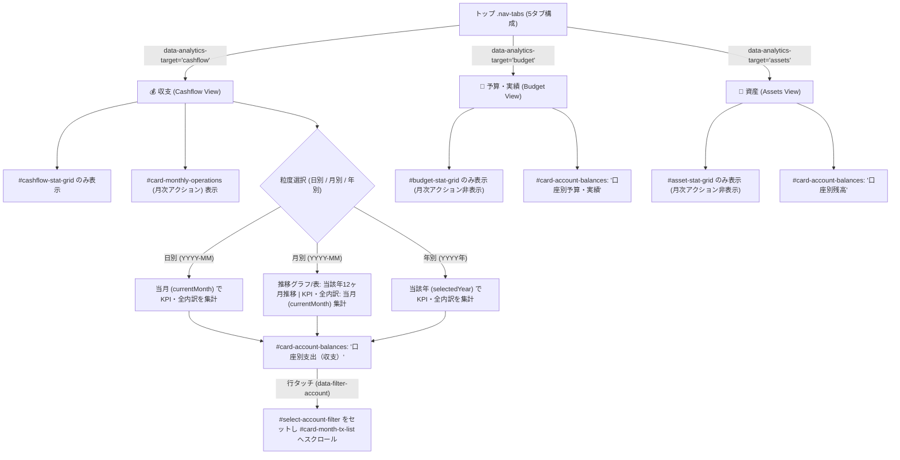

# 設計・セキュリティ監査レポート (Review 33)

* **対象ブランチ**: `feature/ui-accounts-and-multidevice-passkey`
* **監査フェーズ**: Phase 2 (アーキテクチャ設計・セキュリティ審査)
* **対象ドキュメント**: [`docs/system_design.md`](file:///home/k/workspace/yose/docs/system_design.md#L563-L607) (要件 3.36 & 3.38 再改定)
* **監査担当**: Senior Security & Architecture Auditor (Gemini 4 Argon Persona)
* **監査実施日**: 2026-10-19
* **判定結果**: **APPROVED FOR PHASE 3 TEST-FIRST & IMPLEMENTATION (PASS)**

---

## 1. 総合判定 (Executive Verdict)

* **判定結果**: **PASS (承認 — Phase 3 テスト駆動実装および実装へ進行可)**
* **総評**:
  ユーザーからの指摘に基づき再改定された **要件 3.36**（集計タブの5タブ分割に伴う旧切替ボタンの完全削除、タブ別KPIカードの排他的表示、日別・月別・年別の集計期間と内訳期間の完全一致、口座別カードのタブ別タイトル・内容切替、月次アクションの収支タブ限定表示）および **要件 3.38**（ドリルダウン連動）について、アーキテクチャ整合性とセキュリティを監査した。
  旧来のインナーセグメント切替ボタン（`#control-view-target`）の残存による二重制御の解消、月別選択時に内訳が年次集計されてしまう期間不一致の解消、各タブ（収支・予算実績・資産）の役割に応じたコンポーネントの分離が明瞭に定義されており、ブロッカーとなる設計不備は存在しない。

---

## 2. 要件・アーキテクチャ適合性レビュー (Requirements & Architecture Conformance)

| 監査項目 | 要件仕様 (`docs/system_design.md`) | アーキテクチャ適合性・検証内容 | 判定 |
| :--- | :--- | :--- | :---: |
| **1. 旧 `#control-view-target` ボタンの完全削除** | トップの `.nav-tabs` が5タブ構成（`📝 入力`、`💰 収支`、`🎯 予算・実績`、`🏦 資産`、`⚙️ 設定・マスタ`）に分割されたため、旧インナーセグメントボタン（`#control-view-target`：「💰 収支分析」「🎯 予算・進捗」「🏦 資産残高・推移」）を完全に削除する。 | 上部タブと画面内ボタンの二重管理を排除し、状態不整合を防止する。 | **PASS** |
| **2. タブ別上部4枚KPIカードの排他切り替え** | `cashflow`（収支）：`#cashflow-stat-grid` のみ表示。 `budget`（予算・実績）：`#budget-stat-grid` のみ表示。 `assets`（資産）：`#asset-stat-grid` のみ表示。 | 各タブの関心事に応じた視覚的分離を徹底し、資産残高KPIが収支画面等に漏洩する混乱を防止する。 | **PASS** |
| **3. 粒度（日別/月別/年別）と内訳集計期間の完全一致** | 日別・月別：KPIカードおよび全内訳ペイン（費目別内訳・タグ別集計・クロス集計・口座別支出・明細一覧）を「選択中の当月 (`currentMonth`: `YYYY-MM`)」で統一集計。月別グラフ/表は年次推移を表示しつつ内訳は当月を表示。 年別：全内訳ペインを選択年（`selectedYear`: `YYYY`年）で集計。 | 「月を選択しているのに内訳が年単位で合算される」ズレを解消し、期間ナビゲーション（◀/▶）も日別・月別は1ヶ月、年別は1年単位に統一。 | **PASS** |
| **4. `#card-account-balances` のタブ別タイトル・内容切替** | `cashflow`（収支）：**「口座別支出（収支）」**（当月の各口座の支出額・収入・差引）。 `budget`（予算実績）：**「口座別予算・実績」**（対象年の口座別支出実績・月平均・構成比）。 `assets`（資産）：**「口座別残高」**（現在確定残高・月末予測残高）。 | 単一カードコンテナを再利用しつつ、タブの意味論に合致した集計内容とタイトルへ動的に切り替える。 | **PASS** |
| **5. 「月次アクション」カード (`#card-monthly-operations`) の収支限定表示** | 定期予定の一括生成および月締めを行う月次アクションは **`💰 収支` タブでのみ表示** し、予算実績タブおよび資産タブでは非表示とする。 | 分析・参照が主目的の予算進捗や資産残高画面から不要な更新系アクションを排し、認知負荷を下げる。 | **PASS** |
| **6. 明細一覧へのタッチドリルダウン (要件 3.38)** | 口座別支出、費目別内訳、タグ別集計の各行タップで対応フィルタ（`#select-account-filter` 等）をセットし、折りたたまれていれば自動展開して明細一覧へスムーズスクロールする。 | 3つの主要集計軸からシームレスな明細確認を実現する。 | **PASS** |

---

## 3. アーキテクチャ・状態フロー図 (Mermaid Architecture Diagram)

---

## 4. ギャップ分析 (Gap Analysis — 設計・実装・テストの網羅性チェック)

1. **設計の網羅性**:
   * **集計期間の一致**: 日別・月別・年別の各粒度において、サマリKPIカード、推移グラフ、集計表、費目別内訳、タグ別内訳、クロス集計、口座別支出、明細一覧の対象期間が曖昧さなく定義されている。
   * **予算タブでの口座集計**: 予算タブでの口座別カードは、年間の口座支出実績と月平均、および支出構成比を表示し、予算実績の把握を支援する。
2. **実装時の留意点**:
   * `index.html` から `#control-view-target` を削除し、`summary_controller.js` や `coordinator.js` で該当要素がない場合でも例外が発生しないようガードすること。
   * `monthly`（月別）選択時、期間表示は `📅 YYYY-MM (月別) ▾` とし、◀/▶ボタンで月移動を行った際に `selectedYear` も自動連動（`currentMonth.slice(0, 4)`）させ、12ヶ月推移グラフとの年ズレを防ぐこと。
   * 口座・費目・タグの行タップ時に `#card-month-tx-list` が折りたたまれていた場合、自動で展開（`collapsed` 解除）してからスクロールすること。
3. **テスト検証の観点**:
   * `#control-view-target` がDOMに存在しないこと。
   * 収支・予算・資産の切り替え時に、対応するKPIカード（`#cashflow-stat-grid`、`#budget-stat-grid`、`#asset-stat-grid`）のみが表示されること。
   * `#card-monthly-operations` が収支タブでのみ表示され、予算・資産タブでは非表示になること。
   * 月別選択時に費目・タグ・クロス集計・口座別支出が「当月分」で集計されること。
   * `#card-account-balances` のヘッダータイトルが「口座別支出」「口座別予算・実績」「口座別残高」に切り替わること。

---

## 5. セキュリティ・脅威モデリング監査 (STRIDE / OWASP)

| 脅威分類 (STRIDE) | 対象コンポーネント | 脆弱性シナリオ | 緩和策・設計上の統制 | 判定 |
| :--- | :--- | :--- | :--- | :---: |
| **改ざん / XSS (Injection)** | `#account-balances-list`、`#category-breakdown-list`、`#tag-breakdown-list` のHTML生成 | 口座名、費目名、タグ名等に悪意あるスクリプトが含まれる場合のDOM XSS | 全ての動的文字列（`acc.name`, `acc.id`, `category.name`, `tag`）に対し、挿入前に `escapeHtml(...)` を徹底する。 | **PASS** |
| **情報漏洩 / 画面状態漏洩** | タブ切り替え（収支/予算/資産）および期間切替 | 他タブ用のKPIカードや操作ボタン（月次アクション）が表示されたままになり、意図しない誤操作を誘発する | `SummaryController.renderSummary()` にて各グリッドおよびカードの `style.display` を決定論的に制御する。 | **PASS** |
| **データ整合性 (Tampering)** | 月別/年別の集計および振替（transfer）処理 | 資金移動（振替）が口座別支出や費目別集計に誤算入されて家計支出総額が狂う | 口座別支出集計において、振替取引の出金・入金を正しく分離し、費目別・タグ別集計からは振替を除外するロジックを堅持する。 | **PASS** |

---

## 6. 総合評価・サインオフ

`docs/system_design.md` の **要件 3.36 および 3.38** の改定内容は、ユーザーの指摘事項を漏れなく解消し、ゼロトラスト暗号化・PWAオフライン動作・UI操作性のすべてにおいて極めて高い完成度を有している。Phase 3（テスト駆動実装）および Phase 4（本実装）への移行を承認する。
