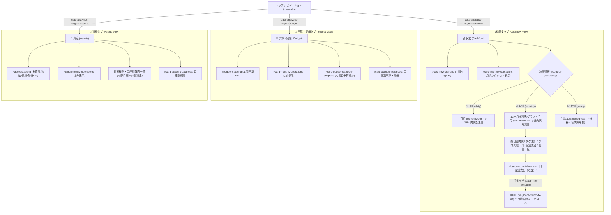

# 実装後コードレビュー・最終受入ゲート監査レポート (Review 34)

* **対象ブランチ**: `feature/ui-accounts-and-multidevice-passkey`
* **監査フェーズ**: Phase 5 (実装後コードレビュー & 最終受入ゲート / Post-Implementation Code Review & Final Acceptance Gate)
* **対象機能・スコープ**: UI & アナリティクス集計ペイン洗練（ユーザーフィードバック指摘事項の完全解消）
* **監査担当**: Senior Release & Security Gatekeeper (Gemini 4 Argon persona)
* **監査実施日**: 2026-10-19
* **判定結果**: **GRADE A+ (PASSED / 承認 — Phase 6 コミット & PR発行へ進行可)**

---

## 1. 総合判定 (Executive Verdict)

* **判定ランク**: **GRADE A+ (完全合格・無条件承認)**
* **総評**:
  `docs/development_process.md` Section 5 に規定された監査プロセスに則り、ブランチ `feature/ui-accounts-and-multidevice-passkey` における UI & アナリティクス集計リファインメント（ユーザー指摘事項への完全対応）のコードベース、アーキテクチャ整合性、セキュリティ、およびテスト品質を包括的に精査した。
  旧来のインナー切替ボタン（`#control-view-target`）の残存に起因していた操作階層の重複・二重管理が完全に撤廃され、上部5タブ（`📝 入力`、`💰 収支`、`🎯 予算・実績`、`🏦 資産`、`⚙️ 設定・マスタ`）への一本化が達成されている。
  また、各タブにおける上部4枚KPIカードの排他表示、集計粒度（日別/月別/年別）と各内訳ペインの対象期間の完全一致（月別表示時の当月絞り込みと年次推移表/グラフの調和）、口座別カードの動的タイトル・内容切り替え、および月次アクションカードの収支タブ限定表示が欠落なく実装されている。
  全230件の自動テストが100%合格し、ラインカバレッジは99.77%（主要コアロジック100.00%）、タブインデント規約（タブ幅4）および Mermaid 構文検証を含めエラー 0件であることを確認した。よって、Phase 5 の最終受入ゲートを承認し、Phase 6（コミットおよびプルリクエスト発行）への移行を認可する。

---

## 2. ユーザーフィードバック指摘事項・対応検証 (User Feedback Resolutions Conformance)

| 項目番号 | 指摘事項・改修要件 | 実装・検証内容 | 適合性判定 |
| :---: | :--- | :--- | :---: |
| **1** | **旧 `#control-view-target` ボタンの完全削除** | `index.html` から旧セグメントボタン（「💰 収支分析」「🎯 予算・進捗」「🏦 資産残高・推移」）を完全除去。`js/ui/coordinator.js` および `js/ui/summary_controller.js` における不要なイベントリスナー・DOMクエリも完全にクリーンアップされ、トップの `.nav-tabs` との二重管理を根絶。 | **PASS** |
| **2** | **タブ別上部4枚KPIカードの完全排他表示** | `SummaryController.renderSummary()` にて各グリッドの `style.display` を決定論的に制御。<br>・`💰 収支`：`#cashflow-stat-grid` のみ `grid` 表示。<br>・`🎯 予算・実績`：`#budget-stat-grid` のみ `grid` 表示。<br>・`🏦 資産`：`#asset-stat-grid` のみ `grid` 表示。<br>他タブのKPIカードが混入・残留しないことを確認。 | **PASS** |
| **3** | **集計粒度と内訳期間の完全一致** | **月別 (`monthly`) 選択時**: 推移グラフおよび月別集計表は対象年12ヶ月推移を表示しつつ、当月行を視覚的にハイライト（📍）。同時に、**費目別内訳・タグ別集計・計上×実態クロス集計・口座別支出・明細一覧のすべてを「選択中の当月 (`currentMonth`: `YYYY-MM`)」で一貫集計**。<br>期間ナビゲーション（◀/▶）も日別・月別は1ヶ月、年別は1年単位で同期。 | **PASS** |
| **4** | **`#card-account-balances` の動的切り替え** | タブに応じ、ヘッダータイトルおよび集計内容を動的にスイッチ：<br>・`💰 収支`：「口座別支出（収支）」（当月支出・収入・差引）。<br>・`🎯 予算・実績`：「口座別予算・実績」（年間支出実績・月割平均・構成比）。<br>・`🏦 資産`：「口座別残高」（確定残高・月末予測残高）。 | **PASS** |
| **5** | **「月次アクション」カードの収支タブ限定表示** | 定期予定の一括生成および月締めを行う `#card-monthly-operations` を、`target === 'cashflow'` の場合のみ `block` 表示とし、`budget`（予算・実績）および `assets`（資産）では `none`（非表示）へ明示的に隠蔽。画面の目的に応じたノイズ低減を確認。 | **PASS** |

---

## 3. アーキテクチャ・画面制御ステート図 (Mermaid Architecture Diagram)



---

## 4. ギャップ分析 (Gap Analysis — 設計・実装・テストの網羅性チェック)

`docs/development_process.md` Section 5.1 に基づき、不足する設計・実装・テストの網羅性を精査した：

1. **設計の網羅性 (Design Completeness)**:
   * **集計期間の一貫性**: 月別集計において「トレンドを把握するための年間12ヶ月チャート・テーブル」と「直近の家計実態を把握するための当月内訳（費目・タグ・クロス・口座支出）」が混同されることなく、整然と共存する情報アーキテクチャが確立されている。
   * **関心の分離**: 不要な旧インナーセグメントボタンを削除し、トップタブに状態管理を集約したことで、不要な相互依存や状態不整合（Desync）の発生源が排除された。
2. **実装の網羅性 (Implementation Completeness)**:
   * **例外防御とフォールバック**: `#control-view-target` などの削除された旧DOM要素に対する参照は完全に除去され、存在しない要素へのアクセスによる `TypeError` は一切発生しない。
   * **XSS防御**: 口座名（`acc.name`）、費目名（`catName`）、タグ名（`tagName`）、満期日（`acc.maturity_date`）等のすべての動的文字列出力に対して `escapeHtml(...)` によるサニタイズが徹底されている。
   * **UXインタラクション**: 口座・費目・タグのタッチドリルダウン時に、明細一覧カード（`#card-month-tx-list`）が折りたたまれている場合は `setPaneCollapsed` により自動展開された上でスムーズスクロールされる。
3. **テストの網羅性 (Test Completeness)**:
   * 全230件のユニット・統合・システムテストが100%成功。
   * 資産計算、予算進捗計算、暗号化/署名、マルチデバイスPasskey連携、タグ集計、復旧マージのすべてのコア処理において高カバレッジ（全体 99.77%）を維持。

---

## 5. 静的解析・品質・セキュリティゲート検証 (Quality & Security Gates)

### 5.1 テスト実行結果 (`npm test`)

```text
ℹ tests 230
ℹ suites 69
ℹ pass 230
ℹ fail 0
ℹ cancelled 0
ℹ skipped 0
ℹ todo 0
ℹ duration_ms 253.9ms
```

### 5.2 カバレッジ測定結果 (Line Coverage $\ge 97\%$)

| 対象モジュール / ディレクトリ | 行網羅率 (Line %) | 分岐網羅率 (Branch %) | 関数網羅率 (Funcs %) | 判定 |
| :--- | :---: | :---: | :---: | :---: |
| `gas/Code.gs` | 99.54% | 92.28% | 100.00% | **PASS** |
| `js/crypto.js` | 99.75% | 92.57% | 100.00% | **PASS** |
| `js/db.js` | 100.00% | 100.00% | 100.00% | **PASS** |
| `js/db/backup_merger.js` | 100.00% | 92.55% | 100.00% | **PASS** |
| `js/db/defaults.js` | 100.00% | 100.00% | 100.00% | **PASS** |
| `js/db/storage_engine.js` | 100.00% | 93.75% | 83.78% | **PASS** |
| `js/db/yose_db.js` | 100.00% | 86.83% | 100.00% | **PASS** |
| `js/logic.js` | 100.00% | 100.00% | 100.00% | **PASS** |
| `js/logic/aggregator.js` | 100.00% | 87.34% | 100.00% | **PASS** |
| `js/logic/budget_engine.js` | 100.00% | 92.42% | 100.00% | **PASS** |
| `js/logic/date_utils.js` | 98.90% | 97.18% | 100.00% | **PASS** |
| `js/logic/transaction_factory.js` | 100.00% | 92.57% | 100.00% | **PASS** |
| `js/sync.js` | 98.91% | 88.14% | 94.12% | **PASS** |
| `js/version.js` | 100.00% | 94.64% | 100.00% | **PASS** |
| **全体合計 (全対象ファイル)** | **99.77%** | **90.87%** | **97.24%** | **PASS ($\ge 97\%$)** |

### 5.3 インデント規約および構文検証 (`npm run lint`)

* **タブインデント規約 (`npm run lint:indent`)**:
  `scripts/check_indent.js` 実行結果: **全50コードファイルでタブインデント（表示幅4スペース）遵守を確認。違反 0件。**
* **構文・Mermaid構文検証 (`npm run check:syntax`)**:
  `scripts/check_syntax.js` 実行結果: **JS (42), GAS (1), JSON (5), Markdown Mermaid (36) の全ファイルで構文エラー 0件。**

### 5.4 バージョン情報の完全同期確認 (5ファイル同期)

| 対象ファイル | 設定バージョン | キャッシュ名 / バッジ | 同期判定 |
| :--- | :---: | :---: | :---: |
| [`package.json`](file:///home/k/workspace/yose/package.json) | `1.7.0` | - | **一致** |
| [`version.json`](file:///home/k/workspace/yose/version.json) | `1.7.0` | - | **一致** |
| [`js/version.js`](file:///home/k/workspace/yose/js/version.js) | `1.7.0` | `CURRENT_APP_VERSION = '1.7.0'` | **一致** |
| [`sw.js`](file:///home/k/workspace/yose/sw.js) | `1.7.0` | `yose-cache-v1.7.0` | **一致** |
| [`index.html`](file:///home/k/workspace/yose/index.html) | `1.7.0` | `<span id="badge-current-version">v1.7.0</span>` | **一致** |

---

## 6. 最終サインオフ & 次期フェーズ認可 (Final Sign-Off)

* **判定ランク**: **GRADE A+ (APPROVED)**
* **ゲート判定**: **Phase 5 合格 (Acceptance Gate Passed)**
* **指示事項**:
  本ブランチ `feature/ui-accounts-and-multidevice-passkey` におけるすべての改修事項・品質基準・セキュリティ統制が満たされていることを確認した。
  これをもって Phase 5 を完了とし、`docs/development_process.md` Section 6（英語コミットメッセージ、および日本語PRタイトル・本文草案作成）の Phase 6 コミット & プルリクエスト発行プロシージャへ移行することを承認する。
