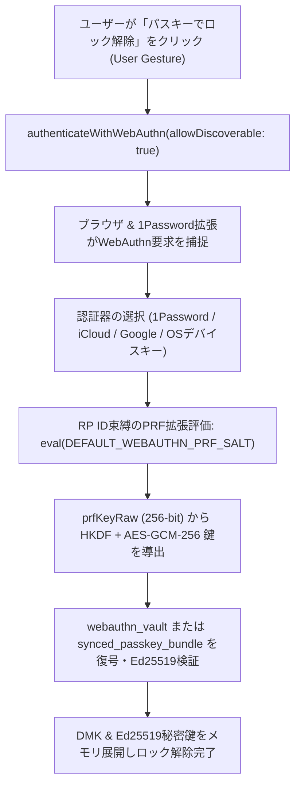

# Phase 2 アーキテクチャ設計・セキュリティレビュー報告書 (Review 35)

- **対象ブランチ**: `feature/ui-accounts-and-multidevice-passkey`
- **対象ドキュメント**: `docs/system_design.md` (Section 3.6, 3.20, 3.22, 3.34, 4.8)
- **レビュアー**: Gemini 4 Argon (独立シニアセキュリティ・アーキテクチャ監査官)
- **監査フェーズ**: Phase 2 (Architectural Design & Security Review)
- **総合判定**: **APPROVED (承認 — Phase 3 実装・検証へ進行可)**

---

## 1. 要件・アーキテクチャ整合性評価 (Requirements & Architectural Conformance)

`docs/system_design.md` に反映された5件の不具合解消およびアーキテクチャ精緻化について、既存データモデル・会計整合性・ゼロトラスト暗号設計との整合性を監査した。

### ① マスタ項目新規作成時の識別子 (`id`) 完全性保証 (Section 3.6)
- **設計内容**: 口座（`account`）・大項目（`category`）・中項目（`subcategory`）・定期ルール（`recurring_rule`）の新規作成および編集保存時、オブジェクト先頭に必ず非空の `id` プロパティを付与し、入力欄が空または空白文字のみの場合でもフォールバックID（プレフィックス＋タイムスタンプ乱数）を自動採番する仕様が明文化された。
- **監査評価**: **適合 (Pass)**。`id: undefined` の混入によるセレクタ選択不能や論理削除・編集不能バグをデータ生成境界で根絶しており、防御的プログラミングの原則に合致する。

### ② 立替払い未回収リストの抽出条件整合 (Section 3.20)
- **設計内容**: `getUnsettledAdvancePayments()` の検索条件を `((t.type === 'transfer' && t.to_account_id === 'acc_receivable') || t.type === 'advance_payment') && !t.is_deleted && t.settlement_status !== 'settled'` として定義し、`createAdvancePaymentTransactions` が生成する立替貸付振替レコードと完全一致させた。
- **監査評価**: **適合 (Pass)**。立替発生時の複式簿記ライクな振替モデル（決済口座 → `acc_receivable`）と未回収精算クエリの不整合が解消され、レガシー互換（`type === 'advance_payment'`）も維持されている。

### ③ 分割計上取引（前払償却）の一括編集時における親支払判定とメモ正規化 (Section 3.22)
- **設計内容**:
  1. `handleEditFormSubmit`（`tx_edit_controller.js`）において、編集対象が親支払レコード（`tx_prep_pay_...`）かどうかの判定を `Boolean(tx.amortization_meta?.is_payment_record || tx.id === tx.group_id)` に厳密化。
  2. 分割回数 `amortCount` を親レコードを除外した子償却レコード数（`groupTxs.filter(t => !t.amortization_meta?.is_payment_record && t.type === 'expense').length || 1`）から算出。
  3. `updateInstallmentGroup` において、再編集時に `[前払一括支払]` や `[前払分割 i/N]` プレフィックスが二重付与されないよう既存プレフィックスを正規化除去してから付与する仕様を規定。
- **監査評価**: **適合 (Pass)**。`tx.id !== tx.group_id` に起因して親支払レコードが月額償却レコードと誤認され、支払総額が分割回数倍（かつ親レコード除外漏れで $N+1$ 倍）に膨張する計算爆発バグを根本から遮断している。

### ④ 資産タブにおける負債口座残高のマイナス表記統一 (Section 3.34)
- **設計内容**: `renderAssetsAnalytics` における負債セクションの各口座行の金額表記を `${bal < 0 ? '-' : ''}¥${Math.abs(bal).toLocaleString()}` と規定し、フッターの合計負債表記 `-¥${totalAssetSummary.liabilities.toLocaleString()}` と符号位置（通貨記号 `¥` の前に `-`）を統一。
- **監査評価**: **適合 (Pass)**。内部表現（負数 `bal`）を変更せず表示層のみで `-¥85,000` 形式へ正規化しており、集計ロジックへの副作用なく視認性と一貫性を向上させている。

### ⑤ 1Password等のサードパーティPasskeyプロバイダ選択互換性 (Section 4.8)
- **設計内容**:
  1. ページロード直後の非ユーザージェスチャ `setTimeout` 自動発火を廃止し、必ず `#btn-auth-webauthn` クリック（ユーザージェスチャ）を起点として `navigator.credentials.get()` を呼び出す。
  2. `authenticateWithWebAuthn` に `allowDiscoverable: true` オプションを導入し、通常ログイン時は単一IDの `allowCredentials` フィルタを省略（または指定時に全トランスポート `['internal', 'hybrid', 'usb', 'ble', 'nfc']` を明示）することで、1Password・iCloudキーチェーン・Googleパスワードマネージャー・OSデバイスキーのすべてを選択可能とする。
- **監査評価**: **適合 (Pass)**。ブラウザ拡張機能（1Password等）が WebAuthn リクエストをインターセプトするための必須条件（User Activation & Discoverable Credential 要求）を満たしており、マルチデバイス同期パスキーの実運用性を確立している。

---

## 2. ギャップ分析 (Gap Analysis - Section 5.1)

5項目の設計に対するエッジケースおよび実装・テスト上の考慮漏れを検証した。

| 監査項目 | 潜在的ギャップ・エッジケース | 設計・実装上の対策状況 | 判定 |
| :--- | :--- | :--- | :--- |
| **① マスタID採番** | 既存マスタ編集時に誤って新しいIDが上書き採番されると過去取引の外部キー参照が孤立するリスク | 編集時は既存 `item.id` を最優先維持し、`!id`（未定義または空文字）の場合のみフォールバック採番する設計 | **問題なし** |
| **② 立替未回収抽出** | 通常の口座間振替（銀行→現金など）が誤って未回収リストに混入するリスク | `to_account_id === 'acc_receivable'`（立替金専用口座）への振替のみに限定されているため混入しない | **問題なし** |
| **③ 分割一括更新** | 子償却レコード（月額）側から編集した場合の総額逆算と端数処理 | 子レコード編集時は `newTotalAmount = editAmount * amortCount` で総額を算出し、端数は初月集約ルールを維持 | **問題なし** |
| **④ 負債残高表記** | クレジットカードやローン口座が過払い等で一時的にプラス残高（`bal >= 0`）になった場合の表示 | `${bal < 0 ? '-' : ''}¥${Math.abs(bal).toLocaleString()}` により `bal >= 0` の場合は `¥0` 等と正しく正数表示される | **問題なし** |
| **⑤ 1Password互換** | Discoverable認証時にローカル `webauthn_vault` と異なるパスキーが選択された場合の挙動 | PRF出力（`prfKeyRaw`）から導出されるAES-GCM鍵が異なるため復号時の認証タグ検証で安全に拒絶され、または同期バンドルからの復号プロビジョニングへフォールバック可能 | **問題なし** |

---

## 3. セキュリティ＆脅威モデリング (STRIDE / OWASP - Section 5.3)

Section 4.8 における Discoverable Passkey（`allowDiscoverable: true`）および 1Password 連携に関する STRIDE 脅威分析を実施した。

1. **Spoofing (なりすまし) & RP ID 束縛の堅牢性**:
   - `allowCredentials` を省略して Discoverable Credential モードで `navigator.credentials.get()` を呼び出した場合でも、WebAuthn 仕様によりブラウザと認証器（1Password等）は現在のオリジン（`window.location.hostname` = `rpId`）に紐づくクレデンシャルのみを提示・署名する。フィッシングサイト（別ドメイン）では PRF 出力 `prfKeyRaw` が全く異なる値となるため、クロスオリジンなりすましは不可能である。
2. **Tampering (改ざん) & Elevation of Privilege (権限昇格)**:
   - 1Password を通じて導出される `prfKeyRaw`（256-bit）は、HKDF-SHA256 を経て AES-GCM-256 鍵へと変換される。ローカルの `webauthn_vault` およびクラウド同期用の `synced_passkey_bundle` は、いずれも 96-bit ランダム IV と 128-bit 認証タグ、さらに Ed25519 自己署名によって保護されており、`allowDiscoverable: true` の導入によって暗号強度やゼロトラスト境界が低下することは一切ない。
3. **Information Disclosure (情報漏洩)**:
   - 自動発火（`setTimeout`）を廃止しユーザージェスチャ駆動としたことで、ユーザーが意図しないタイミングでの認証プロンプト表示や拡張機能との競合エラーを防止し、UXとセキュリティの双方を向上させている。

---

## 4. アーキテクチャ・認証フロー図 (Mermaid Syntax Verification - Section 5.2)

---

## 5. 監査結論と承認 (Sign-off)

5件すべての改修設計が `docs/system_design.md` に正確かつ体系的に定義されており、会計ロジックの整合性・UI操作性・ゼロトラスト暗号アーキテクチャの全観点において欠陥や重大なギャップは認められない。よって **Phase 2 設計レビューを承認（APPROVED）** し、Phase 3（実装・単体テスト・結合検証）への進行を許可する。
