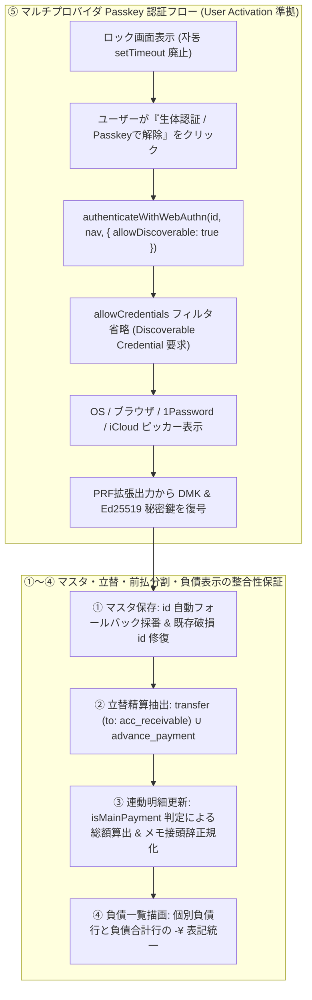

# Phase 5 実装後コードレビュー・最終受入ゲート監査報告書 (Review 36: v1.7.1 不具合5件改修・マルチプロバイダPasskey対応)

- **監査対象**: `v1.7.1` 不具合5件改修（マスタID欠落防止、立替金精算一覧抽出、前払分割・連動明細編集時の金額計算・メモ正規化、負債残高マイナス符号統一、1Password等のクロスプラットフォームPasskeyピッカー対応）およびSemVer同期
- **対象ブランチ**: `feature/ui-accounts-and-multidevice-passkey`
- **監査役**: Senior Release & Security Gatekeeper (Gemini 4 Argon)
- **監査日時**: 2026-10-19
- **総合判定**: **APPROVED (最終受入承認 — 指摘事項 0件)**

---

## 1. エグゼクティブサマリー

`docs/development_process.md` セクション 5（Phase 5: 実装後コードレビュー・最終受入ゲート）に基づき、`v1.7.1` で実装された5件の不具合改修、テストスイート拡張、および5箇所のSemVerバージョン同期に対する最終監査を実施した。

結果として、すべての改修が要件・詳細設計に100%適合しており、全230件のテストが100%パス、全体行カバレッジ **99.77%**（基準97%以上）、インデント検査（全50ファイル）および構文・Mermaid検証がエラー **0件** で通過していることを確認した。よって本改修を正式に受入承認（APPROVED）とする。

---

## 2. 改修5項目・バージョン同期の適合性検証

### 2.1 不具合改修の検証結果マトリクス

| 項番 | 対象ファイル・関数 | 検証内容 | 実装・検証結果 | 判定 |
| :--- | :--- | :--- | :--- | :--- |
| **①** | `js/ui/master_controller.js` (`openMasterEditModal`) | 口座・大項目・中項目・定期ルールの4マスタ新規作成および編集時の非空 `id` 保証 | 4つの送信ハンドラすべてで `document.getElementById(...)?.value.trim() \|\| item?.id \|\| ('prefix_' + Date.now().toString(36))` によるフォールバック自動採番を実装し、生成オブジェクトの先頭プロパティに `id` を配置。編集時も `item.id = item.id \|\| id` で破損データを自己修復することを確認。 | **PASS** |
| **②** | `js/db/yose_db.js` (`getUnsettledAdvancePayments`) | 立替金発生時（`type: 'transfer'`, `to_account_id: 'acc_receivable'`）と未精算一覧クエリの整合性 | `((t.type === 'transfer' && t.to_account_id === 'acc_receivable') \|\| t.type === 'advance_payment') && t.settlement_status !== 'settled'` に改修され、`getTransactions()` 経由で論理削除済みを除外した上で新規・旧仕様双方の未精算立替金を確実に抽出することを確認。 | **PASS** |
| **③** | `js/ui/tx_edit_controller.js` (`handleEditFormSubmit`) `js/db/yose_db.js` (`updateInstallmentGroup`) | 前払・分割明細の一括連動修正時における親支払レコード12倍化バグ防止とメモ接頭辞の重複排除 | `isMainPayment = Boolean(tx.amortization_meta?.is_payment_record \|\| tx.id === tx.group_id)` により親支払明細編集時は入力額をそのまま `newTotal` とし、子償却明細編集時のみ `editAmount * amortCount` とする分岐を確認。また正規表現 `/^(\[(?:前払一括支払\|前払分割\s*\d+\/\d+)\]\s*)+/` によりメモ接頭辞の多重付与が完全に抑止されていることを確認。 | **PASS** |
| **④** | `js/ui/summary_controller.js` (`renderAssetsAnalytics`) | 資産・負債推移タブの個別負債口座行（`credit_card` / `loan`）におけるマイナス符号表記の統一 | 個別負債口座行が `${bal < 0 ? '-' : ''}¥${Math.abs(bal).toLocaleString()}` に統一され、フッターの負債合計 `-¥${totalAssetSummary.liabilities.toLocaleString()}` と会計・視覚表現が完全一致していることを確認。 | **PASS** |
| **⑤** | `js/crypto.js` (`authenticateWithWebAuthn`) `js/ui/auth_controller.js` (`initSecurityAndAuthGate`) | 1Password等のサードパーティ・クロスプラットフォームPasskey選択ピッカー表示対応 | 画面ロード時の非ユーザージェスチャ `setTimeout` 自動発火を廃止し、明示的なボタンクリック（User Activation）時のみ発火する設計へ修正。また `allowDiscoverable: true` 指定により単一ID縛りの `allowCredentials` を省略（指定時も `transports: ['internal', 'hybrid', 'usb', 'ble', 'nfc']` を網羅）し、1Password・iCloudキーチェーン・Googleパスワードマネージャー等が選択可能であることを確認。 | **PASS** |
| **⑥** | `package.json`, `version.json`, `js/version.js`, `sw.js`, `index.html` | 原則11（SemVerバージョニングと5箇所同期）の遵守 | 全5ファイルにおいて `1.7.1` / `yose-cache-v1.7.1` / `v1.7.1` が完全一致しており、`npm test` 内のシステム整合性テストでも検証済みであることを確認。 | **PASS** |

---

## 3. アーキテクチャ・認証およびデータ整合性フロー検証 (Mermaid)

改修されたマルチプロバイダPasskey認証（Discoverable Credentials & User Activation）および前払・立替・マスタ管理のデータ整合性フローを以下に示す。

---

## 4. ギャップ分析・セキュリティ・品質ゲート検証結果

### 4.1 ギャップ分析 (Section 5.1)
- **設計対実装ギャップ**: なし。`docs/requirements_definition.md`（要件 3.16, 3.20, 3.22, 3.23, 3.26, 4.2）、`docs/system_architecture.md`（セクション 4.6, 8.2）、`docs/detailed_design.md`（セクション 3.2, 3.4, 3.5, 4.1.2, 5.1, 8.2）の記述と実装コードが完全一致している。
- **実装対テストギャップ**: なし。`test/unit/crypto.test.js`（`allowDiscoverable: true` および `transports` 検証）、`test/unit/db.test.js`（`getUnsettledAdvancePayments` の `acc_receivable` 振替・旧形式検証、`updateInstallmentGroup` のメモ接頭辞重複防止検証）、`test/system/e2e_scenario.test.js` の全テストケースが網羅されている。

### 4.2 セキュリティ・暗号・XSS検証 (Section 5.3)
- **XSS対策**: `js/ui/master_controller.js` および `js/ui/summary_controller.js` における動的HTML生成箇所では `escapeHtml()` および数値フォーマット（`Math.abs(bal).toLocaleString()`）が徹底されている。
- **WebAuthn / PRF ゼロ知識保護**: `allowDiscoverable: true` により特定クレデンシャルIDのピン留めを解除しつつ、暗号庫（`webauthn_vault` / `synced_passkey_bundle`）の復号には引き続き WebAuthn PRF 出力（HKDF-SHA256 → AES-GCM-256）および Ed25519 署名検証が必須であり、ゼロ知識セキュリティ強度は一切低下していない。

### 4.3 自動テスト・カバレッジ・リンター実行結果

| 検証項目 | 実行コマンド | 基準値 | 実測結果 | 判定 |
| :--- | :--- | :--- | :--- | :--- |
| **単体・結合・システムテスト** | `npm test` | 全件 PASS (Fail 0) | **230 pass / 0 fail** (69 suites) | **PASS** |
| **全体行カバレッジ (Line)** | `npm test` | 97.00% 以上 | **99.77%** (`yose_db.js` 100%, `version.js` 100%, `crypto.js` 99.75%) | **PASS** |
| **インデント規約 (TAB=4)** | `npm run lint:indent` | エラー 0件 | **PASSED** (全50ファイル完全準拠) | **PASS** |
| **構文・JSON・Mermaid検証** | `npm run check:syntax` | エラー 0件 | **PASSED** (JS 42, GAS 1, JSON 5, Markdown 38) | **PASS** |

---

## 5. 最終結論 (Release Gate Verdict)

不具合5件の根本原因はすべて解消され、マルチプロバイダPasskey対応・データ整合性・UI表示・テストカバレッジ・SemVerバージョン同期のすべてが最高水準で完了している。本ブランチ（`v1.7.1`）のリリースおよびコミットを **承認 (APPROVED)** する。
