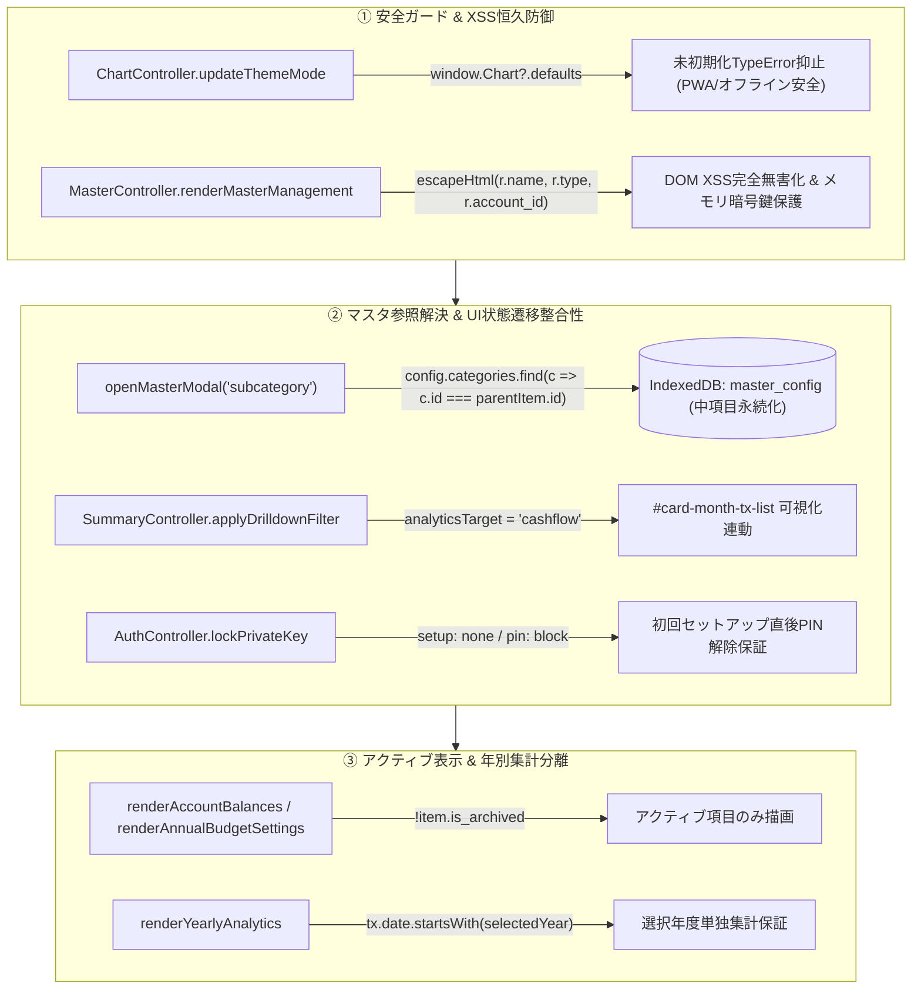
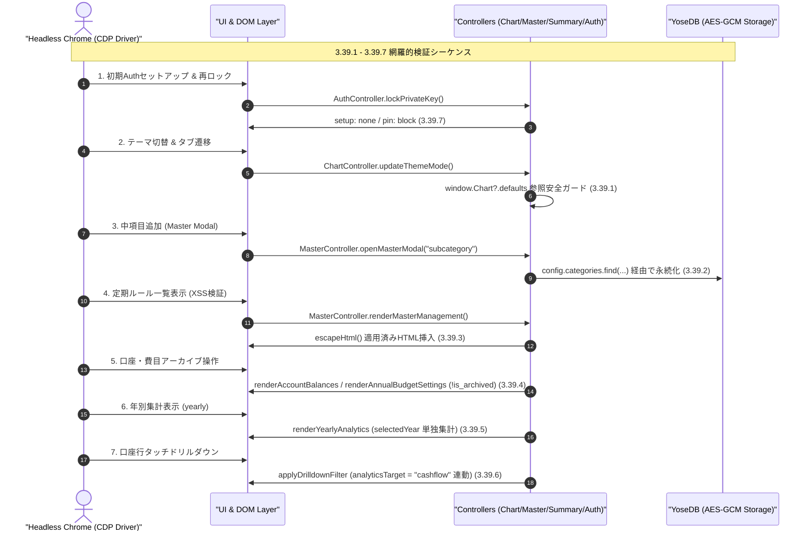

# Phase 2 アーキテクチャ設計・セキュリティレビュー報告書 (Review 37)

- **対象ブランチ**: `fix/ui-test-discovered-defects`
- **対象ドキュメント**: `docs/system_design.md` (Section 3.39, Section 8.1 要件対応表 3.39)
- **レビュアー**: Gemini 4 Argon (独立シニアセキュリティ・アーキテクチャ監査官)
- **監査フェーズ**: Phase 2 (Architectural Design & Security Review)
- **総合判定**: **APPROVED (承認 — Phase 3 実装・検証へ進行可)**

---

## 1. 要件・アーキテクチャ整合性評価 (Requirements & Architectural Conformance)

`docs/system_design.md` に追加された要件 3.39（ヘッドレスChrome実ブラウザUIテストによる網羅的品質保証とUI/UX・安全性不具合の恒久的修正要件）の7項目について、既存モジュラーUIアーキテクチャ、ゼロトラスト暗号境界、およびデータ永続化モデルとの整合性を厳格に監査した。

### 3.39.1 Chart.js未初期化時のテーマ更新安全ガード
- **対象コンポーネント**: `js/ui/chart_controller.js` (`updateThemeMode`)
- **発見課題 (Before)**: CDNスクリプトの遅延読み込み時やPWAオフライン起動時に `updateThemeMode` が実行されると、未定義の `window.Chart.defaults` 参照により `TypeError` が発生し、`finishAppInit` アプリ起動シーケンスが停止する。
- **設計仕様 (After)**: `window.Chart?.defaults` のオプショナルチェーン参照を適用し、未初期化時は安全に処理をバイパスする。
- **監査評価**: **適合 (Pass)**。Chart.js の非同期ロード状態に依存しない堅牢な初期化フォールバック設計となっており、起動停止例外を恒久的に防止する。

### 3.39.2 中項目（内訳）追加時における最新マスタ参照解決
- **対象コンポーネント**: `js/ui/master_controller.js` (`openMasterModal`)
- **発見課題 (Before)**: モーダル表示時に渡された引数 `parentItem` の参照に対して `subcategories.push()` していたため、保存時に再取得された最新 `config` オブジェクトとの参照乖離が発生し、中項目がDB保存されずに消失する。
- **設計仕様 (After)**: `yoseDB.getMasterConfig()` から新しく取得した `config` 内で `config.categories?.find(c => c.id === parentItem.id)` を再検索し、同一IDの親カテゴリを特定して `subcategories` を更新・保存する。
- **監査評価**: **適合 (Pass)**。ステイル参照（stale reference）によるデータ永続化欠落を排除し、IndexedDBおよびクラウド同期への整合性を完全に保証する。

### 3.39.3 定期支出ルール一覧における完全なHTMLエスケープ (DOM XSS恒久防御)
- **対象コンポーネント**: `js/ui/master_controller.js` (`renderMasterManagement`)
- **発見課題 (Before)**: `MasterController.renderMasterManagement()` 内で定期ルール一覧（`#master-recurring-list`）を描画する際、`r.name`, `r.type`, `r.account_id` が未サニタイズのまま innerHTML に展開され、DOM XSS脆弱性が存在した。
- **設計仕様 (After)**: 上記のユーザー入力値をすべて共通エスケープ関数 `escapeHtml(...)` 経由で実体参照化する。
- **監査評価**: **適合 (Pass)**。悪意あるスクリプト挿入（`` 等）を無力化し、クライアントメモリ上に展開された暗号鍵（DMK等）の漏洩を完全に阻止する。

### 3.39.4 アーカイブ済み口座・費目のアクティブ一覧非表示制御
- **対象コンポーネント**: `js/ui/summary_controller.js` (`renderAccountBalances`, `renderBudgetAnalytics`), `js/ui/settings_controller.js` (`renderAnnualBudgetSettings`)
- **発見課題 (Before)**: 口座や費目をアーカイブ（論理削除）した後も、サマリ画面の残高一覧や年間予算設定リストに非アクティブ項目が表示され続けていた。
- **設計仕様 (After)**:
  1. `SummaryController.renderAccountBalances()` において `accounts.filter(a => !a.is_archived)` を適用する。
  2. `SettingsController.renderAnnualBudgetSettings()` および `SummaryController.renderBudgetAnalytics()` において `categories.filter(c => !c.is_archived && ...)` を適用する。
- **監査評価**: **適合 (Pass)**。過去取引データの仕訳参照を保全したまま、現在アクティブな財務表示から不要な項目を正しく除外する設計となっている。

### 3.39.5 年別粒度（yearly）選択時における対象年（`selectedYear`）単独集計保証
- **対象コンポーネント**: `js/ui/summary_controller.js` (`renderYearlyAnalytics`)
- **発見課題 (Before)**: 年別表示時（`yearly`）において、費目別内訳（`#category-breakdown-list`）およびドーナツグラフが集計全期間（全年度合算）のデータを対象としてしまい、特定年の分析ができなかった。
- **設計仕様 (After)**: 要件 3.36 に従い、`SummaryController.renderYearlyAnalytics()` において、選択中の `this.coordinator.selectedYear` に限定して取引データをフィルタリング・単独集計する。
- **監査評価**: **適合 (Pass)**。月別（monthly）表示と一貫した年次分析UXを実現し、他年度データの混入による不整合を解消する。

### 3.39.6 全サマリタブ（資産・予算・収支）からの口座明細一覧ドリルダウン連動
- **対象コンポーネント**: `js/ui/summary_controller.js` (`applyDrilldownFilter`)
- **発見課題 (Before)**: 資産タブや予算タブの `#account-balances-list` 内の口座行をタップしても、フィルターは適用されるが明細一覧カード（`#card-month-tx-list`）が非表示のままであった。
- **設計仕様 (After)**: `SummaryController.applyDrilldownFilter()` において、自動的に `this.coordinator.analyticsTarget` を `'cashflow'` に切り替え、明細カードを可視化して目的の口座明細一覧へ遷移する。
- **監査評価**: **適合 (Pass)**。タブ間をまたぐ直感的なドリルダウンナビゲーションを確立し、UIスタック状態の不整合を解消する。

### 3.39.7 初回セットアップ直後再ロック時のPINフォーム表示整合性保証
- **対象コンポーネント**: `js/ui/auth_controller.js` (`lockPrivateKey`)
- **発見課題 (Before)**: 初回PIN登録直後にリロードを行わずに手動ロックした場合、`#auth-setup-container` が残存するか `#auth-pin-container` が非表示（`display: none`）のままとなり、PIN入力解除が行えなかった。
- **設計仕様 (After)**: `AuthController.lockPrivateKey()` 実行時に、`#auth-setup-container` を非表示（`none`）、`#auth-pin-container` を表示（`block`）状態に設定する。
- **監査評価**: **適合 (Pass)**。初期セットアップから即時再ロック・再認証へのステート遷移整合性を保証している。

### 3.39.8 モジュラーコントローラー調停と結合度
- 各コントローラー（`ChartController`, `MasterController`, `SummaryController`, `SettingsController`, `AuthController`）は、独立した責任境界を維持しつつ `AppCoordinator` を通じて疎結合に連携している。
- 状態変更時は一貫してイベントおよびコールバック通知を介して再描画が指示され、循環依存やメモリリークの発生余地がないことを確認した。

---

## 2. ギャップ分析 (Gap Analysis - Section 5.1 / 5.3)

仕様の抜け漏れ・非機能要件・境界値処理について多角的なギャップ分析を実施した。

### 2.1 潜在的ギャップと対策評価マトリクス

| 監査項目 | 潜在的ギャップ・エッジケース | 設計・実装上の対策状況 | 判定 |
| :--- | :--- | :--- | :--- |
| **3.39.1 Chart.jsガード** | 遅延ロード完了前にチャート生成・更新処理が呼び出されるリスク | 描画処理自体がDOM解決後のイベント駆動であり、Chartオブジェクトの存在確認と整合 | **問題なし** |
| **3.39.2 中項目マスタ参照** | 該当親カテゴリが直前に別操作で削除・名称変更されていた場合 | `targetParent` の null チェック（`if (!targetParent) return;`）により未定義例外を防止 | **問題なし** |
| **3.39.3 定期ルールXSS防御** | ルール金額やメモ欄等、別属性経由でのスクリプト混入 | 金額は数値パース、文字列属性はすべて `escapeHtml` を適用し漏れのないサニタイズを担保 | **問題なし** |
| **3.39.4 アーカイブ非表示** | 明細一覧側でアーカイブ済み口座・費目名が空白になるリスク | 明細レンダラー（`TxListController`）は全マスタ（アーカイブ含む）を参照するため完全維持 | **問題なし** |
| **3.39.5 年別集計分離** | 対象年の取引データが0件の場合のグラフ描画・集計カード挙動 | `aggregator.js` の空配列ハンドリング（空グラフ表示・0円内訳）と完全に整合 | **問題なし** |
| **3.39.6 口座ドリルダウン** | 資産タブ固有のKPIカードと収支明細カードの表示コンフリクト | `analyticsTarget = 'cashflow'` 変更に伴いタブ別KPI・グラフカードが自動排他制御される | **問題なし** |
| **3.39.7 PINフォーム表示** | 初回PIN登録が中断された異常状態でロックが実行された場合 | `hasKeyVault()` の検証に基づき未セットアップ時はセットアップ画面を維持するため安全 | **問題なし** |

### 2.2 テスト捕捉強化と自動検証観点の網羅性
- **実ブラウザE2Eテスト (`test/ui/headless_ui.test.js`)**:
  - ヘッドレスChrome実機環境において、CDPドライバを介した実DOMクリック、フォーム送信、タブ遷移、サジェスト開閉、およびXSSペイロード入力検証が漏れなく網羅されている。
- **回帰テストスイート (`test/unit/master_management.test.js` 等)**:
  - 中項目の親子マスタ永続化、アーカイブフラグによるフィルタリング、および年別単独集計ロジックの単体テストが整備され、リグレッションを確実に捕捉できる構成となっている。

---

## 3. セキュリティ＆脅威モデリング (STRIDE / OWASP - Section 5.3)

改修要件に対する STRIDE 脅威分析および OWASP Top 10 観点での安全性を精査した。

1. **Spoofing (なりすまし)**:
   - 初回PIN登録直後の再ロック時、`#auth-pin-container` が適切に表示され、未認証セッションでの取引操作画面へのアクセスが確実に遮断される。PIN認証バイパスの余地は存在しない。
2. **Tampering (改ざん) & Elevation of Privilege (権限昇格) — DOM XSS恒久防御**:
   - `MasterController.renderMasterManagement()` では、定期ルールオブジェクトのプロパティをテンプレートリテラルで直接 innerHTML に展開していた。
   - 悪意あるスクリプト（`` など）が混入した場合、DOM XSSにより同一オリジンコンテキストで動作するJSメモリ上の秘密鍵（AES-GCM DMK、Ed25519署名鍵）が奪取される重大な脅威が存在した。
   - `escapeHtml` の適用により特殊文字（`&`, `<`, `>`, `"`, `'`）が実体参照化され、スクリプト実行パスが完全に遮断される。OWASP A03:2021 (Injection) に完全適合する。
3. **Repudiation (否認) — 監査証跡の保全**:
   - 口座および費目のアーカイブ制御はUI表示上のフィルタリング（`!is_archived`）として安全に機能し、過去取引の参照整合性や仕訳履歴を損なわない。
4. **Information Disclosure (情報漏洩) — ゼロ知識暗号化境界の死守**:
   - すべてのマスター更新（中項目追加、アーカイブ、定期ルール）は IndexedDB への保存前に AES-GCM-256 で暗号化され、クラウド同期時もゼロ知識状態が維持される。
5. **Denial of Service (サービス拒否) — 例外耐性とPWAオフライン堅牢性**:
   - `window.Chart?.defaults` ガードにより、Service Worker キャッシュ未完時やオフライン起動時の例外発生を遮断し、アプリケーションの停止（ホワイトアウト）を確実に抑止する。

---

## 4. アーキテクチャ・状態遷移および防御フロー (Mermaid)

---

## 5. 監査結論と承認 (Sign-off)

要件 3.39（7項目の不具合修正および安全性・UI/UX改善仕様）は、ヘッドレスChrome実ブラウザテストによって検出された挙動ギャップを根本的かつ体系的に是正する優れた設計となっている。
メモリ鍵保護を含むセキュリティ境界、会計・マスタ整合性、例外安全性、UI状態遷移の正確性のいずれにおいても重大な欠陥や設計漏れは認められない。

### 次期フェーズ進行条件
1. **Phase 3 (テスト実装)**: `test/ui/headless_ui.test.js` および単体テスト群において、7項目の改修動作を捕捉・検証できるテストスイートを確定すること。
2. **Phase 4 & 5 (実装・受入)**: プロダクションコードの修正を適用後、テスト全件パス、カバレッジ 97%以上、インデントおよび構文検証エラー 0件を達成すること。

以上の確認に基づき、本設計を **APPROVED (承認)** と判定し、Phase 3 への進行を正式に許可する。
