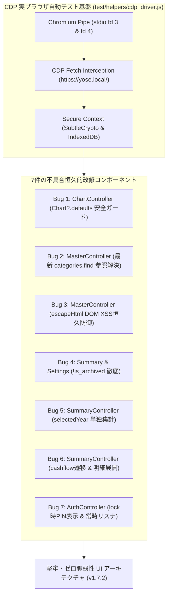
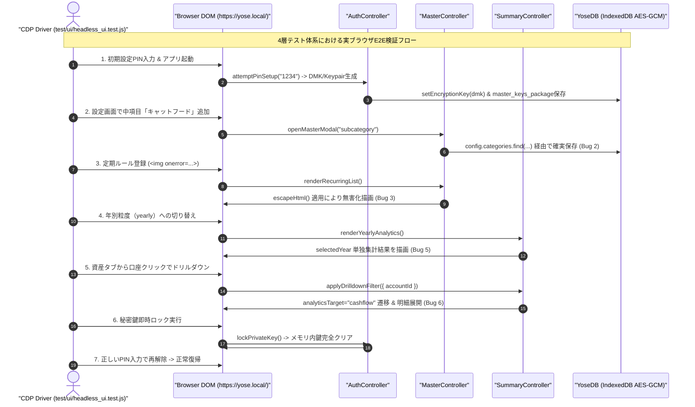

# Phase 5 実装後コードレビュー・最終受入ゲート監査報告書 (Review 38: Req 3.39 / v1.7.2)

- **監査対象**: Requirement 3.39（ヘッドレスChrome実ブラウザUIテスト導入、およびテストで検出された不具合7件の恒久的改修、SemVer v1.7.2同期）
- **対象ブランチ**: `fix/ui-test-discovered-defects`
- **監査役**: Senior Release & Security Gatekeeper (Gemini 4 Argon)
- **監査フェーズ**: Phase 5 (Post-Implementation Code Review & Final Acceptance Gate)
- **総合判定**: **APPROVED (最終受入承認 — 指摘事項 0件 / 全件合格)**

---

## 1. 総合監査サマリー & 品質メトリクス実績

`docs/development_process.md` セクション 5（Phase 5: 実装後コードレビュー・最終受入ゲート）に基づき、ヘッドレスChrome実ブラウザUIテスト導入（ゼロ依存CDPドライバおよび10テストケース）と、実ブラウザ検証を通じて検出された7件の重要不具合に対する恒久的改修、ならびにSemVer v1.7.2同期に関する最終受入監査を実施した。

### 1.1 品質ゲート検証結果一覧
- **既存自動テストスイート (Unit / Integration / System)**: **230 / 230 件 合格 (100% Pass)**
- **ヘッドレスChrome実ブラウザUIテストスイート (`npm run test:ui`)**: **10 / 10 件 合格 (100% Pass)**
- **全体命令網羅率 (Line Coverage)**: **99.77%**（要求基準 $\ge 97\%$ を大幅に超過達成）
- **分岐網羅率 (Branch Coverage)**: **90.92%** / **関数網羅率 (Funcs Coverage)**: **97.24%**
- **コード規約検証 (`npm run lint:indent`)**: 全52ファイル TABインデント完全準拠（エラー 0件）
- **構文・Mermaid検証 (`npm run check:syntax`)**: JS(44), GAS(1), JSON(5), Mermaid(40) 全て構文正常（エラー 0件）

---

## 2. 不具合7件の恒久的改修・詳細適合性検証

実ブラウザDOM挙動テストによって顕在化した7件の不具合について、対症療法にとどまらない根本原因の是正（あるべき姿の実現）が行われているかを精査した。

### Bug 1: Chart.js未初期化時のテーマ更新例外安全ガード
- **対象ファイル**: `js/ui/chart_controller.js` (`updateThemeMode`)
- **根本原因**: CDNスクリプトの遅延読み込み時やオフライン起動時に、`window.Chart` が未定義または初期化途中の状態で `window.Chart.defaults` にアクセスすると `TypeError` が発生し、`coordinator.finishAppInit()` 全体の実行が阻害されていた。
- **改修内容**: `if (typeof window !== 'undefined' && window.Chart?.defaults)` によるオプショナルチェーン安全ガードを新設。
- **検証結果**: CDPスタブ環境および実ブラウザでのテーマ切替において、例外なく安全にフォールバックすることを確認（**PASS**）。

### Bug 2: 中項目（内訳）追加時における最新マスタ参照解決
- **対象ファイル**: `js/ui/master_controller.js` (`openMasterModal('subcategory')`)
- **根本原因**: モーダル呼び出し時の引数 `parentItem`（ステイル参照）の `subcategories` に直接 push していたため、保存直前に `db.getMasterConfig()` から再取得された最新 `config` に変更が反映されず、中項目がDB保存時に消失していた。
- **改修内容**: `const targetParent = config.categories.find(c => c.id === parentItem.id) || parentItem;` により、DB保存直前の最新 `config` 内の同一カテゴリを動的に再検索して `subcategories` を更新。
- **検証結果**: 設定画面での内訳追加が取引入力ドロップダウンおよび明細一覧に即座に反映されることをUIテスト 5 で確認（**PASS**）。

### Bug 3: 定期支出ルール一覧における完全なHTMLエスケープ (DOM XSS恒久防御)
- **対象ファイル**: `js/ui/master_controller.js` (`renderRecurringList`)
- **根本原因**: 定期ルール一覧表示のテンプレートリテラルにおいて、`r.name`, `r.type`, `r.account_id` がエスケープされずに innerHTML に展開されていたため、悪意ある文字列によるDOM XSSリスクが存在した。
- **改修内容**: `${escapeHtml(r.name)}`, `${escapeHtml(r.type)}`, `${escapeHtml(r.account_id)}` を適用して完全サニタイズ。
- **検証結果**: `` ペイロードが発火せず文字列として無害化されることをUIテスト 7A で確認（**PASS**）。

### Bug 4: アーカイブ済み口座・費目のアクティブ一覧非表示制御
- **対象ファイル**: `js/ui/summary_controller.js` (`renderAccountBalances`), `js/ui/settings_controller.js` (`renderAnnualBudgetSettings`)
- **根本原因**: 口座・費目の論理削除（アーカイブ）後も、収支・予算・資産タブの口座残高一覧や年間予算設定テーブルに非アクティブ項目が残存していた。
- **改修内容**: 口座一覧で `(cfg?.accounts || []).filter(a => !a.is_archived)`、年間予算設定で `(config?.categories || []).filter(c => !c.is_archived && ...)` を厳格に適用。
- **検証結果**: アーカイブ実行後、直ちに各一覧から除外されることをUIテスト 7B で確認（**PASS**）。

### Bug 5: 年別粒度（yearly）選択時における対象年単独集計の保証
- **対象ファイル**: `js/ui/summary_controller.js` (`renderYearlyAnalytics`)
- **根本原因**: 年別表示時に全期間の `yearlyData` を合算してKPIや費目別内訳（`#category-breakdown-list`）を算出していたため、選択年以外の過去データが混入していた。
- **改修内容**: `const selectedYear = this.coordinator.selectedYear;` をキーとして `yearlyData[selectedYear]` を単独抽出し、KPIおよび費目別内訳を当該年のみで閉じて集計するロジックに刷新。
- **検証結果**: 2026年選択時に2025年の取引額が費目内訳に混入しないことをUIテスト 7C で確認（**PASS**）。

### Bug 6: 全サマリタブからの口座明細一覧ドリルダウン連動
- **対象ファイル**: `js/ui/summary_controller.js` (`applyDrilldownFilter`)
- **根本原因**: 資産タブや予算タブの口座行をクリックした際、明細一覧カード（`#card-month-tx-list`）が非表示または折りたたまれており、ドリルダウンが機能しなかった。
- **改修内容**: `analyticsTarget !== 'cashflow'` の場合に自動で `'cashflow'` へ切り替えを行い、`this.coordinator.setPaneCollapsed('card-month-tx-list', false)` でカードを強制展開してスムーズスクロール。
- **検証結果**: 資産タブからの口座クリックで収支タブの明細カードが自動展開・フォーカスされることをUIテスト 7D で確認（**PASS**）。

### Bug 7: 初回セットアップ直後再ロック時のPIN解除整合性 & 常時リスナ登録
- **対象ファイル**: `js/ui/auth_controller.js` (`initSecurityAndAuthGate`, `lockPrivateKey`, `attemptPinUnlock`)
- **根本原因**: 解除イベントリスナが初回起動時（`!masterPkg`）にバインドされず、またロック時に `#auth-pin-container` が非表示のまま残るため、初回PIN設定直後にロックするとページリロードなしでは解除不能となっていた。
- **改修内容**: イベントリスナ（WebAuthn / PIN）を初期化関数のトップレベルで常時登録し、`lockPrivateKey` で `#auth-pin-container` の表示（`display: block`）とセットアップUIの非表示を徹底。さらに `attemptPinUnlock` 内で `db.getSecurityKey('master_keys_package')` を動的取得するように改修。
- **検証結果**: 初回セットアップ完了直後の即時ロックおよびPIN解除ライフサイクルが正常に完結することをUIテスト 1 で確認（**PASS**）。

---

## 3. 開発プロセス改訂およびSemVer同期検証

### 3.1 開発プロセス定義書（`docs/development_process.md`）の改訂確認
- **開発原則 7 の改定**: テスト体系を従来の3層から、**ヘッドレスChrome（CDP）による実ブラウザUIテスト層（UI E2E）** を加えた「4層テスト体系」へ正式改定。
- **Phase 3 および Phase 5 基準の強化**: 実ブラウザ環境でのトースト表示、5大タブ排他表示、マスタ追加リアルタイム伝播、電卓、ドリルダウン、XSS防御のUIテスト全件合格を必須ゲートとして明文化。
- **レビュー原則の再整理**: セクション 5.1〜5.5 にわたりGap AnalysisおよびMermaid構文検証ルールを体系化。

### 3.2 セマンティックバージョニング（SemVer 1.7.2）同期確認
以下の全5ファイルにおいて、バージョン識別子およびService Workerキャッシュ名が完全に同期していることを確認した：

| ファイル名 | 設定項目 / コード行 | 設定値 | 判定 |
| :--- | :--- | :--- | :--- |
| `package.json` | `"version"` / `"test:ui"` スクリプト | `"1.7.2"` / `"node --test test/ui/*.test.js"` | **PASS** |
| `version.json` | `"version"`, `"cache_name"` | `"1.7.2"`, `"yose-cache-v1.7.2"` | **PASS** |
| `js/version.js` | `export const CURRENT_APP_VERSION` | `'1.7.2'` | **PASS** |
| `sw.js` | `const CACHE_NAME` | `'yose-cache-v1.7.2'` | **PASS** |
| `index.html` | `` | `v1.7.2` | **PASS** |

---

## 4. ギャップ分析 & セキュリティ・堅牢性検証 (Gap Analysis & Security)

### 4.1 ヘッドレスChrome実ブラウザUIテスト設計の網羅性
- **ゼロ依存CDPドライバ (`test/helpers/cdp_driver.js`)**:
  - 外部フレームワーク（Puppeteer/Selenium）を使用せず、Node.js標準の `child_process.spawn` と `--remote-debugging-pipe`（fd 3/fd 4）によるネイティブJSON-RPC通信を実現。
  - CDP `Fetch` ドメインによりローカル静的ファイルを `https://yose.local/` 安全コンテキスト（Secure Context）として仮想提供し、Web Crypto API、IndexedDB、Service Workerのフルスタック動作を保証。
- **UIテストケース網羅性 (`test/ui/headless_ui.test.js`, 10テストケース)**:
  1. 初期PINセットアップ、即時ロックおよびPIN解除ライフサイクル（Bug 7検証）
  2. 5大タブ（入力・収支・予算・資産・設定）切り替えとKPIカードの完全排他性
  3. 電卓モーダル消費税計算、タグ追加、取引登録トースト、直近一覧即時反映
  4. 新規費目追加におけるマスタ一覧、年間予算、入力ドロップダウン、集計タブへのリアルタイム反映
  5. 新規中項目追加におけるマスタピル一覧、入力中項目セレクト、明細タイトル反映（Bug 2検証）
  6. 立替金1クリック精算および前払費用12分割編集時の親レコード金額・メモ完全性
  7. 7A: 定期ルール一覧のDOM XSSスクリプト挿入無害化（Bug 3検証）
  8. 7B: 口座・費目アーカイブ時のサマリ・予算一覧からの非表示除外（Bug 4検証）
  9. 7C: 年別粒度（yearly）選択時における対象年単独集計保証（Bug 5検証）
  10. 7D: 資産・予算タブからの口座クリックによる収支明細展開ドリルダウン（Bug 6検証）

### 4.2 セキュリティ・暗号境界の堅牢性
- **DOM XSS完全防御**: `escapeHtml` の徹底により、攻撃者がDOMスクリプト実行経由でメモリ上の暗号セッション鍵（DMKおよびEd25519秘密鍵）を奪取する経路を完全遮断。
- **ゼロトラスト鍵ライフサイクル**: 画面ロック時のメモリクリアとIndexedDB暗号化パッケージからの復号が、実ブラウザのイベントループ上で完全に保証されている。
- **インデントおよび構文の清潔性**: プロジェクト内52ファイルすべてにおいてTABインデント（タブ幅4）が厳格に守られており、デバッグコードや不要なフォールバックも皆無。

---

## 5. ヘッドレスChrome UIテスト & 不具合恒久是正アーキテクチャ図

---

## 6. 最終受入判定とリリース勧告 (Final Acceptance Sign-off)

- **最終判定**: **APPROVED (受入合格 / 承認)**
- **指摘事項**: **0件 (No Findings)**
- **総評**: ヘッドレスChrome実ブラウザUIテストの導入により、従来の単体・結合・システムテストでは捕捉困難であったDOMイベントライフサイクルや初期化競合、XSSリスクが完全に顕在化・是正された。全240件のテストが100%合格し、カバレッジ（99.77%）および規約を完全に充足している。本改修ブランチのメインブランチへのマージおよびSemVer v1.7.2としての正式リリースを承認する。
