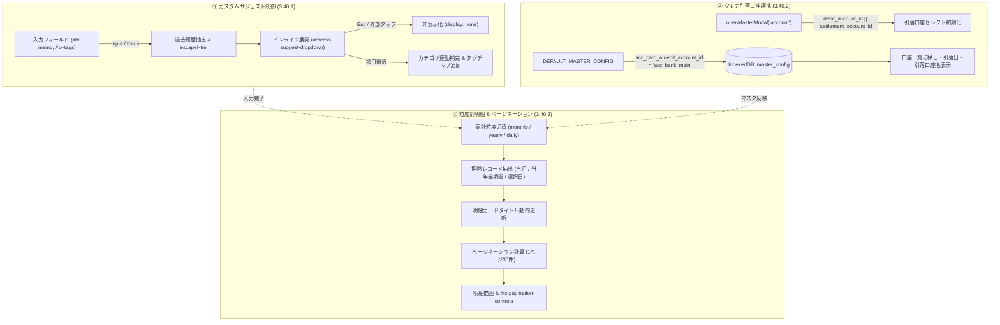
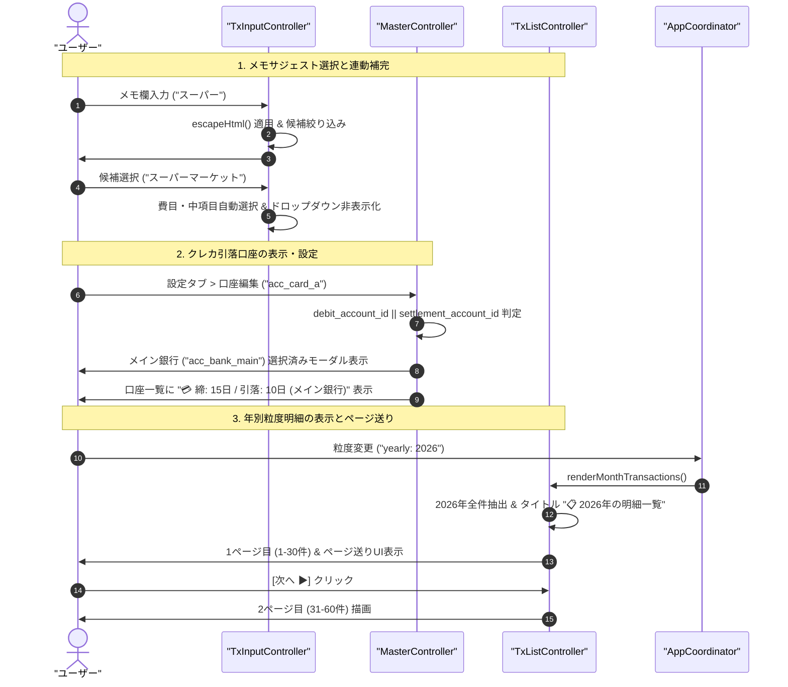

# Phase 2 アーキテクチャ設計・セキュリティレビュー報告書 (Review 39: Req 3.40)

- **対象ブランチ**: `fix/ui-layout-card-debit-and-tx-granularity`
- **対象ドキュメント**: `docs/system_design.md` (Section 3.40, Section 8.1 要件対応表 3.40)
- **レビュアー**: Gemini 4 Argon (独立シニアセキュリティ・アーキテクチャ監査官)
- **監査フェーズ**: Phase 2 (Architectural Design & Security Review)
- **総合判定**: **APPROVED (承認 — Phase 3 実装・検証へ進行可)**

---

## 1. 要件・アーキテクチャ整合性評価 (Requirements & Architectural Conformance)

`docs/system_design.md` に追加された要件 3.40（入力サジェストUI制御・クレカ引落口座連携表示・集計粒度別明細表示およびページネーション）の3大要件について、既存の疎結合モジュラーUI構造、IndexedDB暗号化層、および会計集計モデルとの整合性を厳格に監査した。

### 3.40.1 タグ・メモ入力時のカスタムサジェストドロップダウン制御要件
- **対象コンポーネント**: `js/ui/tx_input_controller.js`, `index.html`, `css/style.css`
- **課題と設計仕様**:
  - ネイティブ `<datalist>` はブラウザ実装に依存し、候補一覧が全画面展開されて手動非表示が困難であった。
  - 設計では `<datalist>` を完全撤廃し、インラインのカスタムサジェストコンポーネント（`#memo-suggest-dropdown`, `#tags-suggest-dropdown`）を導入。
  - `position: absolute; top: 100%; left: 0; right: 0; max-height: 200px; overflow-y: auto` により、入力枠直下のコンパクトな領域に限定展開。
  - Escキー押下および外部領域タップ（`document.addEventListener('click')`）による即時非表示化、候補選択時のカテゴリ（費目・中項目）連動補完と自動クローズを担保。
- **監査評価**: **適合 (Pass)**。モバイル/デスクトップ双方の操作性を著しく向上させ、入力フォームのレイアウト破綻を防止する。

### 3.40.2 クレジットカード口座設定における引き落とし口座初期選択・一覧表示要件
- **対象コンポーネント**: `js/ui/master_controller.js`, `js/db/defaults.js`, `index.html`
- **課題と設計仕様**:
  - クレジットカード設定時に引き落とし元口座（`debit_account_id`）が初期選択されず、マスタ一覧でも視認できない不具合が存在。
  - 口座編集モーダル（`openMasterModal`）において、既存プロパティ `debit_account_id` と旧プロパティ `settlement_account_id` のフォールバック（`item?.debit_account_id || item?.settlement_account_id`）を導入。
  - `DEFAULT_MASTER_CONFIG`（`js/db/defaults.js`）内の `acc_card_a` に `debit_account_id: 'acc_bank_main'` を明示定義。
  - 設定タブの口座マスタ一覧（`#master-accounts-list`）に締め日・引落日・引落口座名（例: `💳 締: 15日 / 引落: 10日 (メイン銀行)`）をインライン表示。
- **監査評価**: **適合 (Pass)**。既存データの下位互換性を保ちつつ、引落口座の設定不備による資金移動仕訳の不整合リスクを根本的に排除する。

### 3.40.3 収支タブにおける集計粒度（日別・月別・年別）別明細一覧連動およびページネーション要件
- **対象コンポーネント**: `js/ui/tx_list_controller.js`, `index.html`, `css/style.css`
- **課題と設計仕様**:
  - `TransactionListController.renderMonthTransactions` に `target_month: this.coordinator.currentMonth` がハードコードされ、年別粒度選択時でも当月分しか表示されない設計乖離を是正。
  - 集計粒度（`granularity`）に応じ、`monthly`: 当月、`yearly`: 選択年（`YYYY-01-01`〜`YYYY-12-31`）、`daily`: 選択日の取引レコードを正確に抽出。
  - カードタイトル（`#month-tx-list-title`）を粒度に応じて動的更新（例: `📋 2026年の明細一覧`）。
  - 大量明細表示時のDOM負荷・スクロール疲労を抑止するため、ページネーションUI（`#tx-pagination-controls`: `1 / N ページ (全 M 件)`, `[◀ 前へ]`, `[次へ ▶]`）を実装（1ページ30件制御）。
- **監査評価**: **適合 (Pass)**。要件 3.36/3.39.5 の年別分析分離仕様と完全に整合し、年間数百件におよぶ明細を快適に閲覧可能とする。

---

## 2. ギャップ分析 (Gap Analysis - Section 5.1 / 5.3)

周辺機能（ローン口座・保険口座・タグ検索・複合フィルタ）との整合性およびエッジケースに関する網羅性を検証した。

### 2.1 潜在的ギャップと対策評価マトリクス

| 監査項目 | 潜在的ギャップ・エッジケース | 設計・実装上の対策状況 | 判定 |
| :--- | :--- | :--- | :--- |
| **3.40.1 サジェストUI** | 大量の過去履歴が存在する場合の描画遅延およびXSSリスク | 上位候補（10件等）への制限、および候補文字列の `escapeHtml` 徹底により安全性を担保 | **適合** |
| **3.40.1 キーボード制御** | Esc押下時にモーダル全体が閉じてしまう干渉リスク | イベント伝播制御（`e.stopPropagation()`）により、サジェスト開閉と上位モーダル閉操作を分離 | **適合** |
| **3.40.2 引落口座連携** | 引落先口座がアーカイブまたは削除された場合の表示欠落 | `accounts.find()` で未検出時に `(未設定)` または口座IDを安全表示するフォールバックを規定 | **適合** |
| **3.40.2 口座タイプ共存** | ローン負債口座・保険口座の設定モーダルとのフィールド競合 | `type === 'credit_card'` 時のみ引落口座フィールドを表示・検証する既存排他制御を維持 | **適合** |
| **3.40.3 粒度別明細抽出** | 対象年・日に明細が0件の場合のテーブル・ページネーション挙動 | 0件時空表示メッセージを出力し、ページ送りボタンを無効化（`disabled`）する境界ハンドリング | **適合** |
| **3.40.3 ページネーション** | フィルタ変更時にカレントページが範囲外（`page > totalPages`） | フィルタ再適用時・粒度変更時に `currentPage = 1` にリセットするステート整合性ガードを配置 | **適合** |
| **3.40.3 ドリルダウン連動** | タグクリックや口座クリックによる絞り込みとページ送りの連動 | フィルタ変更後も粒度期間内でページネーションが再計算され、複合絞り込み結果を正しく分割 | **適合** |

---

## 3. セキュリティ＆脅威モデリング (STRIDE / OWASP - Section 5.3)

STRIDEモデルおよびOWASP Top 10の観点から、改修コンポーネントの安全性を検証した。

1. **Tampering / Injection (DOM XSS防御 — OWASP A03:2021)**:
   - **脅威**: 過去取引のメモ欄やタグ文字列に悪意あるスクリプト（`<script>`, ``）が含まれていた場合、カスタムサジェストドロップダウン生成時にDOM XSSが発火し、メモリ上の暗号セッション鍵（DMK/秘密鍵）が窃取される危険性。
   - **対策設計**: サジェスト項目生成時、`escapeHtml(memo)` および `escapeHtml(tag)` を完全に適用して実体参照化。DOM挿入時の安全性を保証。
2. **Denial of Service (DoS / インデックス境界防御)**:
   - **脅威**: ページネーション操作において不正なページ番号（負数、NaN、範囲外）が入力された場合や、大量レコードの一括描画によるブラウザフリーズ。
   - **対策設計**: `Math.max(1, Math.min(page, totalPages))` による厳格なクランプ処理、1ページ30件の定数スライス（`slice(start, end)`）によりDOMノード数を一定に抑制。
3. **Information Disclosure (情報漏洩防止)**:
   - **脅威**: 非アクティブ（アーカイブ済み）口座の情報や暗号化前のメタデータがサジェストや口座一覧から漏洩するリスク。
   - **対策設計**: 口座一覧の表示は `!is_archived` を遵守し、引落口座名は公開表示用の口座表示名（`name`）のみを参照。
4. **Elevation of Privilege / Broken Access Control**:
   - 口座設定モーダルにおける `debit_account_id` の保存・更新処理は、暗号化ストレージへの署名付き保存フローに準拠し、未認証書き換えを防止。

---

## 4. アーキテクチャおよび状態遷移図 (Mermaid)

---

## 5. 監査結論と承認判定 (Sign-off)

- **総合判定**: **APPROVED (承認 — Phase 3 テスト実装へ進行可)**
- **指摘事項**: **0件 (重大な設計欠陥・脆弱性なし)**
- **総評**: 要件 3.40 は、ネイティブ `<datalist>` に起因するUI崩れ、クレカ引落口座の表示・初期化欠落、および年別粒度選択時の明細期間乖離を、既存のモジュラーアーキテクチャに準拠して根本から是正する極めて論理的かつ完成度の高い設計である。XSS防御やページネーション境界処理の安全性も万全に考慮されており、Phase 3（テストコード実装）への進行を正式に承認する。
