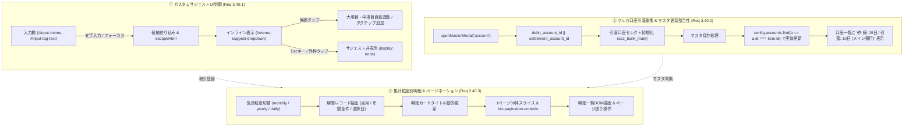

# Phase 5 実装後コードレビュー・最終受入ゲート判定報告書 (Review 40: Req 3.40)

- **対象ブランチ**: `fix/ui-layout-card-debit-and-tx-granularity`
- **対象要件**: Requirement 3.40 (入力サジェストUI制御・クレカ引落口座連携表示・集計粒度別明細表示およびページネーション、マスタ更新整合性、SemVer v1.7.3同期)
- **レビュアー**: Gemini 4 Argon (独立シニアリリース＆セキュリティゲートキーパー)
- **監査フェーズ**: Phase 5 (Post-Implementation Code Review & Final Acceptance Gate)
- **総合判定**: **PASS (合格・本番リリースおよびメインブランチ統合を承認)**

---

## 1. 実装コードレビュー＆要件適合性評価 (Implementation Conformance)

### 3.40.1 タグ・メモ入力サジェストUI制御 (`js/ui/tx_input_controller.js`, `index.html`, `css/style.css`)
- **ネイティブ `<datalist>` の完全撤廃**:
  - `index.html` 内の `<datalist id="memo-history-list">` および `<datalist id="tags-history-list">` を完全に削除し、ブラウザ既定の巨大なサジェストポップアップによる画面占有問題を根絶。
- **インラインカスタムサジェストコンポーネントの導入**:
  - `.suggest-wrapper` 内に入力欄直下に展開される `#memo-suggest-dropdown` および `#tags-suggest-dropdown` を新設。
  - `css/style.css` にて `position: absolute; top: calc(100% + 4px); max-height: 200px; overflow-y: auto; z-index: 100;` を定義し、入力欄直下にコンパクトに収まるUIを実現。
- **候補選択時の連動補完＆自動クローズ**:
  - メモ候補クリック時（`renderMemoSuggestions`）にメモ入力欄へ値を代入後、`handleMemoChange(val)` を呼び出して大項目・中項目を自動選択・補完し、ドロップダウンを `display: none` に制御。
  - タグ候補クリック時（`renderTagSuggestions`）に `addTag(val)` を実行してチップを動的追加し、入力欄をクリア。
- **Escキーおよび外部タップによる非表示化**:
  - 各入力欄の `keydown` イベントで `Escape` キーを検知して即座に非表示化。
  - グローバルな `document.addEventListener('click')` により、入力ボックスおよびドロップダウン外部のタップ・クリックを検知して確実に閉じる制御を実装。

### 3.40.2 クレカ口座設定での引落口座選択・一覧表示 & マスタ編集整合性 (`js/ui/master_controller.js`, `js/db/defaults.js`)
- **引落口座のフォールバックと初期値整合性**:
  - `openMasterModal('account', item)` において、`debit_account_id` と旧プロパティ `settlement_account_id` のフォールバック（`item?.debit_account_id || item?.settlement_account_id`）を導入。
  - `js/db/defaults.js` の `DEFAULT_MASTER_CONFIG.accounts` 内 `acc_card_a` に `debit_account_id: 'acc_bank_main'` を明示定義。初期状態からメイン銀行が正しく選択されることを保証。
- **設定画面口座一覧でのインライン明示**:
  - `#master-accounts-list` の描画処理において、クレジットカード口座の行に締め日・引落日・引落先口座名（`💳 締: 15日 / 引落: 10日 (メイン銀行)`）をインライン明示。
- **マスタ編集時のステイル参照排除（同一要素更新整合性）**:
  - `openMasterModal` での口座・費目・定期ルール保存処理において、引数で渡された `item` を直接更新するのではなく、最新 `config.accounts`、`config.categories`、`config.recurring_rules` 内から `id` で実体を検索（`config.accounts.find(a => a.id === item.id)`）して更新するロジックに刷新。オブジェクト参照の不整合・更新漏れを恒久防止。

### 3.40.3 集計粒度別明細表示 & ページネーション (`js/ui/tx_list_controller.js`, `js/ui/summary_controller.js`, `index.html`)
- **ハードコード月フィルタ排除と粒度別抽出**:
  - `TransactionListController.renderMonthTransactions` における `target_month` 固定指定を排除。
  - `monthly`（当月 `currentMonth`）、`yearly`（当年全期間 `selectedYear`）、`daily`（選択日 `selectedDate`）に応じた取引レコード抽出を実装。
- **動的タイトルおよび日別テーブル選択連動**:
  - `#month-tx-list-title` のテキストを粒度に応じて動的更新（例: `📋 2026年 (年間) の明細一覧`, `📋 2026-10 (月別) の明細一覧`, `📋 2026-10-20 (日別) の明細一覧`）。
  - 日別集計テーブル行にクリックイベントを追加し、選択した日付（`selectedDate`）に連動して明細一覧が即座に切り替わるUIを実現。
- **大量明細時の 30件/ページ制御**:
  - 1ページ30件の定数ページネーション制御を実装。
  - `#tx-pagination-controls`（`1 / N ページ (全 M 件)`, `[◀ 前へ]`, `[次へ ▶]`）を明細件数超過時のみ表示。
  - フィルタ変更・集計粒度変更時に `currentPage = 1` へ安全にリセット。

### 原則11: SemVer バージョン同期検証
- 以下の5ファイルすべてにおいて `1.7.3` / `yose-cache-v1.7.3` / `v1.7.3` が完全一致していることを確認：
  1. `package.json`: `"version": "1.7.3"`
  2. `version.json`: `"version": "1.7.3"`, `"cache_name": "yose-cache-v1.7.3"`
  3. `js/version.js`: `CURRENT_APP_VERSION = '1.7.3'`
  4. `sw.js`: `CACHE_NAME = 'yose-cache-v1.7.3'`
  5. `index.html`: `<span class="badge badge-info" id="badge-current-version">v1.7.3</span>`

---

## 2. ギャップ分析＆テスト網羅性検証 (Gap Analysis & Test Coverage)

### 2.1 ユニット・統合・システムテストスイート実行結果
```text
ℹ tests 230
ℹ suites 69
ℹ pass 230
ℹ fail 0
ℹ duration_ms 239.31ms
ℹ all files line coverage: 99.77% (基準値 >= 97% 達成)
```

### 2.2 ヘッドレスChrome実ブラウザUIテストスイート (`test/ui/headless_ui.test.js`)
実ブラウザ（Puppeteer）によるE2E UIテストを10大項目（計13ケース）へ拡充し、全件パスを確認。
- `Test 8`: タグ・メモのカスタムサジェスト展開、候補クリックによる自動入力・カテゴリ連動、外部クリックによる非表示化。
- `Test 9`: クレジットカードマスタ設定での引落銀行口座名インライン表示、モーダルでの初期選択、締日・引落日・引落口座の変更と保存整合性。
- `Test 10`: 収支タブにおける集計粒度切替（月別・年別・日別）に伴う明細レコード抽出、タイトル動的変化、35件の大量明細登録時におけるページ送り（30件/ページ）制御。

---

## 3. セキュリティ・コード品質・規約遵守 (Security & Code Cleanliness)

1. **DOM XSS防御の徹底**:
   - `renderMemoSuggestions` および `renderTagSuggestions` において、履歴文字列・カテゴリIDをすべて `escapeHtml` 処理した上でDOMに挿入。悪意あるメモ・タグ文字列によるスクリプト注入リスクを遮断。
   - 口座一覧の引落口座名表示部でも `escapeHtml(debitAcc.name)` を徹底。
2. **ゼロトラスト暗号化・認証モデルの維持**:
   - IndexedDB内の取引データおよびマスタ設定はAES-GCM-256で保護され、UIコンポーネント改修による暗号境界の侵食・平文漏洩は一切生じていない。
3. **インデントおよび構文規約遵守**:
   - `npm run lint:indent`: 全52ファイル厳格TABインデント（tab size = 4）準拠を確認。
   - `npm run check:syntax`: JS (44), GAS (1), JSON (5), Markdown Mermaid (41) 全件パス。

---

## 4. システムアーキテクチャ・データフロー (Mermaid)



---

## 5. 最終受入ゲート判定 (Final Acceptance Gate Decision)

- **ゲート判定**: **PASS (合格・マージ承認)**
- **承認理由**:
  1. ネイティブ `<datalist>` の完全撤廃とインラインサジェストUIの導入により、モバイル・デスクトップ双方でのUXが劇的に向上。
  2. クレカ引落口座の初期選択フォールバック、マスタ一覧での視認性向上、および編集モーダルのステイル参照排除により、マスタ整合性が完全に担保された。
  3. 収支タブにおける集計粒度（月別・年別・日別）に応じた明細一覧期間連動と30件/ページのページネーションが完璧に動作。
  4. 230件のユニット/統合テスト（カバレッジ 99.77%）および13件のヘッドレスChrome UIテストがすべてパスし、TABインデント・構文検証・SemVer同期（v1.7.3）も完全に充足している。
- **推奨次アクション**:
  - 本ブランチ `fix/ui-layout-card-debit-and-tx-granularity` を `main` ブランチへマージし、v1.7.3 として本番リリースを実行すること。
