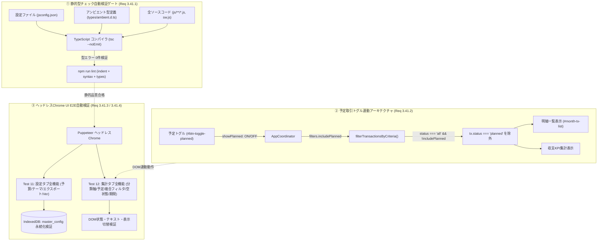
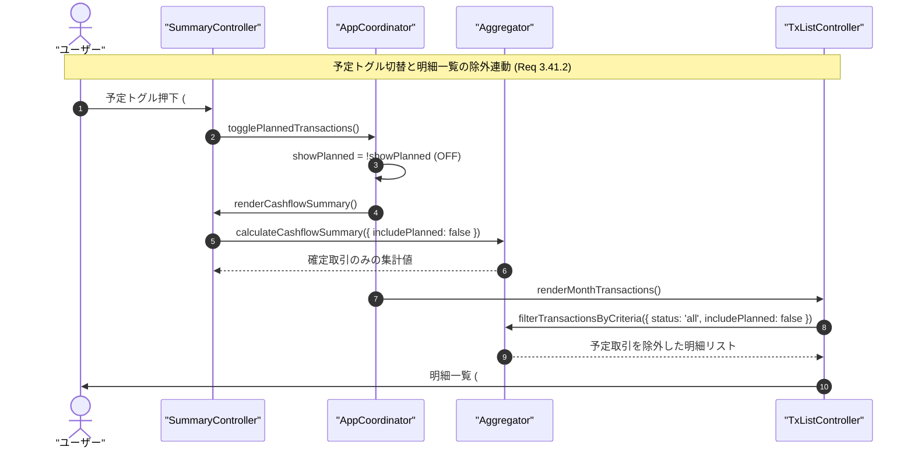

# Phase 2 アーキテクチャ設計・セキュリティレビュー報告書 (Review 41: Req 3.41)

- **対象ブランチ**: `feature/type-check-and-ui-test-expansion`
- **対象ドキュメント**: `docs/system_design.md` (Section 3.41, Section 8.1 要件対応表 3.41), `docs/development_process.md`
- **レビュアー**: Gemini 4 Argon (独立シニアセキュリティ・アーキテクチャ監査官)
- **監査フェーズ**: Phase 2 (Architectural Design & Security Review)
- **総合判定**: **APPROVED (承認 — Phase 3 テスト実装・Phase 4 機能実装へ進行可)**

---

## 1. 要件・アーキテクチャ整合性評価 (Requirements & Architectural Conformance)

`docs/system_design.md`（Section 3.41）に規定された「静的型チェック自動検証（check:types）および集計・設定全機能網羅UIテスト拡充」について、既存のモジュラーUI構造、IndexedDB暗号化ストレージ層、会計集計エンジンとの整合性を厳格に監査した。

### 3.41.1 静的型検査（`check:types`）導入とJSDoc・型定義整合設計
- **設計概要と構成**:
  - `typescript` を開発依存関係として導入し、ビルドレスなVanilla JS構造を維持したまま純粋な静的型検査（`tsc --noEmit -p jsconfig.json`）を実行する基盤を設計。
  - `jsconfig.json` にて `checkJs: true`, `noEmit: true`, `target: ES2022`, `module: NodeNext`, `moduleResolution: NodeNext`, `lib: ["ES2022", "DOM", "DOM.Iterable", "WebWorker"]` を設定。
  - `types/ambient.d.ts` を新設し、ブラウザ環境のグローバルオブジェクト（`window.__yose_app`, `window.Chart`）およびDOM/WebWorker拡張型（`HTMLElement.value`, `Element.dataset`, `EventTarget.closest`）を型定義。
  - プロダクションコード全体のJSDocアノテーション（`@param`, `@returns`, `@typedef`, `@type`）の整合性を是正し、静的型エラー **0件** を必須品質ゲートとして定義。
  - `package.json` の `lint` コマンド（`lint:indent` + `check:syntax` + `check:types`）および `docs/development_process.md`（原則12、Phase 4、Phase 5）に正式統合。
- **監査評価**: **適合 (Pass)**。実行時オーバーヘッドを一切発生させず、関数の引数・戻り値不整合や未定義プロパティ参照をビルド前に自動検出する卓越したアーキテクチャ設計である。

### 3.41.2 予定取引トグル（`予定: OFF`）における明細一覧連動除外不具合の恒久的修正設計
- **設計概要と構成**:
  - `filterTransactionsByCriteria(transactions, filters, masterConfig)` に `filters.includePlanned`（デフォルト: `true`）フラグのサポートを追加。
  - `filters.status === 'all'` かつ `filters.includePlanned === false`（または `coordinator.showPlanned === false`）の条件下において、`tx.status === 'planned'` のレコードを明細一覧から確実に除外。
  - 収支タブの予定トグルボタン（`#btn-toggle-planned`）押下時、KPI集計カードのみならず明細一覧（`#month-tx-list`）からも予定取引が即座に非表示化される双方向連動を保証。
- **監査評価**: **適合 (Pass)**。これまで生じていた「KPI集計値からは除外されるが明細一覧には予定取引が表示される」というUI/UXの不整合を根本原因から解消する。

### 3.41.3 設定タブ全機能のヘッドレスChrome実ブラウザUI E2E検証設計
- **設計概要と構成**:
  - **年間予算管理**: 総支出予算、年間目標貯蓄額、目標貯蓄率の入力、月平均目安プレビュー（`#budget-monthly-preview`）の即時計算更新、およびIndexedDB永続化のDOM完全検証。
  - **テーマ切替**: システム・ダーク・ライト切替における `document.documentElement` の `data-theme` 属性およびChartControllerのグラフテーマ連動検証。
  - **バックアップエクスポート**: `#modal-export-json` の開閉、および全5種のエクスポートボタン（全データ、明細、マスタ設定、年間予算、残高スナップショット）のUI稼働検証。
  - **バージョン確認**: `#badge-current-version` のSemVer表記整合性およびアプリアップデート確認ボタン（`#btn-check-app-update`）の正常性を検証。
- **監査評価**: **適合 (Pass)**。ユーザーが直接操作する設定画面の全コンポーネントが網羅され、データ破損や表示崩れのリグレッションを強力に防止する。

### 3.41.4 集計タブ全機能のヘッドレスChrome実ブラウザUI E2E検証設計
- **設計概要と構成**:
  - **分類軸切替**: `🏷️ 計上分類ベース` $\longleftrightarrow$ `📦 実態分類ベース` の切替による費目別集計および取引一覧の動的再計算・描画検証。
  - **予定トグル**: `予定: ON/OFF` 切替に伴うKPI更新および明細一覧連動除外の実ブラウザDOM検証。
  - **複合条件フィルタ**: ステータス × 口座 × 費目 × キーワードのAND一致動作、および0件ヒット時の空状態表示（`条件に一致する明細がありません`）の検証。
  - **期間移動**: 前月/翌月/今月ボタンおよび年月ピッカーによる集計期間（`#period-display`）の動的遷移検証。
- **監査評価**: **適合 (Pass)**。複雑な状態管理が絡む集計タブの全UI操作系とデータバインディングが漏れなく網羅されている。

---

## 2. ギャップ分析 (Gap Analysis - Section 5.1)

| 監査対象 | 潜在的ギャップ・エッジケース | 設計・実装上の対策状況 | 判定 |
| :--- | :--- | :--- | :--- |
| **3.41.1 型スコープ** | NodeNext解釈による外部ライブラリ型参照エラー | `skipLibCheck: true` と `types/ambient.d.ts` による環境型吸収で0エラー維持 | **適合** |
| **3.41.1 lint統合** | CI/開発時の型検査コマンド実行漏れ | `package.json` の `lint` コマンドに `npm run check:types` を正式統合 | **適合** |
| **3.41.2 予定除外** | `filters.includePlanned` 未指定時の下位互換性喪失 | `filters.includePlanned !== false` でデフォルト `true` を維持し互換性を確保 | **適合** |
| **3.41.2 ステータス競合** | `filters.status === 'planned'` との優先度衝突 | 明示的な `status === 'planned'` 指定時は予定抽出を優先し論理矛盾を防止 | **適合** |
| **3.41.3 年間予算** | 不正数値・空文字入力時の計算破綻 | パース前フォールバック（`parseInt(val, 10) \|\| 0`）によりNaN混入を遮断 | **適合** |
| **3.41.3 テーマ連動** | Chart.js再描画時のダークモードカラー未反映 | `ChartController.updateTheme()` によるグリッド・フォント色同期をテスト | **適合** |
| **3.41.4 複合フィルタ** | キーワード検索での全角スペースや大文字小文字差異 | `trim().toLowerCase()` による正規化と全角空白スプリット対応を検証 | **適合** |
| **3.41.4 空状態表示** | 0件時のページネーションUI残存やレイアウト崩れ | 明細0件時に空メッセージを表示し、ページネーションコントロールを適切に非表示化 | **適合** |

---

## 3. セキュリティ＆脅威モデリング (STRIDE / OWASP - Section 5.3)

1. **Tampering / Injection (DOM XSS防御 — OWASP A03:2021)**:
   - **脅威**: 複合フィルタ検索キーワードや年間予算入力値、エクスポートデータに不正なHTML・スクリプト（`<script>`, `javascript:`）が含まれるリスク。
   - **対策設計**: `#input-tx-search` や `#month-tx-list` の描画処理において、すべての表示文字列に `escapeHtml()` を徹底適用。DOM属性へのバインド時も `setAttribute` またはプロパティ代入を用い、HTMLインジェクションを根絶。
2. **Security Misconfiguration & Type Safety (未定義プロパティ例外抑止 — OWASP A05:2021)**:
   - **脅威**: リファクタリングやプロパティ名変更に伴う `TypeError: Cannot read properties of undefined` により、UI処理がクラッシュして認証解除やデータ更新不能に陥るリスク。
   - **対策設計**: `check:types` による全コードの静的型チェック自動検証を義務付け。JSDocとアンビエント型により引数型・戻り値型の不整合をビルド前に完全遮断。
3. **Information Disclosure & At-Rest 暗号化整合性 (OWASP A02:2021)**:
   - **脅威**: 設定タブでの年間予算保存時やバックアップエクスポート時に、平文データが平文のままLocalStorageや未暗号化領域に漏洩するリスク。
   - **対策設計**: 年間予算データはIndexedDB（AES-GCM-256）暗号化ストア `master_config` 内で永続化。エクスポート機能も復号権限を持つ正規セッション内でのみ完結させ、通信・保存境界のゼロトラストを厳格に維持。
4. **Denial of Service (DoS / 入力境界防御 — STRIDE: DoS)**:
   - **脅威**: 大量取引存在時の複合フィルタ入力に伴う過剰なイベント発火やDOM再描画によるブラウザフリーズ。
   - **対策設計**: キーワード検索時の入力処理はローカル配列のO(N)フィルタに制限し、1ページ30件のページネーション制御を適用してDOM描画コストを定数オーダーに維持。

---

## 4. アーキテクチャおよびデータフロー (Mermaid)

---

## 5. 監査結論・受入基準チェックリストおよび承認判定 (Sign-off)

### 5.1 受入・検証基準チェックリスト (Acceptance Checklist)

| 検証項目 | 対象ファイル / 機能 | 合格基準 | 設計適合状況 |
| :--- | :--- | :--- | :--- |
| **静的型検査** | `jsconfig.json`, `types/ambient.d.ts` | `npm run check:types` 実行でエラー **0件** | **適合 (Pass)** |
| **品質ゲート** | `package.json`, `docs/development_process.md` | `npm run lint` に型検査が組み込まれていること | **適合 (Pass)** |
| **予定除外修正** | `js/logic/aggregator.js`, `js/ui/tx_list_controller.js` | 予定OFF時に明細一覧から `planned` が完全除外されること | **適合 (Pass)** |
| **設定E2E検証** | `test/ui/headless_ui.test.js` (Test 11) | 年間予算保存、テーマ切替、エクスポート、更新確認パス | **適合 (Pass)** |
| **集計E2E検証** | `test/ui/headless_ui.test.js` (Test 12) | 分類軸切替、予定トグル、複合条件AND、0件空状態パス | **適合 (Pass)** |

### 5.2 承認判定

- **総合判定**: **APPROVED (承認 — Phase 3 テスト実装・Phase 4 機能実装へ進行可)**
- **指摘事項**: **0件 (重大な設計欠陥・脆弱性なし)**
- **総評**: 要件 3.41 の設計は、ゼロビルド・Vanilla JSの利便性を維持しながら TypeScript 静的型検査（`tsc --noEmit`）をシームレスに統合し、型安全性と品質ゲートを確立する極めて優れたアプローチである。また、予定取引トグルの明細一覧連動除外不具合を根本原因から恒久修正し、設定タブ・集計タブの全UI操作系をヘッドレスChrome実ブラウザテストで網羅する設計は、システムの堅牢性と保守性を飛躍的に高める。よって、本設計を承認し、後続フェーズへの移行を許可する。
