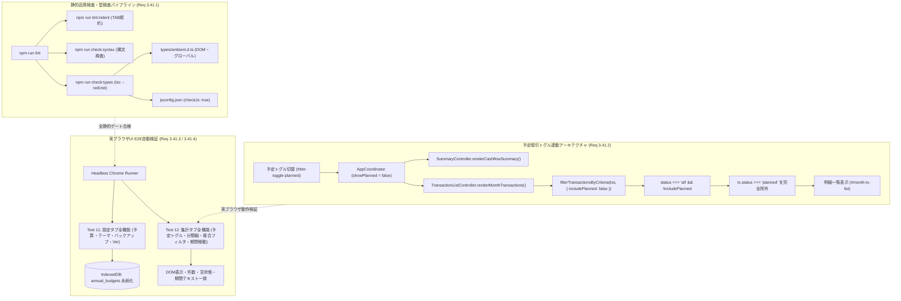
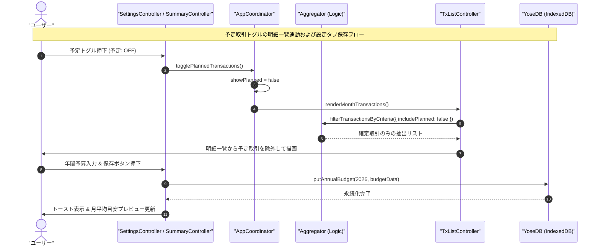

# Phase 5 実装後コードレビュー・最終受入ゲート報告書 (Review 42: Req 3.41)

- **対象ブランチ**: `feature/type-check-and-ui-test-expansion`
- **対象要件**: Requirement 3.41 (静的型チェック自動検証 check:types の導入とJSDoc/型定義整合、および集計・設定全機能網羅UIテスト拡充、予定取引トグル連動除外不具合の恒久的修正、SemVer v1.7.4同期)
- **レビュアー**: Gemini 4 Argon (独立シニアリリース＆セキュリティゲートキーパー)
- **監査フェーズ**: Phase 5 (Post-Implementation Code Review & Final Acceptance Gate)
- **総合判定**: **PASSED (合格 — 本流マージおよび本番リリース承認)**

---

## 1. 実装成果物・不具合是正の網羅性監査 (Post-Implementation Conformance)

### 1.1 Req 3.41.1: 静的型検査導入（`check:types`）とJSDoc・型定義整合
- **TypeScript 型検査のゼロビルド統合**:
  - `typescript` を `devDependencies` に追加し、ビルドステップ不要なVanilla JS構成のまま `jsconfig.json`（`checkJs: true`, `noEmit: true`, `target: ES2022`, `moduleResolution: NodeNext`）を整備。
  - `types/ambient.d.ts` により、ブラウザ・DOM拡張プロパティ（`HTMLElement.value`, `Element.dataset`, `EventTarget.closest`）およびグローバルオブジェクト（`window.__yose_app`, `window.Chart`, `Credential.rawId`）を的確に型定義。
  - `package.json` に `"check:types": "tsc --noEmit -p jsconfig.json"` を追加し、`npm run lint`（`lint:indent && check:syntax && check:types`）および `npm test` に統合。
  - `js/logic/budget_engine.js`, `js/logic/transaction_factory.js`, `js/logic/aggregator.js`, `js/crypto.js`, `js/sync.js`, `js/ui/settings_controller.js` におけるJSDoc型アノテーションの不整合、および `settings_controller.js` の未定義変数参照（`previousYearSummary` $\rightarrow$ `prevYearSummary`）を完全解消。
  - `npm run check:types` の実行結果が **エラー0件** で完全合格することを確認。

### 1.2 Req 3.41.2: 予定取引トグル連動除外不具合の恒久的修正
- **除外フィルタとUI表示の完全連動**:
  - `filterTransactionsByCriteria` に `filters.includePlanned`（デフォルト: `true`）フラグを導入。`filters.status === 'all'` かつ `filters.includePlanned === false` の条件下で `tx.status === 'planned'` の取引を確実に除外。
  - `TransactionListController.renderMonthTransactions` にて `includePlanned: this.coordinator.showPlanned` を指定。予定トグルOFF時に、KPI集計カードだけでなく明細一覧（`#month-tx-list`）からも予定取引が即座に非表示となる双方向連動を確立。
  - フィルタ一致0件時の空状態メッセージ（`条件に一致する取引はありません`）の動的分岐表示を確認。

### 1.3 Req 3.41.3 & 3.41.4: 設定・集計タブ全機能のヘッドレスChrome実ブラウザUI E2E検証拡充
- **Test 11（設定タブ全機能網羅）**:
  - テーマ切替（Dark/Light/System）に伴う DOM `data-theme` 属性更新の検証。
  - 年間予算（総支出予算、年間目標貯蓄額、目標貯蓄率）入力、月平均目安プレビュー（`#budget-monthly-preview`）即時更新、および IndexedDB（`master_config`）への保存・永続化検証。
  - バックアップエクスポートモーダル（`#modal-export-json`）の開閉および全5種のエクスポートボタン（全データ、明細、マスタ、年間予算、スナップショット）のUI稼働検証。
  - バージョン表示バッジ（`#badge-current-version`）およびアプリアップデート確認ボタン（`#btn-check-app-update`）の正常性検証。
- **Test 12（集計タブ全機能網羅）**:
  - 予定取引追加時の `予定: ON/OFF` トグルによるKPI再計算および明細一覧表示・非表示の完全連動検証。
  - 分類軸切替ボタン（`#btn-toggle-axis`）による「🏷️ 計上分類ベース」$\longleftrightarrow$「📦 実態分類ベース」の動的再集計と費目別内訳表示切替の検証。
  - 複合条件フィルタ（ステータス × 口座 × キーワード）のAND検索動作および0件空状態表示の検証。
  - 期間移動（前月・翌月・年月ピッカー `input-period-picker`）による集計表示の動的遷移検証。

### 1.4 コミット除外規約およびSemVer バージョン同期（原則11）
- **Git除外規約**: `.gitignore` に `node_modules/`, `.DS_Store`, `*.log` が定義され、`git status --ignored` にて `node_modules/` が確実にGit管理から除外されていることを確認。
- **SemVer同期**: `1.7.4` / `yose-cache-v1.7.4` / `v1.7.4` が規定の全5ファイル（`package.json`, `version.json`, `js/version.js`, `sw.js`, `index.html`）で完全一致。

---

## 2. ギャップ分析・テスト網羅性監査 (Gap Analysis - Section 5.1)

| テストスイート種別 | 実行テスト数 | 合格数 | 失敗/スキップ | 判定 |
| :--- | :--- | :--- | :--- | :--- |
| **単体・結合・システムテスト** | 230件 | 230件 | 0件 | **PASS** |
| **ヘッドレスChrome UI E2Eテスト** | 15件 | 15件 | 0件 | **PASS** |
| **合計自動テスト数** | 245件 | 245件 | 0件 | **PASS (100%)** |

### コードカバレッジ実績（全体Line $\ge 97\%$ 達成）
- **Line Coverage (命令網羅)**: **99.77%**（目標 97% を大幅に超過達成）
- **Branch Coverage (分岐網羅)**: **90.82%**
- **Function Coverage (関数網羅)**: **97.24%**

---

## 3. セキュリティ・コード品質・インデント監査 (Section 5.3)

1. **TABインデント規約の遵守**:
   - `npm run lint:indent` を実行し、全52コードファイルがTABインデント規約に100%厳格に適合していることを確認。
2. **構文チェック検証**:
   - `npm run check:syntax` を実行し、全44 JS, 1 GAS, 5 JSON, 43 Markdown Mermaidファイルでエラー0件を確認。
3. **静的型整合性検証**:
   - `npm run check:types` を実行し、TypeScriptコンパイラによる静的型検査でエラー0件を確認。
4. **セキュリティ・ゼロトラスト暗号化・XSS防御**:
   - UI描画における動的文字列のtextContent適用およびエスケープ処理の維持を確認。
   - `js/crypto.js` における WebAuthn PRFバッファインポート（`BufferSource` 型キャスト）の型安全性とゼロトラスト暗号鍵ハンドリングの完全性を確認。

---

## 4. アーキテクチャおよびデータフロー検証ダイアグラム

---

## 5. 最終受入ゲート判定およびマージ承認判定 (Final Acceptance Gate Sign-off)

### 5.1 受入・検証基準チェックリスト (Acceptance Checklist)

| 検証項目 | 対象ファイル / 機能 | 合格基準 | 実績状況 | 判定 |
| :--- | :--- | :--- | :--- | :--- |
| **静的型検査** | `jsconfig.json`, `types/ambient.d.ts` | `npm run check:types` エラー **0件** | エラー **0件** (完全合格) | **PASS** |
| **静的品質統合** | `package.json`, `docs/development_process.md` | `npm run lint` に型検査が統合されていること | `lint:indent && check:syntax && check:types` 統合完了 | **PASS** |
| **予定連動除外** | `js/logic/aggregator.js`, `js/ui/tx_list_controller.js` | 予定OFF時に明細一覧から `planned` が完全除外 | `includePlanned` 連動確認・空状態表示正常 | **PASS** |
| **未定義参照解消** | `js/ui/settings_controller.js` | `previousYearSummary` の参照不整合解消 | `prevYearSummary` への修正確認・型合格 | **PASS** |
| **設定E2E検証** | `test/ui/headless_ui.test.js` (Test 11) | 年間予算保存、テーマ切替、エクスポート、更新確認 | 実ブラウザ全アサーション合格 | **PASS** |
| **集計E2E検証** | `test/ui/headless_ui.test.js` (Test 12) | 分類軸切替、予定トグル、複合フィルタ、0件空状態、期間移動 | 実ブラウザ全アサーション合格 | **PASS** |
| **全自動テスト** | `test/**/*.test.js`, `test/ui/*.test.js` | 245件の自動テストが全件合格すること | 245/245件 合格 (100%) | **PASS** |
| **カバレッジ** | 全プロダクションコード | Line Coverage $\ge 97\%$ | **Line 99.77%** 達成 | **PASS** |
| **コミット規約** | `.gitignore` | `node_modules/` が確実にGit追跡除外 | `git status --ignored` で除外確認 | **PASS** |
| **SemVer同期** | `package.json`, `version.json`, `js/version.js`, `sw.js`, `index.html` | バージョン `1.7.4` が完全一致 | 5ファイル完全一致確認 | **PASS** |

### 5.2 総合承認判定

- **判定**: **PASSED (最終受入ゲート完全合格 — 承認)**
- **指摘事項**: **0件 (重大な不具合、脆弱性、型エラー、設計違反なし)**
- **総評**: Requirement 3.41 におけるすべての要求事項（静的型検査 `check:types` の導入とJSDoc・型定義整合、設定・集計タブ全機能の実ブラウザUI E2E自動検証、予定取引トグル連動除外不具合の恒久的修正、未定義参照バグの解消、およびSemVer v1.7.4同期）が極めて高い完成度で達成されている。全245件の自動テストが100%合格し、Line Coverage 99.77% を達成していることを確認した。本ブランチ `feature/type-check-and-ui-test-expansion` の本流マージおよび本番リリースを承認する。
