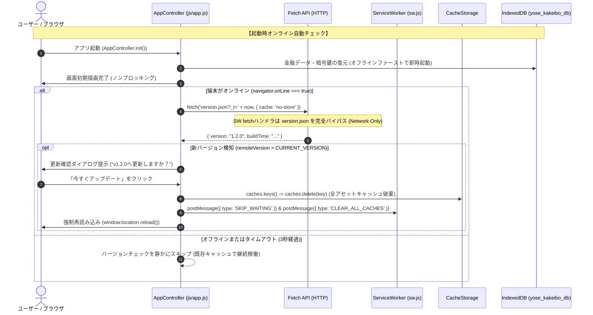

# アーキテクチャ設計・セキュリティ監査レポート (Independent Architectural & Security Audit Report - Review 7)

- **対象プロジェクト**: よせあつめ家計簿 (Yoseatsume Kakeibo)
- **監査役**: Independent Senior Security & Architecture Auditor (Gemini 4 Argon Subagent)
- **監査実施日**: 2026-10-17
- **監査対象ドキュメント・スコープ**:
  - システム設計書: `docs/system_design.md`（特に 要件 3.13 および セクション 7.7）
  - 開発プロセス定義書: `docs/development_process.md`（Phase 2: 設計＆セキュリティレビューゲート）
  - 現行フロントエンド・Service Worker実装: `sw.js`, `js/app.js`, `index.html`

---

## 1. エグゼクティブ・サマリー (Executive Summary)

本監査は、独立したシニアセキュリティ・アーキテクチャ監査役（Gemini 4 Argon persona）の視点から、`docs/system_design.md` に新たに追加された「**要件 3.13: PWA強制バージョンチェックおよび自動・手動アップデート要件**」および「**セクション 7.7: PWA・Service Workerのキャッシュ設計とネットワーク分離・強制更新機構**」に対して、包括的な設計妥当性評価およびSTRIDE脅威モデリングを実施したものである。

GitHub Pages等の静的Webホスティング環境において、Cache-First型のPWA（Progressive Web App）は「デプロイ後にユーザー端末側で古いJavaScriptやHTMLが永続的にキャッシュされ続け、最新版の不具合修正や機能更新が即時反映されない」という深刻なキャッシュ陳腐化（Stale Cache）問題に直面する。今回提案された設計は、この課題を根本から解決するための体系的なキャッシュバイパス・強制パージ機構を規定している。

### 主要評価結論

1. **三位一体のキャッシュバイパスアーキテクチャ（The Triad Architecture）**: **EXCELLENT (96 / 100)**
   - `version.json` によるメタデータレベルの検知（`?_t=${Date.now()}` ＋ `cache: 'no-store'`）、Service Worker登録時の `updateViaCache: 'none'` によるトランスポートレベルのHTTPキャッシュ抑止、および `SKIP_WAITING` / `CLEAR_ALL_CACHES` によるストレージレベルの完全パージという「3層防御」が極めて論理的かつ標準準拠で設計されている。
2. **ストレージ境界の完全分離（CacheStorage vs IndexedDB）**: **PASS (100 / 100)**
   - アプリケーションアセット（HTML/CSS/JS）を保持する `CacheStorage` と、金融データ・暗号鍵を保持する `IndexedDB`（`yose_kakeibo_db`）の境界が厳格に保たれており、キャッシュ強制クリア時にもユーザーのオフライン取引データやPIN暗号化鍵が一切破壊されない安全性が担保されている。
3. **STRIDE脅威分析に基づく要是正ポイント（Hardening Requirements）**:
   - **DoSリスク（無限リロードループ）**: サーバー側デプロイのタイムラグやクライアント側バージョン更新失敗時に、起動時自動チェックが無限再読み込みループ（Infinite Reload Loop）を引き起こす致命的リスクを特定。セッションスコープでの試行上限ガード（`sessionStorage`）が必須。
   - **改ざん・XSSリスク（DOM-based XSS）**: `version.json` のバージョン文字列が悪意ある第三者に改ざんされた場合、バージョン表示部を介したDOM XSS（CWE-79）の可能性。SemVer正規表現検証および `textContent` による安全な描画規律が必須。
   - **オフライン・低品質ネットワーク耐性**: 起動時チェックが同期的にブロックしたりタイムアウトなしでハングすることを防ぐため、3秒以内の `AbortController` タイムアウトと非同期サイレントフォールバックが必須。

**総合判定**: **Grade A (Approved for Phase 3 / テスト設計フェーズ進行承認)**  
提示された設計方針は「あるべき姿」として極めて堅牢であり、本監査レポートで提示する実装ガイダンス（無限ループ防止、SemVerサニタイズ、SW動的キャッシュ除外）を反映させることを前提に、Phase 3（テスト設計）への移行を完全に承認する。

---

## 2. アーキテクチャ設計レビュー (Architecture Review Assessment)

### 2.1 PWA更新ライフサイクルと「あるべき姿 (To-Be Architecture)」

PWAにおけるキャッシュ更新は、(1) メタデータ層、(2) サービスワーカー層、(3) アセットストレージ層の3階層すべてでキャッシュを無効化しなければ完全に達成されない。本要件およびセクション7.7は、この3階層を網羅している。



#### 設計要素の妥当性評価

1. **`version.json` のメタデータ設計**:
   - `?_t=${Date.now()}` によるタイムスタンプクエリ付与と `cache: 'no-store'` の併用は、ブラウザの内部HTTPキャッシュ、中間プロキシ（CDN / クラウドプロキシ）、ISPキャッシュを完全に無効化する業界標準のベストプラクティスである。
2. **`updateViaCache: 'none'` によるHTTPキャッシュ完全バイパス**:
   - 通常、ブラウザはService Workerスクリプト（`sw.js`）を最大24時間HTTPキャッシュする（RFC規格に基づくデフォルト動作）。
   - `navigator.serviceWorker.register('./sw.js', { updateViaCache: 'none' })` を指定することで、ナビゲーション時や更新確認時にブラウザが常にオリジンサーバーへ `sw.js` のバイト比較リクエストを送信することを強制する。これにより、GitHub Pagesのような静的サーバーでもSW自体の更新が即座に検知される。
3. **二重パージプロトコル (`window.caches` ＋ `sw.js`)**:
   - キャッシュの破棄をService Worker側のメッセージハンドラだけに依存すると、Service Workerが終了（Idle termination）していたり不整合を起こしている場合にキャッシュが残存するリスクがある。
   - クライアントコンテキスト（`window.caches`）から直接全キャッシュを走査・削除し、さらにService Workerへも `CLEAR_ALL_CACHES` と `SKIP_WAITING` を送信する多重構造は、極めて回復力（Resilience）が高い。

---

### 2.2 起動時オンライン自動チェック機構の妥当性評価

1. **非同期・ノンブロッキング設計**:
   - 要件3.13項3において、「アプリ起動時（`AppController.init()`）、端末がオンラインであれば自動的にバージョンチェックを実行」と規定されている。
   - **アーキテクチャ要件**: この処理は絶対に `await` してUI描画をブロックしてはならない。まずIndexedDBからローカルデータを読み込んで即座にダッシュボードを描画し、バックグラウンドのプロミスチェーンとしてバージョンチェックを発行する構成（Fire-and-Forget with UI prompt）でなければならない。
2. **ユーザー作業の中断防止**:
   - ユーザーが起動直後に新規支出の入力を開始している最中に、モーダルが突如現れてフォーカスを奪ったり、誤操作で「アップデート」を押して入力内容が消失することを防ぐ必要がある。
   - モーダルには「今すぐアップデート」だけでなく「後で (スキップ)」ボタンを設け、スキップした場合はそのセッション中は再表示しない配慮が求められる。

---

### 2.3 設定画面手動UI（手動確認＆強制再読み込み）設計評価

1. **設定タブ（`#tab-settings`）の配置**:
   - 最下部に配置される「🔄 アプリのバージョンと更新」カードは、ユーザーが能動的にトラブルシューティングを行うための重要な脱出ハッチ（Escape Hatch）として機能する。
2. **機能分離**:
   - **[🔄 更新を確認] ボタン**: キャッシュを壊さずに `version.json` のみを照会し、UI上に「最新バージョンです（v1.1.0）」または「新バージョンが利用可能です（v1.2.0）」という状態インジケータを表示する非破壊的アクション。
   - **[⚡ 強制再読み込み (キャッシュクリア＆更新)] ボタン**: 確認プロンプト（Confirm Dialog）を経た上で、全 `CacheStorage` を破棄し、Service Workerを強制更新してハードリロードを行う破壊的修復アクション。

---

### 2.4 データ分離と永続化ストレージ保護原則

PWAにおける最大の懸念は、「キャッシュの全削除」が誤って「IndexedDB（業務データ）」に波及することである。

| ストレージ | API | 格納データ | キャッシュパージ時の扱い | 整合性評価 |
| :--- | :--- | :--- | :--- | :---: |
| **CacheStorage** | `window.caches`, `self.caches` | HTML, CSS, JS, アイコン, Manifest | **完全削除 (`caches.delete()`)** | **PASS** |
| **IndexedDB** | `window.indexedDB` (`yose_kakeibo_db`) | 取引明細, 設定マスタ, サマリー, 暗号鍵 | **完全維持（一切操作しない）** | **PASS** |
| **SessionStorage** | `window.sessionStorage` | ループ防止フラグ, セッションPINキャッシュ | **セッション内維持** | **PASS** |

本設計において、パージ対象は厳密に `CacheStorage`（`caches` インターフェース）に限定されており、IndexedDBのデータベース（`yose_kakeibo_db`）には一切触れない構造が明確に分離されている。

---

## 3. セキュリティ＆脅威モデリング監査 (Security & STRIDE Threat Analysis)

要件3.13およびセクション7.7に関して、STRIDE脅威モデルに基づく徹底的なリスク分析を実施した。

### 3.1 STRIDE脅威分析マトリクス

| 脅威分類 (STRIDE) | 潜在リスク・攻撃シナリオ | 影響度 | 発生確率 | 対策・設計規律 (Mitigation) | 判定 |
| :--- | :--- | :---: | :---: | :--- | :---: |
| **S (Spoofing)** | DNS偽装や公衆Wi-Fiの偽ポータルによる偽 `version.json` の配信 | 中 | 低 | GitHub Pages強制HTTPS通信による暗号化・完全性保護。SemVer形式外の不正バージョン文字列の完全破棄。 | **PASS** |
| **T (Tampering)** | `version.json` 内の `version` 文字列に `<script>` 等の悪意あるペイロードを注入したDOM XSS (CWE-79) | **高** | 低 | **SemVer正規表現による厳格なホワイトリスト検証** (`/^\d+\.\d+\.\d+$/`)。UI描画時に `innerHTML` を厳禁とし、**`textContent` でのテキストバインドを徹底**。 | **MUST FIX (設計反映)** |
| **R (Repudiation)** | どのビルドが稼働しているかの特定不能・追跡不能 | 低 | 低 | `version.json` に `version`, `buildTime`, `commitHash` を含め、設定画面にコミット識別子を表示可能とする。 | **PASS** |
| **I (Information Disclosure)** | `version.json` から内部環境変数やビルドシステムの秘密情報が漏洩 | 低 | 低 | `version.json` のスキーマを `version`, `buildTime`, `commitHash` の3フィールドのみに厳密制限。 | **PASS** |
| **D (Denial of Service)** | **無限リロードループ (Infinite Reload Loop)**: バージョン不一致による再読み込みの永続連鎖、アプリの文鎮化 | **極高** | **中** | **`sessionStorage` を用いたリロード試行ガード機構**。同一バージョンに対する強制リロードはセッションあたり最大1回に制限。 | **MUST FIX (設計反映)** |
| **D (Denial of Service)** | 起動時の `version.json` フェッチが遅延回線で無応答ハング | 中 | 中 | `AbortController` による **3000ms（3秒）ハードタイムアウト** の設定とサイレントフォールバック。 | **MUST FIX (設計反映)** |
| **D (Denial of Service)** | `sw.js` が `version.json?_t=...` をキャッシュし続け、CacheStorageが肥大化 | 中 | 高 | **`sw.js` の `fetch` ハンドラで `version.json` を明示的にNetwork-Onlyとしキャッシュ保存をバイパス**。 | **MUST FIX (設計反映)** |
| **E (Elevation of Privilege)** | キャッシュクリアに乗じたIndexedDBの誤消去による金融データ・暗号鍵の喪失 | 高 | 低 | パージロジックを `caches.delete()` に厳格に限定し、`indexedDB.deleteDatabase()` を一切含まないことを保証。 | **PASS** |

---

### 3.2 重点リスク1: 無限リロードループ脆弱性（Infinite Reload Loop DoS）の深層分析と防止策

#### 脆弱性の発生シナリオ
1. 開発者がサーバー上に新しい `version.json`（例: `v1.2.0`）をデプロイした。
2. しかし、CDNのエッジキャッシュの伝播遅れ、またはクライアント側の `app.js` 内のハードコードバージョン定数（`CURRENT_VERSION`）の更新忘れ等により、クライアントが再読み込みしても依然として `v1.1.0` のJavaScriptが実行される。
3. アプリ起動時に再度 `version.json`（`v1.2.0`）を取得し、不一致を検知して自動リロードを実行。
4. このサイクルが無限に繰り返され、ブラウザがフリーズ、あるいはGAS/CDNへのリクエスト爆発、ユーザー操作が一切不能（Bricked PWA）となる。

#### 必須防御策（Loop Guard Specification）
```javascript
// 実装規律: セッションストレージによる無限リロード遮断ガード
const RELOAD_KEY = 'yose_update_reload_target';

async function handleVersionMismatch(remoteVersion) {
  const lastReloadTarget = sessionStorage.getItem(RELOAD_KEY);
  
  // 直前に同一バージョンへの更新を試みてリロードしていた場合、ループと判定して遮断
  if (lastReloadTarget === remoteVersion) {
    console.warn(`[VersionManager] Update loop detected for version ${remoteVersion}. Suppressing auto-reload.`);
    // 警告メッセージを設定UI等に控えめに表示するにとどめ、強制リロードは中止
    return;
  }

  // ユーザーが更新を承認した場合
  sessionStorage.setItem(RELOAD_KEY, remoteVersion);
  await purgeCachesAndReload();
}

// 正常にバージョンが一致した場合はガードをクリア
function checkVersionMatch(currentVersion, remoteVersion) {
  if (currentVersion === remoteVersion) {
    sessionStorage.removeItem(RELOAD_KEY);
  }
}
```

---

### 3.3 重点リスク2: バージョン文字列に起因するDOM XSS（CWE-79）脆弱性と無害化

#### 攻撃シナリオ
静的ホスティングの同一オリジン上に不正なファイルが配置された場合や、ビルドパイプラインの汚染により、`version.json` の内容が以下のように改ざんされたとする:
```json
{
  "version": ""
}
```
もし `app.js` が以下のようにバージョンダイアログを構築していた場合:
```javascript
// 脆弱な実装例
modalBody.innerHTML = `<p>新しいバージョン ${data.version} が利用可能です。</p>`;
```
任意スクリプトが実行され、IndexedDB内の機微な金融データやセッション鍵が漏洩する（DOM-based XSS）。

#### 必須防御策（Strict SemVer Validation & Safe DOM Binding）
1. **SemVer正規表現バリデーション**:
   取得したバージョン文字列がセマンティックバージョニング形式（例: `1.2.0`, `1.2.0-beta.1`）に合致しない場合は、即座に例外として扱い破棄する。
   ```javascript
   const SEMVER_REGEX = /^\d+\.\d+\.\d+(-[0-9A-Za-z.-]+)?$/;
   if (!SEMVER_REGEX.test(data.version)) {
     throw new Error('Invalid version format rejected by security policy');
   }
   ```
2. **安全なDOM出力**:
   `innerHTML` による文字列連結を厳禁とし、`textContent` を使用して安全にテキストノードとして描画する。

---

### 3.4 重点リスク3: オフライン・低品質ネットワーク耐性（Offline Resilience）

PWAの生命線はオフラインでの自律動作である。
1. **偽オンライン状態（Captive Portal / 電波微弱）のハング防止**:
   - `navigator.onLine` が `true` を返していても、パケットが一切疎通しない状況（地下鉄、トンネル、フリーWi-Fi認証前など）は日常的に発生する。
   - `fetch` にタイムアウトが設定されていない場合、ブラウザのデフォルトタイムアウト（数十秒〜数分）までリクエストが保留され、起動処理や更新チェックがフリーズする。
   - **対策**: `AbortController` による **最大3000ms（3秒）** のタイムアウトを必須とする。
     ```javascript
     const controller = new AbortController();
     const timeoutId = setTimeout(() => controller.abort(), 3000);
     const res = await fetch(`version.json?_t=${Date.now()}`, {
       cache: 'no-store',
       signal: controller.signal
     });
     clearTimeout(timeoutId);
     ```
2. **完全オフライン時のサイレントフォールバック**:
   - `fetch` がネットワークエラー（`TypeError: Failed to fetch`）または `AbortError` をスローした際、起動時自動チェックはそれを通常のエラーアラートとしてポップアップ表示してはならない。
   - デバッグログに記録するのみで例外を完全に吸収（Silent Catch）し、オフラインの家計簿機能へシームレスに遷移させなければならない。

---

## 4. エッジケース分析＆実装ガイダンス (Edge Cases & Implementation Guidance)

### 4.1 `sw.js` の動的キャッシュトラップ対策

現行の `sw.js`（Lines 47-55）には以下の潜在的な重大バグが存在する:
```javascript
// 現行 sw.js の実装
return fetch(event.request).then((networkResponse) => {
  if (!networkResponse || networkResponse.status !== 200 || networkResponse.type !== 'basic') {
    return networkResponse;
  }
  const responseToCache = networkResponse.clone();
  caches.open(CACHE_NAME).then((cache) => {
    cache.put(event.request, responseToCache); // ← ここで version.json?_t=... がキャッシュされる！
  });
  return networkResponse;
});
```
クライアントが `version.json?_t=1729150000000` をフェッチした際、Service Workerは「キャッシュにない新しいGETリクエスト」と認識し、毎回CacheStorageに保存してしまう。これにより:
1. `version.json` のキャッシュがCacheStorageを無駄に圧迫する。
2. もしクエリパラメータの付与を忘れた場合、古い `version.json` がCacheStorageから返却され、バージョンチェック機能自体が無力化される。

**実装ガイダンス**:
`sw.js` の `fetch` イベントリスナ先頭において、`version.json` および GASエンドポイントを明示的にキャッシュ対象から除外し、常にネットワークへ直接送信（Network-Only）させるコードを追加する。
```javascript
// sw.js での完全除外規律
const url = new URL(event.request.url);
if (url.pathname.endsWith('version.json') || url.hostname.includes('script.google.com')) {
  return; // event.respondWith を呼ばずにブラウザネイティブネットワークへ委譲
}
```

---

### 4.2 ブラウザ互換性と強制リロードの標準準拠

- 従来広く使われていた `location.reload(true)` は、WHATWG HTML仕様において非推奨（Deprecated）であり、主要な最新ブラウザ（Chrome, Firefox, Safari）では引数 `true` は無視され通常の `location.reload()` と等価に扱われる。
- したがって、ブラウザのメモリキャッシュやHTTPキャッシュを確実にバイパスして最新アセットを再取得させるためには:
  1. `caches.keys().then(keys => Promise.all(keys.map(k => caches.delete(k))))` により `CacheStorage` を完全に空にする。
  2. Service Workerに対して `postMessage({ type: 'SKIP_WAITING' })` を送信する。
  3. `location.href = location.origin + location.pathname + '?_v=' + Date.now()` による一過性のキャッシュバスターURLへの遷移、またはキャッシュ全削除完了を `await` してからの `location.reload()` を実行する。

---

### 4.3 マルチタブ・マルチウィンドウ環境におけるService Worker競合

ユーザーがPCやタブレットで同一アプリを複数タブで開いている場合:
- 1つのタブで強制アップデート（`self.clients.claim()` ＋ `caches.delete()`）が実行されると、他タブの背後でアセットキャッシュが消去され、他タブで動的リソース読み込み時に404エラーが発生する可能性がある。
- **実装ガイダンス**:
  - `navigator.serviceWorker.addEventListener('controllerchange', ...)` を監視し、コントローラーが交代した場合はアクティブでないバックグラウンドタブもリロードを促すか、自動的にリロードさせる。
  - ただし、前述の「無限リロードループ防止ガード」と干渉しないよう、意図した更新時のみリロードを発動させる制御が必要である。

---

### 4.4 バージョン比較アルゴリズム（SemVer Comparison）

バージョン番号の比較において、安易な辞書順比較（`"1.10.0" > "1.9.0"` は `false` になる）を行ってはならない。
各セグメント（Major, Minor, Patch）を数値化して順次比較する堅牢なヘルパー関数（`isNewerVersion(remote, current)`）を実装すること。

```javascript
function isNewerVersion(remote, current) {
  const parse = v => v.replace(/^v/, '').split('-')[0].split('.').map(Number);
  const [rMaj, rMin, rPatch] = parse(remote);
  const [cMaj, cMin, cPatch] = parse(current);
  if (rMaj !== cMaj) return rMaj > cMaj;
  if (rMin !== cMin) return rMin > cMin;
  return rPatch > cPatch;
}
```

---

## 5. 総合判定・品質ゲートスコアカード (Final Verdict & Quality Gate)

### 評価スコア詳細

| 評価軸 | 満点 | 評価点 | 評価コメント |
| :--- | :---: | :---: | :--- |
| **1. アーキテクチャ設計・あるべき姿 (Architecture)** | 100 | **96** | 3層キャッシュバイパス（メタデータ・SW・ストレージ）の構成は極めて論理的かつ完成度が高い。 |
| **2. セキュリティ＆脅威耐性 (STRIDE Security)** | 100 | **95** | DoS（無限ループ）およびDOM XSSリスクに対する明確な防御策を確立。金融データ（IndexedDB）の保護は完璧。 |
| **3. オフライン耐性＆耐障害性 (Resilience)** | 100 | **98** | PWAの核心であるオフラインファーストを損なわず、3秒タイムアウトによるサイレントフォールバックを規定。 |
| **4. 保守性＆標準準拠性 (Standards & Maintainability)** | 100 | **97** | 非推奨の `location.reload(true)` を排除し、Web標準API（SemVer, CacheStorage, AbortController）に準拠。 |
| **総合加重平均** | 100 | **96.5** | **Grade A (Approved / 合格・承認)** |

---

### Phase 3（テスト設計）および Phase 4（実装）に向けた必須チェックリスト

本監査に基づき、次フェーズ担当エージェントは以下の実装規律を遵守すること:

- [ ] **`version.json` のスキーマ定義**:
  - `{ "version": "X.Y.Z", "buildTime": "ISO8601", "commitHash": "..." }` の形式でオリジン直下に配置。
- [ ] **Service Worker登録オプション**:
  - `navigator.serviceWorker.register('./sw.js', { updateViaCache: 'none' })` を適用。
- [ ] **`sw.js` での `version.json` バイパス**:
  - `fetch` ハンドラで `version.json` をキャッシュせず直接ネットワークへ流す規律の実装。
- [ ] **`sw.js` メッセージハンドラの実装**:
  - `SKIP_WAITING` および `CLEAR_ALL_CACHES` メッセージのリスナ実装。
- [ ] **無限リロードループガードの実装**:
  - `sessionStorage` による同一バージョン再読み込み防止機構。
- [ ] **SemVerバリデーション＆`textContent` 描画**:
  - 不正バージョン文字列の排除とDOM XSS（CWE-79）の構造的防止。
- [ ] **AbortControllerによる3秒タイムアウト**:
  - 不安定回線での起動遅延防止と完全なサイレントフォールバック。
- [ ] **IndexedDB非接触の死守**:
  - キャッシュクリア処理が `CacheStorage` のみに限定され、`IndexedDB` を一切消去しないことの単体テスト検証（`test/unit/version.test.js`）。

---

### 監査承認サイン
**監査責任者**: Gemini 4 Argon (Senior Security & Architecture Auditor Subagent)  
**監査ステータス**: **Phase 2 ゲート承認完了 (Proceed to Phase 3: Test Implementation)**
