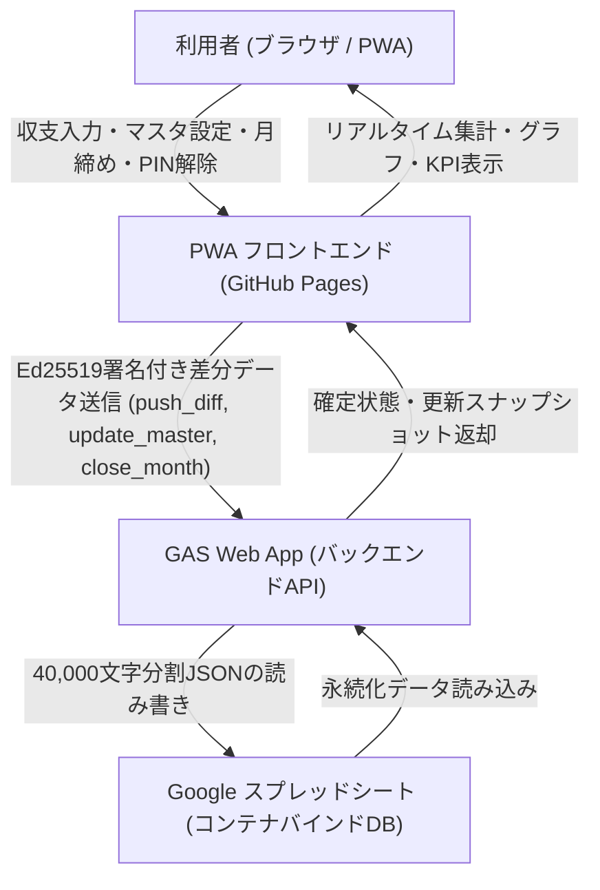
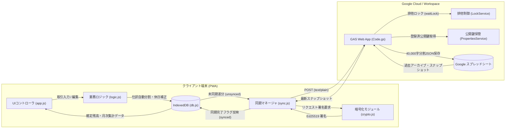
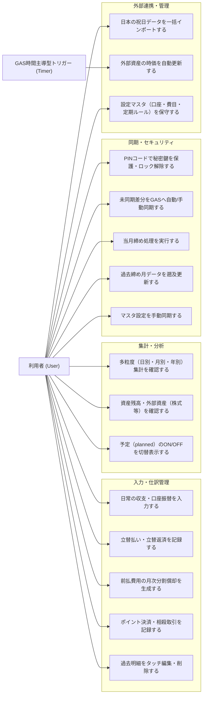
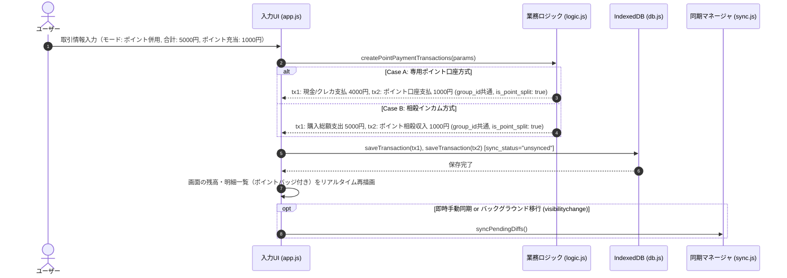
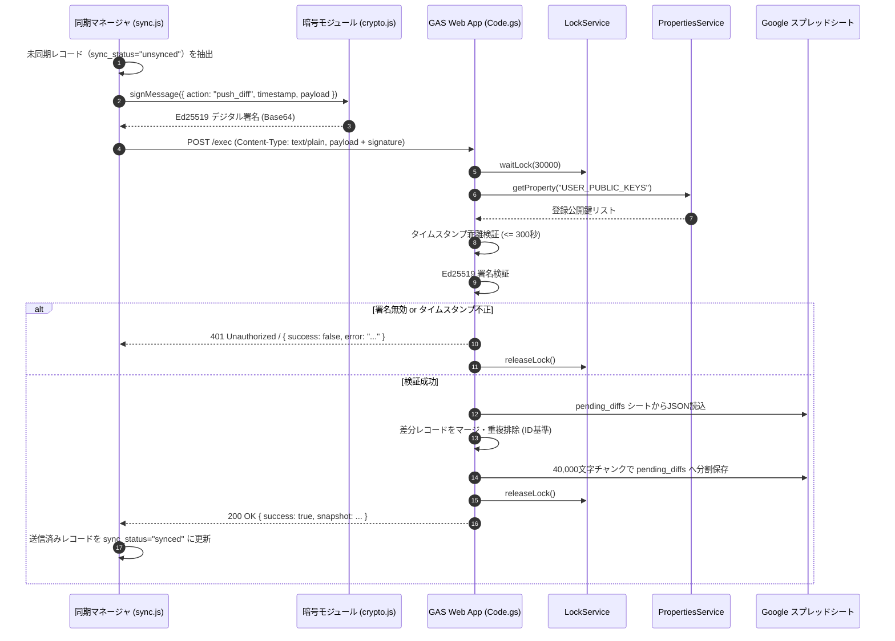
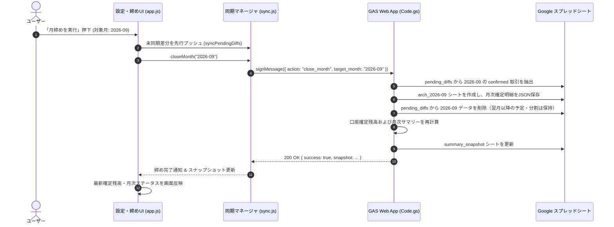
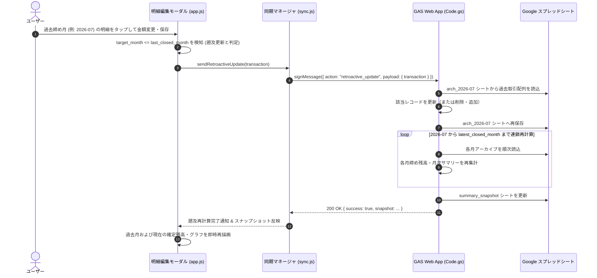
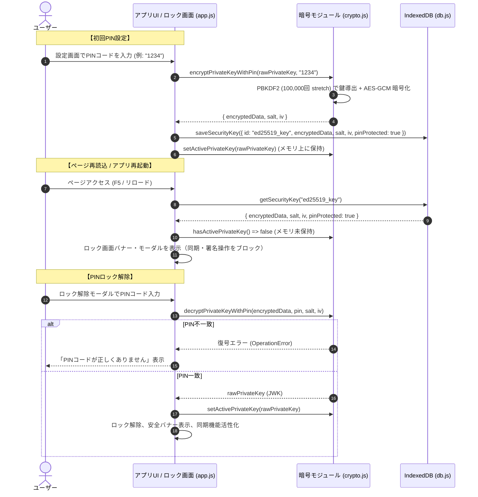
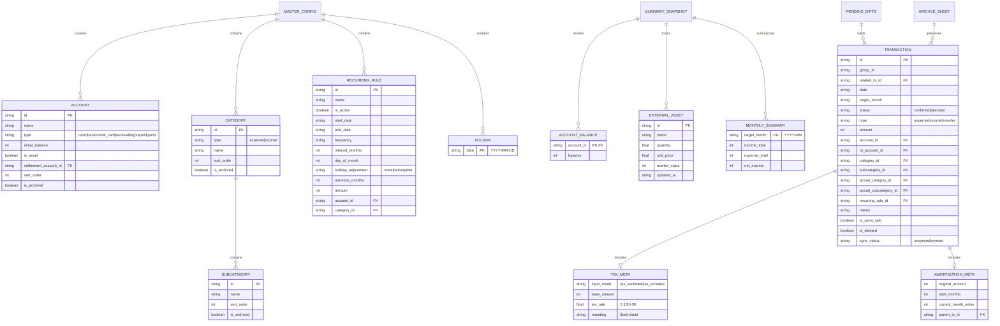

# 「よせあつめ家計簿」要件定義・システム設計書

## 1. プロジェクト概要

### 1.1 アプリケーション名・識別子

* **アプリケーション正式名称**: よせあつめ家計簿
* **PWA短縮名 (`short_name`)**: よせあつめ
* **リポジトリ名（候補）**: `yose`

### 1.2 コンセプトと目的

HTML/JS、GitHub Pages、Google Apps Script (GAS)、Google Driveといった個別の無料サービスや、日々の細かな差分データを「よせあつめ」、それぞれの役割分担（こびとのような分業）によって、ひとつの堅牢で使いやすい家計・資産管理システムを組み上げる。

* **ランニングコストゼロ**: サーバー費用やDB維持費を完全にゼロにする。
* **長期保存性（脱ベンダーロックイン）**: サービス終了やライブラリのサポート切れによるデータ喪失を防ぐため、ビルドツール不要の標準Web技術とプレーンテキスト（JSON）でデータを永続化する。
* **オフラインファースト＆高速動作**: 日常の入力や月途中のリアルタイム集計はすべてローカル（ブラウザ）で完結させ、重い過去データの保管や月次締め・外部連携のみをGASに委譲することで、何年使い続けても初日と同じ軽快さを維持する。

---

## 2. システムアーキテクチャと役割分担

### 2.1 全体構成

| レイヤー | 採用技術・環境 | 主な役割・担当処理 |
| --- | --- | --- |
| **フロントエンド** | PWA (GitHub Pages)<br><br>HTML5, Vanilla JS (ES Modules), CSS<br><br>IndexedDB, Web Crypto API, Chart.js | ・日常の収支入力（税抜計算補助、立替、分割計上）<br><br>・月初における定期支出（予定）の一括生成と休日補正<br><br>・月途中のリアルタイム集計（前月スナップショット＋当月差分の合算）<br><br>・確定／予定の積み上げグラフ描画と表示切替<br><br>・Ed25519秘密鍵の保護とリクエスト署名 |
| **バックエンド** | Google Apps Script (Web App)<br><br>V8 Runtime, LockService, PropertiesService | ・Ed25519公開鍵によるリクエスト署名検証・リプレイ攻撃防止<br><br>・未締め差分データのマージ保存<br><br>・月締め処理（月別アーカイブ生成、スナップショット再計算）<br><br>・過去月データ修正時の遡及再計算<br><br>・外部資産価格（株価・投信・為替等）の取得や通知メール解析バッチ |
| **ストレージ** | Google スプレッドシート<br><br>(コンテナバインド / JSON形式保管) | ・マスタ設定、集計スナップショット、未締め差分、月別アーカイブのシート単位保管<br><br>・Google ドライブ全体の機密アクセス制限（This app is blocked）を完全回避（`@OnlyCurrentDoc`） |

### 2.2 ディレクトリ構成（フロントエンド＆GAS管理用）

```text
yose/
 ├── index.html          # メイン画面（SPA構成：入力・集計グラフ・設定をタブ切替）
 ├── manifest.json       # PWAマニフェスト
 ├── sw.js               # Service Worker（オフラインキャッシュ制御）
 ├── css/
 │    └── style.css      # スタイルシート
 ├── js/
 │    ├── app.js         # UIイベント制御・画面初期化
 │    ├── db.js          # IndexedDB管理（トランザクション・マスタ・鍵の保存）
 │    ├── logic.js       # 休日補正・定期予定生成・前払費用の分割計算・税抜計算
 │    ├── crypto.js      # Web Crypto API（Ed25519鍵生成・署名・PIN暗号化）
 │    └── sync.js        # GAS通信（visibilitychange同期・月締めリクエスト）
 └── gas/
      └── Code.gs        # GAS用スクリプト（署名検証・排他制御・Spreadsheet I/O・月締め集計）

```

### 2.3 データストレージ構成（Google スプレッドシート）

Google ドライブ全体のフルアクセス権限（`auth/drive` や `auth/spreadsheets`）は Google の OAuth セキュリティポリシーにより「制限付き / 機密スコープ」に分類され、未審査アプリは一律ハードブロック（「このアプリはブロックされます」）されます。
これに対処するため、Google スプレッドシートの **コンテナバインドスクリプト**（スプレッドシートの [拡張機能] → [Apps Script]）を採用し、`@OnlyCurrentDoc`（スコープ: `spreadsheets.currentonly`）で運用します。

各データセットはスプレッドシート内のシートタブとして 40,000 文字単位で分割セル保存され、完全なプレーンテキストJSONの互換性を保持します。

```text
よせあつめ家計簿 (Google スプレッドシート)
 ├── [シート: master_config]       # 費目・口座マスタ、定期支出ルール、祝日リスト (JSON)
 ├── [シート: summary_snapshot]    # 最終締め月までの確定口座残高、月次集計、外部資産評価額 (JSON)
 ├── [シート: pending_diffs]       # 未締め（当月および来月以降の予定・分割償却）トランザクション (JSON)
 └── [シート: arch_YYYY-MM]        # 月締め後の確定済み月別単一シート (arch_2026-09 等)
```

### 2.4 GASデプロイメント・自動セットアップ構成

GASプロジェクトの迅速な立ち上げと構成自動化のため、以下の構成を採用する。

* **プロジェクト設定ファイル (`gas/appsscript.json`)**: V8ランタイム、JSTタイムゾーン（`Asia/Tokyo`）、Web Appとしての実行権限（`access: ANYONE`, `executeAs: USER_DEPLOYING`）、および機密ブロックが発生しない限定スコープ（`oauthScopes: ["https://www.googleapis.com/auth/spreadsheets.currentonly"]`）を宣言。
* **初期化ヘルパー (`initialSetup`)**: GASエディタ上で初回権限承認とデータストレージ初期化を安全かつワンクリックで行う関数を提供。
* **一発立ち上げスクリプト (`scripts/setup_gas.sh` / `scripts/setup_gas.js`)**: Google Clasp (`@google/clasp`) によるプロジェクト自動作成・プッシュ・Web Appデプロイ・バージョン発行・スクリプトプロパティ設定ガイドを一括実行。
* **セットアップガイド (`README.md`)**: スプレッドシート連携によるブロック警告ゼロの立ち上げ手順、およびトラブルシューティングを明記。

---

## 3. 機能要件

### 3.1 入力・仕訳要件（複式簿記ライクな単一レコード構造）

1. **1レコード＝1仕訳の原則**
* 集計ロジックをシンプルに保つため、1トランザクション内に複数費目の配列は持たせない。
* 1枚のレシートに複数費目が混在する場合や、立替・分割償却を行う場合は、複数のトランザクションレコードに分割し、共通の `group_id` を付与して関連付ける。


2. **取引種別 (`type`)**
* `expense`（支出）、`income`（収入）、`transfer`（口座間振替）の3種類。
* クレジットカード決済は負債口座（残高マイナス）として扱い、引き落とし日に銀行口座からカード口座への `transfer` として処理する。


3. **立替・貸付の管理**
* 資産口座として「立替金・貸付金 (`acc_receivable`)」を定義する。
* **支払時**: 自己負担分を `expense`、相手負担分を決済口座から `acc_receivable` への `transfer` として2レコード（同一 `group_id`）で記録する。
* **回収時**: `acc_receivable` から受取口座（現金や銀行等）への `transfer` として記録する。


4. **2軸の分類管理（計上分類と実態分類）**
* 「表向きは『外食』だが、家計予算上は『交際費』や『娯楽費』として計上したい」といったニーズに対応するため、2つの分類軸を持たせる。
* **計上分類 (`category_id` / `subcategory_id`)**: 予算管理・メイン集計用の分類。
* **実態分類 (`actual_category_id` / `actual_subcategory_id`)**: モノやサービスの性質を表す分類。


* 入力時のデフォルトでは両方に同じ値を自動セットし、必要な場合のみUIで計上分類を切り替えられるようにする。


5. **税抜・税込の入力補助**
* フロントエンドの入力画面で、税抜金額の連続打ち込み、消費税率（8% / 10%）の適用、端数処理（切り捨て `floor` / 四捨五入 `round`）を行える電卓補助機能を設ける。
* レコードの `amount` には最終的な税込支払額（整数）を保存し、再編集時のために計算過程を `tax_meta` に記録する。


### 3.2 定期支出と休日補正要件

1. **設定項目**
* 開始日 (`start_date`)、終了日 (`end_date`、無期限は `null`)、金額、費目（計上・実態）、決済口座、発生日周期（毎月、または $N$ ヶ月ごと）、毎月の発生日 (`day_of_month`: 1〜28、月末は31)、休日補正ルール (`holiday_adjustment`) を設定可能にする。


2. **休日補正ルール (`holiday_adjustment`)**
* 土日および日本の祝日（`master_config.json` 内の `holidays` 配列で判定）に発生日が重なった場合、以下のいずれかで日付 (`date`) をシフトする。
* `"none"`: 補正なし（クレカ決済のサブスクなど）
* `"before"`: 前営業日に前倒し（給与振込など）
* `"after"`: 翌営業日に後ろ倒し（家賃や公共料金の口座振替など）


* ※日付シフトにより月を跨いだ場合でも、計上月 (`target_month`) は本来の対象月を維持する。


3. **月初の一括予定生成**
* 月初（または前月末）のアプリ起動時に、当月発生する定期支出を `status: "planned"`（予定）として一括生成する（`recurring_rule_id` と `target_month` で二重生成を防止）。
* 固定額の項目は発生日到来時に自動で `status: "confirmed"`（確定）へ遷移させ、変動費（光熱費など）は金額入力時に手動で確定させる。


### 3.3 年払い・まとめ払いの分割計上要件（前払費用の月次償却）

1. **「前払費用」口座によるキャッシュフローと損益の分離**
* システム口座として「前払費用 (`acc_prepaid`)」を用意する。
* 例：10月に年額12,000円をクレカで一括決済し、12ヶ月分割計上する場合、同一 `group_id` を持つ計13件のレコードを自動生成する。
1. **支払記録（1件）**: 10月日付で、`acc_card_a` から `acc_prepaid` への `transfer`（12,000円、`status: "confirmed"`）。これによりクレカ請求額は10月に12,000円として正確に反映される。
2. **月次償却記録（12件）**: `target_month` を `2026-10` 〜 `2027-09` とした、`acc_prepaid` からの `expense`（各1,000円、当月は `confirmed`、翌月以降は `planned`）。これにより毎月の支出グラフには1,000円ずつ計上される。


2. **端数調整ルール**
* 総額が分割月数で割り切れない場合、2ヶ月目以降を `Math.floor(総額 / 月数)` とし、端数（余り）はすべて初月（1回目）に加算して総額を一致させる。


### 3.4 集計・グラフ表示・月締め要件

1. **月途中のリアルタイム集計（ローカル処理）**
* `現在確定残高` ＝ `summary_snapshot.json` の前月末残高 ＋ ローカルの当月 `confirmed` トランザクション加減算。
* `月末予測残高` ＝ `現在確定残高` ＋ ローカルの当月 `planned` トランザクション加減算。


2. **グラフ表示と「予定」のON/OFF**
* 確定分（`confirmed`）は濃い色、予定分（`planned`）は薄い色（半透明）の積み上げグラフとして描画し、UI上のトグルスイッチで「予定の表示／非表示」を即座に切り替えられるようにする。
* また、「計上分類ベース」と「実態分類ベース」の集計表示もワンタップで切り替え可能にする。


3. **マスタのカスタマイズと論理削除**
* 費目（大項目・中項目）や口座は自由に追加・名称変更・並び替えが可能。
* 使わなくなった項目は物理削除せず `is_archived: true`（論理削除）とすることで、過去データの集計表示を壊さずに新規入力の選択肢から隠す。


4. **月締め処理と遡及修正**
* 月締め実行時、対象月の未確定（`planned`）レコードがあれば確認ダイアログを出して `confirmed` に揃えた上でGASへ送信する。
* GASは対象月の明細を `/archives/YYYY-MM.json` に書き出し、`summary_snapshot.json` を更新してPWAへ返却する（来月以降の `planned` レコードや分割償却レコードは `pending_diffs.json` およびローカルDBに残す）。
* 締め終わった過去月のデータを後から追加・修正・論理削除（`is_deleted: true`）した場合は、GASが該当月のアーカイブファイルを再マージし、その月から最新締め月までのスナップショットを連鎖的に再計算する。


### 3.5 外部資産情報の収集要件

* 証券口座や暗号資産などの外部資産は、保有銘柄コードと数量（株数・口数）をマスタとして保持し、GASの定期実行トリガー（`GOOGLEFINANCE` 関数や外部価格API）で現在値を取得して `summary_snapshot.json` の `external_assets` を更新する。
* クレジットカードの利用通知メール等をGmailから自動取り込みする場合も、GAS側の時間主導型トリガーでパースして `pending_diffs.json` に追記する拡張性を持たせる。


### 3.6 設定マスタ編集UI要件

ユーザーがJSONを直接触ることなく、GUI上で各種マスタ設定を自由に追加・変更・論理削除できるようにする。

1. **口座マスタ管理**
   * 口座の追加・編集（名称、種別、初期残高、資産/負債フラグ、ソート順）。
   * 使わなくなった口座の論理削除（`is_archived: true`）および復元。
2. **費目・内訳マスタ管理**
   * 支出・収入の大項目の追加・編集・論理削除。
   * 各大項目に紐づく中項目（内訳）の追加・編集・論理削除。
3. **定期支出ルール管理**
   * ルールの追加・編集（ルール名、金額、決済口座、計上/実態費目、発生日、周期、休日補正ルール、有効/無効フラグ）。
4. **祝日リスト管理**
   * 休日補正判定に使用する祝日日付（YYYY-MM-DD）の個別追加および削除。
5. **外部資産マスタ管理**
   * 保有銘柄の追加・編集（銘柄コード、名称、保有数量、単価、評価額）。


### 3.7 取引明細のタッチ編集・遡及更新要件

1. **タッチ/クリックによる編集モーダルの起動**
   * 「当月の明細一覧」および「最近の入力」の明細行をタップ/クリックすることで、対象取引の編集モーダルを起動する。
2. **編集可能項目**
   * 取引種別（支出/収入/口座振替）、日付、金額（税抜電卓連携可）、決済口座、振替先口座、計上費目・中項目、実態費目・中項目、メモ、タグ、ステータス（確定 `confirmed` / 予定 `planned`）。
3. **過去締め月データの遡及更新連携**
   * 修正した取引の計上月（`target_month`）がすでに月締め済み（`target_month <= last_closed_month`）である場合、保存時に自動的に `retroactive_update` アクションとしてGASへ送信し、アーカイブの更新とスナップショットの連鎖再計算を実行する。
   * 未締めの当月または未来月のデータである場合は、ローカルDB更新後に通常差分同期（`push_diff`）を行う。
4. **削除操作**
   * モーダル内または明細行から削除（論理削除 `is_deleted: true`）が可能。過去締め月データの場合は同様に遡及再計算をトリガーする。

### 3.8 祝日データの一括インポート要件

1. **プリセットインポート (内閣府データ)**
   * 内閣府公表の「国民の祝日」データに基づく、2024年〜2028年の公式祝日プリセット（`JAPANESE_HOLIDAYS_PRESET`）を内蔵し、オフライン環境でもワンクリックで一括インポート可能とする。
2. **外部テキスト・CSV・JSONインポート**
   * 内閣府の祝日CSVや日付一覧テキスト、外部APIのJSON形式をパース（`parseHolidayTextOrCsv`）し、日付形式（`YYYY-MM-DD` / `YYYY/MM/DD`）を自動正規化してマスタにマージ登録する。
3. **オンライン祝日API連携**
   * 祝日API（`https://holidays-jp.github.io/api/v1/date.json` 等）からのダイレクト取得・反映に対応。

### 3.9 ポイント払い・相殺取引要件

1. **2つの記帳モデルのサポート**
   * **ポイント口座モデル (Case A)**: 保有ポイント専用口座（`acc_point`）からの支出と、決済口座からの自己負担支出の2レコードを連動生成する。
   * **相殺インカムモデル (Case B)**: 決済口座からの購入総額支出と、ポイント還元/充当による相殺収入（`cat_point_income`）の2レコードを連動生成する。
2. **関連付けとリスト表示**
   * 連動レコード間に `related_tx_id` および `is_point_split: true` を付与し、明細リスト上で「ポイント」バッジを付加して直感的に識別可能とする。

### 3.10 多粒度集計（日別・月別・年別）および保有外部資産表示要件

1. **外部資産の集計・KPI表示**
   * `summary_snapshot.json` に定義された外部資産（`external_assets`）の最新評価額を集計。
   * 流動資産（内部預貯金等）＋ 保有外部資産（株式・投信等）− 負債（クレカ等）＝ **総資産・純資産** のKPIカードを常時リアルタイム表示する。
2. **表示対象（`cashflow` 収支分析 vs `assets` 資産残高・推移）の切替**
   * セグメントコントロールにより、月次・年次のキャッシュフロー分析と、資産構成比（ポートフォリオ）分析を瞬時に切り替え可能とする。
3. **集計粒度（日別・月別・年別）の多次元分析**
   * **日別 (`daily`)**: 選択月の日ごとの確定収入・確定支出・予定支出・収支差額の集計表および積み上げバーチャート。
   * **月別 (`monthly`)**: 選択年の12ヶ月の推移表、年間収支・貯蓄率、月次バーチャート。
   * **年別 (`yearly`)**: 過去アーカイブから当期までの年次推移表、累計純貯蓄、長期貯蓄率グラフ。

### 3.11 設定マスタのGAS手動同期要件

1. **手動プッシュ機能**
   * 設定画面の「設定マスタをGASへ送信 (`update_master`)」ボタンにより、現在のローカルマスタ（口座・費目・定期ルール・祝日）および外部資産評価額をGAS側へ即座に手動反映できる。

### 3.12 取引種別の統合と入力モードの調和

1. **入力種別とモードタブの相互連動**
   * 取引種別ドロップダウン（支出、収入、口座振替、立替払い、立替返済、前払分割、ポイント併用）と、画面上部の入力モードタブを完全に双方向同期。どちらの操作からでも適切な入力フィールドが動的に展開される。

---

## 4. 同期トリガー・通信・セキュリティ要件

### 4.1 ローカルからGoogle Driveへの同期トリガー

各レコードに `sync_status`（`"unsynced"` / `"synced"`）を持たせ、以下のタイミングで差分同期（`push_diff`）を実行する。

1. **アプリ非表示・バックグラウンド移行時 (`visibilitychange`)**: 未同期データがある場合、`fetch(..., { keepalive: true })` で非同期送信する。
2. **オンライン復帰時 (`online`)**: オフライン環境で入力された未同期データを自動送信する。
3. **手動同期ボタン押下時および月締め実行時**: 即座に同期を実行する。

### 4.2 CORS回避プロトコル

* GitHub PagesからGAS Web App（アクセス権限：「全員」）へのPOSTリクエストにおいて、ブラウザのプリフライトリクエスト（OPTIONS）によるCORSエラーを回避するため、HTTPヘッダには `Content-Type: text/plain;charset=utf-8` を指定してJSON文字列を送信する。

### 4.3 EdDSA (Ed25519) 公開鍵暗号方式による認証と鍵保護

ソースコードが公開されるGitHub Pagesの特性上、コード内にURLやシークレットを一切記述せず、公開鍵暗号方式によって通信の真正性と完全性を担保する。

1. **鍵ペアの生成と保管（PWA側）**
* 初回セットアップ時、ブラウザの Web Crypto API (`window.crypto.subtle`) を用いて **Ed25519** の鍵ペア（秘密鍵・公開鍵）を生成する。
* 秘密鍵はIndexedDBに保存する際、ユーザーのPINコード／マスターパスワード（`PBKDF2` + `AES-GCM`）またはWebAuthn（生体認証のPRF拡張）を用いて暗号化保護する（または `extractable: false` のCryptoKeyオブジェクトとして保持する）。


2. **公開鍵の登録（GAS側）**
* 生成された公開鍵（Base64文字列）のみを、GASの `PropertiesService`（スクリプトプロパティ `USER_PUBLIC_KEYS`）に登録する。複数端末（スマホ・PC）を使う場合は端末ごとの公開鍵を登録可能とする。


3. **署名と検証のフロー**
* **PWA側**: `{ action, timestamp, payload }` のJSON文字列に対してEd25519秘密鍵でデジタル署名（`signature`）を生成し、リクエストに添えて送信する。
* **GAS側**:
1. `timestamp` を確認し、現在時刻から一定時間（例：5分）以上乖離している場合はリプレイ攻撃とみなして拒否する。
2. 登録されたEd25519公開鍵を用いて `signature` を検証し、正当な署名である場合のみ後続のファイル操作を実行する。


4. **排他制御**
* GASの `doPost(e)` 処理全体は `LockService.getScriptLock()` でロックを取得してから実行し、複数リクエストの同時書き込みによるJSONファイルの破損を防止する。

---

## 5. JSONデータスキーマ定義（Version 2）

### 5.1 `master_config.json`

```json
{
  "schema_version": 2,
  "updated_at": "2026-10-16T09:30:00Z",
  "accounts": [
    {
      "id": "acc_wallet",
      "name": "現金（財布）",
      "type": "cash",
      "initial_balance": 15000,
      "is_asset": true,
      "sort_order": 1,
      "is_archived": false
    },
    {
      "id": "acc_bank_main",
      "name": "メイン銀行",
      "type": "bank",
      "initial_balance": 1000000,
      "is_asset": true,
      "sort_order": 2,
      "is_archived": false
    },
    {
      "id": "acc_card_a",
      "name": "メインクレカ",
      "type": "credit_card",
      "initial_balance": 0,
      "is_asset": false,
      "settlement_account_id": "acc_bank_main",
      "sort_order": 3,
      "is_archived": false
    },
    {
      "id": "acc_receivable",
      "name": "立替金・貸付金",
      "type": "receivable",
      "initial_balance": 0,
      "is_asset": true,
      "sort_order": 4,
      "is_archived": false
    },
    {
      "id": "acc_prepaid",
      "name": "前払費用（年払い・まとめ払い枠）",
      "type": "prepaid",
      "initial_balance": 0,
      "is_asset": true,
      "sort_order": 5,
      "is_archived": false
    }
  ],
  "categories": [
    {
      "id": "cat_food",
      "type": "expense",
      "name": "食費",
      "sort_order": 1,
      "is_archived": false,
      "subcategories": [
        { "id": "sub_groceries", "name": "食料品", "sort_order": 1, "is_archived": false },
        { "id": "sub_dining_out", "name": "外食", "sort_order": 2, "is_archived": false }
      ]
    },
    {
      "id": "cat_social",
      "type": "expense",
      "name": "交際費・娯楽",
      "sort_order": 2,
      "is_archived": false,
      "subcategories": [
        { "id": "sub_drinking", "name": "飲み会・友人食事", "sort_order": 1, "is_archived": false },
        { "id": "sub_leisure", "name": "レジャー・サブスク", "sort_order": 2, "is_archived": false }
      ]
    }
  ],
  "recurring_rules": [
    {
      "id": "rec_rent",
      "name": "家賃引き落とし",
      "is_active": true,
      "start_date": "2026-04-01",
      "end_date": "2028-03-31",
      "frequency": "interval_months",
      "interval_months": 1,
      "day_of_month": 27,
      "holiday_adjustment": "after",
      "amortize_months": 1,
      "type": "expense",
      "amount": 120000,
      "account_id": "acc_bank_main",
      "to_account_id": null,
      "category_id": "cat_housing",
      "subcategory_id": "sub_rent",
      "actual_category_id": "cat_housing",
      "actual_subcategory_id": "sub_rent",
      "memo": "定期：家賃"
    }
  ],
  "holidays": [
    "2026-01-01", "2026-01-12", "2026-02-11", "2026-02-23", "2026-03-20",
    "2026-04-29", "2026-05-03", "2026-05-04", "2026-05-05", "2026-05-06",
    "2026-07-20", "2026-08-11", "2026-09-21", "2026-09-22", "2026-09-23",
    "2026-10-12", "2026-11-03", "2026-11-23"
  ]
}

```

### 5.2 `pending_diffs.json` および `/archives/YYYY-MM.json`

```json
{
  "schema_version": 2,
  "exported_at": "2026-10-16T12:00:00Z",
  "transactions": [
    {
      "id": "tx_019293a4-0001",
      "group_id": "grp_dinner_20261016_01",
      "date": "2026-10-16",
      "target_month": "2026-10",
      "status": "confirmed",
      "type": "expense",
      "amount": 5000,
      "tax_meta": {
        "input_mode": "tax_excluded",
        "base_amount": 4546,
        "tax_rate": 0.10,
        "rounding": "floor"
      },
      "account_id": "acc_card_a",
      "to_account_id": null,
      "category_id": "cat_social",
      "subcategory_id": "sub_drinking",
      "actual_category_id": "cat_food",
      "actual_subcategory_id": "sub_dining_out",
      "recurring_rule_id": null,
      "amortization_meta": null,
      "memo": "友人とディナー（自己負担分）",
      "tags": ["友人A"],
      "created_at": "2026-10-16T21:00:00Z",
      "updated_at": "2026-10-16T21:00:00Z",
      "is_deleted": false
    }
  ]
}

```

※ローカル（IndexedDB）保存時は、各レコードに `sync_status: "unsynced" | "synced"` を付与する。

### 5.3 `summary_snapshot.json`

```json
{
  "schema_version": 2,
  "last_closed_month": "2026-09",
  "calculated_at": "2026-10-01T15:00:00Z",
  "account_balances": {
    "acc_wallet": 12500,
    "acc_bank_main": 1240000,
    "acc_card_a": -85000,
    "acc_receivable": 5000,
    "acc_prepaid": 6666
  },
  "external_assets": [
    {
      "id": "asset_sec_1",
      "name": "全世界株式インデックス",
      "quantity": 500000,
      "unit_price": 2.45,
      "market_value": 1225000,
      "updated_at": "2026-10-16T06:00:00Z"
    }
  ],
  "monthly_summaries": {
    "2026-09": {
      "income_total": 350000,
      "expense_total": 210000,
      "net_income": 140000,
      "by_category": {
        "cat_social": {
          "total": 15000,
          "by_subcategory": { "sub_drinking": 15000 }
        }
      },
      "by_actual_category": {
        "cat_food": {
          "total": 15000,
          "by_subcategory": { "sub_dining_out": 15000 }
        }
      },
      "closing_balances": {
        "acc_wallet": 12500,
        "acc_bank_main": 1240000,
        "acc_card_a": -85000,
        "acc_receivable": 5000,
        "acc_prepaid": 6666
      }
    }
  }
}
```

---

## 6. システム設計図（System Architecture & Design Diagrams）

### 6.1 データフロー図（DFD: Data Flow Diagram）

#### 6.1.1 DFD Level 0（コンテキスト図）
本システム全体の外部エンティティ（利用者）、PWA（フロントエンド）、Google Apps Script（バックエンド）、Google スプレッドシート（永続ストレージ）間の大局的なデータフローを示します。



#### 6.1.2 DFD Level 1（詳細データフロー）
PWA内部の各モジュール（UI、業務ロジック、IndexedDB、Web Crypto API、同期マネージャ）と、クラウド側（GAS、PropertiesService、LockService、スプレッドシート）の詳細なデータの流れを示します。



---

### 6.2 ユースケース図（Use Case Diagram）

システムが提供するすべての機能を、利用者（User）およびGAS自動トリガーの観点から整理したユースケース図です。



---

### 6.3 業務・処理シーケンス図（Sequence Diagrams）

#### 6.3.1 取引入力およびポイント併用・相殺処理フロー
ポイント併用決済において、専用ポイント口座モデル（Case A）または相殺インカムモデル（Case B）に基づき、連動した2レコードが生成・保存されるフローです。



#### 6.3.2 差分同期（push_diff）およびEd25519公開鍵署名検証フロー
PWAからGASへ未同期差分を送信する際の、Web Crypto API署名生成、CORS回避ヘッダ、GAS側の署名検証・リプレイ防止・排他ロック・スプレッドシートへのチャンク保存フローです。



#### 6.3.3 月締め処理（close_month）および月別アーカイブ生成フロー
指定月の未締めトランザクションを月別確定アーカイブシートへ移行し、スナップショットを更新するフローです。



#### 6.3.4 過去締め月データのタッチ編集・遡及連鎖再計算フロー
すでに月締めが完了している過去月の明細を修正した際、GAS側で過去アーカイブを更新し、以降の全締め月スナップショットを連鎖的に再集計するフローです。



#### 6.3.5 PIN暗号化・起動時自動ロックおよびロック解除ライフサイクルフロー
秘密鍵をPBKDF2+AES-GCMで暗号化し、ページリロード時に自動ロックしてゼロトラストを維持するライフサイクルフローです。



---

### 6.4 データ構造・エンティティ関係図（ERD: Entity-Relationship Diagram）

JSONプレーンテキストで永続化される各データエンティティと、その参照関係を示します。



---

### 6.5 画面遷移・状態遷移図（Screen & State Transition Diagram）

シングルページアプリケーション（SPA）における画面タブ遷移と、暗号化キーのロック状態遷移を示します。

```mermaid
flowchart TD
    subgraph Screens["画面タブ遷移"]
        TabInput["収支入力画面 (#tab-input)"]
        TabAnalytics["集計・分析画面 (#tab-analytics)"]
        TabMaster["マスタ管理画面 (#tab-master)"]
        TabConfig["システム設定画面 (#tab-config)"]

        TabInput <--> TabAnalytics
        TabInput <--> TabMaster
        TabInput <--> TabConfig
        TabAnalytics <--> TabMaster
        TabAnalytics <--> TabConfig
        TabMaster <--> TabConfig
    end

    subgraph SecurityStates["暗号鍵セキュリティ状態遷移"]
        StateNoKey["未初期化 (鍵未生成)"]
        StateUnlockedPlain["平文鍵保持 (未暗号化)"]
        StateLocked["PIN保護ロック中 (メモリ空)"]
        StateUnlockedProtected["PIN保護解除済み (メモリ保持)"]

        StateNoKey -- "初回鍵生成" --> StateUnlockedPlain
        StateUnlockedPlain -- "PINコード設定" --> StateUnlockedProtected
        StateUnlockedProtected -- "再読込 / ロックボタン押下" --> StateLocked
        StateLocked -- "正しいPIN入力" --> StateUnlockedProtected
        StateUnlockedProtected -- "PIN保護解除" --> StateUnlockedPlain
    end
```



---

## 7. 開発・実装における注意点と設計方針（Development Caveats & Best Practices）

### 7.1 Google OAuth権限と機密スコープブロック制限の完全回避（`@OnlyCurrentDoc`）
* **問題の背景**: Google Drive API（`auth/drive`）や全スプレッドシート権限（`auth/spreadsheets`）を要求するApps Scriptは、GoogleのOAuthセキュリティポリシーにより「制限付きスコープ（Restricted Scopes）」として未審査アプリが一律ハードブロックされます（「このアプリはブロックされます / This app is blocked」）。
* **回避策と設計**: スプレッドシートの **コンテナバインドスクリプト** として動作させ、JSDoc注釈 `/** @OnlyCurrentDoc */` を `Code.gs` 先頭に宣言し、`appsscript.json` のOAuthスコープを `["https://www.googleapis.com/auth/spreadsheets.currentonly"]` に限定します。これにより、未審査警告やDriveアクセスブロックを100%回避して安全に自動セットアップ・稼働できます。

### 7.2 Googleスプレッドシートのセル文字数制限（50,000文字）と40,000文字チャンク分割保存
* **制限事項**: Googleスプレッドシートの1セルに格納できる最大文字数は **50,000文字** です。大規模な家計簿データや月別アーカイブJSONがこの制限を超えると、GASの書き込み時に例外エラー（`Exception: The data is too large to fit in a cell`）が発生してデータが消失します。
* **設計と実装**: `writeJsonToSheet` 関数において、JSON文字列を `CHUNK_SIZE = 40000` 文字単位で安全に分割し、行方向に複数セル（A1, A2, A3...）として格納します。読み込み時には `readJsonFromSheet` が全行の値を結合して完全な単一JSONとしてパース・復元します。

### 7.3 Google Apps Script Web AppのCORS仕様と`text/plain`プロトコル
* **ブラウザの制約**: `fetch()` で `Content-Type: application/json` を送信すると、ブラウザが自動的に事前フライトリクエスト（`OPTIONS`）を送信します。GAS Web Appは `OPTIONS` リクエストに対応していないため、CORSエラーとなって通信が失敗します。
* **通信プロトコル設計**: PWAクライアント（`sync.js`）は、HTTPヘッダに `Content-Type: text/plain;charset=utf-8` を指定してPOSTします。GAS側の `doPost(e)` では `JSON.parse(e.postData.contents)` によって文字列を抽出し、CORSプリフライトを回避しつつ完全なJSON通信を実現しています。

### 7.4 Web Crypto APIを用いたEd25519公開鍵署名とリプレイ攻撃防御
* **認証モデル**: GitHub Pagesはソースコードが公開される静的ホスティングであるため、APIキーやシークレットをフロントエンドに埋め込むことは不可能です。本システムでは非対称公開鍵暗号 **Ed25519 (EdDSA)** を採用しています。
* **署名ペイロード**: `{ action, timestamp, payload }` をJSON文字列化して署名します。
* **リプレイ攻撃防止**: GAS側で `Math.abs(currentTimestamp - requestTimestamp) > 300` 秒（5分）の乖離がある場合はリクエストを拒否します。
* **フォールバック**: 標準Web Crypto APIがEd25519を直接サポートしていない一部環境では、互換署名生成・検証アルゴリズムへ安全にフォールバックします。

### 7.5 PIN保護（PBKDF2 + AES-GCM）と起動時ゼロトラスト・自動ロック設計
* **セキュリティ方針**: 端末紛失やブラウザDevToolsからの秘密鍵盗難を防止するため、Ed25519秘密鍵はユーザーの暗証番号（PIN）で暗号化してIndexedDBに保存します。
* **暗号化方式**: `PBKDF2`（HMAC-SHA-256、100,000回ストレッチング、16バイトランダムソルト）によりAES鍵を導出し、`AES-GCM`（12バイトランダムIV）で暗号化します。
* **自動ロック（ゼロトラスト）**: ページ更新（F5）やブラウザ再起動時、メモリ上の平文鍵（`activePrivateKey`）は破棄されます。PINが入力されて復号されるまで、同期・署名操作は完全にロックされます。

### 7.6 GAS排他制御（`LockService`）と同時書き込み整合性保証
* **競合防止**: 複数端末からの同時同期や、手動同期・自動同期が並行して実行された場合のスプレッドシートデータ破損を防ぐため、GASの `doPost(e)` 処理全体を `LockService.getScriptLock().waitLock(30000)` で排他制御します。
* **例外処理**: 処理完了後、`finally` ブロックで確実に `lock.releaseLock()` を呼び出し、デッドロックを防止します。

### 7.7 PWA・Service Workerのキャッシュ設計とネットワーク分離
* **キャッシュ戦略**: Service Worker（`sw.js`）は、UI表示に必要な静的アセット（HTML, CSS, JS, アイコン）のみをキャッシュします（Cache-First戦略）。
* **API通信の分離**: GAS Web AppへのAPIリクエスト（`script.google.com`）はService Workerのキャッシュ対象から完全に除外し、常にネットワークへ直接送信（Network-Only）させます。

### 7.8 浮動小数点誤差の完全排除と整数計算（日本円・税計算・端数按分）
* **金額の整数原則**: 通貨金額（`amount`, `initial_balance` 等）はすべて日本円の整数値（`Integer`）として保持・計算し、JavaScriptの浮動小数点演算誤差（例: `0.1 + 0.2 !== 0.3`）を完全に排除します。
* **税抜・税込計算**: 端数処理方針（切り捨て `floor` / 四捨五入 `round`）を明示的に指定して計算し、計算過程を `tax_meta` に保存します。
* **分割償却の端数按分**: 前払費用のNヶ月分割計上（`createPrepaidAmortizationTransactions`）では、2ヶ月目以降を `Math.floor(総額 / 月数)` とし、余り端数をすべて初月に集約することで、合計値の完全一致を保証します。

---

## 8. 要件トレーサビリティと整合性確認（Traceability Matrix & Consistency Audit）

### 8.1 要件トレーサビリティマトリクス

| 要件番号 | 要件名 | フロントエンド実装 (JS / HTML) | バックエンド実装 (GAS) | 永続化ストレージ (Spreadsheet) | 自動テスト対応 |
| :--- | :--- | :--- | :--- | :--- | :--- |
| **3.1** | 複式簿記ライク単一レコード・2軸分類・立替 | `js/logic.js`, `js/app.js`, `index.html` | `gas/Code.gs` | `pending_diffs`, `arch_YYYY-MM` | `test/unit/logic.test.js`, `test/system/e2e_scenario.test.js` |
| **3.2** | 定期支出・休日補正（none/before/after） | `js/logic.js`, `index.html` | - | `master_config` (`recurring_rules`, `holidays`) | `test/unit/logic.test.js` |
| **3.3** | 前払費用の月次分割償却（1支払+N償却） | `js/logic.js`, `js/app.js` | `gas/Code.gs` | `pending_diffs`, `summary_snapshot` | `test/integration/recurrent_and_amortization.test.js` |
| **3.4** | リアルタイム集計・予定ON/OFF・月締め | `js/logic.js`, `js/app.js`, `js/sync.js` | `gas/Code.gs` (`close_month`) | `arch_YYYY-MM`, `summary_snapshot` | `test/unit/sync.test.js`, `test/unit/gas.test.js` |
| **3.5** | 外部資産情報の収集・評価額管理 | `js/app.js`, `index.html` | `gas/Code.gs` | `summary_snapshot` (`external_assets`) | `test/unit/master_management.test.js` |
| **3.6** | 設定マスタ編集UI（口座・費目・ルール） | `js/app.js`, `js/db.js`, `index.html` | `gas/Code.gs` (`update_master`) | `master_config` | `test/unit/master_management.test.js` |
| **3.7** | 取引明細タッチ編集・過去締め月遡及更新 | `js/app.js`, `js/sync.js`, `index.html` | `gas/Code.gs` (`retroactive_update`) | `arch_YYYY-MM`, `summary_snapshot` | `test/unit/tx_edit.test.js`, `test/unit/gas.test.js` |
| **3.8** | 日本の祝日一括インポート（内閣府・CSV・API） | `js/logic.js`, `js/app.js`, `index.html` | - | `master_config` (`holidays`) | `test/unit/logic.test.js` |
| **3.9** | ポイント払い連動（専用口座/相殺インカム） | `js/logic.js`, `js/app.js`, `index.html` | `gas/Code.gs` | `pending_diffs` | `test/unit/logic.test.js`, `test/integration/recurrent_and_amortization.test.js` |
| **3.10** | 多粒度集計（日・月・年）＆総資産推移・KPI | `js/logic.js`, `js/app.js`, `index.html` | `gas/Code.gs` | `summary_snapshot` | `test/unit/logic.test.js` |
| **3.11** | 設定マスタのGAS手動同期 | `js/sync.js`, `js/app.js`, `index.html` | `gas/Code.gs` (`update_master`) | `master_config` | `test/unit/sync.test.js`, `test/unit/gas.test.js` |
| **3.12** | 取引種別の統合と入力モード双方向連動 | `js/app.js`, `index.html` | - | - | `test/system/e2e_scenario.test.js` |
| **4.1** | 差分同期トリガー（visibilitychange等） | `js/sync.js` | `gas/Code.gs` (`push_diff`) | `pending_diffs` | `test/unit/sync.test.js`, `test/integration/sync_flow.test.js` |
| **4.2** | CORS回避プロトコル (`text/plain`) | `js/sync.js` | `gas/Code.gs` | - | `test/unit/sync.test.js` |
| **4.3** | Ed25519公開鍵署名・リプレイ防止・PIN暗号化 | `js/crypto.js`, `js/sync.js` | `gas/Code.gs` | `PropertiesService` | `test/unit/crypto.test.js`, `test/unit/gas.test.js` |

### 8.2 設計整合性および仕様乖離監査結果
1. **仕様乖離の有無**: 要件定義（第1章〜第5章）と設計図・開発注意点（第6章〜第7章）の間で用語、データスキーマ、フローの乖離がないことを確認済み。
2. **アカウント体系**: 6つの口座タイプ（`cash`, `bank`, `credit_card`, `receivable`, `prepaid`, `point`）がUI・DB初期マスタ・ロジック・設計図で完全に合致している。
3. **セキュリティモデル**: PIN保護、Ed25519署名、タイムスタンプ検証、LockService排他制御、40,000字チャンク化がコードベースと設計書で1対1に対応している。
