# 「よせあつめ家計簿」要件定義・システム設計書

## 1. プロジェクト概要

### 1.1 アプリケーション名・識別子

* **アプリケーション正式名称**: よせあつめ家計簿
* **PWA短縮名 (`short_name`)**: よせあつめ
* **リポジトリ名（候補）**: `yose`

### 1.2 コンセプトと目的

HTML/JS、GitHub Pages、Google Apps Script (GAS)、Google Driveといった個別の無料サービスや、日々の細かな差分データを「よせあつめ」、それぞれの役割分担（こびとのような分業）によって、ひとつの堅牢で使いやすい家計・資産管理システムを組み上げる。

* **ランニングコストゼロ**: サーバー費用やDB維持費を完全にゼロにする。
* **長期保存性（脱ベンダーロックイン）**: サービス終了やライブラリのサポート切れによるデータ喪失を防ぐため、ビルドツール不要の標準Web技術とプレーンテキスト（JSON）でデータを永続化する。
* **オフラインファースト＆高速動作**: 日常の入力や月途中のリアルタイム集計はすべてローカル（ブラウザ）で完結させ、重い過去データの保管や月次締め・外部連携のみをGASに委譲することで、何年使い続けても初日と同じ軽快さを維持する。

---

## 2. システムアーキテクチャと役割分担

### 2.1 全体構成

| レイヤー | 採用技術・環境 | 主な役割・担当処理 |
| --- | --- | --- |
| **フロントエンド** | PWA (GitHub Pages)<br><br>HTML5, Vanilla JS (ES Modules), CSS<br><br>IndexedDB, Web Crypto API, WebAuthn (FIDO2), Chart.js | ・日常の収支入力（税抜計算補助、立替、分割計上）<br><br>・月初における定期支出（予定）の一括生成と休日補正<br><br>・月途中のリアルタイム集計（前月スナップショット＋当月差分の合算）<br><br>・確定／予定の積み上げグラフ描画と表示切替<br><br>・WebAuthn（生体認証／Passkey）＋PINによる起動時ロック解除<br><br>・全データ（明細・スナップショット・マスタ）のAES-GCM-256暗号化保存<br><br>・Ed25519秘密鍵によるリクエスト署名 |
| **バックエンド** | Google Apps Script (Web App)<br><br>V8 Runtime, LockService, PropertiesService | ・Ed25519公開鍵によるリクエスト署名検証・リプレイ攻撃防止<br><br>・初回公開鍵ワンクリック自動登録 (`register_initial_key`)<br><br>・未締め差分データのマージ保存<br><br>・月締め処理（月別アーカイブ生成、スナップショット再計算）<br><br>・過去月データ修正時の遡及再計算 |
| **ストレージ** | Google スプレッドシート<br><br>(コンテナバインド / JSON形式保管) | ・マスタ設定、集計スナップショット、未締め差分、月別アーカイブのシート単位保管<br><br>・Google ドライブ全体の機密アクセス制限（This app is blocked）を完全回避（`@OnlyCurrentDoc`） |

### 2.2 ディレクトリ構成（フロントエンド＆GAS管理用）

```text
yose/
 ├── index.html          # メイン画面（SPA構成：入力・集計グラフ・設定をタブ切替）
 ├── manifest.json       # PWAマニフェスト
 ├── sw.js               # Service Worker（オフラインキャッシュ制御・強制更新）
 ├── version.json        # アプリバージョン定義（キャッシュバイパスによる更新検知）
 ├── css/
 │    └── style.css      # スタイルシート
 ├── js/
 │    ├── app.js         # UIイベント制御・画面初期化・バージョン更新管理
 │    ├── db.js          # IndexedDB管理（トランザクション・マスタ・鍵の保存）
 │    ├── logic.js       # 休日補正・定期予定生成・前払費用の分割計算・税抜計算
 │    ├── crypto.js      # Web Crypto API（Ed25519鍵生成・署名・PIN暗号化）
 │    └── sync.js        # GAS通信（visibilitychange同期・月締めリクエスト）
 └── gas/
      └── Code.gs        # GAS用スクリプト（署名検証・排他制御・Spreadsheet I/O・月締め集計）

```

### 2.3 データストレージ構成（Google スプレッドシート）

Google ドライブ全体のフルアクセス権限（`auth/drive` や `auth/spreadsheets`）は Google の OAuth セキュリティポリシーにより「制限付き / 機密スコープ」に分類され、未審査アプリは一律ハードブロック（「このアプリはブロックされます」）されます。
これに対処するため、Google スプレッドシートの **コンテナバインドスクリプト**（スプレッドシートの [拡張機能] → [Apps Script]）を採用し、`@OnlyCurrentDoc`（スコープ: `spreadsheets.currentonly`）で運用します。

各データセットはスプレッドシート内のシートタブとして 40,000 文字単位で分割セル保存され、完全なプレーンテキストJSONの互換性を保持します。

```text
よせあつめ家計簿 (Google スプレッドシート)
 ├── [シート: master_config]       # 費目・口座マスタ、定期支出ルール、祝日リスト (JSON)
 ├── [シート: summary_snapshot]    # 最終締め月までの確定口座残高、月次集計、外部資産評価額 (JSON)
 ├── [シート: pending_diffs]       # 未締め（当月および来月以降の予定・分割償却）トランザクション (JSON)
 └── [シート: arch_YYYY-MM]        # 月締め後の確定済み月別単一シート (arch_2026-09 等)
```

### 2.4 GASデプロイメント・自動セットアップ構成

GASプロジェクトの迅速な立ち上げと構成自動化のため、以下の構成を採用する。

* **プロジェクト設定ファイル (`gas/appsscript.json`)**: V8ランタイム、JSTタイムゾーン（`Asia/Tokyo`）、Web Appとしての実行権限（`access: ANYONE_ANONYMOUS`, `executeAs: USER_DEPLOYING`）、および機密ブロックが発生しない限定スコープ（`oauthScopes: ["https://www.googleapis.com/auth/spreadsheets.currentonly"]`）を宣言。
* **初期化ヘルパー (`initialSetup`)**: GASエディタ上で初回権限承認とデータストレージ初期化を安全かつワンクリックで行う関数を提供。
* **一発立ち上げスクリプト (`scripts/setup_gas.sh` / `scripts/setup_gas.js`)**: Google Clasp (`@google/clasp`) によるプロジェクト自動作成・プッシュ・Web Appデプロイ・バージョン発行・スクリプトプロパティ設定ガイドを一括実行。
* **セットアップガイド (`README.md`)**: スプレッドシート連携によるブロック警告ゼロの立ち上げ手順、およびトラブルシューティングを明記。

---

## 3. 機能要件

### 3.1 入力・仕訳要件（複式簿記ライクな単一レコード構造）

1. **1レコード＝1仕訳の原則**
* 集計ロジックをシンプルに保つため、1トランザクション内に複数費目の配列は持たせない。
* 1枚のレシートに複数費目が混在する場合や、立替・分割償却を行う場合は、複数のトランザクションレコードに分割し、共通の `group_id` を付与して関連付ける。


2. **取引種別 (`type`)**
* `expense`（支出）、`income`（収入）、`transfer`（口座間振替）の3種類。
* クレジットカード決済は負債口座（残高マイナス）として扱い、引き落とし日に銀行口座からカード口座への `transfer` として処理する。


3. **立替・貸付の管理**
* 資産口座として「立替金・貸付金 (`acc_receivable`)」を定義する。
* **支払時**: 自己負担分を `expense`、相手負担分を決済口座から `acc_receivable` への `transfer` として2レコード（同一 `group_id`）で記録する。
* **回収時**: `acc_receivable` から受取口座（現金や銀行等）への `transfer` として記録する。


4. **2軸の分類管理（計上分類と実態分類）**
* 「表向きは『外食』だが、家計予算上は『交際費』や『娯楽費』として計上したい」といったニーズに対応するため、2つの分類軸を持たせる。
* **計上分類 (`category_id` / `subcategory_id`)**: 予算管理・メイン集計用の分類。
* **実態分類 (`actual_category_id` / `actual_subcategory_id`)**: モノやサービスの性質を表す分類。


* 入力時のデフォルトでは両方に同じ値を自動セットし、必要な場合のみUIで計上分類を切り替えられるようにする。


5. **税抜・税込の入力補助**
* フロントエンドの入力画面で、税抜金額の連続打ち込み、消費税率（8% / 10%）の適用、端数処理（切り捨て `floor` / 四捨五入 `round`）を行える電卓補助機能を設ける。
* レコードの `amount` には最終的な税込支払額（整数）を保存し、再編集時のために計算過程を `tax_meta` に記録する。


### 3.2 定期支出と休日補正要件

1. **設定項目**
* 開始日 (`start_date`)、終了日 (`end_date`、無期限は `null`)、金額、費目（計上・実態）、決済口座、発生日周期（毎月、または $N$ ヶ月ごと）、毎月の発生日 (`day_of_month`: 1〜28、月末は31)、休日補正ルール (`holiday_adjustment`) を設定可能にする。


2. **休日補正ルール (`holiday_adjustment`)**
* 土日および日本の祝日（`master_config.json` 内の `holidays` 配列で判定）に発生日が重なった場合、以下のいずれかで日付 (`date`) をシフトする。
* `"none"`: 補正なし（クレカ決済のサブスクなど）
* `"before"`: 前営業日に前倒し（給与振込など）
* `"after"`: 翌営業日に後ろ倒し（家賃や公共料金の口座振替など）


* ※日付シフトにより月を跨いだ場合でも、計上月 (`target_month`) は本来の対象月を維持する。


3. **月初の一括予定生成**
* 月初（または前月末）のアプリ起動時に、当月発生する定期支出を `status: "planned"`（予定）として一括生成する（`recurring_rule_id` と `target_month` で二重生成を防止）。
* 固定額の項目は発生日到来時に自動で `status: "confirmed"`（確定）へ遷移させ、変動費（光熱費など）は金額入力時に手動で確定させる。


### 3.3 年払い・まとめ払いの分割計上要件（前払費用の月次償却）

1. **「前払費用」口座によるキャッシュフローと損益の分離**
* システム口座として「前払費用 (`acc_prepaid`)」を用意する。
* 例：10月に年額12,000円をクレカで一括決済し、12ヶ月分割計上する場合、同一 `group_id` を持つ計13件のレコードを自動生成する。
1. **支払記録（1件）**: 10月日付で、`acc_card_a` から `acc_prepaid` への `transfer`（12,000円、`status: "confirmed"`）。これによりクレカ請求額は10月に12,000円として正確に反映される。
2. **月次償却記録（12件）**: `target_month` を `2026-10` 〜 `2027-09` とした、`acc_prepaid` からの `expense`（各1,000円、当月は `confirmed`、翌月以降は `planned`）。これにより毎月の支出グラフには1,000円ずつ計上される。


2. **端数調整ルール**
* 総額が分割月数で割り切れない場合、2ヶ月目以降を `Math.floor(総額 / 月数)` とし、端数（余り）はすべて初月（1回目）に加算して総額を一致させる。


### 3.4 集計・グラフ表示・月締め要件

1. **月途中のリアルタイム集計（ローカル処理）**
* `現在確定残高` ＝ `summary_snapshot.json` の前月末残高 ＋ ローカルの当月 `confirmed` トランザクション加減算。
* `月末予測残高` ＝ `現在確定残高` ＋ ローカルの当月 `planned` トランザクション加減算。


2. **グラフ表示と「予定」のON/OFF**
* 確定分（`confirmed`）は濃い色、予定分（`planned`）は薄い色（半透明）の積み上げグラフとして描画し、UI上のトグルスイッチで「予定の表示／非表示」を即座に切り替えられるようにする。
* また、「計上分類ベース」と「実態分類ベース」の集計表示もワンタップで切り替え可能にする。


3. **マスタのカスタマイズと論理削除**
* 費目（大項目・中項目）や口座は自由に追加・名称変更・並び替えが可能。
* 使わなくなった項目は物理削除せず `is_archived: true`（論理削除）とすることで、過去データの集計表示を壊さずに新規入力の選択肢から隠す。


4. **月締め処理と遡及修正**
* 月締め実行時、対象月の未確定（`planned`）レコードがあれば確認ダイアログを出し、承認した集合・版をGASへ送信する。GASで一致検証後に確定・保存し、成功後にローカルへ反映する。金額未入力は締めない（3.43.7）。
* GASは対象月の明細を `/archives/YYYY-MM.json` に書き出し、`summary_snapshot.json` を更新してPWAへ返却する（来月以降の `planned` レコードや分割償却レコードは `pending_diffs.json` およびローカルDBに残す）。
* 締め終わった過去月のデータを後から追加・修正・論理削除（`is_deleted: true`）した場合は、GASが該当月のアーカイブファイルを再マージし、その月から最新締め月までのスナップショットを連鎖的に再計算する。


### 3.5 資産口座の統合要件（投資・有価証券口座の一本化）

* 従来の独立した「外部資産（`external_assets`）」という特殊な並行管理を廃止し、証券口座、積立NISA、投資信託、暗号資産などの金融資産を、すべて通常の口座マスタ（`accounts`）の種別 `investment`（または `asset`）として完全統合する。
* 投資口座の残高（`account_balances`）がそのまま評価額・資産価値を表し、銀行口座からの積立拠出は通常の口座間振替（`transfer`）として一元的に記録・管理される。
* これにより、複式簿記ライクな資金移動の整合性が保たれ、二重管理や概念の重複による混乱を排除する（あるべき姿の実現）。


### 3.6 設定マスタ編集UI要件

ユーザーがJSONを直接触ることなく、GUI上で各種マスタ設定を自由に追加・変更・論理削除できるようにする。

1. **口座マスタ管理**
   * 口座の追加・編集（ID、名称、種別: 現金/銀行/クレカ/ローン/立替金/前払費用/ポイント/投資資産/保険、初期残高、資産/負債フラグ、ソート順）。
   * 使わなくなった口座の論理削除（`is_archived: true`）および復元。
2. **費目・内訳マスタ管理**
   * 支出・収入の大項目の追加・編集・論理削除。
   * 各大項目に紐づく中項目（内訳）の追加・編集・論理削除。
3. **定期支出ルール管理**
   * ルールの追加・編集（ID、ルール名、金額、決済口座、計上/実態費目、発生日、周期、休日補正ルール、有効/無効フラグ）。
4. **新規作成時の識別子（`id`）完全性保証**
   * 口座・大項目・中項目・定期ルールの新規作成および編集保存時、オブジェクトの先頭に必ず一意な `id` プロパティを付与し、万が一入力欄が空の場合でもフォールバックID（プレフィックス＋タイムスタンプ乱数）を自動採番することで、`id: undefined` によるデータ欠落を完全に防止する。
5. **祝日リスト管理（年別グループ化・アコーディオン表示）**
   * 休日補正判定に使用する祝日日付（YYYY-MM-DD）の個別追加および削除。
   * 年ごとにグループ化した折りたたみアコーディオン（`<details class="holiday-year-group">`）としてレンダリングし、**デフォルトは非表示（折りたたみ）** とすることで、10年以上の大量の祝日データが存在しても画面スペースを圧迫しない設計とする。


### 3.7 取引明細のタッチ編集・遡及更新要件

1. **タッチ/クリックによる編集モーダルの起動**
   * 「当月の明細一覧」および「最近の入力」の明細行をタップ/クリックすることで、対象取引の編集モーダルを起動する。
2. **編集可能項目**
   * 取引種別（支出/収入/口座振替）、日付、金額（税抜電卓連携可）、決済口座、振替先口座、計上費目・中項目、実態費目・中項目、メモ、タグ、ステータス（確定 `confirmed` / 予定 `planned`）。
3. **過去締め月データの遡及更新連携**
   * 修正した取引の計上月（`target_month`）がすでに月締め済み（`target_month <= last_closed_month`）である場合、保存前の再締め確認で承認後、`retroactive_update` アクションとしてGASへ送信し、アーカイブの更新とスナップショットの連鎖再計算を実行する。
   * 未締めの当月または未来月のデータである場合は、ローカルDB更新後に通常差分同期（`push_diff`）を行う。
4. **削除操作**
   * モーダル内または明細行から削除（論理削除 `is_deleted: true`）が可能。過去締め月データの場合は同様に遡及再計算をトリガーする。

### 3.8 祝日データの一括インポート要件

1. **プリセットインポート (内閣府データ)**
   * 内閣府公表の「国民の祝日」データに基づく、2014年〜2028年の公式祝日プリセット（`JAPANESE_HOLIDAYS_PRESET`）を内蔵し、オフライン環境でもワンクリックで一括インポート可能とする。
2. **外部テキスト・CSV・JSONインポート**
   * 内閣府の祝日CSVや日付一覧テキスト、外部APIのJSON形式をパース（`parseHolidayTextOrCsv`）し、日付形式（`YYYY-MM-DD` / `YYYY/MM/DD`）を自動正規化してマスタにマージ登録する。
3. **オンライン祝日API連携**
   * 祝日API（`https://holidays-jp.github.io/api/v1/date.json` 等）からのダイレクト取得・反映に対応。

### 3.9 ポイント払い・相殺取引要件

1. **2つの記帳モデルのサポート**
   * **ポイント口座モデル (Case A)**: 保有ポイント専用口座（`acc_point`）からの支出と、決済口座からの自己負担支出の2レコードを連動生成する。
   * **相殺インカムモデル (Case B)**: 決済口座からの購入総額支出と、ポイント還元/充当による相殺収入（`cat_point_income`）の2レコードを連動生成する。
2. **関連付けとリスト表示**
   * 連動レコード間に `related_tx_id` および `is_point_split: true` を付与し、明細リスト上で「ポイント」バッジを付加して直感的に識別可能とする。

### 3.10 多粒度集計（日別・月別・年別）および資産残高・推移表示要件

1. **資産構成の集計・KPI表示**
   * 口座マスタの定義に基づき、流動資産（現金・普通預金・ポイント等）、投資資産（積立NISA・証券口座等）、負債（クレジットカード等）を明確に区分集計。
   * **流動資産 ＋ 投資資産 − 負債 ＝ 総資産・純資産** のKPIカードを常時リアルタイム表示する。
2. **表示対象（`cashflow` 収支分析 vs `assets` 資産残高・推移）の切替**
   * セグメントコントロールにより、月次・年次のキャッシュフロー分析と、資産構成比（ポートフォリオ）分析を瞬時に切り替え可能とする。
3. **集計粒度（日別・月別・年別）の多次元分析**
   * **日別 (`daily`)**: 選択月の日ごとの確定収入・確定支出・予定支出・収支差額の集計表および積み上げバーチャート。
   * **月別 (`monthly`)**: 選択年の12ヶ月の推移表、年間収支・貯蓄率、月次バーチャート。
   * **年別 (`yearly`)**: 過去アーカイブから当期までの年次推移表、累計純貯蓄、長期貯蓄率グラフ。

### 3.11 設定マスタのGAS統合同期要件

共有マスタは通常の差分同期で双方向に統合する。ローカル保存後に即座に画面へ反映し、背後で同期する。独立した強制送信・全取得のUIは設けない。競合・暗号化基点・端末固有設定の扱いは3.44に従う。

### 3.12 取引種別の統合と入力モードの調和

1. **入力種別とモードタブの相互連動**
   * 取引種別ドロップダウン（支出、収入、口座振替、立替払い、立替返済、前払分割、ポイント併用）と、画面上部の入力モードタブを完全に双方向同期。どちらの操作からでも適切な入力フィールドが動的に展開される。

### 3.13 PWA強制バージョンチェックおよび自動・手動アップデート要件

1. **背景と課題**
   * GitHub Pages等の静的ホスティングやPWAホーム画面インストール環境において、ブラウザのHTTPキャッシュおよびService Workerのキャッシュ戦略（Cache-First）により、開発者が新バージョンをデプロイしてもクライアント側が旧版アセットを保持し続け、即時更新されない問題が発生する。
2. **バージョンメタデータ（`version.json`）による検知**
   * オリジン直下に最新バージョン番号およびビルド日時を記した `version.json` を配置。
   * クライアントは `version.json?_t=${Date.now()}` を `cache: 'no-store'` オプションでフェッチし、ブラウザキャッシュ・プロキシキャッシュを完全バイパスしてサーバー最新版を検知する。
3. **起動時オンライン自動バージョンチェック**
   * アプリ起動時（`AppController.init()`）、端末がオンラインであれば自動的にバージョンチェックを実行。
   * 新バージョンが検知された場合、確認ダイアログ（「新しいバージョン（vX.Y.Z）が利用可能です。アップデートして最新版を読み込みますか？」）を提示。
   * ユーザーが「今すぐアップデート」を選択した場合、Service Workerのキャッシュを完全パージし、サーバーから最新版を強制再読み込み（Force Reload）する。
4. **設定画面からの手動確認＆強制更新UI**
   * 設定画面（`#tab-settings`）の最下部に「🔄 アプリのバージョンと更新」カードを配置。
   * 現在のアプリバージョン（例: `v1.1.0`）を表示。
   * [🔄 更新を確認] ボタンにより手動でサーバー上の `version.json` をチェックし、結果（最新です / 新バージョン検出 / オフライン）を明示。
   * [⚡ 強制再読み込み (キャッシュクリア＆更新)] ボタンにより、Service WorkerキャッシュおよびブラウザCacheStorageを全削除した上で、サーバーから強制リロード（Hard Reload）を実行可能とする。

### 3.14 年間予算・貯蓄目標および消化進捗の可視化要件

1. **年間目標値の設定（設定画面 `#tab-settings`）**
   * 対象年（`target_year`: `YYYY`、デフォルトは当期年）を選択・入力し、以下の3つの目標指標を設定・保存できる：
     * **年間支出予算額 (`expense_budget`)**: 1年間の総支出予算の上限目標額（円）。
     * **年間目標貯蓄額 (`savings_target_amount`)**: 1年間で純増させたい純貯蓄（収入−支出）の目標額（円）。
     * **目標貯蓄率 (`savings_target_rate`)**: 年間収入に対する貯蓄の目標割合（パーセント: %）。
   * 月割換算プレビュー（年間予算 $\div$ 12、目標貯蓄額 $\div$ 12）を自動算出して画面に表示し、月次の目安を把握しやすくする。
   * データは `master_config.annual_budgets[year]` に格納され、端末内DMK暗号化・GAS通信署名・バックアップJSONに完全対応する。

2. **大項目（費目）別年間予算設定と前年実績丸め初期値試算**
   * **費目別予算の個別設定 (`category_budgets`)**:
     * 全体支出予算の内訳として、各大項目（`cat_food`, `cat_housing`, `cat_utilities` 等）ごとの年間予算（円）を設定可能とする。
     * 費目予算の合計値（`Σ category_budgets`）と全体支出予算（`expense_budget`）の突合インジケータ（「内訳合計: ¥○○ / 全体予算との差額: ¥○○」）をリアルタイムに算出し、整合性を常時確認できる。
   * **前年実績に基づく軽微丸めデフォルト値の自動試算 (`calculateAnnualBudgetDefaults`)**:
     * 前年（$target\_year - 1$）の確定取引および月締めスナップショットから、前年の費目別年間支出実績および全体年間支出・収入・純貯蓄額を自動集計する。
     * 「軽く丸めた値」として、直感的に扱いやすい以下の丸めアルゴリズムを適用：
       * 金額 $\ge 1,000,000$ 円: 1万円単位に四捨五入（`Math.round(amt / 10000) * 10000`）
       * 金額 $\ge 10,000$ 円: 1千円単位に四捨五入（`Math.round(amt / 1000) * 1000`）
       * 金額 $< 10,000$ 円: 百円単位に四捨五入（`Math.round(amt / 100) * 100`）
       * 目標貯蓄率: 前年実績貯蓄率を整数%に四捨五入（`Math.max(0, Math.round(rate))`）
     * 新規年度の初期表示時、または「🪄 前年実績から自動試算反映」ボタンの押下により、全体予算・目標貯蓄額・各費目予算に丸め試算値を一括自動入力可能とする。
   * **多数費目に耐えうるスケーラブルUI設計**:
     * 登録費目数が多くなった場合でも設定画面が縦に間延びしないよう、インクリメンタル検索フィルター（`#input-budget-cat-search`）を上部に配置。
     * 最大高さ制限（`max-height: 400px; overflow-y: auto;`）を備えたスクロール可能なリスト/テーブルコンテナ内に各費目をコンパクトに一覧表示。各行に「費目名・アイコン」「前年実績（参考表示）」「年間予算入力フィールド」「月割目安」を整然と配置する。

3. **進捗・消化具合の可視化（集計・グラフ画面 `#tab-summary`）**
   * 表示対象セグメントに **`[🎯 予算・進捗]`** を新設（または年別収支分析とシームレスに統合）：
     * **年間予算進捗カード**: 予算上限、年間確定支出（予定込み支出）、消化率（%）、残予算額、および年間経過月数に応じた基準ペース評価（順調・注意・超過）をカラーインジケーター（プログレスバー）付きで表示。
     * **年間貯蓄目標カード**: 目標貯蓄額、現在確定純貯蓄（予定込み純貯蓄）、達成率（%）、残目標額をプログレスバー付きで表示。
     * **貯蓄率目標カード**: 目標貯蓄率（%）と現在実績貯蓄率（%）を対比表示。
   * **推移チャート（Chart.js）**:
     * 1月〜12月の月別支出実績・予定の累積カーブと、予算均等消費ペースライン（基準点線）の対比ライングラフ。
     * 各月の月間支出実績と月割予算目安バーの対比グラフを描画し、使いすぎている月と節約できた月を一目で把握可能とする。
   * **費目別 予算消化状況一覧**:
     * 各費目の年間予算・現在支出実績・消化率プログレスバー・ペース判定を一覧表示し、どの費目が予算を圧迫しているかを直感的に分析可能とする。

### 3.15 バックアップJSONインポート時の非破壊・差分マージ（ORマージ）要件

本節は既定の差分マージ方式を定義する。明示選択による完全インポートは3.45に従う。

1. **課題と設計方針**
   * 従来のバックアップJSON復元は、既存のローカルマスタ設定やスナップショットを一括上書き（Overwrite）していたため、インポートファイルに含まれないローカル側の独自費目・追加口座・祝日設定が消失する問題があった。
   * これを全面的に改善し、**ローカルデータを消去せず、インポートJSONとの差分のみを取り込んで重複なく統合する非破壊ORマージ方式（Deduplicated Union Merge）** を採用する。
2. **各データセットの差分マージ仕様**
   * **取引明細 (`transactions`)**:
     * 取引ID（`id`）をキーとして重複排除。
     * ローカルに存在しない新規取引はそのまま追加（Insert）。
     * ローカルとインポート双方に同一 `id` が存在する場合、`updated_at` タイムスタンプを比較し、インポート側が新しい場合のみ更新（Update）。ローカルの方が新しい、または同時刻の場合はローカルを保護。
     * ローカルにのみ存在する取引は決して削除しない。
   * **口座マスタ (`accounts`)**:
     * 口座ID（`id`）で重複排除。新規口座のみを追加し、既存口座は維持。
   * **費目・中項目マスタ (`categories` / `subcategories`)**:
     * 大項目ID（`id`）で重複排除。新規大項目を追加。
     * 同一IDの大項目が存在する場合、配下の中項目（`subcategories`）を中項目ID（`id`）でユニオン統合（新規中項目のみを追加し、既存中項目は保護）。
   * **定期支出ルール (`recurring_rules`)**:
     * ルールID（`id`）で重複排除し、新規ルールのみを追加。
   * **祝日リスト (`holidays`)**:
     * 日付文字列の完全集合（Set Union: `Array.from(new Set([...localHolidays, ...importedHolidays]))`）を取り、昇順ソートして重複排除。
   * **年間予算目標 (`annual_budgets`)**:
     * 年キー（`YYYY`）単位でマージ（未設定の年を追加、既存年は尊重）。各大項目の `category_budgets` もユニオン統合。
   * **集計スナップショット (`summary_snapshot`)**:
     * 過去締め月の月次集計（`monthly_summaries`）を月キー（`YYYY-MM`）でマージ。
3. **処理結果の通知**
   * インポート完了時、追加された取引件数、更新された取引件数、追加された口座・費目・祝日数等の詳細なマージ統計をダイアログ表示し、ユーザーが差分取り込み結果を明確に確認できる設計とする。
4. **堅牢なパースと例外処理**
   * ファイル入力ハンドラにおいて、テキスト読み出し（`file.text()`）後に必ず `JSON.parse(text)` によるオブジェクト復元を実施してから `db.importFullData(data)` へ渡すこと。不正なJSONや破損ファイルの場合はわかりやすいエラーダイアログを表示し、クラッシュを完全に防止する。

### 3.16 集計・グラフ画面における迅速年月選択（年月ピッカー）要件

1. **背景と課題**
   * 過去の任意月（例: 2年前の3月）の収支や明細を確認したい場合、従来の「◀ 前へ」ボタンを1ヶ月ずつ十数回〜数十回クリックしなければならず、閲覧操作に多大な手数とストレスを要していた。
2. **年月ピッカー（カレンダーUI）によるワンタップ移動**
   * 集計タブ上部の期間ナビゲーション領域において、現在年月表記（`#period-display`: 例 `📅 2026-10 ▾`）をクリック可能（ポインターカーソル・ホバー演出）とする。
   * クリック時に、ブラウザ標準のネイティブ年月ピッカー（`<input type="month" id="input-period-picker">`）を `showPicker()` APIにより起動する。
   * ユーザーがカレンダーUIから目的の年月を選択すると即座に対象年月が更新され、日別・月別・年別・予算集計および明細一覧へ瞬時にジャンプする。

### 3.17 集計分類・実態分類の軸切替UI表記統一要件

1. **課題と表記の統一**
   * グラフカード右上の分類軸切替ボタン（`#btn-toggle-axis`）において、初期表示時（「計上分類」）とクリック後のトグル時（「実態分類ベース」「計上分類ベース」）で語尾の「ベース」の有無による表記揺れが生じていた。
   * 初期HTMLおよびスクリプト制御を完全に統一し、初期状態からアイコン付きの `🏷️ 計上分類ベース` と表示し、トグル時も `🏷️ 計上分類ベース` $\longleftrightarrow$ `📦 実態分類ベース` の一貫したラベルで状態を明示する。

### 3.18 タグのチップUIおよび集計・検索・グラフ表示要件

1. **新規・編集時のチップUI & 候補サジェスト**
   * 過去の入力履歴（DB内の全アクティブ取引）からユニークなタグ文字列を抽出し、共通部品 `TagMemoInput` の候補リストへ供給する。
   * 入力ボックス（`#input-tags`）で文字入力中にサジェスト表示。Enterキー、カンマ（`,`）、またはサジェスト選択によりタグを確定し、確定したタグは入力中のテキストとは視覚的に分離された独立のチップ（タグバッジ、削除ボタン `×` 付き）として描画。
   * 各チップの `×` ボタン押下、または入力欄が空の状態でBackspaceキーを押下することで末尾のチップを安全に削除可能。
2. **集計・グラフ画面（`#tab-summary`）でのタグ分析**
   * タグ別集計エンジン（`calculateTagSummary`）により、指定期間（当月・当年・全期間）におけるタグごとの確定支出・収入、件数、構成比を算出。
   * タグ検索・フィルタ機能（`#input-tag-search`）により目的のタグを素早くインクリメンタル検索。
   * 上位タグの支出構成比をドーナツチャートまたはバーチャートで視覚化し、タグ別内訳リストを表示。

### 3.19 メモ入力サジェスチョンおよび費目・中項目の自動連動補完要件

1. **過去入力履歴からのインクリメンタルサジェスチョン**
   * 過去の取引履歴からユニークなメモ文字列、およびそのメモが最後に使用された際の「計上大項目（`category_id`）」「計中項目（`subcategory_id`）」のマッピングを抽出・保持。
   * 新規・編集のメモ入力欄に共通部品の候補リストを結び付け、入力時に過去のメモ候補を表示する。候補選択では入力途中の全文を置換する。
2. **候補選択時の費目・中項目の自動補完**
   * ユーザーがサジェスト候補を選択（または入力値が既存履歴メモと完全一致）した際、自動的に紐づく計上大項目（`#select-category`）および中項目（`#select-subcategory`）を選択状態へと連動更新。入力の手間を大幅に削減。

### 3.20 立替払い未回収リストおよびワンクリック返済精算要件

1. **未回収立替金リスト（`#unsettled-advance-container`）の可視化**
   * 取引入力画面の「立替返済（`#mode-repay`）」モード選択時、未精算の立替貸付取引（`createAdvancePaymentTransactions` で生成される `type === 'transfer' && to_account_id === 'acc_receivable'`、または互換用の `type === 'advance_payment'` であり、かつ `!is_deleted && settlement_status !== 'settled'` のレコード）を `getUnsettledAdvancePayments()` により検索し、一覧カード（`#unsettled-advance-list`）として表示。
   * 各明細に対象日付、立替相手・メモ、立替金額、および「回収・精算」ボタンを配置。
2. **ワンクリック返済確定と未回収リストからの自動除外**
   * 「回収・精算」ボタンを押下すると、回収額入力欄（`#input-repay-amount`）に立替額を自動セットし、メモ欄に `[立替回収] ${元メモ}` を補完。
   * そのまま登録を実行することで、返済取引（`createAdvanceRepaymentTransaction`）が即座に生成・保存され、元の立替取引の `settlement_status` が `'settled'` に更新されて未回収リストから自動的に消去・相殺される。

### 3.21 クレジットカード締め日・口座引き落とし日設定および自動引き落とし相殺要件

1. **口座マスタ（クレジットカード）設定項目の拡張**
   * クレジットカード口座（`type: 'credit_card'`）に以下の設定プロパティを追加：
     * `closing_day`: 締め日（1〜28、または 99: 月末）
     * `debit_day`: 口座引き落とし日（1〜28、または 99: 月末）
     * `debit_month_offset`: 引き落とし月オフセット（1: 翌月引き落とし、2: 翌々月引き落とし）
     * `debit_account_id`: 引き落とし元銀行口座のID（例: `acc_bank_main`）
2. **自動引き落とし振替取引の生成と負債残高の自動相殺**
   * 日付計算ユーティリティ（`calculateCreditCardDebitDate`）に基づき、現在日付が引き落とし日以降であり、未処理の締め対象期間が存在する場合に、引き落とし元口座からクレカ口座への振替取引（`type: 'transfer'`, `from: debit_account_id`, `to: card.id`, 金額: 締め期間のカード支出確定額）を自動生成。
   * 重複相殺を防止するため、生成取引に `auto_settlement_meta: { card_id, billing_cycle }` を付与。これにより銀行口座残高が減少し、クレジットカードの負債残高が自動的に相殺・ゼロクリアされる。

### 3.22 分割計上取引（Installment / Prepaid Amortization）の一括連動更新要件

1. **編集時の分割計上グループ検知と確認ダイアログ**
   * 明細編集モーダル（`#modal-edit-tx`）で取引を開いた際、該当レコードが分割計上グループ（`group_id.startsWith('grp_prepaid')` または `amortization_meta` 保持）に属しているかを判定。
   * 保存ボタン押下時、同一グループに属する他の関連明細が存在する場合、「この分割計上の関連する他の $N$ 件の明細（全 $M$ ヶ月分）も一括で修正しますか？」という確認ダイアログ（YES/NO）を提示。
2. **関連レコードへの連動反映・親支払判定の厳密化とスナップショット再計算**
   * ユーザーが「YES」を選択した場合、費目（`category_id`）、中項目（`subcategory_id`）、実態分類、メモ、タグを同一グループ内の全償却明細に一括同期（再編集時に `[前払一括支払]` や `[前払分割 i/N]` のプレフィックスが二重付与されないよう既存プレフィックスを正規化除去してから付与する）。
   * **親支払レコード判定（計算爆発防止）**: `createPrepaidAmortizationTransactions` で生成される親支払レコードは `id: 'tx_prep_pay_...'`、`group_id: 'grp_prepaid_...'` であり `amortization_meta.is_payment_record === true` を保持する。そのため、編集対象が親支払レコードかどうかの判定には `Boolean(tx.amortization_meta?.is_payment_record || tx.id === tx.group_id)` を使用し、分割回数 `amortCount` は親レコードを除いた子償却レコード数（`groupTxs.filter(t => !t.amortization_meta?.is_payment_record && t.type === 'expense').length || 1`）として算出する。これにより、親支払レコードを編集した際に支払総額が `editAmount` のまま保持され、分割月数倍に膨張する計算バグを完全に防止する。
   * 金額が変更された場合は、分割月数に応じた月次償却額の均等再配分（端数は初月集約ルール維持）を行い、全関連レコードをアトミックにDB保存。過去締め月を含む場合はスナップショットの再計算カスケードをトリガー。

### 3.23 計上分類×実態分類のクロス集計（マトリクス/ピボット）要件

1. **二次元ピボットマトリクス（`#card-cross-matrix`）の提供**
   * 集計・グラフ画面（`#tab-summary`）に「計上×実態クロス集計」ビューを新設。
   * 行（Rows）＝ 計上大項目（予算・集計分類）、列（Columns）＝ 実態大項目（支出の性質分類）。
   * 各交差セルに対象期間（指定月または年）における「計上分類 $C_i$ かつ 実態分類 $A_j$」の合計金額を表示。
   * 各行の右端に行合計（計上分類合計）、各列の最下部に列合計（実態分類合計）、右下に対角総合計（Grand Total）を算出・表示。
2. **マトリクス集計エンジン (`calculateCrossAccrualActualSummary`)**
   * `aggregator.js` 内で二次元マトリクスを高速に算出。空セルは0円表示、各行・列をクリックすることで内訳明細へのドリルダウンや構成比率の直感的な比較を可能とする。

### 3.24 ダークテーマ対応（システム追従・ライト・ダーク）要件

1. **CSS変数によるカラーパレット完全抽象化およびネイティブ `color-scheme` 適用**
   * 背景色、カード背景、テキスト主要色、ミュート色、ボーダー色、各種バッジ背景をCSS変数（`--bg-main`, `--bg-card`, `--text-main`, `--border` 等）で定義。
   * `[data-theme="dark"]` セレクタにより、高コントラストかつ目に優しいダークパレットを完全適用。
   * ブラウザのネイティブコントロール（`<input type="month">` 年月ピッカー、スクロールバー、フォーム入力欄）をダークモードと完全連動させるため、`:root` に `color-scheme: light`、`[data-theme="dark"]` に `color-scheme: dark` を指定し、カレンダーポップアップがライトモードのまま残存する不整合を根絶。
   * 表見出し（`summary-table th`）、テーブルホバー（`tr:hover td`）、費目カテゴリヘッダー（`.summary-category-header`）、明細リスト（`.tx-item`）、モード切替タブ（`.mode-tabs`, `.mode-tab-btn.active`）、アコーディオン要約（`.holiday-year-group summary`）における白背景ハードコード（`#fff`, `#f8fafc`, `#f1f5f9`）を完全撤廃し、セマンティックなCSS変数へ統一。
2. **テーマ選択肢と即時適用・システム追従**
   * 設定画面（`#tab-settings`）に「🌓 テーマ設定」コントロールを追加し、`system`（OS設定・`prefers-color-scheme` 追従）、`light`（ライト固定）、`dark`（ダーク固定）を選択可能とする。
   * 選択されたテーマは `master_config.theme`（およびローカルストレージ）に保存され、起動時のチラつき（FOUC）を完全防止するためDOM解析直後に `html` 要素の `data-theme` 属性へ即時反映。
   * `system` 選択時は `window.matchMedia('(prefers-color-scheme: dark)')` の変更リスナーにより、OSのダークモード切替にリアルタイム連動。
   * Chart.js のグリッド線色（`rgba(255,255,255,0.1)`）およびテキストフォント色（`#f8fafc`）もテーマ状態を検知して動的に同期描画。

### 3.25 金額入力欄の簡易電卓機能統合要件（四則演算・8%・10%・税抜統合）

1. **金額入力直結の統合簡易電卓モーダル（`#modal-tax` / `#modal-quick-calc`）**
   * 金額入力欄および明細修正モーダル横のボタン（ラベル: `🧮 簡易電卓`）から、フル機能の簡易電卓キーパッドを起動。旧表記（「税抜計算」）を完全刷新。
   * 従来の単なる税率セレクト方式から、四則演算（`+`, `-`, `×`, `÷`）キー、数字キー（0〜9, 00, `.`）、クリア（`C`）、バックスペース（`⌫`）、計算実行（`=`）を備えた統合電卓UIへと進化。
2. **消費税計算機能のシームレス統合と堅牢性保証**
   * 電卓キーパッド内に `+10%`, `+8%`（外税加算）、`内税10%`, `内税8%`（税込から本体抽出）のワンタップボタンを統合。
   * 四則演算の途中結果に対しても直接消費税率を乗除算可能とし、計算結果は整数端数処理（切捨て `floor` / 四捨五入 `round`）を経て金額入力欄へ反映。
   * `calculateTax` および `evaluateCalculatorExpression` において、`tax_meta` オブジェクトに必ず `tax_amount`（税額）を含めて返却し、UI描画（`updateCalculatorDisplay`）における `tax_amount.toLocaleString()` の未定義プロパティ参照（`TypeError`）を防御的フォールバックと共に根絶。計算過程は `tax_meta` として取引に安全に引き継がれる。

### 3.26 各種データ種別ごとのJSONエクスポート & 自動判別インポート（データポータビリティ強化）要件

1. **背景と目的**
   * 従来はシステム全体のバックアップJSON（全データ一括）のみがエクスポート対象であったが、「取引明細のみを外部ツールや別環境へ移行・分析したい」「口座や費目のマスタ設定のみを別端末に配備したい」「年間予算データのみを切り出して保存したい」といったデータポータビリティのニーズに対応するため、データ種別ごとの個別JSONダウンロード機能を提供する。
   * また、「吐き出したJSONをインポートできるようにしておかないと消費先がない」という要件に応え、エクスポートされた各種JSON（全データ、取引明細単体、マスタ設定単体、年間予算単体、残高スナップショット単体）をインポート時に自動判別し、安全に非破壊・差分ORマージできるインポートエンジンを提供する。

2. **エクスポート可能なJSONデータ種別と仕様**
   * すべてのJSONエクスポートファイルには、メタデータとして `schema_version: 2`、`export_type`、および `exported_at: ISO8601文字列` を付与し、人間可読なインデント整形（Pretty Print: 2 spaces）で出力する。
   1. **全データ一括バックアップ (Full Backup)**:
      * `export_type: 'full_backup'`
      * 内容: `master_config`, `summary_snapshot`, `transactions`
      * ファイル名: `yose_backup_YYYY-MM-DD.json`
   2. **取引明細データ (Transactions Only)**:
      * `export_type: 'transactions'`
      * 内容: `transactions: [...]`（全有効取引、および削除フラグ付き取引を含む明細配列）
      * ファイル名: `yose_transactions_YYYY-MM-DD.json`
   3. **マスタ設定データ (Master Config Only)**:
      * `export_type: 'master_config'`
      * 内容: `master_config: { accounts, categories, subcategories, recurring_rules, holidays, annual_budgets, credit_cards, theme, ... }`
      * ファイル名: `yose_master_config_YYYY-MM-DD.json`
   4. **年間予算データ (Annual Budgets Only)**:
      * `export_type: 'annual_budgets'`
      * 内容: `annual_budgets: { "2026": { expense_budget, savings_target_amount, savings_target_rate, category_budgets }, ... }`
      * ファイル名: `yose_annual_budgets_YYYY-MM-DD.json`
   5. **残高スナップショットデータ (Summary Snapshot Only)**:
      * `export_type: 'summary_snapshot'`
      * 内容: `summary_snapshot: { closed_months, monthly_summaries, last_closed_month }`
      * ファイル名: `yose_snapshot_YYYY-MM-DD.json`

3. **自動判別インポートエンジン（非破壊・差分ORマージ）**
   * インポートハンドラにおいて、アップロードされたJSONの構造（`export_type` または含有キー `transactions`, `master_config`, `annual_budgets`, `summary_snapshot`）を自動検知：
     * **取引明細単体JSON**: 取引明細のみを既存の非破壊ORマージ（`updated_at` による競合解決、新規追加、ローカル保護）で統合。
     * **マスタ設定単体JSON**: 口座、大項目・中項目（ユニオン）、定期ルール、祝日（Setユニオン）、年間予算を既存マスタへ非破壊マージ。
     * **年間予算単体JSON**: 対象年度の予算および費目別予算（`category_budgets`）を既存マスタの `annual_budgets` へ非破壊マージ。
     * **スナップショット単体JSON**: 過去締め月の集計サマリを既存スナップショットへ月キー単位でマージ。
     * **全データ一括バックアップJSON**: 従来通り上記すべてのデータセットを包含マージ。
     * **生配列（`[...]`）互換**: オブジェクトにラップされていない生の取引明細配列が渡された場合も自動ラップして取引明細として取り込み。
   * インポート完了時のダイアログで、取り込んだデータ種別（種別名）と詳細な統計情報（追加件数、更新件数、スキップ件数等）を明示し、正常完了を通知。

4. **UI設計（設定画面 `#tab-settings` の拡張）**
   * 設定タブのバックアップ領域を「📦 データエクスポート・バックアップ & インポート」カードへと拡張。
   * 「💾 各種データJSONダウンロード」ボタン（`#btn-open-export-modal`）を配置し、押下時にモーダル（`#modal-export-json`）を表示。
   * モーダル内には、全データ一括、取引明細、マスタ設定、年間予算、残高スナップショットの各説明文と、ワンクリックダウンロードボタン（`#btn-export-full`, `#btn-export-transactions`, `#btn-export-master`, `#btn-export-budgets`, `#btn-export-snapshot`）を整然と配置。
   * 取込方式の既定を差分マージとし、「JSONファイルを選択してインポート」から上記の各JSON種別を自動判別する。完全インポートを明示選択した場合は3.45の確認と置換を行う。

### 3.27 費目別推移・内訳のドーナツグラフ可視化要件

1. **背景と目的**
   * 従来、「費目別推移・内訳」カード（`#card-category-breakdown`）はテキストベースの構成比・金額リストのみであったため、どの費目が全体の何割を占めているかを直感的に把握しにくかった。
   * リスト上部にドーナツグラフ（`#category-breakdown-chart`）を追加し、日別・月別・年別の各粒度および「計上分類ベース / 実態分類ベース」の軸切替とリアルタイムに連動する視覚的な内訳チャートを提供する。
2. **仕様と描画ルール**
   * `#card-category-breakdown` 内の `#category-breakdown-list` の直前に `<canvas id="category-breakdown-chart">` を格納した `.chart-container`（高さ `240px`）を配置する。
   * 支出金額が正（`> 0`）の費目を金額の降順でソートしてドーナツグラフを描画する（データが空または合計0円の場合はキャンバスを非表示とする）。
   * グラフの破棄（`destroy()`）管理およびダークモード時の凡例テキストカラー（`#e2e8f0` / `#334155`）追従を `ChartController` に統合する。

### 3.28 各種ドーナツグラフのタッチ・ホバー時ツールチップへのパーセント（構成比）表示追加要件

1. **対象チャート**
   * アプリ内のすべてのドーナツグラフ（`type: 'doughnut'`）：
     1. **費目別内訳ドーナツグラフ** (`#category-breakdown-chart` / `renderChartForCategoryBreakdown`)
     2. **タグ別集計ドーナツグラフ** (`#tag-chart` / `renderChartForTags`)
     3. **資産配分ドーナツグラフ** (`#summary-chart` 資産ビュー時 / `renderChartForAssets`)
2. **ツールチップ表示仕様**
   * グラフのセグメントをタッチまたはマウスホバーした際のツールチップ（`options.plugins.tooltip.callbacks.label`）において、項目名・金額に加えて全体に対する構成比（小数点第1位まで、例: `食費: ¥45,000 (32.1%)`）を統一フォーマットで表示する。
   * 計算ロジックは純粋関数または共通ヘルパー（`formatDoughnutTooltipLabel`）として定義し、合計値が `0` の場合のゼロ除算防御（`0%`）を保証する。

### 3.29 明細一覧の表示階層刷新（費目・中項目メイン、メモ・タグ補助表示）要件

1. **背景と目的**
   * 従来の「当月の明細一覧」（`#month-tx-list`）および「最近の入力」（`#recent-tx-list`）では、メモ（`t.memo`）がメインタイトル（`.tx-title`）として大きく表示され、肝心の「どの費目・中項目か」が表示されていなかった（またはメモ未入力時に `(メモなし)` とだけ表示されていた）。
   * 家計簿としての視認性を高めるため、**費目（大項目）と中項目をメインタイトル**として表示し、**メモとタグは補助情報**として表示する階層構造へ刷新する。
2. **表示レイアウト仕様**
   * **メイン表示（`.tx-title`）**:
     * 費目マスタおよび中項目マスタから名称とアイコンを解決し、`🏷️ 食費 > 食料品`（中項目がない場合は `🏷️ 食費`、資金移動の場合は `🔄 資金移動・振替`）をメインタイトルとして太字表示する。
   * **補助表示（`.tx-meta`）**:
     * 1行目またはメタ情報として日付（`YYYY-MM-DD`）、ステータスバッジ（`確定` / `予定` / `立替` / `ポイント`）を表示。
     * 補助テキストとして、メモ（入力されている場合のみ `📝 メモ内容`）およびタグ（設定されている場合のみ `🏷️ #タグ1 #タグ2` のチップまたはバッジ形式）を視認性良く併記する。
   * XSS対策として、費目名・中項目名・メモ・タグのすべてに `escapeHtml()` を適用する。

### 3.30 明細一覧のマルチフィルタリング（費目・タグ・キーワード・状態による絞り込み）要件

1. **背景と目的**
   * 従来、「当月の明細一覧」（`#month-tx-list`）はステータス（すべて / 確定のみ / 予定のみ）でしか絞り込めず、特定の費目や特定のタグ、あるいはメモのキーワードで明細を探し出すことができなかった。
2. **フィルタUIと絞り込み仕様**
   * 当月の明細一覧カードに以下の複合フィルタコントロールを配置する：
     1. **状態フィルタ (`#select-status-filter`)**: `すべて表示` (`all`) / `確定のみ` (`confirmed`) / `予定のみ` (`planned`)
     2. **費目フィルタ (`#select-category-filter`)**: `すべての費目` (`all`) ＋ マスタ上の各大項目（計上分類 `category_id` または実態分類 `actual_category_id` が一致する明細を抽出）
     3. **タグフィルタ (`#select-tag-filter`)**: `すべてのタグ` (`all`) ＋ 当月明細または履歴に存在するタグ一覧（選択したタグを `tags` 配列に含む明細を抽出）
     4. **キーワード検索 (`#input-tx-search`)**: メモ・費目名・中項目名・タグ名に対する部分一致（大文字小文字区別なし）でのリアルタイム絞り込み
   * すべてのフィルタ条件は **AND条件** で複合適用され、条件変更時に即座に明細一覧を再描画する（また、絞り込み後の表示件数や合計金額が把握しやすいよう配慮する）。

### 3.31 中項目を選択しない（費目のみ指定）選択肢の追加要件

1. **背景と目的**
   * 従来、大項目（費目）を選択すると、それに紐づく最初の中項目が強制的に選択され、「費目（大項目）のみを指定して中項目は指定しない」という入力ができなかった。
2. **仕様**
   * 入力画面（`#select-subcategory`, `#select-actual-subcategory`）および明細編集モーダル（`#edit-tx-subcategory`, `#edit-tx-actual-subcategory`）の中項目セレクトボックスの先頭に、常に `<option value="">（指定なし / 費目のみ）</option>` を配置する。
   * 値が空文字（`""`）の場合は `subcategory_id: null`（および `actual_subcategory_id: null`）として保存し、集計・表示時は大項目名のみ（例: `🍽️ 食費`）として扱う。

### 3.32 スマートフォンにおけるメモ・タグ入力欄のフォーカスアウト時サジェスト非表示制御要件

1. **背景と目的**
   * スマートフォンブラウザ（iOS Safari / Mobile Chrome等）において、ネイティブ `<datalist>` をバインドした `#input-memo` や `#input-tag-text` にフォーカスした後、候補を選択せずにフォーカスアウト（`blur`）してもネイティブ候補リストが画面上に残留する不具合が発生していた。
2. **仕様**
   * `#input-memo` および `#input-tag-text` をカスタムサジェストドロップダウン（`#memo-suggest-dropdown`, `#tag-suggest-dropdown`）または `focus` 時にのみ `list` 属性を付与し、`blur` / `touchend`（外部タップ）時に即座に候補ポップアップを破棄・非表示化する制御を実装する。
   * これにより、スマートフォンでどの候補も選択せずに他の入力欄や背景をタップした際にも、確実にサジェストリストが閉じる快適なモバイルUXを保証する。

### 3.33 取引入力完了時のトースト通知（完了ポップアップ）表示要件

1. **背景と目的**
   * 取引を入力して「💾 登録する」ボタンを押した際、入力欄がクリアされるだけで視覚的な完了フィードバックがなく、登録が完了したのかどうかが直感的に分かりづらかった。
2. **仕様**
   * 画面上部または下部に軽量・非ブロッキングなトースト通知コンポーネント（`#toast-notification`）を設ける。
   * 取引登録完了時（通常入力・立替・返済・前払・ポイント）、明細修正完了時、立替精算完了時に `✅ 登録が完了しました` 等のポップアップトーストをフェードイン表示し、約2.5秒後に自動でフェードアウト消去する（`showToast(message, type)`）。

### 3.34 口座種別への負債「ローン (`loan`)」の追加要件および負債残高表記の統一

1. **背景と目的**
   * 住宅ローン・マイカーローン・奨学金等の長期負債をクレジットカード未払金とは区別して管理できるよう、口座の負債種別に「ローン（`loan`）」を追加する。
2. **仕様**
   * 口座マスタの種別（`type`）に `loan`（ローン・借入金）を追加し、`is_asset: false`（負債口座）として扱う。
   * `calculateTotalAssetSummary` において、`type === 'loan'` の口座残高（マイナス残高または借入残高の絶対値）を負債合計（`liabilities` / `total_liabilities`）および `by_type.loan` に正確に算入し、資産タブの負債セクションに表示する。
   * **負債残高のマイナス表記統一 (`renderAssetsAnalytics`)**: クレジットカードやローンの内部残高 `bal` は負数（例: `-85000`）で保持されるが、個別行で `¥${bal.toLocaleString()}`（`¥-85,000`）と出力すると合計負債行の `-¥${totalAssetSummary.liabilities.toLocaleString()}`（`-¥85,000`）と符号位置の不整合や二重マイナスの混乱が生じる。そのため、負債セクションの各口座行も `${bal < 0 ? '-' : ''}¥${Math.abs(bal).toLocaleString()}` として通貨記号の前に `-` 符号を統一配置する。

### 3.35 口座種別への「保険 (`insurance`)」追加（定期出費ルール・満期日の同時設定）要件

1. **背景と目的**
   * 積立型保険や貯蓄型生命保険・学資保険等を資産口座として管理しつつ、毎月の保険料支払（または積立振替）と満期日（`maturity_date`）を一元的に設定できるようにする。
2. **仕様**
   * 口座マスタの種別（`type`）に `insurance`（保険・積立保険）を追加し、投資・資産口座群（または流動・保険資産）として純資産集計に統合する。
   * 口座追加・編集モーダルで `insurance` を選択した際、以下の保険専用設定フィールドを表示する：
     * **満期日 (`maturity_date`)**: `YYYY-MM-DD` 形式の満期日（定期ルールの `end_date` にも自動連動）
     * **満期返戻金・想定額 (`maturity_amount`)**: 任意入力（円）
     * **毎月の保険料・定期出費の同時設定**:
       * 支払元口座（`premium_pay_account_id`）、毎月金額（`premium_amount`）、引落日（`premium_day`、1〜31）、計上費目（`premium_category_id`）を指定可能。
       * 保存時に、対応する定期ルール（`recurring_rules` 内の `id: "rec_ins_" + account.id`、`end_date: maturity_date`）を自動生成・同期更新する。

### 3.36 集計・グラフタブの3タブ分割（収支 / 予算・実績 / 資産）および各タブ専用表示の整理要件

1. **背景と目的**
   * 従来の「📊 集計・グラフ」タブは単一タブ内で内部セグメントボタンにより表示を切り替えていたため、情報量が多く目的の画面へのアクセス階層が深くなっていた。また、タブ分割後に旧セグメントボタンや他タブ向けのKPIカード・月次アクションが残留しないよう、各タブの役割に応じて表示コンポーネントと集計期間を厳密に整理する。
2. **仕様**
   * **トップナビゲーション5タブ構成と旧切替ボタンの廃止**:
     * トップナビゲーションバー（`.nav-tabs`）を以下の5タブ構成へ分割し、画面内部にあった旧表示切替ボタン群（`#control-view-target`：「💰 収支分析」「🎯 予算・進捗」「🏦 資産残高・推移」）は完全に削除する：
       1. `📝 入力` (`data-tab="tab-input"`)
       2. `💰 収支` (`data-tab="tab-summary"`, `data-analytics-target="cashflow"`)
       3. `🎯 予算・実績` (`data-tab="tab-summary"`, `data-analytics-target="budget"`)
       4. `🏦 資産` (`data-tab="tab-summary"`, `data-analytics-target="assets"`)
       5. `⚙️ 設定・マスタ` (`data-tab="tab-settings"`)
   * **タブ別KPIサマリカード（上部4枚）の排他切り替え**:
     * `💰 収支` タブでは収支KPIグリッド（`#cashflow-stat-grid`：収入・支出・収支差額・残高/貯蓄率）のみを表示する。
     * `🎯 予算・実績` タブでは年間予算KPIグリッド（`#budget-stat-grid`：年間支出予算/消化額・目標貯蓄額/純増・目標貯蓄率vs実績・ペース判定）のみを表示する。
     * `🏦 資産` タブでは資産KPIグリッド（`#asset-stat-grid`：総資産・流動資産・投資資産・負債/立替金枠）のみを表示する（収支タブや予算・実績タブでは資産KPIグリッドを非表示とする）。
   * **日別・月別・年別の粒度選択と期間ナビゲーション・内訳集計期間の完全一致**:
     * **📅 日別 (`daily`)**: 選択中の当月（`currentMonth`：`YYYY-MM`）の1日〜末日を対象とし、◀/▶ボタンは1ヶ月単位で移動する。収支KPI、日別推移グラフ・日別集計表、および **費目別内訳・タグ別集計・計上×実態クロス集計・口座別支出・明細一覧のすべてを「選択中の当月 (`YYYY-MM`)」で統一集計** する。
     * **📊 月別 (`monthly`)**: 選択中の当月（`currentMonth`：`YYYY-MM`）を基準とし、◀/▶ボタンは1ヶ月単位で移動する（表示ラベル：`📅 YYYY-MM (月別) ▾`）。推移グラフと月別集計表は当該年（`selectedYear`）の1月〜12月推移を表示しつつ、**収支KPIカード・費目別内訳・タグ別集計・計上×実態クロス集計・口座別支出・明細一覧のすべてを「選択中の当月 (`YYYY-MM`)」で統一集計** する（月別を選択しているのに内訳が年単位で合算されてしまうズレを解消する）。
     * **📈 年別 (`yearly`)**: 選択中の対象年（`selectedYear`：`YYYY`年）を対象とし、◀/▶ボタンは1年単位で移動する（表示ラベル：`📅 YYYY年 (年別) ▾`）。**費目別内訳・タグ別集計・計上×実態クロス集計・口座別支出のすべてを「選択中の対象年 (`YYYY`年)」で統一集計** する。
   * **口座別カードのタブ別タイトル・集計内容の切り替え (`#card-account-balances`)**:
     * `💰 収支` タブ：タイトルを **「口座別支出（収支）」** とし、選択期間（日別・月別なら当月、年別なら対象年）における各口座からの支出額（および収入・差引）を集計表示する。
     * `🎯 予算・実績` タブ：タイトルを **「口座別予算・実績」** とし、対象年（`selectedYear`）における各口座の年間支出実績・月平均支出・年間支出構成比（および紐づく定期予算目安との比較）を表示する。
     * `🏦 資産` タブ：タイトルを **「口座別残高」** とし、各口座の現在確定残高および月末予測残高を表示する。
   * **「月次アクション」カード (`#card-monthly-operations`) の収支タブ限定表示**:
     * 定期予定の一括生成および月締めを行う「月次アクション」カードは **`💰 収支` タブでのみ表示** し、`🎯 予算・実績` タブおよび `🏦 資産` タブでは非表示とする（同様にタグ別集計・クロス集計・当月明細一覧も収支タブを中心とし、資産・予算タブではノイズにならないよう整理する）。

### 3.37 各画面（収支・予算・資産・設定）における各ペイン（カード）の折りたたみ（表示/非表示）切替要件

1. **背景と目的**
   * 収支、予算・実績、資産、設定・マスタの各画面には多くの機能カード（ペイン）が並んでいるため、ユーザーが必要なペインだけを開き、不要なペインを折りたたんで（非表示にして）スッキリ閲覧できるようにする。
2. **仕様**
   * 収支・予算・資産・設定の各 `.card` ヘッダー（`.card-title`）に折りたたみトグルボタン（`▼` / `▶`）を自動付与（または配置）し、クリックでカード本体の表示・非表示（`.card.collapsed`）を切り替えられるようにする。
   * 各カードの開閉状態（`collapsed_panes: { [cardId]: boolean }`）は `localStorage`（および `master_config`）に保存し、リロード後もユーザーの好みを維持する。

### 3.38 収支タブの口座別・費目別・タグ別集計項目タッチによる明細一覧へのドリルダウン連動要件

1. **背景と目的**
   * 収支タブの「口座別支出」「費目別推移・内訳」「タグ別集計・内訳」の各行をタッチした際、その項目に該当する取引明細を即座に確認したい。
2. **仕様**
   * 明細一覧フィルタに **口座フィルタ (`#select-account-filter`)** を新設し、`filterTransactionsByCriteria` で `accountId`（`tx.account_id === accountId || tx.to_account_id === accountId`）による絞り込みに対応する。
   * 「口座別支出 / 口座別残高」（`#account-balances-list`）の各口座行をタッチすると、`#select-account-filter` に当該口座IDをセット（他のフィルタはリセット）し、明細一覧を再描画して `#card-month-tx-list` へスムーズスクロールする。
   * 「費目別推移・内訳」（`#category-breakdown-list`）の各費目行をタッチすると、`#select-category-filter` に当該費目IDをセットし、明細一覧へドリルダウンする。
   * 「タグ別集計・内訳」（`#tag-breakdown-list`）の各タグ行をタッチすると、`#select-tag-filter` に当該タグ名をセットし、明細一覧へドリルダウンする。

### 3.39 ヘッドレスChrome実ブラウザUIテストによる網羅的品質保証とUI/UX・安全性不具合の恒久的修正要件

1. **背景と目的**
   * ヘッドレスChromeによる実ブラウザEnd-to-End（E2E）UIテストの導入に伴い、実際のブラウザDOMイベント実行時に顕在化した初期化例外、データ欠落、DOM XSS脆弱性、およびUI表示不整合をシステム全体のあるべき姿に基づいて根本から是正し、恒久的な品質と安全性を保証する。
2. **仕様およびあるべき姿**
   * **3.39.1 Chart.js未初期化時のテーマ更新安全ガード**:
     * `ChartController.updateThemeMode(isDark)` において、CDNライブラリ読み込み遅延時やオフライン起動時でも `window.Chart?.defaults` をオプショナルチェーンで安全に参照し、未定義時の `TypeError` による `finishAppInit` 中断を完全に防止する。
   * **3.39.2 中項目（内訳）追加時における最新マスタ参照解決**:
     * `MasterController.openMasterModal('subcategory', item, parentItem)` において、モーダル保存時に `const targetParent = config.categories?.find(c => c.id === parentItem.id)` により新しく取得した `config` 内の同一カテゴリーを確実に特定して `subcategories` を追加・更新し、DB保存時に中項目が消失する不具合を解消する。
   * **3.39.3 定期支出ルール一覧における完全なHTMLエスケープ（DOM XSS防御）**:
     * `MasterController.renderMasterManagement()` 内の定期ルール一覧（`#master-recurring-list`）描画において、`r.name`, `r.type`, `r.account_id` をすべて `escapeHtml(...)` でサニタイズし、悪意あるスクリプト挿入を完全に無害化する。
   * **3.39.4 アーカイブ済み口座・費目のアクティブ一覧非表示制御**:
     * `SummaryController.renderAccountBalances()` において `accounts.filter(a => !a.is_archived)` を適用し、アーカイブ済み口座を収支・予算・資産一覧から除外する。
     * `SettingsController.renderAnnualBudgetSettings()` および `SummaryController.renderBudgetAnalytics()` において `categories.filter(c => !c.is_archived && ...)` を適用し、アーカイブ済み費目が年間予算リストに残存しないよう制御する。
   * **3.39.5 年別粒度（yearly）選択時における対象年（`selectedYear`）単独集計保証**:
     * 要件 3.36 に従い、`SummaryController.renderYearlyAnalytics()` において、費目別内訳（`#category-breakdown-list`）およびドーナツグラフが集計全年度の合算ではなく選択中の `this.coordinator.selectedYear` に限定して集計・表示されるように修正する。
   * **3.39.6 全サマリタブ（資産・予算・収支）からの口座明細一覧ドリルダウン連動**:
     * 資産タブや予算実績タブから `#account-balances-list` 内の口座行をタッチした際、`SummaryController.applyDrilldownFilter()` が自動的に `this.coordinator.analyticsTarget` を `'cashflow'` に切り替えて `#card-month-tx-list` を可視化し、該当口座の明細一覧へスムーズに案内する。
   * **3.39.7 初回セットアップ直後再ロック時のPINフォーム表示整合性保証**:
     * `AuthController.lockPrivateKey()` 実行時に、`#auth-setup-container` を非表示、`#auth-pin-container` を表示（`display: block`）状態に設定し、初回PINセットアップ直後にページ再読み込みを行わなくても即座にPIN入力によるロック解除が行える状態を保証する。

### 3.40 入力サジェストUI制御・クレカ引落口座連携表示・集計粒度別明細表示およびページネーション要件

1. **背景と目的**
   * 入力画面においてネイティブ `<datalist>` によるメモ・タグ候補が画面全体に拡大展開されユーザーが非表示にできない問題、設定画面でクレジットカードの引き落とし元口座が表示・初期選択されない問題、および収支タブで年別粒度を選択しているにもかかわらず明細一覧が当月分のみにとどまる問題を根本から解消する。
2. **仕様およびあるべき姿**
   * **3.40.1 タグ・メモ入力時のカスタムサジェストドロップダウン制御要件**:
     * ネイティブ `<datalist>` を完全撤廃し、入力欄直下に限定配置される軽量カスタムサジェストコンポーネント（`#memo-suggest-dropdown`, `#tags-suggest-dropdown`）を導入する。
     * ドロップダウンは入力ボックスの直下（`position: absolute; top: 100%; left: 0; right: 0; max-height: 200px; overflow-y: auto`）にコンパクトに展開し、画面を占有しない。
     * 入力欄へのフォーカス・文字入力時に絞り込み候補を表示し、候補のクリック選択で即座に入力確定および関連カテゴリ連動を行い、ドロップダウンを自動で閉じる。
     * 入力欄外のクリック（外部タップ）またはEscキー押下により、ユーザーが意図したタイミングで確実にサジェスト一覧を非表示化できる操作性を担保する。
   * **3.40.2 クレジットカード口座設定における引き落とし口座（`debit_account_id`）の初期選択・マスタ一覧表示要件**:
     * 口座編集モーダル（`openMasterModal`）において、既存プロパティ `debit_account_id` に加え旧プロパティ `settlement_account_id` との互換フォールバック（`item?.debit_account_id || item?.settlement_account_id`）を導入し、初期設定クレカ口座（`acc_card_a`）でも紐づくメイン銀行（`acc_bank_main`）が正しく選択された状態で表示されるようにする。
     * 初期マスタ設定（`DEFAULT_MASTER_CONFIG`）の `acc_card_a` に `debit_account_id: 'acc_bank_main'` を明示定義する。
     * 設定タブの口座マスタ一覧（`#master-accounts-list`）において、クレジットカード口座の行に締め日・引き落とし日および紐づく引き落とし口座名（例: `💳 締: 15日 / 引落: 10日 (メイン銀行)`）を表示し、設定状況を一目で確認可能とする。
   * **3.40.3 収支タブにおける集計粒度（日別・月別・年別）に応じた明細一覧期間連動およびページネーション要件**:
     * 明細一覧描画処理（`TransactionListController.renderMonthTransactions`）において、現在の集計粒度（`granularity`）を判定し、粒度に合致する取引レコードを抽出する：
       * **月別 (`monthly`)**: 選択月（`this.coordinator.currentMonth`）の取引
       * **年別 (`yearly`)**: 選択年（`this.coordinator.selectedYear`）の全取引（`YYYY-01-01` 〜 `YYYY-12-31`）
       * **日別 (`daily`)**: 選択日（`this.coordinator.selectedDate`）の取引
     * 明細カードのタイトル（`#month-tx-list-title`）を粒度および対象期間に応じて動的に更新する（例: `📋 2026-10の明細一覧`, `📋 2026年の明細一覧`, `📋 2026-10-20の明細一覧`）。
     * 年別など明細が多数（30件超）に及ぶ場合、快適なページ送り操作（`#tx-pagination-controls`: `1 / N ページ (全 M 件)`, `[◀ 前へ]`, `[次へ ▶]`）を提供し、DOM描画負荷とスクロール負荷を抑制する。

### 3.41 静的型チェック自動検証（check:types）および集計・設定全機能網羅UIテスト拡充（予定トグル・軸切替・年次予算・テーマ）要件

1. **背景と目的**
   * 開発プロセス定義書において静的型チェックが未導入であったため、関数戻り値の不整合（例: `evaluateCalculatorExpression` の `result` プロパティ欠落）や潜在的な型・プロパティ不一致の自動検知が不十分であった。
   * また、ヘッドレスChrome実ブラウザUIテストにおいて、収支タブの予定取引トグル（`予定: ON/OFF`）切り替え時に明細一覧（`#month-tx-list`）から予定取引が除外されない不具合が未検知であった。
   * さらに、設定タブの全機能（年間予算の設定と保存、テーマ切替、バックアップモーダル展開、バージョンチェック）および集計タブの全機能（分類軸切替、マルチフィルタ複合、0件空状態表示、年月移動）のDOM自動検証を網羅し、継続的品質保証を確立する。
2. **仕様およびあるべき姿**
   * **3.41.1 静的型検査（`npm run check:types`）の導入とJSDoc・型定義の整合**:
     * `typescript` を開発依存関係として導入し、`jsconfig.json` にて `checkJs: true` および `noEmit: true` を設定する。
     * ブラウザグローバル環境およびDOM拡張（`types/ambient.d.ts`）を定義し、プロジェクト全ソースコード（`js/**/*.js`, `sw.js`）を対象とする `npm run check:types`（`tsc --noEmit -p jsconfig.json`）を確立する。
     * JSDocアノテーション（`@returns`, `@param`, `@typedef`）の型整合性を完全化し、`check:types` のエラーを **0件** とする。
     * `package.json` の `lint` コマンド（`npm run lint:indent && npm run check:syntax && npm run check:types`）および `docs/development_process.md` の開発標準・品質ゲート（原則12、Phase 4、Phase 5）に正式統合する。
   * **3.41.2 予定取引トグル（`予定: OFF`）における明細一覧連動除外不具合の恒久的修正**:
     * `filterTransactionsByCriteria(transactions, filters, masterConfig)` において、`filters.includePlanned`（デフォルト: `true`）フラグのサポートを追加する。
     * `filters.status === 'all'` かつ `filters.includePlanned === false`（または `coordinator.showPlanned === false`）の場合、`tx.status === 'planned'` のレコードを確実に明細一覧から除外する。
     * 予定トグルボタン（`#btn-toggle-planned`）が `予定: OFF` の状態では、KPI集計だけでなく明細一覧（`#month-tx-list`）からも予定取引が即座に非表示となる連動を保証する。
   * **3.41.3 設定タブ全機能（年間予算・テーマ・バックアップ・バージョン）のUI E2E自動検証**:
     * 年間予算（総支出予算、年間目標貯蓄額、目標貯蓄率）の入力、月平均目安プレビュー更新、および保存（IndexedDB永続化）のDOM挙動を自動検証する。
     * テーマ切替（ダーク・ライト・システム）における `document.documentElement` の `data-theme` 属性およびChartControllerのテーマ連動を自動検証する。
     * バックアップエクスポートモーダル（`#modal-export-json`）の開閉および全5種のエクスポートボタン（全データ、取引明細、マスタ設定、年間予算、残高スナップショット）のUI稼働を検証する。
     * バージョン確認バッジ（`#badge-current-version`）およびアプリアップデート確認ボタン（`#btn-check-app-update`）の正常性を検証する。
   * **3.41.4 集計タブ全機能（分類軸・予定トグル・マルチフィルタ・年月移動）のUI E2E自動検証**:
     * 分類軸切替（`🏷️ 計上分類ベース` $\longleftrightarrow$ `📦 実態分類ベース`）による費目別集計および取引一覧の分類連動を自動検証する。
     * 複合条件フィルタ（ステータス × 口座 × 費目 × キーワード）のAND一致動作、および一致件数0件時の空状態（`条件に一致する明細がありません`）表示を自動検証する。
     * 前月・翌月・今月ボタン（`#btn-prev-period`, `#btn-next-period`, `#btn-today-period`）および年月ピッカーによる期間表示の正確な遷移を自動検証する。

---

### 3.42 UI回帰テストに基づく入力・編集・一覧・インポート境界の整合性

1. **検証順序と範囲**
   * [UIテスト調査・回帰検証記録](ui_test_audit.md) に操作・期待結果・検証境界を定める。テストを製品コードの修正前に完成・実行し、テスト不備と製品不具合を切り分ける。
   * 既存の日時依存はテスト用の固定日時で除去する。各追加ケースは独立ブラウザコンテキストを持ち、実マウス操作・可視性・待機失敗・未捕捉例外を検証する。
2. **入力モードと保存値・マスタ再編集**
   * モードタブ・取引種別プルダウンのどちらから切り替えても、表示項目と費目候補を同じ処理で更新する。立替・前払・ポイント・通常支出には支出費目、収入には収入費目を提示する。
   * 中項目の未指定値は入力・編集とも `null` として保存する（要件3.31）。
   * マスタ編集モーダルは取得した最新configから対象IDを解決し、一覧描画時の古いオブジェクトを編集初期値にしない。保存直後の再編集でも最新値を表示する。
3. **通常編集と前払編集の分離**
   * `group_id` は通常・立替・ポイントにも存在する。連動確認は前払メタデータを持ち、関連する有効明細が複数存在する前払グループに限定する。通常取引では日付・状態・口座・種別・金額・分類・メモ・タグを単独更新する。
   * 前払親の振替種別は子の支出分類を消去する根拠にはならない。親のメモ・タグ更新では子の分類を保持する。
   * 金額が数値として変更された場合だけ再配分する。メモのみの子編集では総額1,001円・3分割のような端数も保持する。明示的に子の金額を変更した場合の総額は新しい月額×有効子明細数とし、親編集の場合は入力総額を使用する。金額を変更した場合は親と有効子の `amortization_meta.total_amount` も更新し、メモのみの変更では保持する。
   * 連動更新の共有項目は費目（子編集時）・メモ・タグ・変更された金額である。編集対象自身の日付・状態・口座等も保存する。前払の親子の仕訳種別と親の振替先 `acc_prepaid` は維持し、対応するコントロールを編集不可とする。締め済み月を含む場合は、変更された締め済み明細ごとに `retroactive_update` を送信してアーカイブ・スナップショット再計算を要求し、その後に未締め明細を差分同期する。通信失敗は利用者へ通知し、ローカルの未同期状態を保持する。前払の共有変更と編集対象自身の変更は1つの配列として全件を事前暗号化し、単一IndexedDBトランザクションで保存する。暗号化失敗・DB中断時は全件を保持し、モーダル上で保存失敗を通知する。
4. **過去月移動と通信再試行**
   * 同期処理は未同期明細の取得を含む最初の非同期処理より前に排他状態を確保する。取得待機中の二重起動も拒否し、0件・取得失敗・送信失敗を含む全終了経路で排他状態を解除する。ACK用暗号化の待機中に再編集された場合も、DB内比較・置換で最新版を保持する。
   * 計上月を変更する場合、元の月を `previous_target_month` としてローカル明細に保持する。未同期のまま再移動しても最初の元月を保持する。サーバー応答成功後に同期済み化するときだけ元月情報を消去する。
   * 既存の `retroactive_update` ペイロードに任意の `previous_target_month` を追加する。GASは未締め差分と全アーカイブを通じて同一取引IDの保存先を一意にし、変更前月や応答喪失で適用済みの可能性がある中間月からもIDを除去し、変更後月のアーカイブまたは差分に1件だけ保存する。変更前後のいずれかが締め済み、または同一IDを他の締め済みアーカイブから除去した場合は関連スナップショットを再計算し、未登録の移動先締め月も計算対象に含める。同じ要求を再送しても重複しない。
   * 手動同期・オンライン復帰・画面非表示時同期も、現在月が締め済み、または月移動情報 `previous_target_month` が残る未同期明細を `retroactive_update` へ振り分ける。その他の未締め明細だけを `push_diff` へ送る。ACKは送信時の明細全体とローカル版が一致する場合だけ適用する。updated_atが同一でも内容差を検知し、暗号化エンベロープの比較と置換を単一DBトランザクションで行う。送信中の再編集は未同期のまま保持し、元月も消去しない。各遡及要求の成功を個別に記録し、途中失敗した未送信・失敗明細は再試行時に正しい経路へ残す。
5. **ページ送りと期間状態**
   * 次ページ判定は最新の検索結果件数を使う。初回表示時の配列をイベントリスナーに閉じ込めない。
   * 期間・粒度・検索条件の変更とドリルダウンはページ番号を1へ戻す。0件・1ページ・複数ページ間を移動してもボタン状態と実際の明細を一致させる。
   * 月移動・年月ピッカーでは `currentMonth`、`selectedYear`、`selectedDate` を同時更新する。日別の選択日番号を新しい月へ引き継ぎ、月末を超える場合は新しい月の末日へ丸める。
6. **JSON境界とDOM安全性**
   * 不明な形式や宣言と一致しないデータ型は、書き込み前に拒否しエラー通知する。既存5形式および生の取引配列は引き続き受理する。配列要素・中項目配列・タグ配列・マスタ内配列・予算マップ・スナップショット内マップを描画に使う階層まで全件事前検証し、費目集計値は有限数値または対応する集計オブジェクト（内訳マップを含む）だけを許可する。正常・不正要素の混在でも書き込み前に拒否する。省略可能フィールドの省略は引き続き許容する。金額・初期残高・定期金額・発生日・予算・スナップショット集計値は、指定された場合に有限の数値であることも事前検証する。数値を装ったHTML文字列を受理しない。数値表示先でもNumberによる正規化を行う。
   * インポート可能な名称だけでなく、ID・費目アイコン・ルール発生日・祝日・数値入力欄の属性値も外部入力として扱い、HTMLテキスト・属性の双方でエスケープする。通常のUnicodeアイコンは文字列として保持する。
7. **電卓と編集税情報**
   * 編集用電卓で計算した税情報も編集対象へ保存する。金額を手動変更した場合は計算過程との不一致を防ぐため税情報を無効化する。前払グループの金額変更で再配分される他明細の旧税情報も無効化する。
8. **スナップショットの正規フィールド**
   * GASと設計5.3が出力する `income_total`・`expense_total`・`net_income` を履歴集計で読み取り、月別表・年別KPI・年間予算へ反映する。旧形式を読み取る場合も正規値を優先し、有効な0を欠落扱いしない。
9. **有効値0と暗号セッション**
   * クレカの当月引落 `debit_month_offset: 0` は有効値であり、保存・再表示・自動引落計算で翌月へ置換しない。
   * 認証成功時の `setActiveSession(dmk, privateKey)` はCryptoKeyを2引数で受け取り、各認証経路で同じ契約に従う。ロック時には両鍵へのセッション参照を消去する。

---

### 3.43 パスキー互換性・日常操作・双方向同期の改善

本節は2026年10月21日の追加要望による変更であり、競合する旧記述に優先する。パスキーのPIN併用は利用者が選択済みである。

1. **PRFを使用しないパスキーとPIN**
   * 登録・認証は通常のWebAuthnで行い、PRF拡張、認証器種別・transport・hintsの限定を送らない。ユーザー操作を起点とし、ランダムなuser handleをデータ領域ごとに保存して再登録にも使用する。
   * WebAuthn公開鍵・アルゴリズム・credential ID・user handle・RP ID・originを保存する。clientDataのtype・単回challenge・origin、RP ID hash、UP/UV、署名、返却IDを検証する。GAS通信のEd25519鍵とは分離する。
   * パスキー認証後もDBの復号はPINで行う。PIN単独の解除・復旧も可能である。credential ID・署名値を暗号鍵へ転用せず、DMK・秘密鍵の平文/Base64永続化を禁止する。
   * 旧PRFのvault・共有bundle・解除UI・暗号ヘルパーを廃止する。既存PINパッケージを復号してデータを読めることを確認してから旧保存値を削除し、パスキーは公開鍵付きで再登録する。誤PIN・取消では鍵を生成・変更しない。パスキー単独の端末間DB復旧を保証しない。
   * 設定の鍵管理詳細を開いた状態は再描画でも保持し、非同期の初期描画・同期更新が登録操作中のコントロールを隠さない。
2. **更新・戻る・離脱確認**
   * 初期化後の更新・タブ終了・別ページへの離脱にはbeforeunloadでブラウザ標準確認を要求する。文言や表示可否はブラウザの制約に従う。beforeunloadでは鍵を消去せず、取消後も入力と暗号セッションを保持する。鍵参照は実際のpagehideで消去し、BFCache復帰時も再認証する。
   * 戻る操作には同一URLの履歴ガードと確認を設け、取消時は履歴位置と入力を保持し、承認時のみ元の履歴へ戻る。アプリ自身が実行する更新は二重確認を避ける。
3. **金額未入力の予定登録**
   * 空欄と明示的な0・不正値を区別する。通常の支出・収入・振替、立替（両額空欄）、回収、前払総額、ポイント購入総額が未入力の場合、確認承認後に0円の予定として保存し、`amount_pending: true` を付ける。取消時は保存・入力消去を行わない。
   * 特殊モードの構造・関連ID・前払日程を維持し、未入力から作成した明細はすべて予定とする。立替は自己負担・立替の予定を作成し、回収額未入力では元の立替を精算済みにしない。ポイント総額未入力かつ利用額ありの場合は矛盾として拒否する。
   * 一覧には「金額未入力」を表示する。編集で有効な金額を入力したときに未入力フラグを解除する。前払の連動金額更新では再計算された親子全件を解除し、メモのみの編集と単独編集の他明細では保持する。未入力予定の月締めは確認承認でも拒否する。未入力の立替元のワンクリック精算も拒否する。
4. **資産推移の期間指定**
   * 資産タブに月・年・期間指定・すべての選択を設ける。月は日別、年は月末、期間指定は開始日・終了日を含む残高、すべては記録開始から本日までの月末残高を表示する。未来の確定取引と予定は実績へ含めない。
   * 履歴スナップショットの月末残高を基点とし、基点後の確定明細だけを加算する。期間開始前の残高を引き継ぎ、振替・負債・投資口座を反映する。履歴のない過去日を0円で補完せず、取得できる月末残高のみ表示し、その制約を表示する。開始日が終了日より後の場合はエラーとし、前の表示を維持する。
   * 既存の資産構成・口座別残高表を維持し、独立した折りたたみ可能な資産推移カードを追加する。
   * 月表示の前後移動は1か月、年表示の前後移動は1年とし、期間指定の開始・終了日は独立して保持する。資産の期間と収支の集計粒度を混同せず、資産タブでは資産の表示期間だけで移動幅を判定する。
5. **横スワイプによるタブ移動**
   * 表示順（入力・収支・予算・資産・設定）に隣接移動し、両端で循環しない。1本指の横優勢・閾値以上の操作だけを受け付け、縦スクロールを妨げない。
   * 入力欄、選択欄、ボタン、リンク、チャート、横スクロール領域、モーダル、画面端のブラウザ操作から開始したスワイプは除外する。取消・複数指では遷移しない。タブクリックと同じ表示更新経路を使用する。
6. **手動の双方向同期**
   * 手動同期は単一の排他区間で取得・マージ・アップロード・再取得を実行する。GASのfetch_stateへ全月のアーカイブ明細と取得済み月一覧を追加し、締め済み明細・削除も別端末へ反映する。0件のローカル差分でもダウンロードする。
   * 同一IDはupdated_atが新しい版を採用し、同時刻ではローカル未同期版を優先する。取得待機中や暗号化待機中の再編集はDB内比較・置換で保護する。サーバーも古い送信で新しい版を上書きしない。別IDの変更と削除は双方を保持する。同期結果は送信件数・受信件数・残る未同期件数を区別する。
   * 再締め承認の付与も、確認対象の全内容と一致する版だけへDB内比較・置換で行う。確認待機中・承認保存用暗号化中に変わった明細へ承認を流用せず、最新版を未同期として保持して再確認を求める。直接の遡及送信もサーバーの競合版を同じマージ処理へ渡し、拒否された版を同期済みにしない。
   * 共有マスタの送受信も通常同期へ統合する（詳細は3.44）。端末固有の表示設定・認証情報をリモートマスタで上書きしない。スナップショットは取得後に更新する。通信失敗時は保存済みのローカル変更と未同期状態を保持し、処理段階を通知する。
7. **未確定のある月締め**
   * 対象月の予定件数を表示して確定・締めの承認を求め、取消時はDB・GASを変更しない。金額未入力は先に補完するよう通知する。通常の予定はサーバーで確認付きの確定・アーカイブ保存を行い、成功後にローカルへ反映する。通信失敗でローカルだけ確定しない。
   * 承認した予定のIDと、ローカル同期状態等を除いた全内容の正規化文字列を `approved_planned` に渡す。GASの排他区間で現在の予定集合・各版と完全一致するか検証し、追加・変更・削除があれば書き込み前に拒否して再取得・再確認を要求する。GASも金額未入力を拒否する。既存月の再締めは当月以降の残高を連鎖再計算し、last_closed_monthを古い月へ戻さない。
8. **締め済み明細変更と再締め確認**
   * 編集・削除・新規登録で締め済み月へ影響する場合、保存前に対象月を表示して「変更を保存して再月締め」を確認する。取消時は変更全体を中止し、編集内容を保持する。前払連動では影響する全締め月をまとめて確認する。
   * 承認後の既存retroactive_updateによるアーカイブ更新と後続残高再計算を再締め処理として使用する。古い月へ通常のclose_monthを重ねない。通信失敗では承認済みのローカル変更を未同期として保持し、手動・自動再試行で反映する。
   * 承認した締め月の集合をローカル明細の `reclose_approved_months` として保持する。GASも移動元・移動先・実在する同IDの全締め月に対する承認を検査する。差分送信が締め済み月へ到達した場合も書き込み前に拒否する。別端末の締めを後から取得した場合、未承認のローカル変更は未同期のまま保持し、手動同期で再締め確認を求める。ここで取消しても既存の未同期変更は破棄しない。通常の保存前取消とは異なる。締め済み月への定期予定生成は、予定を保存できないため説明して拒否し、DBを変更しない。
   * 締め済み月に新たに保存する有効明細は金額入力済み・確定のみとする。未入力・予定のままの登録や編集は説明して拒否し、通常月締めの検査を迂回させない。削除は未入力予定でも承認後に可能である。

---

### 3.44 モバイル編集・アーカイブ保守・マスタ統合同期

本節は3.11および3.43のマスタ専用送受信の記述を置換する。

- タブ欄は1行固定で横スクロール可能とし、文書全体の横溢れを発生させない。タブ欄のスクロールと画面スワイプを区別する。
- 新規・編集のタグ入力は共通のチップUIとする。候補選択では入力途中の語を破棄し、候補だけを確定する。メモ候補も全文置換する。IME変換確定をチップ確定と混同しない。
- 編集の削除操作は別段へ分離し、キャンセル左・保存右とする。編集の戻る・閉じる・Escapeは共通の変更破棄確認を使用し、変更なしなら確認なしで閉じる。離脱確認との二重表示と履歴の累積を防止する。
- モーダル表示中は背景をinertとしスクロール位置を固定する。最前面だけを操作可能とし、内部スクロールの端で背景へ連鎖させない。ネストした電卓を閉じても編集と背景の保護を維持する。
- 設定内の保守機能で、アーカイブされた口座・費目・中項目を参照する取得済み明細を一覧表示し、有効な設定へ一括移行する。削除明細は除外し、計上・実態分類、支払・振替先口座を検出する。親費目がアーカイブならその子も対象とする。取得範囲を表示し、未取得過去の網羅を保証しない。通常の差分同期で全アーカイブを取得してから保守する。
- 費目移行は同じ収支種別の有効費目と、その配下の有効中項目（未指定可）を選択する。口座移行は同種別・同じ資産区分の有効口座へ限定し、振替元先の同一化を拒否する。中項目は同じ収支種別の有効費目配下へ移す。移行する参照だけを変更し、明細ID・金額・タグ・メモ・日付・関連グループを保持する。口座の初期残高や定期ルールは変更対象外である。
- 件数と移行先を確認後、影響する締め月の再締め承認を行う。確認前の全対象内容とマスタをDB書込時に比較し、変化があれば全件無変更で再確認する。暗号化準備後の比較と書込は単一IndexedDBトランザクションとする。保存は一括で未同期とし、既存の遡及更新により後続残高を再計算する。通信失敗でもローカル変更を保持する。
- マスタ変更はローカル保存と描画を先に完了し、通信は背後で行う。手動差分同期に共有マスタの送受信を統合し、専用の送信・取得ボタンを削除する。前回共有版を基点に3者比較し、別項目の変更を統合する。同項目衝突は利用者が確認して解決し、未確認の上書きを禁止する。端末固有の表示設定・認証情報は共有しない。前回共有版は暗号化して保存する。サーバーで基点版を比較し、待機中の再編集を送信済み扱いしない。
- 同期状態は同期中・未同期・同期済み・失敗を区別し、全通信経路で処理開始と終了を通知する。到達失敗・HTTPエラー・非JSON応答・タイムアウトを区別する。到達失敗では接続・URL・公開権限の確認を案内し、元のエラー詳細も表示する。応答を読めないno-corsを使用せず、本番未確認の通信失敗原因を断定しない。


### 3.44.1 共有マスタの背景同期補足

共有マスタの背景保存には署名済み `fetch_master` を使用し、明細アーカイブを取得せず共有マスタのみ受信する。手動差分同期とonline復帰では `fetch_state` から始まる統合双方向同期を使用する。本文受信完了まで30秒のtimeoutを適用し、サーバー側の処理成否が不明な場合は自動再送せず次回の再取得で調停する。ロック解除によるSyncManager再生成時は同期状態の旧購読を解除して再購読する。


### 3.44.2 設定競合の確認取消と確認待ち

手動同期で競合した場合は比較モーダルを表示し、各項目の手元・サーバー値から採用側を選ぶ。全項目選択後に明示適用する。全件手元・全件サーバーの補助操作は選択だけを設定する。非競合合成は維持し、削除・未設定・null・空値は区別する。参照整合性に問題がある場合は設定名と項目を画面内に表示し、選択を修正できるようにする。配列IDを含む構造化経路で適用し、任意IDのドットやHTMLを実行・誤解釈しない。

確認中の共有ローカル値変更、認証ロック、サーバーの版変更を検査し、古い選択を流用しない。×・取消・Escape・戻る・認証ロックは確認待機を終了し、両設定を保持する。UIは競合IDの選択辞書を返し、同期層が内部Mapへ変換して採用側と選択集合を検証する。基点推定や自動マージ規則は変更しない。

設定競合の確認を取り消した場合は `master_conflict_cancelled`、自動同期で確認できない場合は `master_conflict` として返す。通信失敗とは区別し、`lastError` を設定しない。競合項目は専用状態へ保持し、ヘッダーに「設定の確認待ち」と表示する。明細だけの同期成功では解除せず、共有マスタの調停・共有基点保存が成功したときに解除する。

取消時は今回の設定競合の上書きを行わず、手元とサーバーの設定を保持する。確認前の明細受信や、再受信前の設定・明細送信が完了している場合は巻き戻さない。同期結果はその時点までの送受信件数と残未同期件数を保持し、画面も同期全体を取り消したとは表示しない。実通信・署名・サーバー版比較の失敗は従来どおり失敗として通知する。初回共有基点の推定とマージ規則は変更しない。

### 3.45 セクション操作・編集分類・完全インポート

カードはタイトル文字とタイトルバーの余白から開閉できるものとする。内包するボタン・リンク・入力・選択・ラベル等の操作は開閉と分離し、1回の操作で二重反転しない。キーボードと開閉状態の読み上げ、既存の状態保存を維持する。狭い画面ではタイトルバーを折り返し、見出しに約12文字分（コンテナ幅が上限）の幅を確保して1文字ずつの縦積みを防ぐ。

明細編集では計上・実態の大項目と中項目がともに一致する場合、入力画面と同じ「実態分類を計上分類と同じにする」を初期ONとし、実態欄を畳む。ON中の計上変更は保存時も実態に反映する。一致しない明細はOFFとし、独立した値を維持する。未指定値・振替・一括編集・変更破棄確認の扱いを既存編集と整合させる。

インポートの既定は従来の非破壊差分マージである。追加の完全インポートではファイルの種別（全データ、明細、マスタ、年間予算、スナップショット）に対応する範囲を丸ごと置き換え、同一更新日時の手編集も採用し、対象範囲内のファイルにない値を削除する。全体ファイルと型・ID・参照の整合性を検査してから、対象・件数・削除範囲・次回同期でサーバーの同種データも置き換える旨を表示し、マジックワード「完全インポート」の完全一致入力を最終確認とする。取消・誤入力・戻る・ロックでは書き込まない。

ローカルの3業務ストアと暗号化した送信待ち完全取込outboxを単一トランザクションで更新する。確認開始時からの原本変更、暗号鍵変更、同期中、既存outbox保留中の通常取込は中止し、部分取込を行わない。認証鍵・接続先・同期共有基点は保持する。取込payloadは同一取込IDの中で不変とし、ACKで後続の手元編集を上書きしない。ACK成功時にのみ、取込対象の共有マスタ基点をサーバーの受理版へ進める。

次回の各同期入口では通常受信・送信に先行して完全取込outboxを送信する。初回取得したサーバー版をoutboxへ永続化し、署名付き `replace_import` で版比較して対象種別だけを置き換える。全データ・明細の対象にはサーバー上の全アーカイブも含む。サーバーの多ファイル更新は永続ジャーナル等により中断後も旧版と新版が混在して参照されない方式とする。同じ取込IDの再送は再適用せず結果を回収し、同ID異payloadは拒否する。版競合時に基点を自動更新せず、設定で再びマジックワードを入力して再承認したときだけ最新状態に対して試行する。保留状態は設定画面と同期表示で確認できる。送信不能な保留を修正ファイルでやり直す場合は、専用チェックとmagic確認により、同種または全データのファイルだけを新IDで置き換える。旧保留を含む原本比較を行い、旧要求が適用済でもロールバックとは扱わない。

サーバーで省略された既存明細は削除通知として保持して他端末にも伝播する。通常の一覧には表示しない。明示取込時だけ、サーバー・ファイル・現在時刻の最大値を超える確定日時を取込明細と削除通知へ付与する。ACKは一致する現行明細をその版で同期済みにし、同IDの後続編集は内容を保持してさらに新しい未同期版へ進める。通常の差分マージ規則は変更しない。

取込スナップショットも完全置換の対象である。以後の通常の月締め・締め済み明細修正では、通常仕様どおりサーバーが残高を再計算する。完全取込の最終確認はデータ置換の承認であり、既存の再月締め確認を恒久的に無効化しない。

## 4. 同期トリガー・通信・セキュリティ要件

### 4.1 ローカルからGoogle Driveへの同期トリガー

各レコードに `sync_status`（`"unsynced"` / `"synced"`）を持たせ、以下のタイミングで差分同期（`push_diff`）を実行する。

1. **アプリ非表示・バックグラウンド移行時 (`visibilitychange`)**: 未同期データがある場合、`fetch(..., { keepalive: true })` で非同期送信する。
2. **オンライン復帰時 (`online`)**: 明細と共有マスタを単一の双方向同期として送受信する。
3. **手動同期ボタン押下時**: 取得・マージ・アップロード・再取得の双方向同期を実行する。
4. **月締め実行時**: 未同期明細を先行送信し、予定の集合・版承認を検証して月締めを実行する。

### 4.2 CORS回避プロトコル

* GitHub PagesからGAS Web App（アクセス権限はGoogleログイン不要の「全員」、マニフェストは `ANYONE_ANONYMOUS`）へのPOSTリクエストにおいて、ブラウザのプリフライトリクエスト（OPTIONS）によるCORSエラーを回避するため、HTTPヘッダには `Content-Type: text/plain;charset=utf-8` を指定してJSON文字列を送信する。

* 通信は `credentials: 'omit'` と `redirect: 'follow'` を使用する。GoogleログインCookieを必要とする `ANYONE` 公開は、この通信契約と整合しない。実行主体は `USER_DEPLOYING`、データ操作の認証は既存のEd25519署名・時刻検証・初回公開鍵write-onceとし、Googleログインへ依存しない。`doGet` は接続確認用の固定ステータスだけを返し、明細・マスタ・鍵を返さない。
* ソースのマニフェスト変更だけでは公開済みデプロイの権限変更を保証しない。リリース時に実行ユーザー・Googleログイン不要のアクセス設定を確認して再デプロイし、シークレットタブで `/exec` の固定ステータス応答を確認する。このGET確認だけで署名付きPOST・CORSの正常性まで保証しない。
* 設定値の意味は[Google公式のWebappマニフェスト仕様](https://developers.google.com/apps-script/manifest/web-app-api-executable)に従う。Androidの受信段階のfetch失敗は観測事象であり、本番権限・通信ログなしに根本原因を断定しない。

### 4.3 WebAuthn生体認証・全データAES-GCM暗号化・Ed25519署名認証

ソースコードが公開されるGitHub Pagesの特性上、コード内にURLやシークレットを一切記述せず、暗号技術により端末内データの秘匿性と通信の真正性を完全担保する。

1. **初回鍵生成（Ed25519通信鍵 ＋ データ暗号化キーDMKの同時生成）**
* 初回起動時、以下の2系統の暗号鍵を同時に生成する：
  * **Ed25519署名鍵ペア**: GASとの通信認証用（リクエスト改ざん・なりすまし防止）。
  * **データベースマスタ鍵 (DMK: Database Master Key)**: `crypto.getRandomValues(new Uint8Array(32))` による256ビットの高エントロピー対称暗号鍵。
* **WebAuthn（生体認証／Passkey）連携**:
  * ブラウザの `navigator.credentials.create()` を用いて端末の生体認証（Touch ID, Face ID, Windows Hello, 指紋センサー等）を登録。
  * パスキーは通常WebAuthnによる認証に使用し、DMKおよびEd25519秘密鍵はPINで暗号化して保護する。
  * DB復号および復旧手段として、ユーザー指定のPINコード（`PBKDF2` 100,000回ストレッチング ＋ `AES-GCM-256`）による多重暗号化ラップ（`wrapped_keys_pin`）を保持する。

2. **データ全体のAES-GCM-256暗号化（At-Rest暗号化）**
* ローカルストレージ（IndexedDB）に格納されるすべての機微データ：
  * **`transactions`**（取引明細全件）
  * **`master_config`**（口座・費目・定期ルール・祝日マスタ）
  * **`summary_snapshot`**（資産残高・月次集計スナップショット）
  を、DMKを用いて `AES-GCM-256`（12バイト乱数IV）で暗号化して永続化する。
* 端末のストレージを物理的にダンプされたり、ブラウザの開発者ツールでIndexedDBを直接閲覧されても、平文の金融データや個人情報は一切読み取れない。

3. **起動時画面遷移（WebAuthn認証 → メモリ復号 → アプリ本編表示）**
* ページ読み込み時は、全画面の「セキュリティロック画面（Auth Screen）」を最前面に表示し、家計データやナビゲーションは一切レンダリングしない。
* 利用者が「生体認証で解除 (WebAuthn)」を実行（またはPIN入力）すると、パスキーによる認証後もPINを入力し、PIN復号成功時にメモリ上へDMKを展開する。
* DMKを用いてIndexedDBからデータをメモリ上に復号・ロードし、ロック画面を解除してアプリ本編（入力・集計・設定画面）へ遷移する。
* ページ更新（F5）やタブクローズ時は、メモリ上のDMKおよびEd25519平文秘密鍵は完全に破棄され、ゼロトラストの安全状態（自動ロック）に復帰する。

4. **公開鍵のワンクリック自動登録 (`register_initial_key`)**
* GASのスクリプトプロパティ（`USER_PUBLIC_KEYS`）が未設定（初回セットアップ時）の場合：
  * PWAクライアントは生成したEd25519公開鍵をペイロードに含め、自身の秘密鍵で自己署名した `register_initial_key` アクションをGASへ送信する。
  * GASは署名がペイロード内の公開鍵と一致することを検証し、正当であれば `PropertiesService` の `USER_PUBLIC_KEYS` に自動保存する。
  * これにより、ユーザーがGASエディタの「スクリプトプロパティ」を開いて公開鍵を手動コピー＆ペーストする煩雑な作業を完全に撤廃し、**ボタン一発でGAS連携を完結** させる。

5. **設定画面におけるGAS連携UIの整理・分離**
* **初回設定領域のトグル化**: 初回セットアップ完了後（URL登録・公開鍵設定済み）、URL入力欄等の初回用UIは非表示とし、「接続設定を変更」ボタンによるトグル展開とする。
* **通常同期への統合**: 明細と共有マスタを通常の差分同期で送受信する。強制上書き送信・全取得の専用操作は廃止し、同期中の状態を共通表示する。競合確認・通信失敗時の保持は3.44に従う。

6. **署名検証と排他制御**
* **署名検証**: `{ action, timestamp, payload }` をEd25519署名し、GAS側でタイムスタンプ乖離（±5分以内）と署名の有効性を検証。
* **排他制御**: GASの `doPost(e)` 処理全体を `LockService.getScriptLock().waitLock(30000)` で排他制御し、`finally` で確実に解放する。

### 4.4 通常WebAuthnとPINによる鍵管理

登録・認証と暗号鍵保護を分離する。PRF拡張と旧vault保存は廃止し、詳細は3.43.1に定義する。登録したWebAuthn公開鍵で署名・challenge・origin・RP ID・UP/UVを検証した後も、DMKとGAS署名鍵の復号にはPINを必要とする。PIN変更・Ed25519鍵再生成はPIN暗号化パッケージを更新し、秘密情報をWebAuthn保存値へ複製しない。

user handleはデータ領域ごとの乱数を一度だけ生成・保存し、再登録で再利用する。パスキーマネージャの保存・更新ダイアログはブラウザと提供元が決定し、特定UIの表示を保証しない。

根拠は[W3C WebAuthn登録・認証検証手順](https://www.w3.org/TR/webauthn-3/#sctn-rp-operations)および[PRF拡張の用途](https://www.w3.org/TR/webauthn-3/#prf-extension)である。

### 4.5 設定画面におけるセキュリティ・鍵管理操作の明確なグルーピングと視覚的分離

1. **背景と課題（操作の性質・毛色の混同防止）**
   * 設定画面の鍵管理領域において、PINコード管理（端末保護・DMK保護）、WebAuthnパスキー管理（生体認証連携）、GAS登録用Ed25519公開鍵管理という「操作の目的や影響範囲がまったく異なる操作」が混同されるリスクを排除する。

2. **3領域の独立した視覚的分離（サブカード＆バッジ）**
   * 設定画面（`#tab-settings`）の認証鍵管理エリアを、以下の3つの独立したブロック（サブカード）として明確に構造化する：
     * **① 🔐 秘密鍵PIN保護 & 端末ロック状態 (PIN Protection & Device Lock)**:
       * ステータスバッジ（🔒 ロック中 / 🔓 解除中）
       * PIN変更入力フィールドおよび `[PINを変更・保存]` ボタン
       * 日常操作: `[🔒 今すぐ再ロック]`, `[🔓 PINでロック解除]`
       * ※ 全データゼロトラスト暗号化（DMK保護）を維持するため、平文復帰ボタンは完全排除。
     * **② 👆 WebAuthn・Passkey連携管理 (WebAuthn / Passkey - 1Password等)**:
       * 状態表示（設定済 / 未登録）および通常WebAuthn・PIN併用に関する案内文
       * アクションボタン: `[👆 WebAuthn (Passkey) を上書き・再登録]`
       * 連携解除ボタン: `[🗑️ WebAuthn登録を解除]`
     * **③ ☁️ GAS登録用 Ed25519 公開鍵管理 (GAS Public Key)**:
       * 公開鍵Base64テキストエリア
       * アクションボタン: `[⚡ GASへワンクリック登録]`, `[公開鍵をコピー]`, `[新しい鍵ペアを生成]`
       * 初回概要サマリ領域（カード最上部）の重複ボタンを完全廃止し、本Subcard 3の `[⚡ GASへワンクリック登録]` へ操作を集約。
       * 注記の明記: ワンクリック自動登録（`register_initial_key`）が利用可能なのはGAS側のスクリプトプロパティ（`USER_PUBLIC_KEYS`）が未設定（初回プロビジョニング前）の場合のみであり、既に登録済みの環境ではGAS側で保護されるためエディタ等で手動更新が必要である旨の注意書きをボタン直下に常時明示。

### 4.6 モジュラーUIアーキテクチャ（AppCoordinator & UIコンポーネントコントローラー分割設計）

1. **背景と課題（God Class `AppController` の解消）**
   * 単一ファイル `js/app.js` および単一クラス `AppController` に約3,870行の処理（認証ゲート、入力フォーム制御、税額電卓、編集モーダル、集計ダッシュボード、Chart.js描画、マスタ管理5種、設定画面、PWAバージョン確認等）が集中し、単一責任の原則（SRP）を逸脱して保守性・可読性・テスト容易性を阻害していた。
   * これを全面的に刷新し、**調停者パターン（Mediator / Coordinator Pattern）** に基づく高凝集・疎結合なモジュラーアーキテクチャへと分割・再編する。

2. **モジュール構成と責務分離 (`js/ui/` ディレクトリ配下)**
   * **全体調停 (`js/ui/coordinator.js`) - `AppCoordinator`**:
     * アプリケーション全体のライフサイクル管理、共有状態（`currentMonth`, `selectedYear`, `analyticsTarget`, `useActualCategoryAxis` 等）の一元保持。
     * `_domInitialized` フラグによるガード制御：端末の再ロック・解除時にDOMイベントリスナーが多重登録され取引が重複送信されるバグを完全防止。
     * 各コンポーネントコントローラーのインスタンス化と依存性注入（DI: `db`, `syncManager`, コールバック関数群）。
     * コンポーネント間連携の調停（イベント通知 ➔ 画面全体の更新 `refreshAllViews()` や特定モーダルの展開）。
     * **テーマ管理と起動時相殺調停**: テーマ設定（`system` / `light` / `dark`）の一元管理と即時適用（`applyTheme`）、およびアプリ起動・データ更新時におけるクレジットカード自動引き落とし相殺処理（`checkCreditCardAutoSettlement`）の呼び出し調停。
   * **認証・セキュリティゲート (`js/ui/auth_controller.js`) - `AuthController`**:
     * 起動時ロック画面（`#auth-screen`）、通常WebAuthn・PIN認証ゲートの制御、DMK＆秘密鍵アトミック再ラップ、アクティブセッション破棄。
   * **取引入力制御 (`js/ui/tx_input_controller.js`) - `TransactionInputController`**:
     * 取引入力フォーム（通常・ポイント・定期・前払・立替の5モード）、動的フィールド切替、取引種別（`#input-type` 支出/収入）に応じた大項目費目の動的フィルタリング。
     * **タグチップUI**: 過去履歴サジェスト（`<datalist>`）、確定タグのチップバッジ化、`×` ボタン・Backspaceによる削除。
     * **メモ入力サジェスチョン＆費目自動連動**: 過去メモ履歴サジェスト、候補選択時の大項目・中項目自動選択。
     * **立替払い未回収リスト**: 立替返済モード時の未精算立替金一覧描画、ワンクリックでの回収額・メモ補完および返済確定。
     * **統合簡易電卓モーダル連携**: 四則演算キーパッド（`+`, `-`, `×`, `÷`）、消費税率（`+10%`, `+8%`, `内税10%`, `内税8%`）、端数処理統合。
     * 新規取引保存（`generateUUID` による暗号学的衝突防止）。
   * **明細編集・遡及更新 (`js/ui/tx_edit_controller.js`) - `TransactionEditController`**:
     * 取引編集モーダル（`#modal-edit-tx`）の開閉・初期値セット、過去締め月遡及更新判定、明細更新、明細削除。
     * **分割計上の一括連動更新**: 同一 `group_id` を持つ前払分割明細の検知、連動確認ダイアログ（YES/NO）、関連全レコードの費目・メモ・タグおよび均等再配分金額のアトミック一括保存。
     * 編集モーダル内でのタグチップUIおよび統合電卓キーパッド連携。
   * **取引一覧描画 (`js/ui/tx_list_controller.js`) - `TransactionListController`**:
     * 「当月の明細一覧」および「最近の入力」のDOMレンダリング、編集モーダル呼出イベント伝達。全動的出力での `escapeHtml()` 徹底。
   * **集計・ダッシュボード制御 (`js/ui/summary_controller.js`) - `SummaryController`**:
     * 集計タブ（`#tab-summary`）のKPIカード、期間ナビゲーション、ネイティブ年月ピッカー（`showPicker`）、分類軸切替、日別・月別・年別・予算・資産集計表描画。
     * **タグ別集計・検索ビュー**: `calculateTagSummary` によるタグ別支出・収入集計、インクリメンタル検索フィルター、内訳一覧。
     * **計上×実態クロス集計マトリクス**: `calculateCrossAccrualActualSummary` による二次元ピボットテーブル（行＝計上分類、列＝実態分類、行計・列計・総合計）描画。
     * 資産分析表（`assets`）における口座確定残高（`summary.confirmed_balances[a.id]`）の正確な反映、およびカテゴリ内訳リストでのカテゴリ名解決（内部ID直接露出の防止）。
   * **グラフ描画専任 (`js/ui/chart_controller.js`) - `ChartController`**:
     * Chart.jsインスタンスの生成・破棄・再描画（日別・月別・年別バーチャート、予算消化累積軌跡ラインチャート、資産構成ドーナツチャート、および上位タグ別支出構成比チャート）。
     * **ダークテーマ対応**: アクティブなテーマ状態に応じたグリッド線（`rgba(255,255,255,0.1)`）およびフォント色（`#f8fafc`）の動的適応。
   * **マスタ管理制御 (`js/ui/master_controller.js`) - `MasterController`**:
     * マスタ管理タブ、口座・大項目・中項目・定期ルール・祝日の各一覧描画、追加・編集モーダル。
     * **クレジットカード引き落とし設定**: 口座編集モーダルでの締め日（`closing_day`）、引き落とし日（`debit_day`）、引き落とし月オフセット（`debit_month_offset`）、引き落とし元口座（`debit_account_id`）の入力・保存UI。
   * **設定・環境管理 (`js/ui/settings_controller.js`) - `SettingsController`**:
     * 設定タブ（`#tab-settings`）、GAS接続設定、3分割鍵管理サブカード（PIN変更/通常WebAuthn認証/GAS公開鍵）、年間予算スケーラブルUI・自動試算反映。
     * **テーマ設定UI**: `system`（OS追従）/ `light` / `dark` の選択コントロールおよび即時切り替え。
     * バックアップJSONエクスポート／インポート（堅牢なJSONパース）。
   * **同期・ネットワーク状態監視 (`js/ui/sync_status_controller.js`) - `SyncStatusController`**:
     * オンライン/オフラインバッジ、未同期件数バッジのリアルタイム更新、手動差分同期、リモート全データ強制再取得。

3. **エントリーポイント (`js/app.js`) の軽量Facade化**
   * `js/app.js` は `AppCoordinator` をラップして従来の `AppController` クラスとして公開し、ブラウザ起動コード（DOMReady監視・インスタンス化）を提供する軽量なエントリーポイント（Facade）とする。
   * これにより `index.html`（`<script type="module" src="js/app.js"></script>`）および既存コードとの100%の後方互換性を保証する。

4. **依存関係の有向非巡回グラフ (DAG) と循環参照の完全防止**
   * 各サブコントローラー同士は絶対に直接 `import` せず、すべての相互作用は `AppCoordinator` が仲介する。
   * これにより、Vanilla ES Modules環境下におけるモジュール循環依存による実行時 `undefined` エラーを100%防止する。

5. **PWAオフラインキャッシュ完全整合性保証 (`sw.js`)**
   * Vanilla ES Modules（ノーバンドラー）アーキテクチャを維持するため、新設される `js/ui/*.js` の全10ファイルを `sw.js` の `ASSETS_TO_CACHE` 配列へ厳格に追加する。
   * これにより、オフライン環境下でも全UIモジュールが確実にCacheStorageから即座に提供され、画面停止やロード漏れを根脱する。

### 4.7 コアエンジン・モジュラーアーキテクチャ（`js/db/` ストレージ層 & `js/logic/` 計算エンジン層のクラス・ファイル分割設計）

1. **背景と課題（肥大化した `js/db.js` および `js/logic.js` の責務分離）**
   * 機能拡張に伴い、`js/db.js`（約930行）には初期マスタ定義、インメモリフォールバックDB、IndexedDB低レイヤI/O、AES-GCM-256暗号化ラッパー、ドメインリポジトリ操作、およびバックアップJSONの非破壊ORマージ処理が混在していた。
   * 同様に、`js/logic.js`（約1,500行）には日付・祝日ユーティリティ、消費税計算、複雑な取引生成ファクトリ（定期・前払分割・立替・ポイント連動）、残高・多粒度集計エンジン（日次・月次・年次・純資産）、および年間予算・貯蓄進捗エンジンが単一ファイルに集約されていた。
   * これらを単一責任の原則（SRP）および高凝集・疎結合の原則に基づき、`js/db/` および `js/logic/` 配下の専門モジュール・クラス群へと分割する。

2. **ストレージ・リポジトリ層の分割構成 (`js/db/` ディレクトリ配下)**
   * **初期スキーマ・定数定義 (`js/db/defaults.js`)**:
     * `DB_NAME`, `DB_VERSION`, `FORBIDDEN_PROTOTYPE_KEYS`, `DEFAULT_MASTER_CONFIG`, `DEFAULT_SUMMARY_SNAPSHOT` を定義する純粋定数モジュール（外部依存ゼロ）。
   * **低レイヤストレージ＆暗号化エンジン (`js/db/storage_engine.js`) - `MemoryDatabase` & `StorageEngine`**:
     * `MemoryDatabase`: IndexedDB非対応環境（Node.js単体テスト等）向けのインメモリストア実装。
     * `StorageEngine`: IndexedDBのオープン・マイグレーション（`onupgradeneeded`）、初期データの安全なシード処理、汎用ストアI/O（`getRaw`, `putRaw`, `deleteRaw`, `getAllRaw`）、およびDMKを用いた透過的AES-GCM-256暗号化／復号ラッパー（`encryptRecord`, `decryptRecord`）を提供する基底エンジンクラス。
   * **非破壊ORマージ＆サニタイズエンジン (`js/db/backup_merger.js`) - `BackupMerger`**:
     * バックアップJSONインポート時のスキーマ検証、Prototype Pollution防御（`isSafeKey`）、年間予算エントリの正規化（`normalizeBudgetEntry`）、マスタ設定の非破壊和集合マージ（`mergeMasterConfig`）、およびスナップショットの非破壊マージ（`mergeSummarySnapshot`）を専門に担うドメインクラス。
   * **ドメインリポジトリ (`js/db/yose_db.js`) - `YoseDB extends StorageEngine`**:
     * `StorageEngine` を継承し、`BackupMerger` と協調してアプリケーションへ統一的なドメインAPIを提供するリポジトリクラス。
     * **平文メタデータ事前フィルタリングによる高速化**: `getTransactions(filter)` において、暗号化エンベロープの外側に付与された平文メタデータ（`target_month`, `sync_status`, `is_deleted`）により合致レコードのみを抽出してからAES-GCM復号を実行。大量データ蓄積時における復号オーバーヘッドを大幅削減。
     * **未回収立替金・タグ・履歴クエリAPI**: `getUnsettledAdvancePayments()`（未回収立替リスト）、`getUniqueTags()`（既存タグ一覧）、`getMemoHistory()`（メモと直近費目のマップ）、`processCreditCardAutoSettlements()`（クレカ自動相殺振替の一括生成）、`updateInstallmentGroup()`（分割計上の一括連動更新）を提供。
   * **エントリーポイント Facade (`js/db.js`)**:
     * `js/db/*.js` の全公開クラス・定数を再エクスポート（Re-export）し、既存コードおよびテストスイートとの100%後方互換性を保証する。

3. **純粋計算・ビジネスロジック層の分割構成 (`js/logic/` ディレクトリ配下)**
   * **日付・祝日・共通ユーティリティ (`js/logic/date_utils.js`)**:
     * 日付フォーマット・パース（`formatDate`, `parseDate`, `addMonthsToMonthStr`, `getLastDayOfMonth`）、営業日・祝日判定と補正（`isWeekend`, `isHoliday`, `isBusinessDay`, `adjustDateForHoliday`）、内閣府祝日プリセット＆パーサー（`JAPANESE_HOLIDAYS_PRESET`, `parseHolidayTextOrCsv`, `groupHolidaysByYear`）、クレジットカード締め日・引き落とし日算出（`calculateCreditCardDebitDate`）、暗号学的乱数を用いた高衝突耐性ID生成（`generateUUID`：`crypto.randomUUID()` 活用）、XSS防止エスケープ（`escapeHtml`）。
   * **税計算＆取引生成ファクトリ (`js/logic/transaction_factory.js`)**:
     * 消費税計算（`calculateTax`）、定期支出予定生成（`generateRecurringTransactions`）、前払費用月次分割償却生成（`createPrepaidAmortizationTransactions`）、立替払い・立替回収生成（`createAdvancePaymentTransactions`, `createAdvanceRepaymentTransaction`）、ポイント併用取引生成（`createPointPaymentTransactions`）、クレジットカード自動引き落とし振替生成（`createCreditCardSettlementTransaction`）。
   * **残高計算＆多粒度集計エンジン (`js/logic/aggregator.js`)**:
     * 口座確定・予定残高および当月2軸集計（`calculateBalancesAndSummaries`）、日別集計（`aggregateDailySummaries`）、月別集計（`aggregateMonthlySummaries`）、年別集計（`aggregateYearlySummaries`）、総資産・純資産・負債集計（`calculateTotalAssetSummary`）、タグ別集計（`calculateTagSummary`）、計上分類×実態分類クロス集計マトリクス（`calculateCrossAccrualActualSummary`）。
   * **年間予算・貯蓄目標＆推移エンジン (`js/logic/budget_engine.js`)**:
     * 段階的丸め計算（`roundTieredAmount`）、前年実績ベースの予算初期値算出（`calculateAnnualBudgetDefaults`）、年間予算消化率・貯蓄達成率・標準ペース判定・費目別進捗計算（`calculateAnnualBudgetProgress`）、12ヶ月累積推移データ生成（`generateAnnualTrajectory`）。
   * **署名直列化のキー順序保証 (`js/crypto.js` & `gas/Code.gs`)**:
     * `canonicalJsonStringify` によるキー昇順ソート直列化を導入し、PWAとGAS間での署名対象文字列の完全一致を保証。
   * **エントリーポイント Facade (`js/logic.js`)**:
     * `js/logic/*.js` の全関数・定数を再エクスポートし、既存コードおよびテストスイートとの100%後方互換性を保証する。

4. **コアエンジンの有向非巡回グラフ (DAG) 依存構造**

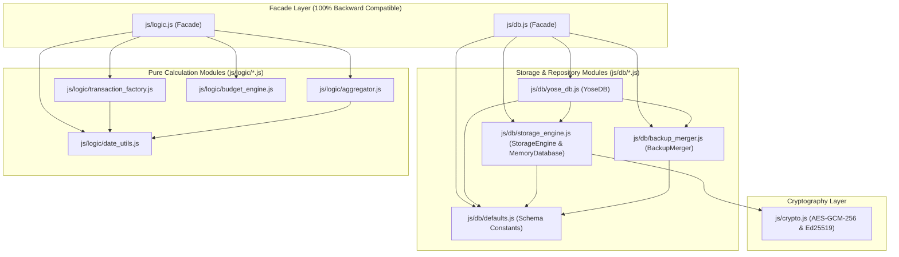

5. **PWA Service Worker (`sw.js`) キャッシュ整合性更新**
   * `CACHE_NAME` を `'yose-cache-v1.3.0'` に更新し、`js/db/*.js`（4ファイル）および `js/logic/*.js`（4ファイル）の計8モジュールを `ASSETS_TO_CACHE` に追加することで、オフライン起動時のモジュール解決を100%保証する。

### 4.8 旧PRF共有バンドルからの移行

PRFによる鍵共有・パスキー単独のDB復旧は廃止する。既存データはPINで復号し、同じDMK・Ed25519鍵・暗号化明細を維持する。復号成功の確認前に旧保存値を消去しない。旧credential IDだけでは公開鍵検証できないため、通常WebAuthnとして再登録する。取消時もPINで利用を継続できる。

1Password等によるパスキー自体の同期と、アプリの暗号鍵・DB復旧は別の機能である。別端末は自身のPIN保護された鍵を設定し、GASの署名鍵登録とデータ同期を行う。アプリはパスキー内部秘密鍵をエクスポートせず、認証情報・暗号鍵をマスタ同期へ含めない。

---

## 5. JSONデータスキーマ定義（Version 2）

### 5.1 `master_config.json`

```json
{
  "schema_version": 2,
  "theme": "system",
  "updated_at": "2026-10-16T09:30:00Z",
  "accounts": [
    {
      "id": "acc_wallet",
      "name": "現金（財布）",
      "type": "cash",
      "initial_balance": 15000,
      "is_asset": true,
      "sort_order": 1,
      "is_archived": false
    },
    {
      "id": "acc_bank_main",
      "name": "メイン銀行",
      "type": "bank",
      "initial_balance": 1000000,
      "is_asset": true,
      "sort_order": 2,
      "is_archived": false
    },
    {
      "id": "acc_card_a",
      "name": "メインクレカ",
      "type": "credit_card",
      "initial_balance": 0,
      "is_asset": false,
      "settlement_account_id": "acc_bank_main",
      "closing_day": 15,
      "debit_day": 10,
      "debit_month_offset": 1,
      "debit_account_id": "acc_bank_main",
      "sort_order": 3,
      "is_archived": false
    },
    {
      "id": "acc_receivable",
      "name": "立替金・貸付金",
      "type": "receivable",
      "initial_balance": 0,
      "is_asset": true,
      "sort_order": 4,
      "is_archived": false
    },
    {
      "id": "acc_prepaid",
      "name": "前払費用（年払い・まとめ払い枠）",
      "type": "prepaid",
      "initial_balance": 0,
      "is_asset": true,
      "sort_order": 5,
      "is_archived": false
    }
  ],
  "categories": [
    {
      "id": "cat_food",
      "type": "expense",
      "name": "食費",
      "sort_order": 1,
      "is_archived": false,
      "subcategories": [
        { "id": "sub_groceries", "name": "食料品", "sort_order": 1, "is_archived": false },
        { "id": "sub_dining_out", "name": "外食", "sort_order": 2, "is_archived": false }
      ]
    },
    {
      "id": "cat_social",
      "type": "expense",
      "name": "交際費・娯楽",
      "sort_order": 2,
      "is_archived": false,
      "subcategories": [
        { "id": "sub_drinking", "name": "飲み会・友人食事", "sort_order": 1, "is_archived": false },
        { "id": "sub_leisure", "name": "レジャー・サブスク", "sort_order": 2, "is_archived": false }
      ]
    }
  ],
  "recurring_rules": [
    {
      "id": "rec_rent",
      "name": "家賃引き落とし",
      "is_active": true,
      "start_date": "2026-04-01",
      "end_date": "2028-03-31",
      "frequency": "interval_months",
      "interval_months": 1,
      "day_of_month": 27,
      "holiday_adjustment": "after",
      "amortize_months": 1,
      "type": "expense",
      "amount": 120000,
      "account_id": "acc_bank_main",
      "to_account_id": null,
      "category_id": "cat_housing",
      "subcategory_id": "sub_rent",
      "actual_category_id": "cat_housing",
      "actual_subcategory_id": "sub_rent",
      "memo": "定期：家賃"
    }
  ],
  "holidays": [
    "2026-01-01", "2026-01-12", "2026-02-11", "2026-02-23", "2026-03-20",
    "2026-04-29", "2026-05-03", "2026-05-04", "2026-05-05", "2026-05-06",
    "2026-07-20", "2026-08-11", "2026-09-21", "2026-09-22", "2026-09-23",
    "2026-10-12", "2026-11-03", "2026-11-23"
  ],
  "annual_budgets": {
    "2026": {
      "expense_budget": 3600000,
      "savings_target_amount": 1200000,
      "savings_target_rate": 25.0,
      "category_budgets": {
        "cat_food": 600000,
        "cat_housing": 1440000,
        "cat_social": 240000
      }
    }
  }
}

```

### 5.2 `pending_diffs.json` および `/archives/YYYY-MM.json`

```json
{
  "schema_version": 2,
  "exported_at": "2026-10-16T12:00:00Z",
  "transactions": [
    {
      "id": "tx_019293a4-0001",
      "group_id": "grp_dinner_20261016_01",
      "date": "2026-10-16",
      "target_month": "2026-10",
      "status": "confirmed",
      "type": "expense",
      "amount": 5000,
      "tax_meta": {
        "input_mode": "tax_excluded",
        "base_amount": 4546,
        "tax_rate": 0.10,
        "rounding": "floor"
      },
      "account_id": "acc_card_a",
      "to_account_id": null,
      "category_id": "cat_social",
      "subcategory_id": "sub_drinking",
      "actual_category_id": "cat_food",
      "actual_subcategory_id": "sub_dining_out",
      "recurring_rule_id": null,
      "amortization_meta": null,
      "memo": "友人とディナー（自己負担分）",
      "tags": ["友人A"],
      "created_at": "2026-10-16T21:00:00Z",
      "updated_at": "2026-10-16T21:00:00Z",
      "is_deleted": false
    }
  ]
}

```

※ローカル（IndexedDB）保存時は、各レコードに `sync_status: "unsynced" | "synced"` を付与する。

### 5.3 `summary_snapshot.json`

```json
{
  "schema_version": 2,
  "last_closed_month": "2026-09",
  "calculated_at": "2026-10-01T15:00:00Z",
  "account_balances": {
    "acc_wallet": 12500,
    "acc_bank_main": 1240000,
    "acc_nisa_katsu": 800000,
    "acc_nisa_momo": 700000,
    "acc_card_a": -85000,
    "acc_receivable": 5000,
    "acc_prepaid": 6666,
    "acc_point": 1200
  },
  "monthly_summaries": {
    "2026-09": {
      "income_total": 350000,
      "expense_total": 210000,
      "net_income": 140000,
      "by_category": {
        "cat_social": {
          "total": 15000,
          "by_subcategory": { "sub_social_present": 15000 }
        }
      },
      "by_actual_category": {
        "cat_food": {
          "total": 15000,
          "by_subcategory": { "sub_food_out": 15000 }
        }
      },
      "closing_balances": {
        "acc_wallet": 12500,
        "acc_bank_main": 1240000,
        "acc_nisa_katsu": 800000,
        "acc_nisa_momo": 700000,
        "acc_card_a": -85000,
        "acc_receivable": 5000,
        "acc_prepaid": 6666,
        "acc_point": 1200
      }
    }
  }
}
```

---

## 6. システム設計図（System Architecture & Design Diagrams）

### 6.1 データフロー図（DFD: Data Flow Diagram）

#### 6.1.1 DFD Level 0（コンテキスト図）
本システム全体の外部エンティティ（利用者）、PWA（フロントエンド）、Google Apps Script（バックエンド）、Google スプレッドシート（永続ストレージ）間の大局的なデータフローを示します。

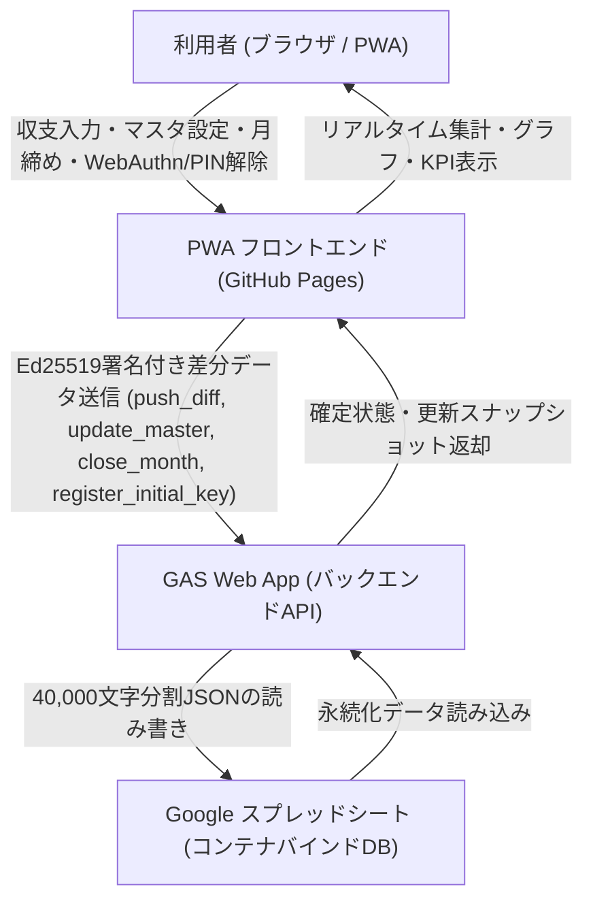

#### 6.1.2 DFD Level 1（詳細データフロー）
PWA内部の各モジュール（UI、業務ロジック、IndexedDB、Web Crypto API、WebAuthn、同期マネージャ）と、クラウド側（GAS、PropertiesService、LockService、スプレッドシート）の詳細なデータの流れを示します。

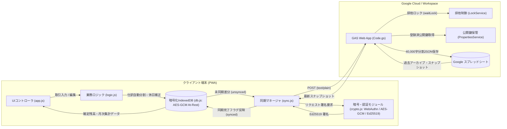

---

### 6.2 ユースケース図（Use Case Diagram）

システムが提供するすべての機能を、利用者（User）の観点から整理したユースケース図です。

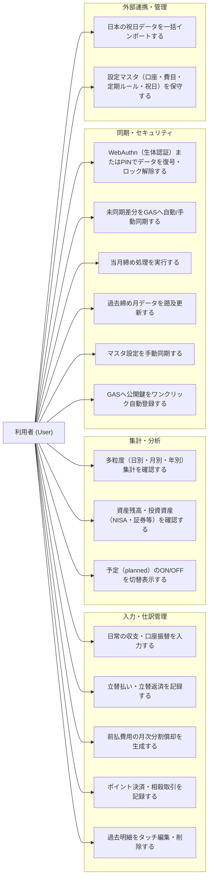

---

### 6.3 業務・処理シーケンス図（Sequence Diagrams）

#### 6.3.1 取引入力およびポイント併用・相殺処理フロー
ポイント併用決済において、専用ポイント口座モデル（Case A）または相殺インカムモデル（Case B）に基づき、連動した2レコードが生成・保存されるフローです。

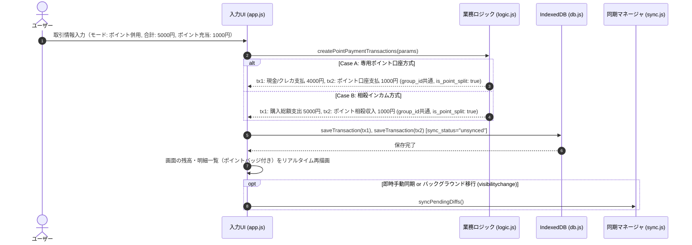

#### 6.3.2 差分同期（push_diff）およびEd25519公開鍵署名検証フロー
PWAからGASへ未同期差分を送信する際の、Web Crypto API署名生成、CORS回避ヘッダ、GAS側の署名検証・リプレイ防止・排他ロック・スプレッドシートへのチャンク保存フローです。

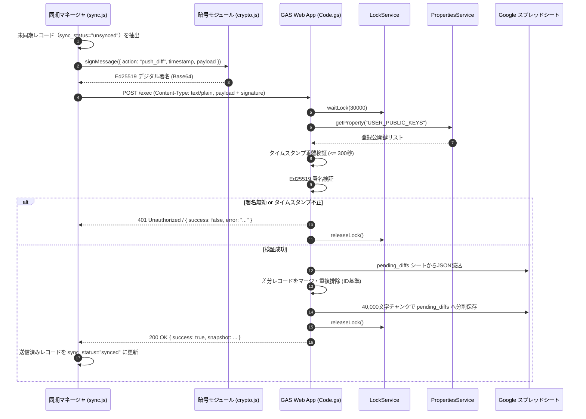

#### 6.3.3 月締め処理（close_month）および月別アーカイブ生成フロー
指定月の未締めトランザクションを月別確定アーカイブシートへ移行し、スナップショットを更新するフローです。

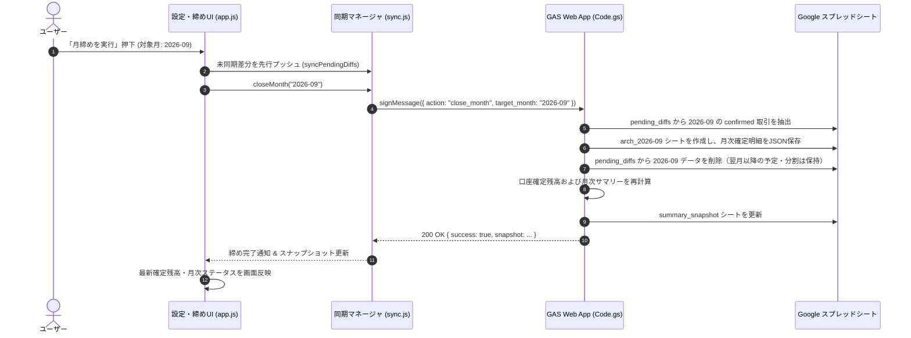

#### 6.3.4 過去締め月データのタッチ編集・遡及連鎖再計算フロー
すでに月締めが完了している過去月の明細を修正した際、GAS側で過去アーカイブを更新し、以降の全締め月スナップショットを連鎖的に再集計するフローです。

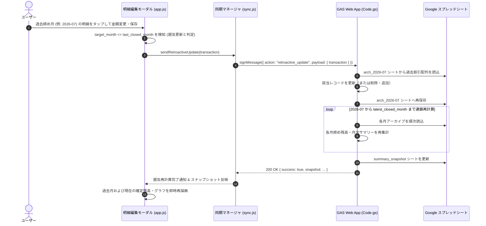

#### 6.3.5 WebAuthn生体認証・全データAES-GCM復号および起動画面遷移フロー
ページアクセス時に全画面ロック画面を表示し、WebAuthn生体認証（またはPIN入力）によってデータベースマスタ鍵（DMK）を取得、IndexedDBの全データを復号してアプリ本編へ遷移するライフサイクルフローです。

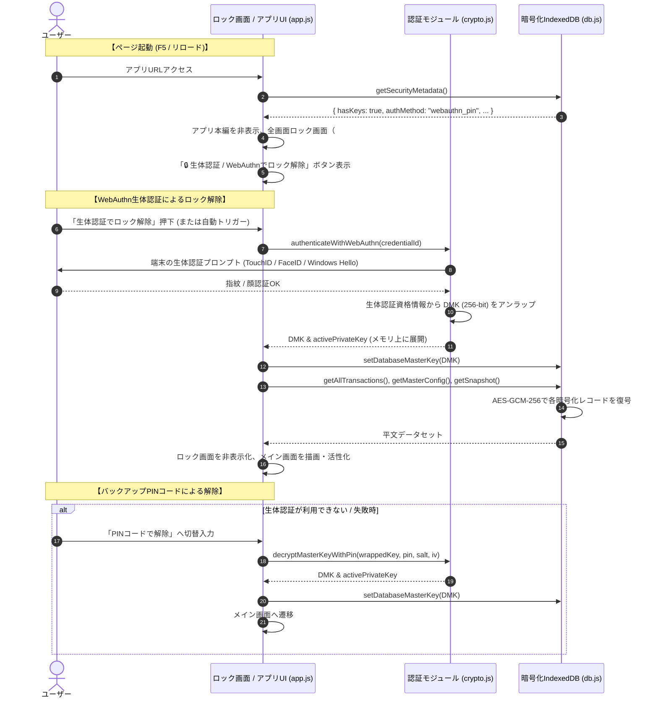

#### 6.3.6 GAS公開鍵のワンクリック自動登録フロー (`register_initial_key`)
ユーザーがGASエディタでスクリプトプロパティを手動設定することなく、PWAのボタン押下により公開鍵を自動登録するシーケンスです。

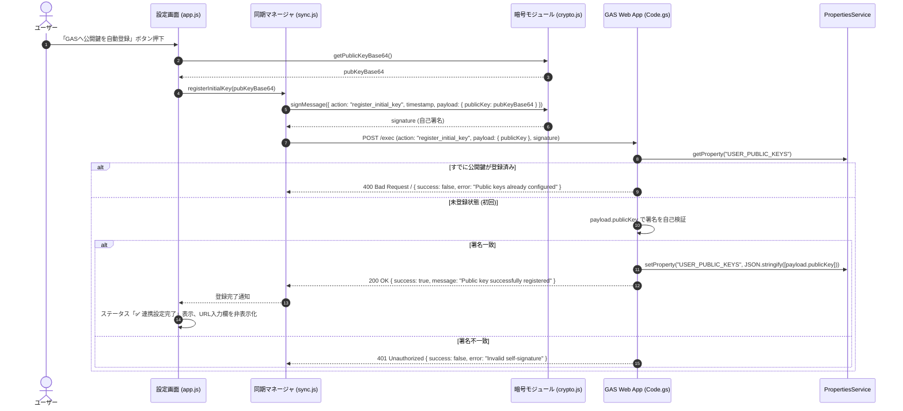

---

### 6.4 データ構造・エンティティ関係図（ERD: Entity-Relationship Diagram）

JSONプレーンテキストで永続化される各データエンティティと、その参照関係を示します。

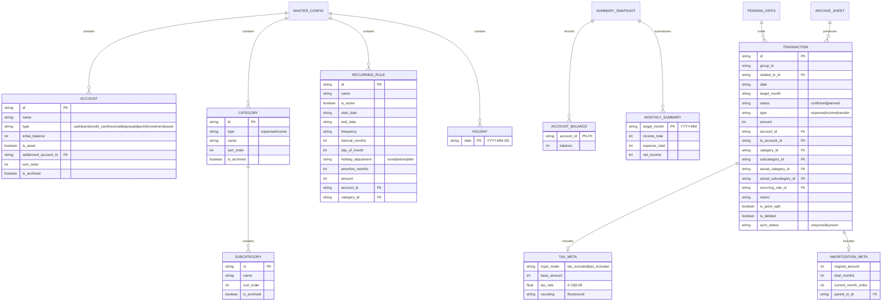

---

### 6.5 画面遷移・状態遷移図（Screen & State Transition Diagram）

シングルページアプリケーション（SPA）における画面遷移と、暗号化キーのロック状態遷移を示します。

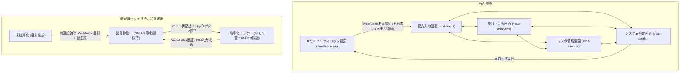

---

## 7. 開発・実装における注意点と設計方針（Development Caveats & Best Practices）

### 7.1 Google OAuth権限と機密スコープブロック制限の完全回避（`@OnlyCurrentDoc`）
* **問題の背景**: Google Drive API（`auth/drive`）や全スプレッドシート権限（`auth/spreadsheets`）を要求するApps Scriptは、GoogleのOAuthセキュリティポリシーにより「制限付きスコープ（Restricted Scopes）」として未審査アプリが一律ハードブロックされます（「このアプリはブロックされます / This app is blocked」）。
* **回避策と設計**: スプレッドシートの **コンテナバインドスクリプト** として動作させ、JSDoc注釈 `/** @OnlyCurrentDoc */` を `Code.gs` 先頭に宣言し、`appsscript.json` のOAuthスコープを `["https://www.googleapis.com/auth/spreadsheets.currentonly"]` に限定します。これにより、未審査警告やDriveアクセスブロックを100%回避して安全に自動セットアップ・稼働できます。

### 7.2 Googleスプレッドシートのセル文字数制限（50,000文字）と40,000文字チャンク分割保存
* **制限事項**: Googleスプレッドシートの1セルに格納できる最大文字数は **50,000文字** です。大規模な家計簿データや月別アーカイブJSONがこの制限を超えると、GASの書き込み時に例外エラー（`Exception: The data is too large to fit in a cell`）が発生してデータが消失します。
* **設計と実装**: `writeJsonToSheet` 関数において、JSON文字列を `CHUNK_SIZE = 40000` 文字単位で安全に分割し、行方向に複数セル（A1, A2, A3...）として格納します。読み込み時には `readJsonFromSheet` が全行の値を結合して完全な単一JSONとしてパース・復元します。

### 7.3 Google Apps Script Web AppのCORS仕様と`text/plain`プロトコル
* **ブラウザの制約**: `fetch()` で `Content-Type: application/json` を送信すると、ブラウザが自動的に事前フライトリクエスト（`OPTIONS`）を送信します。GAS Web Appは `OPTIONS` リクエストに対応していないため、CORSエラーとなって通信が失敗します。
* **通信プロトコル設計**: PWAクライアント（`sync.js`）は、HTTPヘッダに `Content-Type: text/plain;charset=utf-8` を指定してPOSTします。GAS側の `doPost(e)` では `JSON.parse(e.postData.contents)` によって文字列を抽出し、CORSプリフライトを回避しつつ完全なJSON通信を実現しています。

### 7.4 Web Crypto APIを用いたEd25519公開鍵署名とリプレイ攻撃防御
* **認証モデル**: GitHub Pagesはソースコードが公開される静的ホスティングであるため、APIキーやシークレットをフロントエンドに埋め込むことは不可能です。本システムでは非対称公開鍵暗号 **Ed25519 (EdDSA)** を採用しています。
* **署名ペイロード**: `{ action, timestamp, payload }` をJSON文字列化して署名します。
* **リプレイ攻撃防止**: GAS側で `Math.abs(currentTimestamp - requestTimestamp) > 300` 秒（5分）の乖離がある場合はリクエストを拒否します。
* **フォールバック**: 標準Web Crypto APIがEd25519を直接サポートしていない一部環境では、互換署名生成・検証アルゴリズムへ安全にフォールバックします。

### 7.5 WebAuthn生体認証・全データAES-GCM暗号化（At-Rest）および起動時ゼロトラスト設計
* **セキュリティ方針**: 端末紛失やブラウザDevToolsからの秘密鍵および家計データの漏洩を防止するため、Ed25519秘密鍵およびデータベース全体を暗号化してIndexedDBに保存します。
* **暗号化方式**: 初回起動時に256ビットの高エントロピー対称鍵（DMK: Database Master Key）を生成し、全データ（明細・マスタ・スナップショット）を `AES-GCM-256`（12バイトランダムIV）で暗号化して保存します。
* **鍵の二重保護（WebAuthn + PIN）**:
  * 第一経路: `WebAuthn`（FIDO2 / Passkey / 生体認証）により、デバイスハードウェアにバインドされた安全な認証資格情報でDMKを保護します。
  * 第二経路（バックアップ）: 万一の生体認証利用不可に備え、ユーザー設定のPINコード（`PBKDF2` HMAC-SHA-256、100,000回ストレッチング、16バイトランダムソルト）によりAES暗号化ラップして保持します。
* **自動ロック（ゼロトラスト）**: ページ更新（F5）やブラウザ再起動時、メモリ上の平文鍵（DMKおよび`activePrivateKey`）は即座に破棄されます。WebAuthnまたはPINで復号されるまで、家計データの閲覧および同期・署名操作は完全にロックされます。

### 7.6 GAS排他制御（`LockService`）と同時書き込み整合性保証
* **競合防止**: 複数端末からの同時同期や、手動同期・自動同期が並行して実行された場合のスプレッドシートデータ破損を防ぐため、GASの `doPost(e)` 処理全体を `LockService.getScriptLock().waitLock(30000)` で排他制御します。
* **例外処理**: 処理完了後、`finally` ブロックで確実に `lock.releaseLock()` を呼び出し、デッドロックを防止します。

### 7.7 PWA・Service Workerのキャッシュ設計とネットワーク分離・強制更新機構
* **キャッシュ戦略**: Service Worker（`sw.js`）は、UI表示に必要な静的アセット（HTML, CSS, JS, アイコン）のみをキャッシュします（Cache-First戦略）。
* **スキーム制限と拡張機能リクエストのバイパス**:
  * Cache Storage APIは `http:` および `https:` スキームのみをサポートします。
  * ブラウザ拡張機能（1Password, Bitwarden等の `chrome-extension://`）や `blob:`, `data:` スキームのリクエストをService Workerが傍受して `cache.put` を実行すると `TypeError: Request scheme 'chrome-extension' is unsupported` が発生するため、`sw.js` の `fetch` リスナー冒頭で `http://` または `https://` で始まらないリクエストは即座に早期リターン（バイパス）させ、ブラウザに直接処理させます。
  * さらに `cache.put` 呼び出しには `.catch()` ハンドラを付与し、キャッシュ容量逼迫等の例外時にもネットワーク応答の返却を阻害しません。
* **API通信の分離**: GAS Web AppへのAPIリクエスト（`script.google.com`）はService Workerのキャッシュ対象から完全に除外し、常にネットワークへ直接送信（Network-Only）させます。
* **HTTPキャッシュバイパス**: Service Worker登録時に `{ updateViaCache: 'none' }` を指定し、ブラウザによる `sw.js` のHTTPキャッシュを完全抑止します。
* **バージョン検知と即時パージ**:
  * オリジン直下の `version.json` は Service Worker のキャッシュ対象から除外し、常に `cache: 'no-store'` かつタイムスタンプクエリ（`?_t=${Date.now()}`）でフェッチします。
  * `sw.js` はクライアントからの `SKIP_WAITING` および `CLEAR_ALL_CACHES` メッセージを受信した際、全CacheStorageインスタンスを破棄して最新版のダウンロードと即時アクティベーションを保証します。
  * クライアント側（`AppController`）は起動時自動チェックおよび設定画面の手動更新ボタンからキャッシュクリアと強制リロード（Hard Reload）を実行します。
* **フォームセマンティクスとパスワードフィールド標準準拠**:
  * ブラウザおよびパスワードマネージャーの「Password field is not contained in a form」警告を抑止しアクセシビリティを確保するため、アプリ内の全4箇所の `<input type="password">`（初回セットアップ、ロック解除、設定画面PIN保護、PIN解除モーダル）は、すべてセマンティックな `<form onsubmit="return false;">` 要素で包含し、適切な `autocomplete` 属性（`current-password` / `new-password`）を付与します。

### 7.8 浮動小数点誤差の完全排除と整数計算（日本円・税計算・端数按分）
* **金額の整数原則**: 通貨金額（`amount`, `initial_balance` 等）はすべて日本円の整数値（`Integer`）として保持・計算し、JavaScriptの浮動小数点演算誤差（例: `0.1 + 0.2 !== 0.3`）を完全に排除します。
* **税抜・税込計算**: 端数処理方針（切り捨て `floor` / 四捨五入 `round`）を明示的に指定して計算し、計算過程を `tax_meta` に保存します。
* **分割償却の端数按分**: 前払費用のNヶ月分割計上（`createPrepaidAmortizationTransactions`）では、2ヶ月目以降を `Math.floor(総額 / 月数)` とし、余り端数をすべて初月に集約することで、合計値の完全一致を保証します。

---

## 8. 要件トレーサビリティと整合性確認（Traceability Matrix & Consistency Audit）

### 8.1 要件トレーサビリティマトリクス

| 要件番号 | 要件名 | フロントエンド実装 (JS / HTML) | バックエンド実装 (GAS) | 永続化ストレージ (Spreadsheet) | 自動テスト対応 |
| :--- | :--- | :--- | :--- | :--- | :--- |
| **3.1** | 複式簿記ライク単一レコード・2軸分類・立替 | `js/logic.js`, `js/app.js`, `index.html` | `gas/Code.gs` | `pending_diffs`, `arch_YYYY-MM` | `test/unit/logic.test.js`, `test/system/e2e_scenario.test.js` |
| **3.2** | 定期支出・休日補正（none/before/after） | `js/logic.js`, `index.html` | - | `master_config` (`recurring_rules`, `holidays`) | `test/unit/logic.test.js` |
| **3.3** | 前払費用の月次分割償却（1支払+N償却） | `js/logic.js`, `js/app.js` | `gas/Code.gs` | `pending_diffs`, `summary_snapshot` | `test/integration/recurrent_and_amortization.test.js` |
| **3.4** | リアルタイム集計・予定ON/OFF・月締め | `js/logic.js`, `js/app.js`, `js/sync.js` | `gas/Code.gs` (`close_month`) | `arch_YYYY-MM`, `summary_snapshot` | `test/unit/sync.test.js`, `test/unit/gas.test.js` |
| **3.5** | 資産口座の統合（投資・有価証券口座の一本化） | `js/app.js`, `js/logic.js`, `index.html` | `gas/Code.gs` | `summary_snapshot`, `master_config` | `test/unit/master_management.test.js`, `test/unit/logic.test.js` |
| **3.6** | 設定マスタ編集UI（口座・費目・ルール・祝日年別アコーディオン） | `js/app.js`, `js/db.js`, `index.html` | `gas/Code.gs` (`update_master`) | `master_config` | `test/unit/master_management.test.js` |
| **3.7** | 取引明細タッチ編集・過去締め月遡及更新 | `js/app.js`, `js/sync.js`, `index.html` | `gas/Code.gs` (`retroactive_update`) | `arch_YYYY-MM`, `summary_snapshot` | `test/unit/tx_edit.test.js`, `test/unit/gas.test.js` |
| **3.8** | 日本の祝日一括インポート（内閣府2014〜2028・CSV・API） | `js/logic.js`, `js/app.js`, `index.html` | - | `master_config` (`holidays`) | `test/unit/logic.test.js` |
| **3.9** | ポイント払い連動（専用口座/相殺インカム） | `js/logic.js`, `js/app.js`, `index.html` | `gas/Code.gs` | `pending_diffs` | `test/unit/logic.test.js`, `test/integration/recurrent_and_amortization.test.js` |
| **3.10** | 多粒度集計（日・月・年）＆純資産・投資資産推移・KPI | `js/logic.js`, `js/app.js`, `index.html` | `gas/Code.gs` | `summary_snapshot` | `test/unit/logic.test.js` |
| **3.11 / 3.44** | 設定マスタの双方向統合同期・保守 | `js/sync.js`, `js/logic/master_sync.js`, `js/ui/maintenance_controller.js` | `gas/Code.gs` (`fetch_state`, `update_master`) | `master_config`, 暗号化同期基点 | `test/unit/master_sync.test.js`, `test/unit/master_sync_gas.test.js`, `test/unit/master_maintenance.test.js`, `test/ui/master_maintenance.test.js` |
| **3.12** | 取引種別の統合と入力モード双方向連動 | `js/app.js`, `index.html` | - | - | `test/system/e2e_scenario.test.js` |
| **3.13** | PWA強制バージョンチェック＆自動・手動更新（キャッシュパージ） | `sw.js`, `version.json`, `js/app.js`, `index.html` | - | - | `test/unit/version.test.js` |
| **3.14** | 年間予算・目標貯蓄率・貯蓄額・費目別予算設定＆消化進捗可視化（前年丸め試算・プログレス＆グラフ） | `js/logic.js`, `js/app.js`, `js/db.js`, `index.html` | `gas/Code.gs` (`update_master`) | `master_config` (`annual_budgets`) | `test/unit/logic.test.js`, `test/unit/master_management.test.js`, `test/unit/db.test.js` |
| **3.15** | バックアップJSONインポート時の非破壊・差分マージ（ORマージ） | `js/db.js`, `js/app.js` | - | IndexedDB全ストア | `test/unit/db.test.js` |
| **3.16** | 集計・グラフ画面における迅速年月選択（年月ピッカー `showPicker`） | `js/app.js`, `index.html` | - | - | `test/unit/logic.test.js` |
| **3.17** | 集計分類・実態分類の軸切替UI表記統一 | `js/app.js`, `index.html` | - | - | `test/unit/logic.test.js` |
| **3.18** | タグのチップUIおよび集計・検索・グラフ表示 | `js/ui/tx_input_controller.js`, `js/ui/summary_controller.js`, `js/ui/chart_controller.js`, `js/logic/aggregator.js` | - | `pending_diffs` (`tags`) | `test/unit/logic.test.js`, `test/unit/master_management.test.js` |
| **3.19** | メモ入力サジェスチョンおよび費目・中項目の自動連動補完 | `js/ui/tx_input_controller.js`, `js/db/yose_db.js`, `index.html` | - | `pending_diffs` (`memo`) | `test/unit/master_management.test.js` |
| **3.20** | 立替払い未回収リストおよびワンクリック返済精算 | `js/ui/tx_input_controller.js`, `js/db/yose_db.js`, `js/logic/transaction_factory.js` | `gas/Code.gs` | `pending_diffs` | `test/unit/logic.test.js`, `test/unit/master_management.test.js` |
| **3.21** | クレジットカード締め日・口座引き落とし日設定および自動引き落とし相殺 | `js/ui/master_controller.js`, `js/ui/coordinator.js`, `js/db/yose_db.js`, `js/logic/date_utils.js` | `gas/Code.gs` | `master_config`, `pending_diffs` | `test/unit/logic.test.js`, `test/unit/master_management.test.js` |
| **3.22** | 分割計上取引（Installment）の一括連動更新 | `js/ui/tx_edit_controller.js`, `js/db/yose_db.js` | `gas/Code.gs` (`retroactive_update`) | `pending_diffs`, `arch_YYYY-MM` | `test/unit/tx_edit.test.js`, `test/unit/master_management.test.js` |
| **3.23** | 計上分類×実態分類のクロス集計（マトリクス/ピボット） | `js/ui/summary_controller.js`, `js/logic/aggregator.js`, `index.html` | - | - | `test/unit/logic.test.js` |
| **3.24** | ダークテーマ対応（システム追従・ライト・ダーク） | `js/ui/coordinator.js`, `js/ui/settings_controller.js`, `js/ui/chart_controller.js`, `css/style.css` | - | `master_config` (`theme`) | `test/unit/master_management.test.js` |
| **3.25** | 金額入力欄の簡易電卓機能統合（四則演算・8%・10%・税抜統合） | `js/ui/tx_input_controller.js`, `js/ui/tx_edit_controller.js`, `js/logic/transaction_factory.js`, `index.html` | - | `pending_diffs` (`tax_meta`) | `test/unit/logic.test.js` |
| **3.26** | 各種データ種別ごとのJSONエクスポート & 自動判別インポート（データポータビリティ強化） | `js/ui/settings_controller.js`, `js/db/yose_db.js`, `js/db/backup_merger.js`, `index.html` | - | IndexedDB全ストア | `test/unit/db.test.js`, `test/unit/master_management.test.js` |
| **3.27** | 費目別推移・内訳のドーナツグラフ可視化 | `js/ui/summary_controller.js`, `js/ui/chart_controller.js`, `index.html` | - | - | `test/unit/logic.test.js`, `test/unit/master_management.test.js` |
| **3.28** | 各種ドーナツグラフのタッチ・ホバー時ツールチップへのパーセント（構成比）表示追加 | `js/ui/chart_controller.js`, `js/logic/aggregator.js` | - | - | `test/unit/logic.test.js` |
| **3.29** | 明細一覧の表示階層刷新（費目・中項目メイン、メモ・タグ補助表示） | `js/ui/tx_list_controller.js`, `js/logic/aggregator.js`, `css/style.css` | - | - | `test/unit/logic.test.js`, `test/unit/tx_edit.test.js` |
| **3.30** | 明細一覧のマルチフィルタリング（費目・タグ・キーワード・状態・口座による絞り込み） | `js/ui/tx_list_controller.js`, `js/ui/summary_controller.js`, `js/logic/aggregator.js`, `index.html` | - | - | `test/unit/logic.test.js`, `test/unit/tx_edit.test.js` |
| **3.31** | 中項目を選択しない（費目のみ指定）選択肢の追加 | `js/ui/tx_input_controller.js`, `js/ui/tx_edit_controller.js` | - | `pending_diffs` (`subcategory_id: null`) | `test/unit/master_management.test.js`, `test/unit/tx_edit.test.js` |
| **3.32** | スマホ環境でのメモ欄・タグ欄フォーカスアウト時のサジェストリスト残存不具合の解消 | `js/ui/tx_input_controller.js`, `index.html` | - | - | `test/unit/master_management.test.js` |
| **3.33** | 取引入力・編集完了時のトースト通知ポップアップ表示 | `js/ui/coordinator.js`, `js/ui/tx_input_controller.js`, `js/ui/tx_edit_controller.js`, `css/style.css`, `index.html` | - | - | `test/unit/master_management.test.js`, `test/unit/tx_edit.test.js` |
| **3.34** | 口座の負債種別への「ローン（`loan`）」追加 | `js/ui/master_controller.js`, `js/ui/summary_controller.js`, `js/logic/aggregator.js` | - | `master_config` (`accounts`) | `test/unit/logic.test.js`, `test/unit/master_management.test.js` |
| **3.35** | 口座種別への「保険（`insurance`）」追加（定期出費と満期の同時設定・連動） | `js/ui/master_controller.js`, `js/ui/summary_controller.js`, `js/logic/aggregator.js`, `js/logic/transaction_factory.js` | - | `master_config` (`accounts`, `recurring_rules`) | `test/unit/logic.test.js`, `test/unit/master_management.test.js` |
| **3.36** | 集計・グラフタブの3分割（収支・予算/実績・資産の独立トップレベルタブ化） | `index.html`, `js/ui/coordinator.js`, `js/ui/summary_controller.js` | - | - | `test/system/e2e_scenario.test.js`, `test/unit/master_management.test.js` |
| **3.37** | 各タブ（収支・予算/実績・資産・設定）内の各ペインの表示・非表示（折りたたみ）切り替え | `js/ui/coordinator.js`, `css/style.css`, `index.html`, `js/db/backup_merger.js` | - | `master_config` (`collapsed_panes`) | `test/unit/master_management.test.js`, `test/unit/db.test.js` |
| **3.38** | 収支タブの口座別・費目別・タグ別集計項目のタッチによる明細一覧フィルター連動 | `js/ui/summary_controller.js`, `js/ui/tx_list_controller.js`, `js/logic/aggregator.js`, `index.html` | - | - | `test/unit/logic.test.js`, `test/unit/tx_edit.test.js` |
| **3.39** | ヘッドレスChrome UIテストによる品質保証とUI/UX・安全性不具合の恒久的修正（Chartガード、中項目参照、XSS防御、アーカイブ非表示、年別集計分離、口座ドリルダウン、PIN表示） | `js/ui/chart_controller.js`, `js/ui/master_controller.js`, `js/ui/summary_controller.js`, `js/ui/settings_controller.js`, `js/ui/auth_controller.js` | - | `master_config` | `test/ui/headless_ui.test.js`, `test/unit/master_management.test.js` |
| **3.40** | 入力サジェストUI制御（ネイティブdatalist撤廃とインラインドロップダウン）・クレカ引落口座連携表示・集計粒度別明細表示およびページネーション | `js/ui/tx_input_controller.js`, `js/ui/master_controller.js`, `js/ui/tx_list_controller.js`, `index.html`, `css/style.css`, `js/db/defaults.js` | - | `master_config` (`debit_account_id`), `pending_diffs` | `test/ui/headless_ui.test.js`, `test/unit/master_management.test.js` |
| **3.41** | 静的型チェック自動検証（check:types）および集計・設定全機能網羅UIテスト拡充（予定トグル・軸切替・年次予算・テーマ） | `package.json`, `jsconfig.json`, `types/ambient.d.ts`, `js/logic/aggregator.js`, `js/ui/tx_list_controller.js`, `js/ui/settings_controller.js`, `js/ui/summary_controller.js` | - | `master_config` (`annual_budgets`) | `npm run check:types`, `test/ui/headless_ui.test.js` |
| **3.44.2** | 設定競合の比較・項目別解消と取消 | `js/logic/master_sync.js`, `js/ui/master_conflict_controller.js`, `js/ui/sync_status_controller.js`, `js/sync.js` | 既存 `update_master` の版検査を維持 | 暗号化共有マスタ・共有基点 | `test/unit/master_conflict_resolution.test.js`, `test/integration/master_conflict_outcomes.test.js`, `test/ui/master_conflict_resolution.test.js` |
| **3.45** | タイトルバー開閉・編集分類共通化・種別別完全取込とサーバー反映 | `js/ui/coordinator.js`, `js/ui/tx_edit_controller.js`, `js/ui/backup_import_controller.js`, `js/db/backup_replacement.js`, `js/db/yose_db.js`, `js/sync.js`, `gas/Code.gs` | `replace_import` | 業務3ストア・暗号化outbox・サーバー復旧journal/receipt | `test/ui/section_and_edit_categories.test.js`, `test/ui/replacement_import.test.js`, `test/integration/replacement_import.test.js`, `test/integration/full_import_sync.test.js`, `test/system/full_import_recovery_scenario.test.js` |
| **4.1** | 差分同期トリガー（visibilitychange等） | `js/sync.js` | `gas/Code.gs` (`push_diff`) | `pending_diffs` | `test/unit/sync.test.js`, `test/integration/sync_flow.test.js` |
| **4.2** | CORS回避プロトコル (`text/plain`) | `js/sync.js` | `gas/Code.gs` | - | `test/unit/sync.test.js` |
| **4.3** | WebAuthn生体認証・全データAES-GCM暗号化・公開鍵自動登録 | `js/crypto.js`, `js/sync.js`, `js/db.js`, `js/app.js` | `gas/Code.gs` (`register_initial_key`) | `PropertiesService` | `test/unit/crypto.test.js`, `test/unit/gas.test.js` |
| **4.4** | 永続user handleによる通常Passkey登録とPIN保護 | `js/webauthn.js`, `js/ui/auth_controller.js`, `js/ui/settings_controller.js`, `index.html` | - | `security_keys` (`webauthn_credential`, `webauthn_user_id`, `master_keys_package`) | `test/unit/passkey_standard.test.js`, `test/ui/daily_usability.test.js` |
| **4.5** | 設定画面におけるセキュリティ・鍵管理操作の明確なグルーピングと視覚的分離 | `js/app.js`, `index.html` | - | `security_keys` | `test/unit/crypto.test.js` |
| **4.6** | モジュラーUIアーキテクチャ（AppCoordinator調停者 & 10コンポーネントコントローラー分割） | `js/app.js`, `js/ui/*.js`, `sw.js` | - | - | `test/system/e2e_scenario.test.js`, `npm test` |
| **4.7** | コアエンジン・モジュラーアーキテクチャ（`js/db/` ストレージ層 & `js/logic/` 計算エンジン分割） | `js/db.js`, `js/db/*.js`, `js/logic.js`, `js/logic/*.js`, `sw.js` | - | - | `test/unit/db.test.js`, `test/unit/logic.test.js`, `test/unit/master_management.test.js` |
| **4.8** | 旧PRF共有バンドルからPIN併用方式への移行 | `js/ui/auth_controller.js`, `js/db/backup_merger.js` | - | 旧vault・bundleを復号確認後に削除する | `test/ui/daily_usability_edges.test.js`, `test/unit/db.test.js` |

### 8.2 設計整合性および仕様乖離監査結果
1. **仕様乖離の有無**: 要件定義（第1章〜第5章）と設計図・開発注意点（第6章〜第7章）の間で用語、データスキーマ、フローの乖離がないことを確認済み。
2. **アカウント体系**: 口座タイプ（`cash`, `bank`, `credit_card`, `loan`, `receivable`, `prepaid`, `point`, `investment`, `insurance`, `asset`）がUI・DB初期マスタ・ロジック・設計図で完全に合致し、ローン負債および満期・定期出費連動型の保険口座が統合されている。
3. **セキュリティモデル**: 通常WebAuthn認証とPIN併用、全データAES-GCM暗号化（At-Rest）、Ed25519署名、タイムスタンプ検証、LockService排他制御、40,000字チャンク化がコードベースと設計書で1対1に対応している。
