# 「よせあつめ家計簿」要件定義・システム設計書

## 1. プロジェクト概要

### 1.1 アプリケーション名・識別子

* **アプリケーション正式名称**: よせあつめ家計簿
* **PWA短縮名 (`short_name`)**: よせあつめ
* **リポジトリ名（候補）**: `yose`

### 1.2 コンセプトと目的

HTML/JS、GitHub Pages、Google Apps Script (GAS)、Google Driveといった個別の無料サービスや、日々の細かな差分データを「よせあつめ」、それぞれの役割分担（こびとのような分業）によって、ひとつの堅牢で使いやすい家計・資産管理システムを組み上げる。

* **ランニングコストゼロ**: サーバー費用やDB維持費を完全にゼロにする。
* **長期保存性（脱ベンダーロックイン）**: サービス終了やライブラリのサポート切れによるデータ喪失を防ぐため、ビルドツール不要の標準Web技術とプレーンテキスト（JSON）でデータを永続化する。
* **オフラインファースト＆高速動作**: 日常の入力や月途中のリアルタイム集計はすべてローカル（ブラウザ）で完結させ、重い過去データの保管や月次締め・外部連携のみをGASに委譲することで、何年使い続けても初日と同じ軽快さを維持する。

---

## 2. システムアーキテクチャと役割分担

### 2.1 全体構成

| レイヤー | 採用技術・環境 | 主な役割・担当処理 |
| --- | --- | --- |
| **フロントエンド** | PWA (GitHub Pages)<br><br>HTML5, Vanilla JS (ES Modules), CSS<br><br>IndexedDB, Web Crypto API, WebAuthn (FIDO2), Chart.js | ・日常の収支入力（税抜計算補助、立替、分割計上）<br><br>・月初における定期支出（予定）の一括生成と休日補正<br><br>・月途中のリアルタイム集計（前月スナップショット＋当月差分の合算）<br><br>・確定／予定の積み上げグラフ描画と表示切替<br><br>・WebAuthn（生体認証／Passkey）＋PINによる起動時ロック解除<br><br>・全データ（明細・スナップショット・マスタ）のAES-GCM-256暗号化保存<br><br>・Ed25519秘密鍵によるリクエスト署名 |
| **バックエンド** | Google Apps Script (Web App)<br><br>V8 Runtime, LockService, PropertiesService | ・Ed25519公開鍵によるリクエスト署名検証・リプレイ攻撃防止<br><br>・初回公開鍵ワンクリック自動登録 (`register_initial_key`)<br><br>・未締め差分データのマージ保存<br><br>・月締め処理（月別アーカイブ生成、スナップショット再計算）<br><br>・過去月データ修正時の遡及再計算 |
| **ストレージ** | Google スプレッドシート<br><br>(コンテナバインド / JSON形式保管) | ・マスタ設定、集計スナップショット、未締め差分、月別アーカイブのシート単位保管<br><br>・Google ドライブ全体の機密アクセス制限（This app is blocked）を完全回避（`@OnlyCurrentDoc`） |

### 2.2 ディレクトリ構成（フロントエンド＆GAS管理用）

```text
yose/
 ├── index.html          # メイン画面（SPA構成：入力・集計グラフ・設定をタブ切替）
 ├── manifest.json       # PWAマニフェスト
 ├── sw.js               # Service Worker（オフラインキャッシュ制御・強制更新）
 ├── version.json        # アプリバージョン定義（キャッシュバイパスによる更新検知）
 ├── css/
 │    └── style.css      # スタイルシート
 ├── js/
 │    ├── app.js         # UIイベント制御・画面初期化・バージョン更新管理
 │    ├── db.js          # IndexedDB管理（トランザクション・マスタ・鍵の保存）
 │    ├── logic.js       # 休日補正・定期予定生成・前払費用の分割計算・税抜計算
 │    ├── crypto.js      # Web Crypto API（Ed25519鍵生成・署名・PIN暗号化）
 │    └── sync.js        # GAS通信（visibilitychange同期・月締めリクエスト）
 └── gas/
      └── Code.gs        # GAS用スクリプト（署名検証・排他制御・Spreadsheet I/O・月締め集計）

```

### 2.3 データストレージ構成（Google スプレッドシート）

Google ドライブ全体のフルアクセス権限（`auth/drive` や `auth/spreadsheets`）は Google の OAuth セキュリティポリシーにより「制限付き / 機密スコープ」に分類され、未審査アプリは一律ハードブロック（「このアプリはブロックされます」）されます。
これに対処するため、Google スプレッドシートの **コンテナバインドスクリプト**（スプレッドシートの [拡張機能] → [Apps Script]）を採用し、`@OnlyCurrentDoc`（スコープ: `spreadsheets.currentonly`）で運用します。

各データセットはスプレッドシート内のシートタブとして 40,000 文字単位で分割セル保存され、完全なプレーンテキストJSONの互換性を保持します。

```text
よせあつめ家計簿 (Google スプレッドシート)
 ├── [シート: master_config]       # 費目・口座マスタ、定期支出ルール、祝日リスト (JSON)
 ├── [シート: summary_snapshot]    # 最終締め月までの確定口座残高、月次集計、外部資産評価額 (JSON)
 ├── [シート: pending_diffs]       # 未締め（当月および来月以降の予定・分割償却）トランザクション (JSON)
 └── [シート: arch_YYYY-MM]        # 月締め後の確定済み月別単一シート (arch_2026-09 等)
```

### 2.4 GASデプロイメント・自動セットアップ構成

GASプロジェクトの迅速な立ち上げと構成自動化のため、以下の構成を採用する。

* **プロジェクト設定ファイル (`gas/appsscript.json`)**: V8ランタイム、JSTタイムゾーン（`Asia/Tokyo`）、Web Appとしての実行権限（`access: ANYONE`, `executeAs: USER_DEPLOYING`）、および機密ブロックが発生しない限定スコープ（`oauthScopes: ["https://www.googleapis.com/auth/spreadsheets.currentonly"]`）を宣言。
* **初期化ヘルパー (`initialSetup`)**: GASエディタ上で初回権限承認とデータストレージ初期化を安全かつワンクリックで行う関数を提供。
* **一発立ち上げスクリプト (`scripts/setup_gas.sh` / `scripts/setup_gas.js`)**: Google Clasp (`@google/clasp`) によるプロジェクト自動作成・プッシュ・Web Appデプロイ・バージョン発行・スクリプトプロパティ設定ガイドを一括実行。
* **セットアップガイド (`README.md`)**: スプレッドシート連携によるブロック警告ゼロの立ち上げ手順、およびトラブルシューティングを明記。

---

## 3. 機能要件

### 3.1 入力・仕訳要件（複式簿記ライクな単一レコード構造）

1. **1レコード＝1仕訳の原則**
* 集計ロジックをシンプルに保つため、1トランザクション内に複数費目の配列は持たせない。
* 1枚のレシートに複数費目が混在する場合や、立替・分割償却を行う場合は、複数のトランザクションレコードに分割し、共通の `group_id` を付与して関連付ける。


2. **取引種別 (`type`)**
* `expense`（支出）、`income`（収入）、`transfer`（口座間振替）の3種類。
* クレジットカード決済は負債口座（残高マイナス）として扱い、引き落とし日に銀行口座からカード口座への `transfer` として処理する。


3. **立替・貸付の管理**
* 資産口座として「立替金・貸付金 (`acc_receivable`)」を定義する。
* **支払時**: 自己負担分を `expense`、相手負担分を決済口座から `acc_receivable` への `transfer` として2レコード（同一 `group_id`）で記録する。
* **回収時**: `acc_receivable` から受取口座（現金や銀行等）への `transfer` として記録する。


4. **2軸の分類管理（計上分類と実態分類）**
* 「表向きは『外食』だが、家計予算上は『交際費』や『娯楽費』として計上したい」といったニーズに対応するため、2つの分類軸を持たせる。
* **計上分類 (`category_id` / `subcategory_id`)**: 予算管理・メイン集計用の分類。
* **実態分類 (`actual_category_id` / `actual_subcategory_id`)**: モノやサービスの性質を表す分類。


* 入力時のデフォルトでは両方に同じ値を自動セットし、必要な場合のみUIで計上分類を切り替えられるようにする。


5. **税抜・税込の入力補助**
* フロントエンドの入力画面で、税抜金額の連続打ち込み、消費税率（8% / 10%）の適用、端数処理（切り捨て `floor` / 四捨五入 `round`）を行える電卓補助機能を設ける。
* レコードの `amount` には最終的な税込支払額（整数）を保存し、再編集時のために計算過程を `tax_meta` に記録する。


### 3.2 定期支出と休日補正要件

1. **設定項目**
* 開始日 (`start_date`)、終了日 (`end_date`、無期限は `null`)、金額、費目（計上・実態）、決済口座、発生日周期（毎月、または $N$ ヶ月ごと）、毎月の発生日 (`day_of_month`: 1〜28、月末は31)、休日補正ルール (`holiday_adjustment`) を設定可能にする。


2. **休日補正ルール (`holiday_adjustment`)**
* 土日および日本の祝日（`master_config.json` 内の `holidays` 配列で判定）に発生日が重なった場合、以下のいずれかで日付 (`date`) をシフトする。
* `"none"`: 補正なし（クレカ決済のサブスクなど）
* `"before"`: 前営業日に前倒し（給与振込など）
* `"after"`: 翌営業日に後ろ倒し（家賃や公共料金の口座振替など）


* ※日付シフトにより月を跨いだ場合でも、計上月 (`target_month`) は本来の対象月を維持する。


3. **月初の一括予定生成**
* 月初（または前月末）のアプリ起動時に、当月発生する定期支出を `status: "planned"`（予定）として一括生成する（`recurring_rule_id` と `target_month` で二重生成を防止）。
* 固定額の項目は発生日到来時に自動で `status: "confirmed"`（確定）へ遷移させ、変動費（光熱費など）は金額入力時に手動で確定させる。


### 3.3 年払い・まとめ払いの分割計上要件（前払費用の月次償却）

1. **「前払費用」口座によるキャッシュフローと損益の分離**
* システム口座として「前払費用 (`acc_prepaid`)」を用意する。
* 例：10月に年額12,000円をクレカで一括決済し、12ヶ月分割計上する場合、同一 `group_id` を持つ計13件のレコードを自動生成する。
1. **支払記録（1件）**: 10月日付で、`acc_card_a` から `acc_prepaid` への `transfer`（12,000円、`status: "confirmed"`）。これによりクレカ請求額は10月に12,000円として正確に反映される。
2. **月次償却記録（12件）**: `target_month` を `2026-10` 〜 `2027-09` とした、`acc_prepaid` からの `expense`（各1,000円、当月は `confirmed`、翌月以降は `planned`）。これにより毎月の支出グラフには1,000円ずつ計上される。


2. **端数調整ルール**
* 総額が分割月数で割り切れない場合、2ヶ月目以降を `Math.floor(総額 / 月数)` とし、端数（余り）はすべて初月（1回目）に加算して総額を一致させる。


### 3.4 集計・グラフ表示・月締め要件

1. **月途中のリアルタイム集計（ローカル処理）**
* `現在確定残高` ＝ `summary_snapshot.json` の前月末残高 ＋ ローカルの当月 `confirmed` トランザクション加減算。
* `月末予測残高` ＝ `現在確定残高` ＋ ローカルの当月 `planned` トランザクション加減算。


2. **グラフ表示と「予定」のON/OFF**
* 確定分（`confirmed`）は濃い色、予定分（`planned`）は薄い色（半透明）の積み上げグラフとして描画し、UI上のトグルスイッチで「予定の表示／非表示」を即座に切り替えられるようにする。
* また、「計上分類ベース」と「実態分類ベース」の集計表示もワンタップで切り替え可能にする。


3. **マスタのカスタマイズと論理削除**
* 費目（大項目・中項目）や口座は自由に追加・名称変更・並び替えが可能。
* 使わなくなった項目は物理削除せず `is_archived: true`（論理削除）とすることで、過去データの集計表示を壊さずに新規入力の選択肢から隠す。


4. **月締め処理と遡及修正**
* 月締め実行時、対象月の未確定（`planned`）レコードがあれば確認ダイアログを出して `confirmed` に揃えた上でGASへ送信する。
* GASは対象月の明細を `/archives/YYYY-MM.json` に書き出し、`summary_snapshot.json` を更新してPWAへ返却する（来月以降の `planned` レコードや分割償却レコードは `pending_diffs.json` およびローカルDBに残す）。
* 締め終わった過去月のデータを後から追加・修正・論理削除（`is_deleted: true`）した場合は、GASが該当月のアーカイブファイルを再マージし、その月から最新締め月までのスナップショットを連鎖的に再計算する。


### 3.5 資産口座の統合要件（投資・有価証券口座の一本化）

* 従来の独立した「外部資産（`external_assets`）」という特殊な並行管理を廃止し、証券口座、積立NISA、投資信託、暗号資産などの金融資産を、すべて通常の口座マスタ（`accounts`）の種別 `investment`（または `asset`）として完全統合する。
* 投資口座の残高（`account_balances`）がそのまま評価額・資産価値を表し、銀行口座からの積立拠出は通常の口座間振替（`transfer`）として一元的に記録・管理される。
* これにより、複式簿記ライクな資金移動の整合性が保たれ、二重管理や概念の重複による混乱を排除する（あるべき姿の実現）。


### 3.6 設定マスタ編集UI要件

ユーザーがJSONを直接触ることなく、GUI上で各種マスタ設定を自由に追加・変更・論理削除できるようにする。

1. **口座マスタ管理**
   * 口座の追加・編集（名称、種別: 現金/銀行/クレカ/立替金/前払費用/ポイント/投資資産、初期残高、資産/負債フラグ、ソート順）。
   * 使わなくなった口座の論理削除（`is_archived: true`）および復元。
2. **費目・内訳マスタ管理**
   * 支出・収入の大項目の追加・編集・論理削除。
   * 各大項目に紐づく中項目（内訳）の追加・編集・論理削除。
3. **定期支出ルール管理**
   * ルールの追加・編集（ルール名、金額、決済口座、計上/実態費目、発生日、周期、休日補正ルール、有効/無効フラグ）。
4. **祝日リスト管理（年別グループ化・アコーディオン表示）**
   * 休日補正判定に使用する祝日日付（YYYY-MM-DD）の個別追加および削除。
   * 年ごとにグループ化した折りたたみアコーディオン（`<details class="holiday-year-group">`）としてレンダリングし、**デフォルトは非表示（折りたたみ）** とすることで、10年以上の大量の祝日データが存在しても画面スペースを圧迫しない設計とする。


### 3.7 取引明細のタッチ編集・遡及更新要件

1. **タッチ/クリックによる編集モーダルの起動**
   * 「当月の明細一覧」および「最近の入力」の明細行をタップ/クリックすることで、対象取引の編集モーダルを起動する。
2. **編集可能項目**
   * 取引種別（支出/収入/口座振替）、日付、金額（税抜電卓連携可）、決済口座、振替先口座、計上費目・中項目、実態費目・中項目、メモ、タグ、ステータス（確定 `confirmed` / 予定 `planned`）。
3. **過去締め月データの遡及更新連携**
   * 修正した取引の計上月（`target_month`）がすでに月締め済み（`target_month <= last_closed_month`）である場合、保存時に自動的に `retroactive_update` アクションとしてGASへ送信し、アーカイブの更新とスナップショットの連鎖再計算を実行する。
   * 未締めの当月または未来月のデータである場合は、ローカルDB更新後に通常差分同期（`push_diff`）を行う。
4. **削除操作**
   * モーダル内または明細行から削除（論理削除 `is_deleted: true`）が可能。過去締め月データの場合は同様に遡及再計算をトリガーする。

### 3.8 祝日データの一括インポート要件

1. **プリセットインポート (内閣府データ)**
   * 内閣府公表の「国民の祝日」データに基づく、2014年〜2028年の公式祝日プリセット（`JAPANESE_HOLIDAYS_PRESET`）を内蔵し、オフライン環境でもワンクリックで一括インポート可能とする。
2. **外部テキスト・CSV・JSONインポート**
   * 内閣府の祝日CSVや日付一覧テキスト、外部APIのJSON形式をパース（`parseHolidayTextOrCsv`）し、日付形式（`YYYY-MM-DD` / `YYYY/MM/DD`）を自動正規化してマスタにマージ登録する。
3. **オンライン祝日API連携**
   * 祝日API（`https://holidays-jp.github.io/api/v1/date.json` 等）からのダイレクト取得・反映に対応。

### 3.9 ポイント払い・相殺取引要件

1. **2つの記帳モデルのサポート**
   * **ポイント口座モデル (Case A)**: 保有ポイント専用口座（`acc_point`）からの支出と、決済口座からの自己負担支出の2レコードを連動生成する。
   * **相殺インカムモデル (Case B)**: 決済口座からの購入総額支出と、ポイント還元/充当による相殺収入（`cat_point_income`）の2レコードを連動生成する。
2. **関連付けとリスト表示**
   * 連動レコード間に `related_tx_id` および `is_point_split: true` を付与し、明細リスト上で「ポイント」バッジを付加して直感的に識別可能とする。

### 3.10 多粒度集計（日別・月別・年別）および資産残高・推移表示要件

1. **資産構成の集計・KPI表示**
   * 口座マスタの定義に基づき、流動資産（現金・普通預金・ポイント等）、投資資産（積立NISA・証券口座等）、負債（クレジットカード等）を明確に区分集計。
   * **流動資産 ＋ 投資資産 − 負債 ＝ 総資産・純資産** のKPIカードを常時リアルタイム表示する。
2. **表示対象（`cashflow` 収支分析 vs `assets` 資産残高・推移）の切替**
   * セグメントコントロールにより、月次・年次のキャッシュフロー分析と、資産構成比（ポートフォリオ）分析を瞬時に切り替え可能とする。
3. **集計粒度（日別・月別・年別）の多次元分析**
   * **日別 (`daily`)**: 選択月の日ごとの確定収入・確定支出・予定支出・収支差額の集計表および積み上げバーチャート。
   * **月別 (`monthly`)**: 選択年の12ヶ月の推移表、年間収支・貯蓄率、月次バーチャート。
   * **年別 (`yearly`)**: 過去アーカイブから当期までの年次推移表、累計純貯蓄、長期貯蓄率グラフ。

### 3.11 設定マスタのGAS手動同期要件

1. **手動プッシュ機能**
   * 設定画面の「設定マスタをGASへ送信 (`update_master`)」ボタンにより、現在のローカルマスタ（口座・費目・定期ルール・祝日）および外部資産評価額をGAS側へ即座に手動反映できる。

### 3.12 取引種別の統合と入力モードの調和

1. **入力種別とモードタブの相互連動**
   * 取引種別ドロップダウン（支出、収入、口座振替、立替払い、立替返済、前払分割、ポイント併用）と、画面上部の入力モードタブを完全に双方向同期。どちらの操作からでも適切な入力フィールドが動的に展開される。

### 3.13 PWA強制バージョンチェックおよび自動・手動アップデート要件

1. **背景と課題**
   * GitHub Pages等の静的ホスティングやPWAホーム画面インストール環境において、ブラウザのHTTPキャッシュおよびService Workerのキャッシュ戦略（Cache-First）により、開発者が新バージョンをデプロイしてもクライアント側が旧版アセットを保持し続け、即時更新されない問題が発生する。
2. **バージョンメタデータ（`version.json`）による検知**
   * オリジン直下に最新バージョン番号およびビルド日時を記した `version.json` を配置。
   * クライアントは `version.json?_t=${Date.now()}` を `cache: 'no-store'` オプションでフェッチし、ブラウザキャッシュ・プロキシキャッシュを完全バイパスしてサーバー最新版を検知する。
3. **起動時オンライン自動バージョンチェック**
   * アプリ起動時（`AppController.init()`）、端末がオンラインであれば自動的にバージョンチェックを実行。
   * 新バージョンが検知された場合、確認ダイアログ（「新しいバージョン（vX.Y.Z）が利用可能です。アップデートして最新版を読み込みますか？」）を提示。
   * ユーザーが「今すぐアップデート」を選択した場合、Service Workerのキャッシュを完全パージし、サーバーから最新版を強制再読み込み（Force Reload）する。
4. **設定画面からの手動確認＆強制更新UI**
   * 設定画面（`#tab-settings`）の最下部に「🔄 アプリのバージョンと更新」カードを配置。
   * 現在のアプリバージョン（例: `v1.1.0`）を表示。
   * [🔄 更新を確認] ボタンにより手動でサーバー上の `version.json` をチェックし、結果（最新です / 新バージョン検出 / オフライン）を明示。
   * [⚡ 強制再読み込み (キャッシュクリア＆更新)] ボタンにより、Service WorkerキャッシュおよびブラウザCacheStorageを全削除した上で、サーバーから強制リロード（Hard Reload）を実行可能とする。

### 3.14 年間予算・貯蓄目標および消化進捗の可視化要件

1. **年間目標値の設定（設定画面 `#tab-settings`）**
   * 対象年（`target_year`: `YYYY`、デフォルトは当期年）を選択・入力し、以下の3つの目標指標を設定・保存できる：
     * **年間支出予算額 (`expense_budget`)**: 1年間の総支出予算の上限目標額（円）。
     * **年間目標貯蓄額 (`savings_target_amount`)**: 1年間で純増させたい純貯蓄（収入−支出）の目標額（円）。
     * **目標貯蓄率 (`savings_target_rate`)**: 年間収入に対する貯蓄の目標割合（パーセント: %）。
   * 月割換算プレビュー（年間予算 $\div$ 12、目標貯蓄額 $\div$ 12）を自動算出して画面に表示し、月次の目安を把握しやすくする。
   * データは `master_config.annual_budgets[year]` に格納され、端末内DMK暗号化・GAS通信署名・バックアップJSONに完全対応する。

2. **大項目（費目）別年間予算設定と前年実績丸め初期値試算**
   * **費目別予算の個別設定 (`category_budgets`)**:
     * 全体支出予算の内訳として、各大項目（`cat_food`, `cat_housing`, `cat_utilities` 等）ごとの年間予算（円）を設定可能とする。
     * 費目予算の合計値（`Σ category_budgets`）と全体支出予算（`expense_budget`）の突合インジケータ（「内訳合計: ¥○○ / 全体予算との差額: ¥○○」）をリアルタイムに算出し、整合性を常時確認できる。
   * **前年実績に基づく軽微丸めデフォルト値の自動試算 (`calculateAnnualBudgetDefaults`)**:
     * 前年（$target\_year - 1$）の確定取引および月締めスナップショットから、前年の費目別年間支出実績および全体年間支出・収入・純貯蓄額を自動集計する。
     * 「軽く丸めた値」として、直感的に扱いやすい以下の丸めアルゴリズムを適用：
       * 金額 $\ge 1,000,000$ 円: 1万円単位に四捨五入（`Math.round(amt / 10000) * 10000`）
       * 金額 $\ge 10,000$ 円: 1千円単位に四捨五入（`Math.round(amt / 1000) * 1000`）
       * 金額 $< 10,000$ 円: 百円単位に四捨五入（`Math.round(amt / 100) * 100`）
       * 目標貯蓄率: 前年実績貯蓄率を整数%に四捨五入（`Math.max(0, Math.round(rate))`）
     * 新規年度の初期表示時、または「🪄 前年実績から自動試算反映」ボタンの押下により、全体予算・目標貯蓄額・各費目予算に丸め試算値を一括自動入力可能とする。
   * **多数費目に耐えうるスケーラブルUI設計**:
     * 登録費目数が多くなった場合でも設定画面が縦に間延びしないよう、インクリメンタル検索フィルター（`#input-budget-cat-search`）を上部に配置。
     * 最大高さ制限（`max-height: 400px; overflow-y: auto;`）を備えたスクロール可能なリスト/テーブルコンテナ内に各費目をコンパクトに一覧表示。各行に「費目名・アイコン」「前年実績（参考表示）」「年間予算入力フィールド」「月割目安」を整然と配置する。

3. **進捗・消化具合の可視化（集計・グラフ画面 `#tab-summary`）**
   * 表示対象セグメントに **`[🎯 予算・進捗]`** を新設（または年別収支分析とシームレスに統合）：
     * **年間予算進捗カード**: 予算上限、年間確定支出（予定込み支出）、消化率（%）、残予算額、および年間経過月数に応じた基準ペース評価（順調・注意・超過）をカラーインジケーター（プログレスバー）付きで表示。
     * **年間貯蓄目標カード**: 目標貯蓄額、現在確定純貯蓄（予定込み純貯蓄）、達成率（%）、残目標額をプログレスバー付きで表示。
     * **貯蓄率目標カード**: 目標貯蓄率（%）と現在実績貯蓄率（%）を対比表示。
   * **推移チャート（Chart.js）**:
     * 1月〜12月の月別支出実績・予定の累積カーブと、予算均等消費ペースライン（基準点線）の対比ライングラフ。
     * 各月の月間支出実績と月割予算目安バーの対比グラフを描画し、使いすぎている月と節約できた月を一目で把握可能とする。
   * **費目別 予算消化状況一覧**:
     * 各費目の年間予算・現在支出実績・消化率プログレスバー・ペース判定を一覧表示し、どの費目が予算を圧迫しているかを直感的に分析可能とする。

### 3.15 バックアップJSONインポート時の非破壊・差分マージ（ORマージ）要件

1. **課題と設計方針**
   * 従来のバックアップJSON復元は、既存のローカルマスタ設定やスナップショットを一括上書き（Overwrite）していたため、インポートファイルに含まれないローカル側の独自費目・追加口座・祝日設定が消失する問題があった。
   * これを全面的に改善し、**ローカルデータを消去せず、インポートJSONとの差分のみを取り込んで重複なく統合する非破壊ORマージ方式（Deduplicated Union Merge）** を採用する。
2. **各データセットの差分マージ仕様**
   * **取引明細 (`transactions`)**:
     * 取引ID（`id`）をキーとして重複排除。
     * ローカルに存在しない新規取引はそのまま追加（Insert）。
     * ローカルとインポート双方に同一 `id` が存在する場合、`updated_at` タイムスタンプを比較し、インポート側が新しい場合のみ更新（Update）。ローカルの方が新しい、または同時刻の場合はローカルを保護。
     * ローカルにのみ存在する取引は決して削除しない。
   * **口座マスタ (`accounts`)**:
     * 口座ID（`id`）で重複排除。新規口座のみを追加し、既存口座は維持。
   * **費目・中項目マスタ (`categories` / `subcategories`)**:
     * 大項目ID（`id`）で重複排除。新規大項目を追加。
     * 同一IDの大項目が存在する場合、配下の中項目（`subcategories`）を中項目ID（`id`）でユニオン統合（新規中項目のみを追加し、既存中項目は保護）。
   * **定期支出ルール (`recurring_rules`)**:
     * ルールID（`id`）で重複排除し、新規ルールのみを追加。
   * **祝日リスト (`holidays`)**:
     * 日付文字列の完全集合（Set Union: `Array.from(new Set([...localHolidays, ...importedHolidays]))`）を取り、昇順ソートして重複排除。
   * **年間予算目標 (`annual_budgets`)**:
     * 年キー（`YYYY`）単位でマージ（未設定の年を追加、既存年は尊重）。各大項目の `category_budgets` もユニオン統合。
   * **集計スナップショット (`summary_snapshot`)**:
     * 過去締め月の月次集計（`monthly_summaries`）を月キー（`YYYY-MM`）でマージ。
3. **処理結果の通知**
   * インポート完了時、追加された取引件数、更新された取引件数、追加された口座・費目・祝日数等の詳細なマージ統計をダイアログ表示し、ユーザーが差分取り込み結果を明確に確認できる設計とする。
4. **堅牢なパースと例外処理**
   * ファイル入力ハンドラにおいて、テキスト読み出し（`file.text()`）後に必ず `JSON.parse(text)` によるオブジェクト復元を実施してから `db.importFullData(data)` へ渡すこと。不正なJSONや破損ファイルの場合はわかりやすいエラーダイアログを表示し、クラッシュを完全に防止する。

### 3.16 集計・グラフ画面における迅速年月選択（年月ピッカー）要件

1. **背景と課題**
   * 過去の任意月（例: 2年前の3月）の収支や明細を確認したい場合、従来の「◀ 前へ」ボタンを1ヶ月ずつ十数回〜数十回クリックしなければならず、閲覧操作に多大な手数とストレスを要していた。
2. **年月ピッカー（カレンダーUI）によるワンタップ移動**
   * 集計タブ上部の期間ナビゲーション領域において、現在年月表記（`#period-display`: 例 `📅 2026-10 ▾`）をクリック可能（ポインターカーソル・ホバー演出）とする。
   * クリック時に、ブラウザ標準のネイティブ年月ピッカー（`<input type="month" id="input-period-picker">`）を `showPicker()` APIにより起動する。
   * ユーザーがカレンダーUIから目的の年月を選択すると即座に対象年月が更新され、日別・月別・年別・予算集計および明細一覧へ瞬時にジャンプする。

### 3.17 集計分類・実態分類の軸切替UI表記統一要件

1. **課題と表記の統一**
   * グラフカード右上の分類軸切替ボタン（`#btn-toggle-axis`）において、初期表示時（「計上分類」）とクリック後のトグル時（「実態分類ベース」「計上分類ベース」）で語尾の「ベース」の有無による表記揺れが生じていた。
   * 初期HTMLおよびスクリプト制御を完全に統一し、初期状態からアイコン付きの `🏷️ 計上分類ベース` と表示し、トグル時も `🏷️ 計上分類ベース` $\longleftrightarrow$ `📦 実態分類ベース` の一貫したラベルで状態を明示する。

---

## 4. 同期トリガー・通信・セキュリティ要件

### 4.1 ローカルからGoogle Driveへの同期トリガー

各レコードに `sync_status`（`"unsynced"` / `"synced"`）を持たせ、以下のタイミングで差分同期（`push_diff`）を実行する。

1. **アプリ非表示・バックグラウンド移行時 (`visibilitychange`)**: 未同期データがある場合、`fetch(..., { keepalive: true })` で非同期送信する。
2. **オンライン復帰時 (`online`)**: オフライン環境で入力された未同期データを自動送信する。
3. **手動同期ボタン押下時および月締め実行時**: 即座に同期を実行する。

### 4.2 CORS回避プロトコル

* GitHub PagesからGAS Web App（アクセス権限：「全員」）へのPOSTリクエストにおいて、ブラウザのプリフライトリクエスト（OPTIONS）によるCORSエラーを回避するため、HTTPヘッダには `Content-Type: text/plain;charset=utf-8` を指定してJSON文字列を送信する。

### 4.3 WebAuthn生体認証・全データAES-GCM暗号化・Ed25519署名認証

ソースコードが公開されるGitHub Pagesの特性上、コード内にURLやシークレットを一切記述せず、暗号技術により端末内データの秘匿性と通信の真正性を完全担保する。

1. **初回鍵生成（Ed25519通信鍵 ＋ データ暗号化キーDMKの同時生成）**
* 初回起動時、以下の2系統の暗号鍵を同時に生成する：
  * **Ed25519署名鍵ペア**: GASとの通信認証用（リクエスト改ざん・なりすまし防止）。
  * **データベースマスタ鍵 (DMK: Database Master Key)**: `crypto.getRandomValues(new Uint8Array(32))` による256ビットの高エントロピー対称暗号鍵。
* **WebAuthn（生体認証／Passkey）連携**:
  * ブラウザの `navigator.credentials.create()` を用いて端末の生体認証（Touch ID, Face ID, Windows Hello, 指紋センサー等）を登録。
  * DMKおよびEd25519秘密鍵は、WebAuthn認証資格情報にバインドされて保護される。
  * さらにバックアップ・復旧手段として、ユーザー指定のPINコード（`PBKDF2` 100,000回ストレッチング ＋ `AES-GCM-256`）による多重暗号化ラップ（`wrapped_keys_pin`）を保持する。

2. **データ全体のAES-GCM-256暗号化（At-Rest暗号化）**
* ローカルストレージ（IndexedDB）に格納されるすべての機微データ：
  * **`transactions`**（取引明細全件）
  * **`master_config`**（口座・費目・定期ルール・祝日マスタ）
  * **`summary_snapshot`**（資産残高・月次集計スナップショット）
  を、DMKを用いて `AES-GCM-256`（12バイト乱数IV）で暗号化して永続化する。
* 端末のストレージを物理的にダンプされたり、ブラウザの開発者ツールでIndexedDBを直接閲覧されても、平文の金融データや個人情報は一切読み取れない。

3. **起動時画面遷移（WebAuthn認証 → メモリ復号 → アプリ本編表示）**
* ページ読み込み時は、全画面の「セキュリティロック画面（Auth Screen）」を最前面に表示し、家計データやナビゲーションは一切レンダリングしない。
* 利用者が「生体認証で解除 (WebAuthn)」を実行（またはPIN入力）すると、認証成功によりメモリ上にDMKがアンラップ展開される。
* DMKを用いてIndexedDBからデータをメモリ上に復号・ロードし、ロック画面を解除してアプリ本編（入力・集計・設定画面）へ遷移する。
* ページ更新（F5）やタブクローズ時は、メモリ上のDMKおよびEd25519平文秘密鍵は完全に破棄され、ゼロトラストの安全状態（自動ロック）に復帰する。

4. **公開鍵のワンクリック自動登録 (`register_initial_key`)**
* GASのスクリプトプロパティ（`USER_PUBLIC_KEYS`）が未設定（初回セットアップ時）の場合：
  * PWAクライアントは生成したEd25519公開鍵をペイロードに含め、自身の秘密鍵で自己署名した `register_initial_key` アクションをGASへ送信する。
  * GASは署名がペイロード内の公開鍵と一致することを検証し、正当であれば `PropertiesService` の `USER_PUBLIC_KEYS` に自動保存する。
  * これにより、ユーザーがGASエディタの「スクリプトプロパティ」を開いて公開鍵を手動コピー＆ペーストする煩雑な作業を完全に撤廃し、**ボタン一発でGAS連携を完結** させる。

5. **設定画面におけるGAS連携UIの整理・分離**
* **初回設定領域のトグル化**: 初回セットアップ完了後（URL登録・公開鍵設定済み）、URL入力欄等の初回用UIは非表示とし、「接続設定を変更」ボタンによるトグル展開とする。
* **通常同期と手動メンテナンスの視覚的境界分離**:
  * **通常同期**: 日常利用する「未同期差分の同期 (`push_diff`)」をプライマリボタンとして配置。
  * **手動メンテナンス操作**: 「設定マスタのGAS強制上書き送信 (`update_master`)」および「スプレッドシートからの全データ強制再取得 (`fetch_remote`)」は、境界線（Visual Divider）および注意書きで明確に区画を分け、誤操作を防止する。

6. **署名検証と排他制御**
* **署名検証**: `{ action, timestamp, payload }` をEd25519署名し、GAS側でタイムスタンプ乖離（±5分以内）と署名の有効性を検証。
* **排他制御**: GASの `doPost(e)` 処理全体を `LockService.getScriptLock().waitLock(30000)` で排他制御し、`finally` で確実に解放する。

### 4.4 決定論的User IDによるWebAuthn・Passkey（1Password等）上書き・更新および鍵管理設計

1. **背景と課題（無限増殖・上書き不可の根本原因）**
   * FIDO2 / WebAuthn仕様および1Password等のパスキーマネージャでは、同一ドメインにおけるアカウント資格情報を `(rp.id, user.id)` のタプルによって一意に識別・インデックスする。
   * 従来実装では資格情報生成（`registerWebAuthnCredential`）の呼び出しごとにランダムな16バイト（`getRandomValues(new Uint8Array(16))`）を `user.id` として割り当てていた。
   * その結果、1Password等のパスキーマネージャは再登録やアップデート後の鍵更新を「まったく別の新規ユーザーアカウント」と判定し、既存パスキーを上書き（更新）する選択肢を表示できず、再登録のたびに新規パスキーエントリが無限に増殖（累積）して管理が破綻する課題が生じていた。

2. **決定論的・永続的User ID (`user.id`) の導入**
   * 同一アプリ（同一インストール・ドメイン）において、常に固定・決定論的なUser ID（固定バイト列 `new TextEncoder().encode('yose_passkey_user_v1')` またはIndexedDB `security_keys` に永続化された `webauthn_user_id`）を `nav.credentials.create()` の `user.id` として提供する。
   * これにより、1PasswordやiCloudキーチェーン、Googleパスワードマネージャー等の主要パスキー管理ツールが同一ユーザーであることを正確に検知し、再登録時に**「既存のよせあつめ家計簿パスキーを上書き・更新しますか？」という更新ダイアログを確実に提示**させる。

3. **認証時（`authenticateWithWebAuthn`）の柔軟な照合**
   * 保存された単一の `credentialId` のみに厳格拘束せず、パスキーマネージャ内の最新資格情報を柔軟に受け入れ可能な構造とし、ブラウザや1Passwordで再登録・更新されたパスキーからのスムーズな認証復帰を実現する。
   * IndexedDBに保存される `webauthn_vault`（DMKおよびEd25519秘密鍵の暗号化ペイロード）はPWAキャッシュパージ時にも一切削除されず永続化されるため、アップデート後も同一パスキーで確実にアンラップ可能とする。

4. **設定画面における鍵管理UIの改善**
   * 設定画面（`#tab-settings`）の認証鍵管理セクションに、**[🔑 WebAuthn (Passkey) を上書き・再登録]** ボタンおよび **[🗑️ WebAuthn登録を解除]** ボタンを配備。
   * パスキーの再登録時は1Password上で既存キーが上書き更新される旨を注記し、不要な鍵が溜まるストレスを完全に解消する。

### 4.5 設定画面におけるセキュリティ・鍵管理操作の明確なグルーピングと視覚的分離

1. **背景と課題（操作の性質・毛色の混同防止）**
   * 設定画面の鍵管理領域において、PINコード管理（端末保護）、WebAuthnパスキー管理（生体認証連携）、GAS登録用Ed25519公開鍵管理という「操作の目的や影響範囲がまったく異なる操作」が同一エリアに並列配置され、誤認・誤操作を誘発しやすい構造となっていた。
   * 「今すぐ再ロック」と「PIN保護解除（平文復帰）」、あるいは「WebAuthn再登録」と「WebAuthn登録解除」のように、安全性を高める操作と解除・危険操作が混同されるリスクを排除する。

2. **3領域の独立した視覚的分離（サブカード＆バッジ）**
   * 設定画面（`#tab-settings`）の認証鍵管理エリアを、以下の3つの独立したブロック（サブカード）として明確に構造化する：
     * **① 🔐 秘密鍵PIN保護 & 端末ロック状態 (PIN Protection & Device Lock)**:
       * ステータスバッジ（🔒 ロック中 / 🔓 解除中 / ⚠️ PIN未設定）
       * PIN設定・変更入力フィールド
       * 日常操作: `[🔒 今すぐ再ロック]`, `[🔓 PINでロック解除]`, `[PINで秘密鍵を保護]`
       * 危険操作（平文復帰）: 明確な境界線と警告色（`btn-danger`）で区切った `[⚠️ PIN保護を解除 (平文に戻す)]`
     * **② 👆 WebAuthn・Passkey連携管理 (WebAuthn / Passkey - 1Password等)**:
       * 状態表示（設定済 / 未登録）および1Password上書き更新に関する案内文
       * アクションボタン: `[👆 WebAuthn (Passkey) を上書き・再登録]`
       * 連携解除ボタン: `[🗑️ WebAuthn登録を解除]`（危険操作として明確に分離）
     * **③ ☁️ GAS登録用 Ed25519 公開鍵管理 (GAS Public Key)**:
       * 公開鍵Base64テキストエリア
       * アクションボタン: `[⚡ GASへワンクリック登録]`, `[公開鍵をコピー]`, `[新しい鍵ペアを生成]`

### 4.6 モジュラーUIアーキテクチャ（AppCoordinator & UIコンポーネントコントローラー分割設計）

1. **背景と課題（God Class `AppController` の解消）**
   * 単一ファイル `js/app.js` および単一クラス `AppController` に約3,870行の処理（認証ゲート、入力フォーム制御、税額電卓、編集モーダル、集計ダッシュボード、Chart.js描画、マスタ管理5種、設定画面、PWAバージョン確認等）が集中し、単一責任の原則（SRP）を逸脱して保守性・可読性・テスト容易性を阻害していた。
   * これを全面的に刷新し、**調停者パターン（Mediator / Coordinator Pattern）** に基づく高凝集・疎結合なモジュラーアーキテクチャへと分割・再編する。

2. **モジュール構成と責務分離 (`js/ui/` ディレクトリ配下)**
   * **全体調停 (`js/ui/coordinator.js`) - `AppCoordinator`**:
     * アプリケーション全体のライフサイクル管理、共有状態（`currentMonth`, `selectedYear`, `analyticsTarget`, `useActualCategoryAxis` 等）の一元保持。
     * 各コンポーネントコントローラーのインスタンス化と依存性注入（DI: `db`, `syncManager`, コールバック関数群）。
     * コンポーネント間連携の調停（イベント通知 ➔ 画面全体の更新 `refreshAllViews()` や特定モーダルの展開）。
   * **認証・セキュリティゲート (`js/ui/auth_controller.js`) - `AuthController`**:
     * 起動時ロック画面（`#auth-screen`）、WebAuthn/PIN認証ゲートの制御、秘密鍵アンラップ、PINロック/解除、平文復帰、アクティブセッション破棄。
   * **取引入力制御 (`js/ui/tx_input_controller.js`) - `TransactionInputController`**:
     * 取引入力フォーム（通常・ポイント・定期・前払・立替の5モード）、動的フィールド切替、マスタドロップダウン生成、税額計算モーダル連携、新規取引保存。
   * **明細編集・遡及更新 (`js/ui/tx_edit_controller.js`) - `TransactionEditController`**:
     * 取引編集モーダル（`#modal-edit-tx`）の開閉・初期値セット、過去締め月遡及更新判定、明細更新、明細削除。
   * **取引一覧描画 (`js/ui/tx_list_controller.js`) - `TransactionListController`**:
     * 「当月の明細一覧」および「最近の入力」のDOMレンダリング、編集モーダル呼出イベント伝達。
   * **集計・ダッシュボード制御 (`js/ui/summary_controller.js`) - `SummaryController`**:
     * 集計タブ（`#tab-summary`）のKPIカード、期間ナビゲーション、ネイティブ年月ピッカー（`showPicker`）、分類軸切替、日別・月別・年別・予算・資産集計表描画。
   * **グラフ描画専任 (`js/ui/chart_controller.js`) - `ChartController`**:
     * Chart.jsインスタンスの生成・破棄・再描画（日別・月別・年別バーチャート、予算消化累積軌跡ラインチャート、資産構成チャート）。
   * **マスタ管理制御 (`js/ui/master_controller.js`) - `MasterController`**:
     * マスタ管理タブ、口座・大項目・中項目・定期ルール・祝日・資産の各一覧描画、追加・編集モーダル、祝日一括インポートモーダル、GAS設定マスタ同期。
   * **設定・環境管理 (`js/ui/settings_controller.js`) - `SettingsController`**:
     * 設定タブ（`#tab-settings`）、GAS接続設定、3分割鍵管理サブカード（PIN/WebAuthn/GAS公開鍵）、年間予算スケーラブルUI・自動試算反映、バックアップJSONエクスポート／インポート（堅牢なJSONパース）。
   * **同期・ネットワーク状態監視 (`js/ui/sync_status_controller.js`) - `SyncStatusController`**:
     * オンライン/オフラインバッジ、未同期件数バッジのリアルタイム更新、手動差分同期、リモート全データ強制再取得。

3. **エントリーポイント (`js/app.js`) の軽量Facade化**
   * `js/app.js` は `AppCoordinator` をラップして従来の `AppController` クラスとして公開し、ブラウザ起動コード（DOMReady監視・インスタンス化）を提供する軽量なエントリーポイント（Facade）とする。
   * これにより `index.html`（`<script type="module" src="js/app.js"></script>`）および既存コードとの100%の後方互換性を保証する。

4. **依存関係の有向非巡回グラフ (DAG) と循環参照の完全防止**
   * 各サブコントローラー同士は絶対に直接 `import` せず、すべての相互作用は `AppCoordinator` が仲介する。
   * これにより、Vanilla ES Modules環境下におけるモジュール循環依存による実行時 `undefined` エラーを100%防止する。

5. **PWAオフラインキャッシュ完全整合性保証 (`sw.js`)**
   * Vanilla ES Modules（ノーバンドラー）アーキテクチャを維持するため、新設される `js/ui/*.js` の全10ファイルを `sw.js` の `ASSETS_TO_CACHE` 配列へ厳格に追加する。
   * これにより、オフライン環境下でも全UIモジュールが確実にCacheStorageから即座に提供され、画面停止やロード漏れを根絶する。

### 4.7 コアエンジン・モジュラーアーキテクチャ（`js/db/` ストレージ層 & `js/logic/` 計算エンジン層のクラス・ファイル分割設計）

1. **背景と課題（肥大化した `js/db.js` および `js/logic.js` の責務分離）**
   * 機能拡張に伴い、`js/db.js`（約930行）には初期マスタ定義、インメモリフォールバックDB、IndexedDB低レイヤI/O、AES-GCM-256暗号化ラッパー、ドメインリポジトリ操作、およびバックアップJSONの非破壊ORマージ処理が混在していた。
   * 同様に、`js/logic.js`（約1,500行）には日付・祝日ユーティリティ、消費税計算、複雑な取引生成ファクトリ（定期・前払分割・立替・ポイント連動）、残高・多粒度集計エンジン（日次・月次・年次・純資産）、および年間予算・貯蓄進捗エンジンが単一ファイルに集約されていた。
   * これらを単一責任の原則（SRP）および高凝集・疎結合の原則に基づき、`js/db/` および `js/logic/` 配下の専門モジュール・クラス群へと分割する。

2. **ストレージ・リポジトリ層の分割構成 (`js/db/` ディレクトリ配下)**
   * **初期スキーマ・定数定義 (`js/db/defaults.js`)**:
     * `DB_NAME`, `DB_VERSION`, `FORBIDDEN_PROTOTYPE_KEYS`, `DEFAULT_MASTER_CONFIG`, `DEFAULT_SUMMARY_SNAPSHOT` を定義する純粋定数モジュール（外部依存ゼロ）。
   * **低レイヤストレージ＆暗号化エンジン (`js/db/storage_engine.js`) - `MemoryDatabase` & `StorageEngine`**:
     * `MemoryDatabase`: IndexedDB非対応環境（Node.js単体テスト等）向けのインメモリストア実装。
     * `StorageEngine`: IndexedDBのオープン・マイグレーション（`onupgradeneeded`）、初期データの安全なシード処理、汎用ストアI/O（`getRaw`, `putRaw`, `deleteRaw`, `getAllRaw`）、およびDMKを用いた透過的AES-GCM-256暗号化／復号ラッパー（`encryptRecord`, `decryptRecord`）を提供する基底エンジンクラス。
   * **非破壊ORマージ＆サニタイズエンジン (`js/db/backup_merger.js`) - `BackupMerger`**:
     * バックアップJSONインポート時のスキーマ検証、Prototype Pollution防御（`isSafeKey`）、年間予算エントリの正規化（`normalizeBudgetEntry`）、マスタ設定の非破壊和集合マージ（`mergeMasterConfig`）、およびスナップショットの非破壊マージ（`mergeSummarySnapshot`）を専門に担うドメインクラス。
   * **ドメインリポジトリ (`js/db/yose_db.js`) - `YoseDB extends StorageEngine`**:
     * `StorageEngine` を継承し、`BackupMerger` と協調してアプリケーションへ統一的なドメインAPI（`getMasterConfig`, `saveMasterConfig`, `getSnapshot`, `saveSnapshot`, `getTransaction`, `putTransaction`, `putTransactions`, `deleteTransaction`, `getTransactions`, `getUnsyncedTransactions`, `markTransactionsSynced`, `getSecurityKey`, `saveSecurityKey`, `deleteSecurityKey`, `getSetting`, `setSetting`, `getAnnualBudget`, `saveAnnualBudget`, `exportFullData`, `importFullData`）を提供するリポジトリクラス。
   * **エントリーポイント Facade (`js/db.js`)**:
     * `js/db/*.js` の全公開クラス・定数を再エクスポート（Re-export）し、既存コードおよびテストスイートとの100%後方互換性を保証する。

3. **純粋計算・ビジネスロジック層の分割構成 (`js/logic/` ディレクトリ配下)**
   * **日付・祝日・共通ユーティリティ (`js/logic/date_utils.js`)**:
     * 日付フォーマット・パース（`formatDate`, `parseDate`, `addMonthsToMonthStr`, `getLastDayOfMonth`）、営業日・祝日判定と補正（`isWeekend`, `isHoliday`, `isBusinessDay`, `adjustDateForHoliday`）、内閣府祝日プリセット＆パーサー（`JAPANESE_HOLIDAYS_PRESET`, `parseHolidayTextOrCsv`, `groupHolidaysByYear`）、ID生成（`generateUUID`）、XSS防止エスケープ（`escapeHtml`）。
   * **税計算＆取引生成ファクトリ (`js/logic/transaction_factory.js`)**:
     * 消費税計算（`calculateTax`）、定期支出予定生成（`generateRecurringTransactions`）、前払費用月次分割償却生成（`createPrepaidAmortizationTransactions`）、立替払い・立替回収生成（`createAdvancePaymentTransactions`, `createAdvanceRepaymentTransaction`）、ポイント併用取引生成（`createPointPaymentTransactions`）。
   * **残高計算＆多粒度集計エンジン (`js/logic/aggregator.js`)**:
     * 口座確定・予定残高および当月2軸集計（`calculateBalancesAndSummaries`）、日別集計（`aggregateDailySummaries`）、月別集計（`aggregateMonthlySummaries`）、年別集計（`aggregateYearlySummaries`）、総資産・純資産・負債集計（`calculateTotalAssetSummary`）。
   * **年間予算・貯蓄目標＆推移エンジン (`js/logic/budget_engine.js`)**:
     * 段階的丸め計算（`roundTieredAmount`）、前年実績ベースの予算初期値算出（`calculateAnnualBudgetDefaults`）、年間予算消化率・貯蓄達成率・標準ペース判定・費目別進捗計算（`calculateAnnualBudgetProgress`）、12ヶ月累積推移データ生成（`generateAnnualTrajectory`）。
   * **エントリーポイント Facade (`js/logic.js`)**:
     * `js/logic/*.js` の全関数・定数を再エクスポートし、既存コードおよびテストスイートとの100%後方互換性を保証する。

4. **コアエンジンの有向非巡回グラフ (DAG) 依存構造**

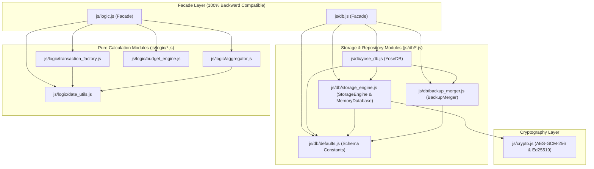

5. **PWA Service Worker (`sw.js`) キャッシュ整合性更新**
   * `CACHE_NAME` を `'yose-cache-v1.3.0'` に更新し、`js/db/*.js`（4ファイル）および `js/logic/*.js`（4ファイル）の計8モジュールを `ASSETS_TO_CACHE` に追加することで、オフライン起動時のモジュール解決を100%保証する。

---

## 5. JSONデータスキーマ定義（Version 2）

### 5.1 `master_config.json`

```json
{
  "schema_version": 2,
  "updated_at": "2026-10-16T09:30:00Z",
  "accounts": [
    {
      "id": "acc_wallet",
      "name": "現金（財布）",
      "type": "cash",
      "initial_balance": 15000,
      "is_asset": true,
      "sort_order": 1,
      "is_archived": false
    },
    {
      "id": "acc_bank_main",
      "name": "メイン銀行",
      "type": "bank",
      "initial_balance": 1000000,
      "is_asset": true,
      "sort_order": 2,
      "is_archived": false
    },
    {
      "id": "acc_card_a",
      "name": "メインクレカ",
      "type": "credit_card",
      "initial_balance": 0,
      "is_asset": false,
      "settlement_account_id": "acc_bank_main",
      "sort_order": 3,
      "is_archived": false
    },
    {
      "id": "acc_receivable",
      "name": "立替金・貸付金",
      "type": "receivable",
      "initial_balance": 0,
      "is_asset": true,
      "sort_order": 4,
      "is_archived": false
    },
    {
      "id": "acc_prepaid",
      "name": "前払費用（年払い・まとめ払い枠）",
      "type": "prepaid",
      "initial_balance": 0,
      "is_asset": true,
      "sort_order": 5,
      "is_archived": false
    }
  ],
  "categories": [
    {
      "id": "cat_food",
      "type": "expense",
      "name": "食費",
      "sort_order": 1,
      "is_archived": false,
      "subcategories": [
        { "id": "sub_groceries", "name": "食料品", "sort_order": 1, "is_archived": false },
        { "id": "sub_dining_out", "name": "外食", "sort_order": 2, "is_archived": false }
      ]
    },
    {
      "id": "cat_social",
      "type": "expense",
      "name": "交際費・娯楽",
      "sort_order": 2,
      "is_archived": false,
      "subcategories": [
        { "id": "sub_drinking", "name": "飲み会・友人食事", "sort_order": 1, "is_archived": false },
        { "id": "sub_leisure", "name": "レジャー・サブスク", "sort_order": 2, "is_archived": false }
      ]
    }
  ],
  "recurring_rules": [
    {
      "id": "rec_rent",
      "name": "家賃引き落とし",
      "is_active": true,
      "start_date": "2026-04-01",
      "end_date": "2028-03-31",
      "frequency": "interval_months",
      "interval_months": 1,
      "day_of_month": 27,
      "holiday_adjustment": "after",
      "amortize_months": 1,
      "type": "expense",
      "amount": 120000,
      "account_id": "acc_bank_main",
      "to_account_id": null,
      "category_id": "cat_housing",
      "subcategory_id": "sub_rent",
      "actual_category_id": "cat_housing",
      "actual_subcategory_id": "sub_rent",
      "memo": "定期：家賃"
    }
  ],
  "holidays": [
    "2026-01-01", "2026-01-12", "2026-02-11", "2026-02-23", "2026-03-20",
    "2026-04-29", "2026-05-03", "2026-05-04", "2026-05-05", "2026-05-06",
    "2026-07-20", "2026-08-11", "2026-09-21", "2026-09-22", "2026-09-23",
    "2026-10-12", "2026-11-03", "2026-11-23"
  ],
  "annual_budgets": {
    "2026": {
      "expense_budget": 3600000,
      "savings_target_amount": 1200000,
      "savings_target_rate": 25.0,
      "category_budgets": {
        "cat_food": 600000,
        "cat_housing": 1440000,
        "cat_social": 240000
      }
    }
  }
}

```

### 5.2 `pending_diffs.json` および `/archives/YYYY-MM.json`

```json
{
  "schema_version": 2,
  "exported_at": "2026-10-16T12:00:00Z",
  "transactions": [
    {
      "id": "tx_019293a4-0001",
      "group_id": "grp_dinner_20261016_01",
      "date": "2026-10-16",
      "target_month": "2026-10",
      "status": "confirmed",
      "type": "expense",
      "amount": 5000,
      "tax_meta": {
        "input_mode": "tax_excluded",
        "base_amount": 4546,
        "tax_rate": 0.10,
        "rounding": "floor"
      },
      "account_id": "acc_card_a",
      "to_account_id": null,
      "category_id": "cat_social",
      "subcategory_id": "sub_drinking",
      "actual_category_id": "cat_food",
      "actual_subcategory_id": "sub_dining_out",
      "recurring_rule_id": null,
      "amortization_meta": null,
      "memo": "友人とディナー（自己負担分）",
      "tags": ["友人A"],
      "created_at": "2026-10-16T21:00:00Z",
      "updated_at": "2026-10-16T21:00:00Z",
      "is_deleted": false
    }
  ]
}

```

※ローカル（IndexedDB）保存時は、各レコードに `sync_status: "unsynced" | "synced"` を付与する。

### 5.3 `summary_snapshot.json`

```json
{
  "schema_version": 2,
  "last_closed_month": "2026-09",
  "calculated_at": "2026-10-01T15:00:00Z",
  "account_balances": {
    "acc_wallet": 12500,
    "acc_bank_main": 1240000,
    "acc_nisa_katsu": 800000,
    "acc_nisa_momo": 700000,
    "acc_card_a": -85000,
    "acc_receivable": 5000,
    "acc_prepaid": 6666,
    "acc_point": 1200
  },
  "monthly_summaries": {
    "2026-09": {
      "income_total": 350000,
      "expense_total": 210000,
      "net_income": 140000,
      "by_category": {
        "cat_social": {
          "total": 15000,
          "by_subcategory": { "sub_social_present": 15000 }
        }
      },
      "by_actual_category": {
        "cat_food": {
          "total": 15000,
          "by_subcategory": { "sub_food_out": 15000 }
        }
      },
      "closing_balances": {
        "acc_wallet": 12500,
        "acc_bank_main": 1240000,
        "acc_nisa_katsu": 800000,
        "acc_nisa_momo": 700000,
        "acc_card_a": -85000,
        "acc_receivable": 5000,
        "acc_prepaid": 6666,
        "acc_point": 1200
      }
    }
  }
}
```

---

## 6. システム設計図（System Architecture & Design Diagrams）

### 6.1 データフロー図（DFD: Data Flow Diagram）

#### 6.1.1 DFD Level 0（コンテキスト図）
本システム全体の外部エンティティ（利用者）、PWA（フロントエンド）、Google Apps Script（バックエンド）、Google スプレッドシート（永続ストレージ）間の大局的なデータフローを示します。

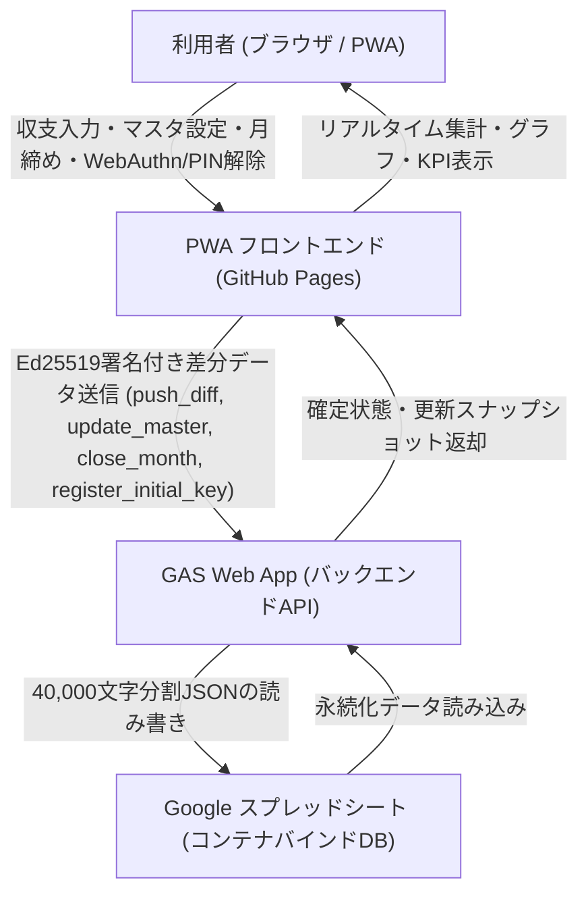

#### 6.1.2 DFD Level 1（詳細データフロー）
PWA内部の各モジュール（UI、業務ロジック、IndexedDB、Web Crypto API、WebAuthn、同期マネージャ）と、クラウド側（GAS、PropertiesService、LockService、スプレッドシート）の詳細なデータの流れを示します。

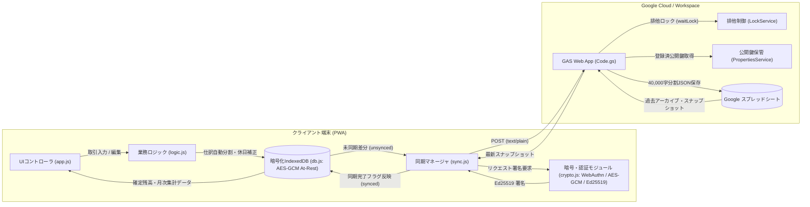

---

### 6.2 ユースケース図（Use Case Diagram）

システムが提供するすべての機能を、利用者（User）の観点から整理したユースケース図です。

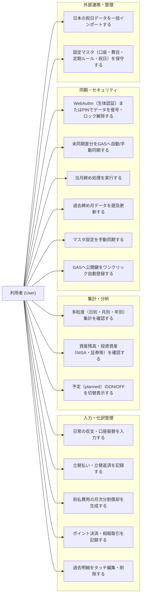

---

### 6.3 業務・処理シーケンス図（Sequence Diagrams）

#### 6.3.1 取引入力およびポイント併用・相殺処理フロー
ポイント併用決済において、専用ポイント口座モデル（Case A）または相殺インカムモデル（Case B）に基づき、連動した2レコードが生成・保存されるフローです。

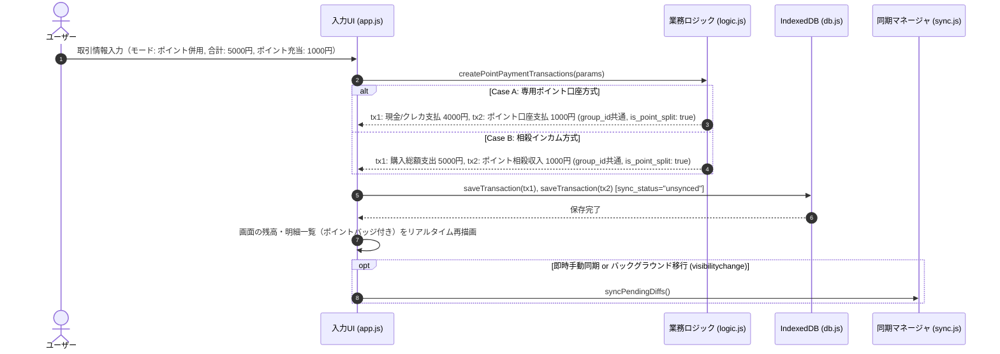

#### 6.3.2 差分同期（push_diff）およびEd25519公開鍵署名検証フロー
PWAからGASへ未同期差分を送信する際の、Web Crypto API署名生成、CORS回避ヘッダ、GAS側の署名検証・リプレイ防止・排他ロック・スプレッドシートへのチャンク保存フローです。

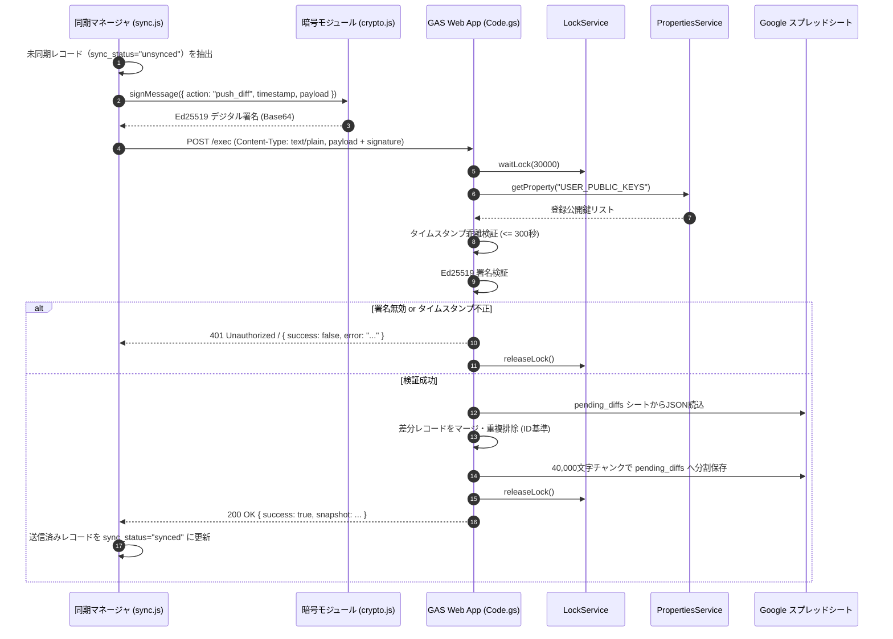

#### 6.3.3 月締め処理（close_month）および月別アーカイブ生成フロー
指定月の未締めトランザクションを月別確定アーカイブシートへ移行し、スナップショットを更新するフローです。

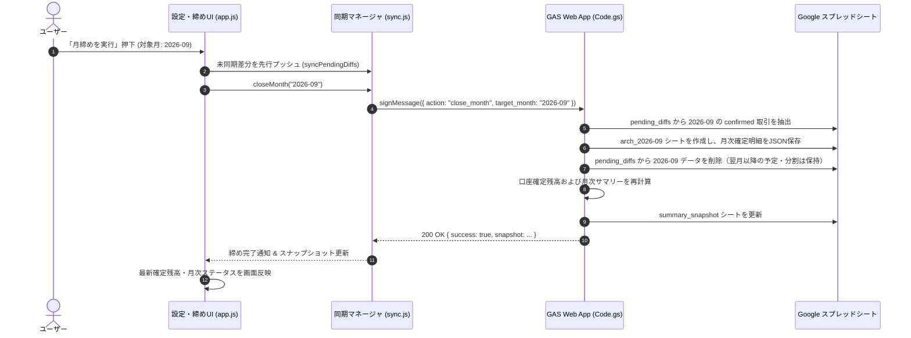

#### 6.3.4 過去締め月データのタッチ編集・遡及連鎖再計算フロー
すでに月締めが完了している過去月の明細を修正した際、GAS側で過去アーカイブを更新し、以降の全締め月スナップショットを連鎖的に再集計するフローです。

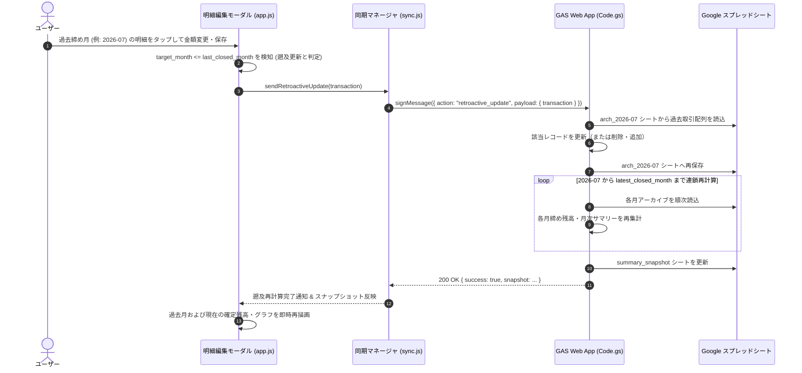

#### 6.3.5 WebAuthn生体認証・全データAES-GCM復号および起動画面遷移フロー
ページアクセス時に全画面ロック画面を表示し、WebAuthn生体認証（またはPIN入力）によってデータベースマスタ鍵（DMK）を取得、IndexedDBの全データを復号してアプリ本編へ遷移するライフサイクルフローです。

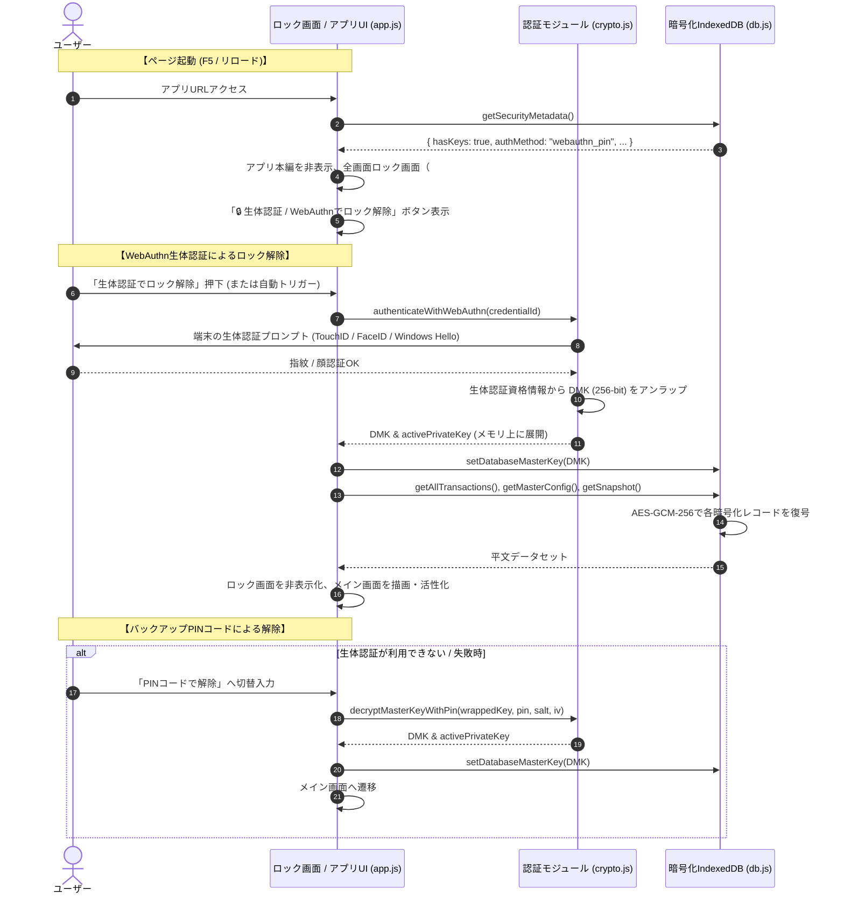

#### 6.3.6 GAS公開鍵のワンクリック自動登録フロー (`register_initial_key`)
ユーザーがGASエディタでスクリプトプロパティを手動設定することなく、PWAのボタン押下により公開鍵を自動登録するシーケンスです。

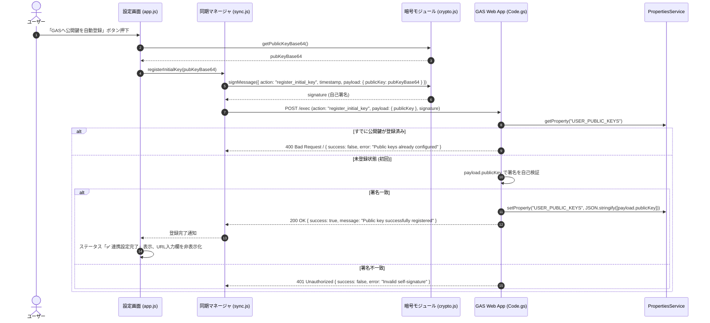

---

### 6.4 データ構造・エンティティ関係図（ERD: Entity-Relationship Diagram）

JSONプレーンテキストで永続化される各データエンティティと、その参照関係を示します。

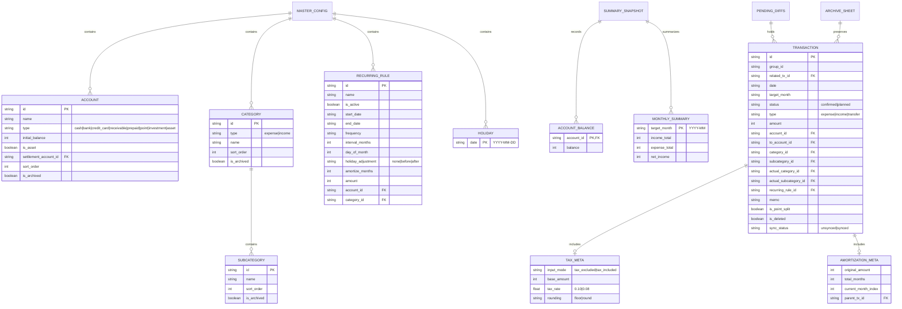

---

### 6.5 画面遷移・状態遷移図（Screen & State Transition Diagram）

シングルページアプリケーション（SPA）における画面遷移と、暗号化キーのロック状態遷移を示します。

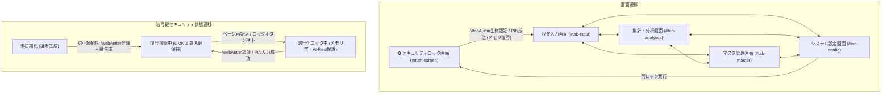

---

## 7. 開発・実装における注意点と設計方針（Development Caveats & Best Practices）

### 7.1 Google OAuth権限と機密スコープブロック制限の完全回避（`@OnlyCurrentDoc`）
* **問題の背景**: Google Drive API（`auth/drive`）や全スプレッドシート権限（`auth/spreadsheets`）を要求するApps Scriptは、GoogleのOAuthセキュリティポリシーにより「制限付きスコープ（Restricted Scopes）」として未審査アプリが一律ハードブロックされます（「このアプリはブロックされます / This app is blocked」）。
* **回避策と設計**: スプレッドシートの **コンテナバインドスクリプト** として動作させ、JSDoc注釈 `/** @OnlyCurrentDoc */` を `Code.gs` 先頭に宣言し、`appsscript.json` のOAuthスコープを `["https://www.googleapis.com/auth/spreadsheets.currentonly"]` に限定します。これにより、未審査警告やDriveアクセスブロックを100%回避して安全に自動セットアップ・稼働できます。

### 7.2 Googleスプレッドシートのセル文字数制限（50,000文字）と40,000文字チャンク分割保存
* **制限事項**: Googleスプレッドシートの1セルに格納できる最大文字数は **50,000文字** です。大規模な家計簿データや月別アーカイブJSONがこの制限を超えると、GASの書き込み時に例外エラー（`Exception: The data is too large to fit in a cell`）が発生してデータが消失します。
* **設計と実装**: `writeJsonToSheet` 関数において、JSON文字列を `CHUNK_SIZE = 40000` 文字単位で安全に分割し、行方向に複数セル（A1, A2, A3...）として格納します。読み込み時には `readJsonFromSheet` が全行の値を結合して完全な単一JSONとしてパース・復元します。

### 7.3 Google Apps Script Web AppのCORS仕様と`text/plain`プロトコル
* **ブラウザの制約**: `fetch()` で `Content-Type: application/json` を送信すると、ブラウザが自動的に事前フライトリクエスト（`OPTIONS`）を送信します。GAS Web Appは `OPTIONS` リクエストに対応していないため、CORSエラーとなって通信が失敗します。
* **通信プロトコル設計**: PWAクライアント（`sync.js`）は、HTTPヘッダに `Content-Type: text/plain;charset=utf-8` を指定してPOSTします。GAS側の `doPost(e)` では `JSON.parse(e.postData.contents)` によって文字列を抽出し、CORSプリフライトを回避しつつ完全なJSON通信を実現しています。

### 7.4 Web Crypto APIを用いたEd25519公開鍵署名とリプレイ攻撃防御
* **認証モデル**: GitHub Pagesはソースコードが公開される静的ホスティングであるため、APIキーやシークレットをフロントエンドに埋め込むことは不可能です。本システムでは非対称公開鍵暗号 **Ed25519 (EdDSA)** を採用しています。
* **署名ペイロード**: `{ action, timestamp, payload }` をJSON文字列化して署名します。
* **リプレイ攻撃防止**: GAS側で `Math.abs(currentTimestamp - requestTimestamp) > 300` 秒（5分）の乖離がある場合はリクエストを拒否します。
* **フォールバック**: 標準Web Crypto APIがEd25519を直接サポートしていない一部環境では、互換署名生成・検証アルゴリズムへ安全にフォールバックします。

### 7.5 WebAuthn生体認証・全データAES-GCM暗号化（At-Rest）および起動時ゼロトラスト設計
* **セキュリティ方針**: 端末紛失やブラウザDevToolsからの秘密鍵および家計データの漏洩を防止するため、Ed25519秘密鍵およびデータベース全体を暗号化してIndexedDBに保存します。
* **暗号化方式**: 初回起動時に256ビットの高エントロピー対称鍵（DMK: Database Master Key）を生成し、全データ（明細・マスタ・スナップショット）を `AES-GCM-256`（12バイトランダムIV）で暗号化して保存します。
* **鍵の二重保護（WebAuthn + PIN）**:
  * 第一経路: `WebAuthn`（FIDO2 / Passkey / 生体認証）により、デバイスハードウェアにバインドされた安全な認証資格情報でDMKを保護します。
  * 第二経路（バックアップ）: 万一の生体認証利用不可に備え、ユーザー設定のPINコード（`PBKDF2` HMAC-SHA-256、100,000回ストレッチング、16バイトランダムソルト）によりAES暗号化ラップして保持します。
* **自動ロック（ゼロトラスト）**: ページ更新（F5）やブラウザ再起動時、メモリ上の平文鍵（DMKおよび`activePrivateKey`）は即座に破棄されます。WebAuthnまたはPINで復号されるまで、家計データの閲覧および同期・署名操作は完全にロックされます。

### 7.6 GAS排他制御（`LockService`）と同時書き込み整合性保証
* **競合防止**: 複数端末からの同時同期や、手動同期・自動同期が並行して実行された場合のスプレッドシートデータ破損を防ぐため、GASの `doPost(e)` 処理全体を `LockService.getScriptLock().waitLock(30000)` で排他制御します。
* **例外処理**: 処理完了後、`finally` ブロックで確実に `lock.releaseLock()` を呼び出し、デッドロックを防止します。

### 7.7 PWA・Service Workerのキャッシュ設計とネットワーク分離・強制更新機構
* **キャッシュ戦略**: Service Worker（`sw.js`）は、UI表示に必要な静的アセット（HTML, CSS, JS, アイコン）のみをキャッシュします（Cache-First戦略）。
* **API通信の分離**: GAS Web AppへのAPIリクエスト（`script.google.com`）はService Workerのキャッシュ対象から完全に除外し、常にネットワークへ直接送信（Network-Only）させます。
* **HTTPキャッシュバイパス**: Service Worker登録時に `{ updateViaCache: 'none' }` を指定し、ブラウザによる `sw.js` のHTTPキャッシュを完全抑止します。
* **バージョン検知と即時パージ**:
  * オリジン直下の `version.json` は Service Worker のキャッシュ対象から除外し、常に `cache: 'no-store'` かつタイムスタンプクエリ（`?_t=${Date.now()}`）でフェッチします。
  * `sw.js` はクライアントからの `SKIP_WAITING` および `CLEAR_ALL_CACHES` メッセージを受信した際、全CacheStorageインスタンスを破棄して最新版のダウンロードと即時アクティベーションを保証します。
  * クライアント側（`AppController`）は起動時自動チェックおよび設定画面の手動更新ボタンからキャッシュクリアと強制リロード（Hard Reload）を実行します。

### 7.8 浮動小数点誤差の完全排除と整数計算（日本円・税計算・端数按分）
* **金額の整数原則**: 通貨金額（`amount`, `initial_balance` 等）はすべて日本円の整数値（`Integer`）として保持・計算し、JavaScriptの浮動小数点演算誤差（例: `0.1 + 0.2 !== 0.3`）を完全に排除します。
* **税抜・税込計算**: 端数処理方針（切り捨て `floor` / 四捨五入 `round`）を明示的に指定して計算し、計算過程を `tax_meta` に保存します。
* **分割償却の端数按分**: 前払費用のNヶ月分割計上（`createPrepaidAmortizationTransactions`）では、2ヶ月目以降を `Math.floor(総額 / 月数)` とし、余り端数をすべて初月に集約することで、合計値の完全一致を保証します。

---

## 8. 要件トレーサビリティと整合性確認（Traceability Matrix & Consistency Audit）

### 8.1 要件トレーサビリティマトリクス

| 要件番号 | 要件名 | フロントエンド実装 (JS / HTML) | バックエンド実装 (GAS) | 永続化ストレージ (Spreadsheet) | 自動テスト対応 |
| :--- | :--- | :--- | :--- | :--- | :--- |
| **3.1** | 複式簿記ライク単一レコード・2軸分類・立替 | `js/logic.js`, `js/app.js`, `index.html` | `gas/Code.gs` | `pending_diffs`, `arch_YYYY-MM` | `test/unit/logic.test.js`, `test/system/e2e_scenario.test.js` |
| **3.2** | 定期支出・休日補正（none/before/after） | `js/logic.js`, `index.html` | - | `master_config` (`recurring_rules`, `holidays`) | `test/unit/logic.test.js` |
| **3.3** | 前払費用の月次分割償却（1支払+N償却） | `js/logic.js`, `js/app.js` | `gas/Code.gs` | `pending_diffs`, `summary_snapshot` | `test/integration/recurrent_and_amortization.test.js` |
| **3.4** | リアルタイム集計・予定ON/OFF・月締め | `js/logic.js`, `js/app.js`, `js/sync.js` | `gas/Code.gs` (`close_month`) | `arch_YYYY-MM`, `summary_snapshot` | `test/unit/sync.test.js`, `test/unit/gas.test.js` |
| **3.5** | 資産口座の統合（投資・有価証券口座の一本化） | `js/app.js`, `js/logic.js`, `index.html` | `gas/Code.gs` | `summary_snapshot`, `master_config` | `test/unit/master_management.test.js`, `test/unit/logic.test.js` |
| **3.6** | 設定マスタ編集UI（口座・費目・ルール・祝日年別アコーディオン） | `js/app.js`, `js/db.js`, `index.html` | `gas/Code.gs` (`update_master`) | `master_config` | `test/unit/master_management.test.js` |
| **3.7** | 取引明細タッチ編集・過去締め月遡及更新 | `js/app.js`, `js/sync.js`, `index.html` | `gas/Code.gs` (`retroactive_update`) | `arch_YYYY-MM`, `summary_snapshot` | `test/unit/tx_edit.test.js`, `test/unit/gas.test.js` |
| **3.8** | 日本の祝日一括インポート（内閣府2014〜2028・CSV・API） | `js/logic.js`, `js/app.js`, `index.html` | - | `master_config` (`holidays`) | `test/unit/logic.test.js` |
| **3.9** | ポイント払い連動（専用口座/相殺インカム） | `js/logic.js`, `js/app.js`, `index.html` | `gas/Code.gs` | `pending_diffs` | `test/unit/logic.test.js`, `test/integration/recurrent_and_amortization.test.js` |
| **3.10** | 多粒度集計（日・月・年）＆純資産・投資資産推移・KPI | `js/logic.js`, `js/app.js`, `index.html` | `gas/Code.gs` | `summary_snapshot` | `test/unit/logic.test.js` |
| **3.11** | 設定マスタのGAS手動同期 | `js/sync.js`, `js/app.js`, `index.html` | `gas/Code.gs` (`update_master`) | `master_config` | `test/unit/sync.test.js`, `test/unit/gas.test.js` |
| **3.12** | 取引種別の統合と入力モード双方向連動 | `js/app.js`, `index.html` | - | - | `test/system/e2e_scenario.test.js` |
| **3.13** | PWA強制バージョンチェック＆自動・手動更新（キャッシュパージ） | `sw.js`, `version.json`, `js/app.js`, `index.html` | - | - | `test/unit/version.test.js` |
| **3.14** | 年間予算・目標貯蓄率・貯蓄額・費目別予算設定＆消化進捗可視化（前年丸め試算・プログレス＆グラフ） | `js/logic.js`, `js/app.js`, `js/db.js`, `index.html` | `gas/Code.gs` (`update_master`) | `master_config` (`annual_budgets`) | `test/unit/logic.test.js`, `test/unit/master_management.test.js`, `test/unit/db.test.js` |
| **3.15** | バックアップJSONインポート時の非破壊・差分マージ（ORマージ） | `js/db.js`, `js/app.js` | - | IndexedDB全ストア | `test/unit/db.test.js` |
| **3.16** | 集計・グラフ画面における迅速年月選択（年月ピッカー `showPicker`） | `js/app.js`, `index.html` | - | - | `test/unit/logic.test.js` |
| **3.17** | 集計分類・実態分類の軸切替UI表記統一 | `js/app.js`, `index.html` | - | - | `test/unit/logic.test.js` |
| **4.1** | 差分同期トリガー（visibilitychange等） | `js/sync.js` | `gas/Code.gs` (`push_diff`) | `pending_diffs` | `test/unit/sync.test.js`, `test/integration/sync_flow.test.js` |
| **4.2** | CORS回避プロトコル (`text/plain`) | `js/sync.js` | `gas/Code.gs` | - | `test/unit/sync.test.js` |
| **4.3** | WebAuthn生体認証・全データAES-GCM暗号化・公開鍵自動登録 | `js/crypto.js`, `js/sync.js`, `js/db.js`, `js/app.js` | `gas/Code.gs` (`register_initial_key`) | `PropertiesService` | `test/unit/crypto.test.js`, `test/unit/gas.test.js` |
| **4.4** | 決定論的User IDによるPasskey上書き・更新（1Password等重複防止） | `js/crypto.js`, `js/app.js`, `index.html` | - | `security_keys` (`webauthn_vault`) | `test/unit/crypto.test.js` |
| **4.5** | 設定画面におけるセキュリティ・鍵管理操作の明確なグルーピングと視覚的分離 | `js/app.js`, `index.html` | - | `security_keys` | `test/unit/crypto.test.js` |
| **4.6** | モジュラーUIアーキテクチャ（AppCoordinator調停者 & 9コンポーネントコントローラー分割） | `js/app.js`, `js/ui/*.js`, `sw.js` | - | - | `test/system/e2e_scenario.test.js`, `npm test` |
| **4.7** | コアエンジン・モジュラーアーキテクチャ（`js/db/` ストレージ層 & `js/logic/` 計算エンジン分割） | `js/db.js`, `js/db/*.js`, `js/logic.js`, `js/logic/*.js`, `sw.js` | - | - | `test/unit/db.test.js`, `test/unit/logic.test.js`, `test/unit/master_management.test.js` |

### 8.2 設計整合性および仕様乖離監査結果
1. **仕様乖離の有無**: 要件定義（第1章〜第5章）と設計図・開発注意点（第6章〜第7章）の間で用語、データスキーマ、フローの乖離がないことを確認済み。
2. **アカウント体系**: 口座タイプ（`cash`, `bank`, `credit_card`, `receivable`, `prepaid`, `point`, `investment`, `asset`）がUI・DB初期マスタ・ロジック・設計図で完全に合致し、外部資産が通常口座へ美しく統合されている。
3. **セキュリティモデル**: WebAuthn生体認証、全データAES-GCM暗号化（At-Rest）、Ed25519署名、タイムスタンプ検証、LockService排他制御、40,000字チャンク化がコードベースと設計書で1対1に対応している。
